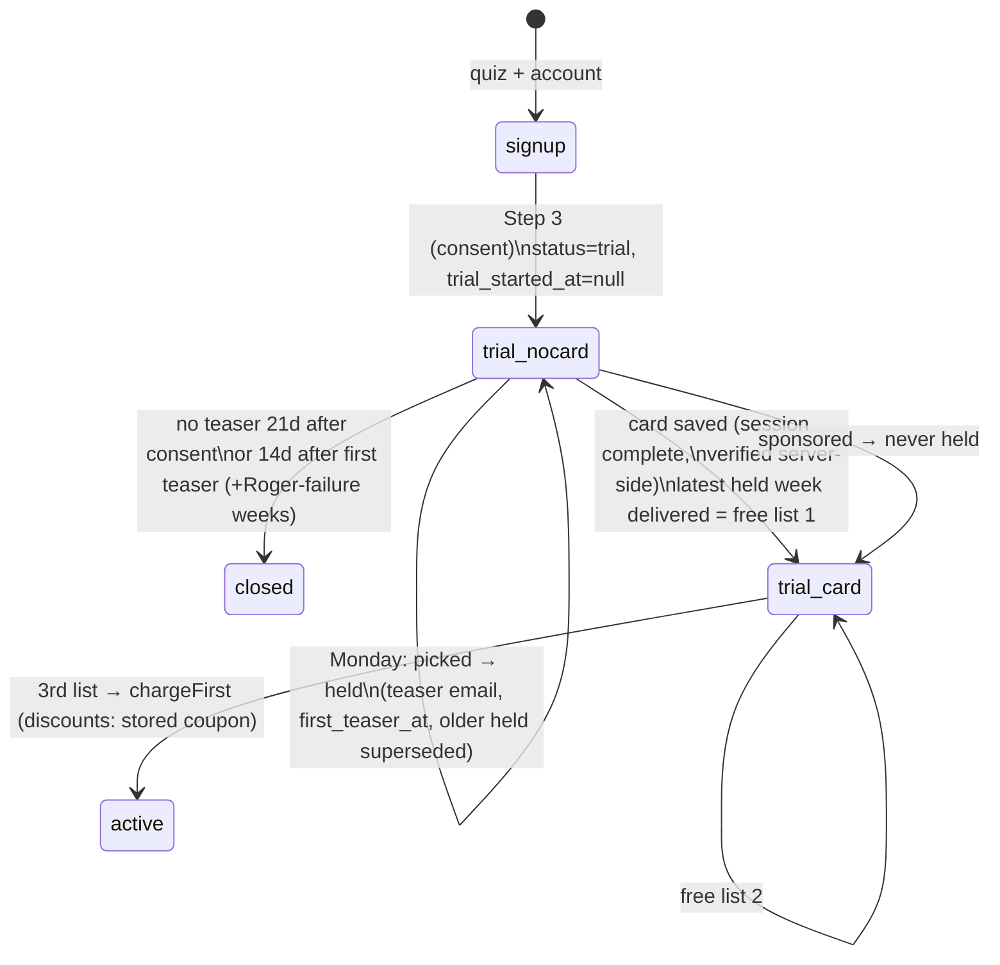
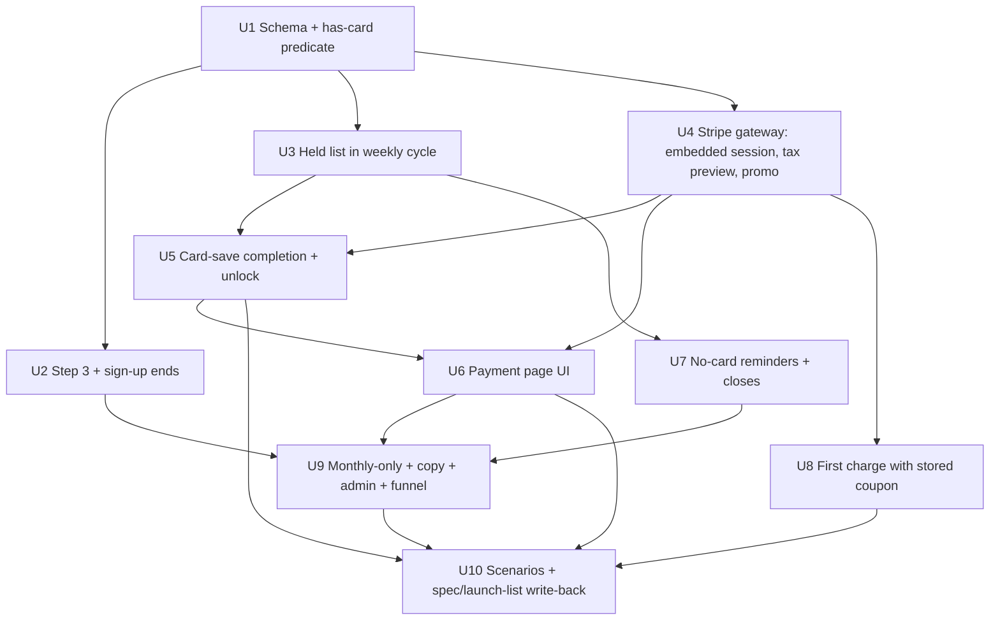

# feat: Product and Pricing at sign-up; Payment at the first Cora list

## Overview

Sign-up becomes three steps (quiz, account, Product and Pricing with Zack consent). It ends without a card. People connect Zack and their first Cora list is picked as usual. If there is no card, the list is **held**: the email and `/app` show the three titles only, with a link to a new embedded **Payment** page (Step 4). Saving a card unlocks the held list (free list 1 of 2). The first charge stays with the third delivered list. Monthly becomes the only plan. This lands before `v3.signupOpen` goes on in production.

## Problem Frame

See origin: `docs/brainstorms/2026-11-26-payment-at-first-curation-requirements.md`. Today the card is asked for at Step 4, before the person has seen anything, and it is surrounded by dense terms. The change asks for the card when intent is highest: when a real, personal list exists. It also rebuilds the card form to checkout best practice (embedded, branded, a transparent price box, no distractions). It reverses Strategy v3.1 decision 38 (card up front), and the change is measured by a funnel (R30).

## Requirements Trace

R1–R30 and the Success Criteria are carried from the origin document. **One amendment:** origin R17 says the discount is attached to the Stripe customer at save. Stripe removed customer-level discounts in API version Basil (2025-03-31), so the plan stores the discount on Roger's user row at save and applies it at preview and subscription create. The member-facing promise ("you pay what you were shown") is unchanged. In short:
- **Plans:** R1 monthly only. R28 removes one-list-at-a-time from all copy.
- **Step 3:** R2–R7 (Product and Pricing, consent kept, no higher-rate line, then `/app` onboarding).
- **Gate:** R8–R12 (titles-only teaser enforced on the server, unlock only on a server-verified save, counting starts at the card, replaced teasers, closes, charge rule unchanged).
- **Payment:** R13–R24 (embedded cards-only form, Price Box with toggle and live tax, "Due today $0", promo locked in at save, trust signals, policy links, no nav, "Start free trial", duplicate guard, deleted copy).
- **Knock-on:** R25–R27, R29 (emails, FAQ and spec copy; pilot links; admin state; sponsored members skip the gate).
- **Measurement:** R30 funnel counts.

## Scope Boundaries

Carried from the origin document:
- No wallets, Link, PayPal, Interac or BNPL.
- No guest checkout.
- Leftover per-run test accounts on preview are not migrated.
- Part A marketing pages are not rebuilt; only the copy R25 and R28 name changes.

Added by planning:
- **"Update card" on `/app/billing` stays on hosted Checkout.** Only first card collection moves to the embedded form. This keeps one change of card mechanism per release; moving updates too is a follow-up.
- **Per-run billing machinery is hidden, not deleted.** This covers `orders.ts`, `switch.ts`, the per-run branches in `who-gets-a-list.ts` and `deliver.ts`, and the `one-at-a-time` scenario. Entry points and copy go away; the code goes dormant. Deleting it is a separate cleanup after launch, to keep this diff reviewable.
- **No PCI badge image.** The trust signals are a padlock, "Secured by Stripe", card brand marks and a plain-text line (see Key Technical Decisions).

## Context & Research

### Relevant Code and Patterns

- **Account state.** In `db/schema.sql` the `users` table has `status` (check: signup, trial, active, held, cancelled, closed), `plan`, `signup_step`, `consent_at`, `trial_started_at` (today this means "card saved"), `free_lists_used`, `quote`, `stripe_customer` and `sponsor_id`. Schema changes are appended idempotent statements, run by hand with `db/setup.mjs` on production, preview and the scenario database. A check is changed with the one-line `do $$ … $$` pattern used for `login_tokens.purpose`.
- **Sign-up.**
  - Pages: `src/app/start/page.tsx`, `account/page.tsx`, `plan/page.tsx`, `card/page.tsx`, `done/page.tsx`.
  - Actions: `src/app/start/actions.ts`, `src/app/start/billing-actions.ts` (`savePlan`, `setCurrency`, `openCardPage`).
  - Helpers: `src/lib/signup/account.ts` (`stepPaths`), `src/lib/signup/current.ts` (`signupUser`).
  - Components: `src/components/app/plan-form.tsx`, `src/components/app/card-button.tsx`.
- **Card setup.**
  - `src/lib/billing/gateway.ts` (`CardGateway`: `createCustomer`, `createSetupSession`, `getSetupSession`, `setDefaultCard`, `checkTaxLocation`).
  - `src/lib/billing/card-setup.ts` (`startCardSetup`, `completeCardSetup`, the `sendWelcome` path, `startCardUpdate` / `completeCardUpdate`).
  - The webhook is `src/app/api/stripe/webhook/route.ts`, which calls `src/lib/billing/webhook.ts` (`checkout.session.completed` routes by `metadata.purpose`).
  - Reconcile is in `src/lib/housekeeping/job.ts`.
- **First charge.**
  - `src/lib/billing/first-charge.ts` (`chargeFirst`: preview against `users.quote`, then `createSubscription`).
  - `src/lib/billing/subscriptions.ts` (`stripeBilling.preview` → `invoices.createPreview`; `createSubscription` with `error_if_incomplete`).
  - `src/lib/billing/quote.ts` (`tell`, `sendFirstPaidNext`, `sendFirstChargeReminders`).
- **Weekly cycle.**
  - Picking: `src/lib/cora/job.ts`. `src/lib/cora/context.ts` (`loadUsers` status filter, and `ctx.sent` = delivered picks only, so undelivered picks are already not "sent").
  - Eligibility: `src/lib/cora/who-gets-a-list.ts`.
  - Delivery: `src/lib/cora/deliver.ts` (`DELIVERABLE_SQL`, `deliverWeek` counts the free list in the same statement).
  - Sending: `src/lib/cora/send-job.ts` (`deliverAndTell`, and `deliverLate`, which delivers any undelivered picks from the last 8 days hourly — the key trap).
  - Templates: `src/lib/mail/templates/monday.ts`.
- **`/app`.**
  - `src/app/app/layout.tsx` (`AppNav`).
  - `src/app/app/page.tsx` and `src/lib/app/home.ts`.
  - `src/lib/app/week.ts` (`weekIdeas`: delivered picks only).
  - `src/app/app/week/[date]/page.tsx`.
  - `src/lib/app/status.ts`, `src/lib/app/onboarding.ts`, `src/lib/app/billing.ts`.
  - `src/components/app/week-ideas.tsx` and `idea-card.tsx`.
- **Gates that shut out non-trial accounts today.** These must be checked for a no-card trial:
  - `src/lib/zack/key.ts` (`userForKey`)
  - `src/app/app/page.tsx`
  - `src/app/app/zack/page.tsx` and `actions.ts`
  - `src/app/app/settings/*`
  - `src/lib/app/billing.ts` (`loadBilling`)
  - `src/lib/app/onboarding.ts` (`loadChecklist`)
  - `src/lib/cora/context.ts` (`loadUsers`)
  - `src/lib/cora/who-gets-a-list.ts`
  - `src/lib/cora/deliver.ts`
  - `src/lib/housekeeping/trial.ts` (`ON_CLOCK`)
  - `src/lib/admin/ops.ts`
  - `src/lib/admin/users.ts` (`addRunForUser`)
  - `src/app/admin/cora/page.tsx`
  - `src/lib/billing/quote.ts` (`quotable`)
  - `src/lib/zack/sharing-effect.ts`
- **Closes and nudges.** `src/lib/housekeeping/trial.ts` (`trialClocks`, `closeMoment` adds a week for each Monday Roger failed, `sendTrialNudges`, `closeTrialsWithNoList`). The new no-card clocks follow these patterns.
- **Admin.** `src/lib/admin/ops.ts` (`Attention`, `ATTENTION_LABELS`, `statusKey`), `src/lib/admin/interest.ts` (`loadInterest`) and `src/app/admin/interest/page.tsx`.
- **UI.**
  - The currency toggle pattern in `src/components/circles/price.tsx` (role group, `aria-pressed`, `min-h-11`, aria-live).
  - Tokens and `.btn`/`.tlink` in `src/app/globals.css`.
  - The form pattern in `plan-form.tsx` (`useActionState`, `role="alert"`, `aria-describedby`).
  - Chrome: the `/start` layout has no nav, `SiteHeader` shows no links on `/start`, and `FooterSwitch` hides the footer on listed paths.
- **Tests.**
  - PGlite `src/test-helpers/pglite-db.ts`, fakes `src/test-helpers/fake-card-gateway.ts`, and `src/test-helpers/next-fakes.ts`.
  - Scenarios in `tests/scenarios/helpers.ts` (`signUp()` does the card at sign-up today, so it must be rewritten).
- **Packages.** `next` 16.4.1 (`cacheComponents`), `stripe` 23.2.0 pinned to `2026-11-18.endive`. `@stripe/stripe-js` and `@stripe/react-stripe-js` are **not installed**. There is no content security policy anywhere.

### Institutional Learnings

- `docs/solutions/logic-errors/side-effect-tied-to-winning-transition-is-lost-2026-11-22.md`: the unlock must run every side effect on every pass through the after-state (return page, webhook, reconcile, hourly). Decide from stored state, never from a value only the winning call sees.
- `docs/solutions/database-issues/data-modifying-cte-runs-even-when-insert-conflicts-2026-11-22.md`: in one-statement claims, put the irreversible write last behind `exists(...)`, and never update `users` twice in one statement.
- `docs/solutions/best-practices/test-claim-sql-on-pglite-2026-11-22.md`: test claims on PGlite, including `Promise.all` races. Use plain throwing functions for failure tests.
- `docs/solutions/best-practices/job-clock-not-database-now-2026-11-23.md`: every new timestamp (`first_teaser_at`, card saved, superseded, close moments) takes the job clock, `coalesce($n::timestamptz, now())`.
- `docs/solutions/best-practices/lease-must-guard-every-write-not-just-entry-2026-11-23.md`: hold, teaser and supersede writes inside the Cora or send jobs respect `holder` and `dry_run`. A dry run never sends a teaser.
- `docs/solutions/logic-errors/one-money-rule-two-mechanisms-double-charges-2026-11-23.md`: keep **one** charge mechanism. The card is saved now and the subscription is created by the app at the third list. No trialing subscription.
- `docs/solutions/ui-bugs/react-19-form-action-reset-brings-back-stale-defaults-2026-11-23.md`: keep the Payment Element out of any server-action `<form>`. Fields beside it are controlled.
- `docs/solutions/runtime-errors/next16-clock-read-during-render-2026-11-22.md`: call `await connection()` before reading the clock or Stripe in render.
- `docs/solutions/developer-experience/scripted-edits-mangle-escapes-and-crlf-2026-11-22.md`: edit with Edit and Write, never scripts.

### External References

- Embedded setup-mode Checkout (`ui_mode: 'elements'`): https://docs.stripe.com/payments/checkout/save-and-reuse?payment-ui=embedded-components
- Deferred-intent setup (the fallback): https://docs.stripe.com/payments/accept-a-payment-deferred?type=setup
- Endive removed `payment_method_types` on intents in favour of `allowed_payment_method_types`: https://docs.stripe.com/changelog/endive/2026-09-30/removes-the-payment-method-types-parameter-from-payment-intents-and-setup-intents
- Endive strict billing-details validation with Checkout Elements: https://docs.stripe.com/changelog/endive/2026-09-30/strict-billing-details-validation
- Customer-level coupons and promotion codes were removed in Basil (2025-03-31): https://docs.stripe.com/changelog/basil/2025-03-31/deprecate-singular-coupon-promotion-code
- Promotion code shape since Clover (`promotion.coupon`): https://docs.stripe.com/changelog/clover/2025-09-30/polymorphic-coupon
- Invoice preview with `customer_details.address` and `discounts`: https://docs.stripe.com/api/invoices/create_preview
- Tax customer location rules (Canada: province from the postal code; US: ZIP centre point): https://docs.stripe.com/tax/customer-locations
- Endive `failed_tax_calculation` error: https://docs.stripe.com/changelog/endive/2026-09-30/failed-tax-calculation-error
- CSP and PCI (Elements fall under SAQ A): https://docs.stripe.com/security/guide

## Key Technical Decisions

- **A no-card account is `status = 'trial'` with `trial_started_at` null.** No new status value is added. Step 3 moves the person straight to `trial` (`signup_step = 'done'`).
  - `trial_started_at` keeps its meaning, "card saved", so every existing card-saved clock (`ON_CLOCK`, the 21-day no-list close, `sharing-effect`) is unchanged and excludes no-card users automatically.
  - Most gates already allow `trial`: the Zack key, `/app`, Cora's `loadUsers`, onboarding and settings.
  - Rationale: adding a status would touch about fifteen allow-lists, and missing one breaks onboarding silently. A predicate is safer: **"has card" = `trial_started_at is not null`**. It is audited where a trial was assumed to have a card: delivery, charge, quote, billing page, status line and admin. Sponsored trials (`sponsor_id` set) count as "no card needed".
- **A held list is picked but not deliverable.** ("Held list" is a list state. It is unrelated to the existing `users.status = 'held'` payment hold, which this change does not use.) `DELIVERABLE_SQL` adds "trial requires a card or a sponsor". Cora picks as normal (undelivered picks are already not "sent", so replaced teaser ideas stay resendable — R10, no change to Cora rule 1).
  - **Superseding happens when the newer week becomes ready** (changed from "at pick time" by review fix F1; see As-built notes, "Review fixes (Units 1–3)"). The lease-guarded statement that moves a Cora week to `ready` stamps `superseded_at` on every undelivered week older than the member's newest week of a ready or sent Cora week. At any moment a no-card user therefore has at most one held list: the newest one Cora finished, whether or not its teaser has been sent yet. A newer week that fails after its picks supersedes nothing.
  - The send job, finding a no-card trial user with a picked or short week, sends the teaser instead of the list and stamps `users.first_teaser_at` (job clock, `coalesce`).
  - `deliverLate`, the unlock and the charge job all skip superseded weeks. This closes the trap where the hourly job would deliver a replaced teaser the moment the card is saved.
  - **A card saved between Cora's pick (01:00) and the send (07:00) unlocks this week's list (W)**, delivered at once with its list email. W-1 was already superseded when W became ready, so there is one list that day, no repeated ideas, and one free list counted. The send job then finds W delivered and sends nothing more.
- **Card collection uses Stripe's embedded setup-mode Checkout Session** (`ui_mode: 'elements'`, Payment Element, cards only, Link and wallets off), mounted in Roger's page.
  - Rationale: it keeps the existing session plumbing. That means `getSetupSession`, `completeCardSetup`, `checkout.session.completed` (already subscribed on the preview webhook), `customer_update: {address, name}` writing the address to the customer for Stripe Tax, and the `metadata.purpose` routing.
  - Roger's own name, country and postal code inputs feed the session through `updateBillingAddress` (Endive's strict billing-details rule). The Payment Element's own address fields are set to `never`.
  - **Fallback**, if the spike in Unit 4 shows `customer_update` or billing-detail handling doesn't work in elements mode: the deferred-intent flow (`elements({mode:'setup'})` → a server-created SetupIntent with `allowed_payment_method_types: ['card']` → `confirmSetup` → a new `setup_intent.succeeded` handler), writing the address to the customer explicitly before `checkTaxLocation`.
- **The live tax line comes from Roger's server via `invoices.createPreview`.** It takes the price, `customer_details.address {country, postal_code}`, `automatic_tax` and `discounts`, and is debounced from the country and postal inputs. It uses the same Billing logic as the real first invoice. Not `tax.calculations`, which knows nothing about recurring prices or discounts.
- **The promo code is validated on the server.** `promotionCodes.list({code, active})` plus restriction checks, rate-limited per user and IP.
  - "Locked in at save" (R17): customer-level discounts no longer exist (Basil). So at card save Roger stores the promotion code's **coupon id** and label on the user. `chargeFirst` passes `discounts: [{coupon}]` to both `preview` and `createSubscription`, so the quote, the preview and the charge agree.
  - Applying the coupon directly means a promotion-code limit that lapses after save can't take the discount away.
  - **Because Stripe then never counts the redemption, Roger enforces limits itself.** A `promo_reservations` table (promotion code id, user id, reserved at — unique on code + user) is written in the same completion claim that stamps the card. Card save refuses the code if the reservations plus Stripe's `times_redeemed` would exceed `max_redemptions`, or if `first_time_transaction` is set and this person or card fingerprint already has a reservation or a payment. If the code was taken while the person was on the page, the card is still saved, without the discount, and the page says so. A coupon that is itself deleted or past `redeem_by` at charge time is charged at full price through the existing "amount changed" hold and email.
- **The Payment page lives at `/start/payment`.** The `/start` layout already has no nav and `SiteHeader` shows only the logo there. Add it to `FooterSwitch`'s hidden list (R22). It requires a signed-in user in trial with no card; otherwise it redirects to `/app`. Return page: `/start/payment/done?session_id=…`, which replaces `/start/done`.
- **"Start free trial" protection:**
  - The client disables the button and shows a loading state.
  - The server reuses one open session per user (stored id; a new one only if the stored one is complete or expired).
  - `createCustomer` is already idempotent per user.
  - Completion is idempotent (claim-first).
  - Price, currency and tax are derived from the account on the server.
- **The welcome email moves to Step 3 completion** and its card wording is rewritten (R25). It is sent through the existing claim, and a failed send is retried by an hourly "welcome not sent" sweep, because a server action can't rely on a webhook retry (the side-effect lesson). The card-save moment sends the unlocked Monday list email (receipt "Free list 1 of 2"), not a second welcome.
- **Trust line:** "Payments are processed by Stripe, a PCI DSS Level 1 certified provider. Roger never sees your card number." This is accurate for SAQ A. No badge image.
- **CSP:** a route-scoped content security policy for `/start/payment` allowing Stripe origins (`js.stripe.com`, `*.js.stripe.com`, `hooks.stripe.com`, `api.stripe.com`), added through `next.config.ts` `headers()`. It is not site-wide (no CSP exists elsewhere, so this is not the release to introduce one).
- **The publishable key** is a new `NEXT_PUBLIC_STRIPE_PUBLISHABLE_KEY` per environment. Stripe.js is always loaded from js.stripe.com via `@stripe/stripe-js` (version confirmed compatible with Endive during Unit 4).

## Open Questions

### Resolved During Planning

- **Account state for "consented, no card":** `trial` with `trial_started_at` null (above).
- **SetupIntent vs trialing subscription:** saved card only, with the app creating the subscription at the third list (one money mechanism).
- **Promo lock-in:** a stored coupon id applied at preview and subscription create (customer discounts were removed).
- **Unlock path edge cases** (origin deferred questions):
  - Completion runs from the return page, the webhook and reconcile.
  - A session that is `open` or still processing shows a "confirming" state and re-checks.
  - `address_invalid` keeps the card unsaved for the trial and returns to Payment with the existing message.
  - If delivery fails after the status flip, the hourly sweep retries (it selects "card saved, newest non-superseded held list undelivered").
  - A save between Cora's pick and the 7:00 send unlocks this week's list (superseding happens at pick time). That is one list and one free list, never two in a day.
- **Pre-existing charge gap (found in review):** `runChargeJob` re-runs every 10 minutes on Monday after the 7:00 send. It selects trials with `free_lists_used >= freeRuns` and a picked week, without checking whether **this** week's list was itself a free list. A trial whose second free list is delivered at 7:00 could be charged at 7:10 for that same week. Unit 8 adds the guard ("no charge for a week whose delivered list is a free list"). This may affect today's card-at-sign-up flow too, so it ships even if the rest slips.
- **Update card flow:** stays hosted (Scope Boundaries).
- **Email content for a held list:** titles only. Details are fetched only from delivered picks, which already gates `weekIdeas`. The teaser is a separate template that has no access to details.
- **Where the funnel lives:** `/admin/interest` (`loadInterest`).

### Deferred to Implementation

- Whether `customer_update` and `updateBillingAddress` behave as documented in embedded setup-mode Checkout on Endive, and which `@stripe/stripe-js` major supports Endive. Unit 4 starts with a short spike in Stripe test mode, and switches to the fallback flow if either fails.
- Exact `appearance` variables to match Roger's tokens (decided against the rendered page).
- Whether `first_time_transaction` promotion codes accept a customer with a saved card but no payments. Test in the sandbox, and treat as "not eligible" if unclear.
- The exact wording of the new emails and the Step 3 paragraphs goes to Peter (launch list S18). The drafted wording ships until then.

## High-Level Technical Design

> *This illustrates the intended approach and is directional guidance for review, not implementation specification. The implementing agent should treat it as context, not code to reproduce.*

Monday for a no-card trial user: `cora job` picks → `send job` finds the user not deliverable and no card → it marks earlier held weeks superseded → teaser email (kind `first_list_held`, ref week) → stamps `first_teaser_at` if null.

Card save: the Payment page creates or reuses the embedded setup session → Stripe confirms → `completeCardSetup` (return page, webhook or reconcile) → default card, tax location, stored promo coupon, `trial_started_at` = job clock → deliver the latest non-superseded held week through `deliverWeek` → Monday list email with receipt.

## Implementation Units

- [ ] **Unit 1: Schema and the "has card" predicate**

**Goal:** add the columns the new flow needs, and audit every place that assumes a trial has a card.

**Requirements:** R7, R8, R10, R11, R17, R27, R30.

**Dependencies:** none.

**Files:**
- Modify: `db/schema.sql` (appended idempotent statements)
- Modify: `src/lib/billing/quote.ts` (`quotable`)
- Modify: `src/lib/app/status.ts`
- Modify: `src/lib/admin/ops.ts` (`statusKey`)
- Modify: `src/lib/zack/sharing-effect.ts`
- Modify: `src/lib/app/billing.ts` (`canUpdateCard`, no-card cancel)
- Modify: `src/lib/billing/card-setup.ts` (`startCardUpdate` guard)
- Modify: `src/lib/admin/users.ts` (`giveExtraFreeList` refuses no-card trials; `addRunForUser` accepts them, review fix F3)
- Modify: `src/lib/cora/who-gets-a-list.ts`, `src/lib/cora/context.ts` (`hasCard` fact)
- Test: `db/schema.pglite.test.ts`, `src/lib/billing/quote.test.ts`, `src/lib/app/status.test.ts`, `src/lib/admin/ops.test.ts`, `src/lib/app/billing.test.ts`, `src/lib/billing/card-setup.test.ts`, `src/lib/admin/users.test.ts`

**Approach:**
- Add these columns:
  - `users.first_teaser_at timestamptz`
  - `users.setup_session text` (the open embedded session, reused)
  - `users.promo_code text`, `users.promo_coupon text`, `users.promo_label text` (see the promo decision for which are needed)
  - `cora_user_weeks.superseded_at timestamptz`
  - A `promo_reservations` table (promotion code id, user id, card fingerprint, reserved at; unique on code + user)
  - No welcome column: the `notifications` claim covers it.
- `signup_step` keeps `card` in its check for old rows. No check change is needed, since no new status is added.
- Define the "has card or sponsored" predicate once as an exported SQL fragment and a TS helper, so every caller shares it.
- **The audit is a recorded step, not a recollection.** Grep for every `'trial'` status check, every `status in (...)` list containing trial, and every `stripe_customer` truthiness check across `src/`, including `src/app/api/**`. Record each hit with a verdict (needs the predicate / fine as is) in a table in this plan's as-built notes. The known hits to fix:
  - `quotable` (no quote without a card)
  - `statusLine`. No-card wording: "Your first list arrives after Zack's first report", or, with sharing off, "Your first list arrives on Monday"; and "Your first ideas are ready — add a card to see them".
  - `statusKey` (new key `trial_no_card`)
  - `sharing-effect` (no "no earlier than" date without a card)
  - **`canUpdateCard` in `src/lib/app/billing.ts` and `startCardUpdate` in `src/lib/billing/card-setup.ts`.** Today they key on `stripe_customer`, and Payment creates the customer, so a no-card user who left Payment could save a card through "Update card" without unlocking. Both require the predicate; otherwise `no_card_yet`.
  - Cancel on `/app/billing` for a no-card trial: closes the account with no card to remove, using the "You have not been charged" confirmation.
  - The admin "give extra free list" action refuses no-card trials with a clear message ("Waiting for the member's card"). This is simpler than inventing deferred counting. "Add a run" is allowed for a no-card trial (review fix F3): a run counts nothing before a card, and Zack's own key accepts the member's runs anyway.
- Add `hasCard` to the `who-gets-a-list.ts` `ListFacts` (selected in `context.ts` `loadUsers`) for the admin reason text.
- Release note: run `db/setup.mjs` on production, preview and the scenario database before deploying.

**Patterns to follow:** the appended-statement convention below the "Changes after first application" line in `db/schema.sql`. Shared SQL constants, as with `DELIVERABLE_SQL`.

**Test scenarios:**
- Happy path: the schema applies twice on PGlite without error (idempotent).
- Happy path: `statusLine` for a trial with no card and no teaser says the first list follows Zack's first report. With a teaser, it says the ideas are ready, with a Payment link.
- Edge case: `quotable` is false for a trial with a `stripe_customer` but `trial_started_at` null.
- Edge case: a sponsored trial with no card counts as "has card or sponsored".
- Error path: a no-card trial with a `stripe_customer` → `canUpdateCard` is false and `startCardUpdate` returns `no_card_yet`.
- Happy path: cancel for a no-card trial → closed, no Stripe calls beyond what exists, the "not charged" confirmation sent.
- Error path: the admin "extra free list" action on a no-card trial is refused with the waiting message; "add a run" is stored as for any trial.

**Verification:** the schema applies cleanly; no code path treats a no-card trial as quotable or chargeable.

- [ ] **Unit 2: Step 3 "Product and Pricing" and the end of sign-up**

**Goal:** sign-up ends at Step 3 with consent, without a card. The person lands in `/app` onboarding.

**Requirements:** R2–R7, R24, R25 (welcome), R26.

**Dependencies:** Unit 1.

**Files:**
- Modify: `src/app/start/plan/page.tsx` (heading "Product and Pricing", "Step 3 of 4", Product and Pricing paragraphs; both prices shown as "US$200 a month or CA$280 a month, plus tax")
- Modify: `src/components/app/plan-form.tsx` (remove the plan radios and the higher-rate line; keep consent and the Zack link; button "Continue")
- Modify: `src/app/start/billing-actions.ts`. `savePlan` validates consent only, then:
  - sets `plan='monthly'`, `consent_at`, `status='trial'`, `signup_step='done'` where `status='signup'`;
  - calls `claimFreeRun(query, userId, settings.runCutoff)` (moved from `sendWelcome`, so a free-tool report still becomes this week's run);
  - sends the welcome email (claim, failure logged);
  - redirects to `/app`.

  Remove `openCardPage` from sign-up use.
- Modify: `src/app/start/page.tsx`, `src/app/start/account/page.tsx` ("Step N of 4")
- Modify: `src/lib/signup/account.ts` (`stepPaths.card` → `/start/plan`, `done` → `/app`)
- Delete: `src/app/start/card/page.tsx`, `src/app/start/done/page.tsx`, `src/components/app/card-button.tsx` (replaced in Unit 6). No redirects: production has no users holding these links.
- Modify: `src/lib/mail/templates/welcome.ts` (no card at sign-up, no "no earlier than", no higher-rate line; "Your first two Cora lists are free. When your first list is ready we'll ask for your card.")
- Modify: `src/lib/billing/card-setup.ts` (the welcome send leaves `completeCardSetup`)
- Modify: `src/lib/housekeeping/job.ts`. New hourly task `welcome_unsent`: no-card trial users with `consent_at` after this release and no `welcome` notification, capped. It also re-runs `claimFreeRun`. Leftover preview accounts are never re-welcomed.
- Modify: `src/app/admin/users/page.tsx` (pilot link copy: "opens at Product and Pricing")
- Test: `src/app/start/billing-actions.test.ts`, `src/components/app/plan-form.test.tsx`, `src/lib/mail/templates/welcome.test.ts` (new or existing), `src/lib/housekeeping/job.test.ts`

**Approach:**
- Pricing copy (R4): "Roger is US$200 a month or CA$280 a month, plus tax. We'll ask for your card before Cora's first full list is shown. Your free trial includes your first two Cora lists, two Mondays." The Product paragraph explains Zack collecting in your agent and Cora curating three ideas every Monday. Both are drafts for S18.
- The currency already stored on the account from `/start` params stays the default for Payment. Step 3 shows both prices, so no toggle is needed there.
- The redirect target `/app` works because no-card trials pass the `/app` gate (Unit 1 predicate audit confirms the onboarding checklist and the Zack page load for them).

**Patterns to follow:** the existing `savePlan` validation and conditional update; `sendToUser` claims; the `HOURLY_TASKS` registration.

**Test scenarios:**
- Happy path: consent ticked → user `status=trial`, `signup_step=done`, `plan=monthly`, `trial_started_at` null; welcome email sent once; redirect to `/app`.
- Error path: consent unticked → inline error, no state change, the field keeps its value (React 19 reset lesson).
- Edge case: submitting twice (two tabs) → one state change, one welcome email (claim).
- Error path: the welcome send throws → the action still redirects; the hourly `welcome_unsent` task sends it next hour, exactly once.
- Edge case: a user already in `trial` who opens `/start/plan` is redirected to `/app`.
- Integration: a pending free-tool report (`zack` token) becomes this week's run when Step 3 completes.
- Integration: the welcome email text contains no "no earlier than", no US$400 / CA$560, and no "one list at a time".
- Integration: a pilot link opens at `/start/plan` and completes to `/app` without a card.

**Verification:** a fresh user goes from `/start` to `/app` with Zack connectable and no card asked for.

- [ ] **Unit 3: Held lists in the weekly cycle**

**Goal:** no-card trial users get a titles-only teaser, never the details. Only the newest held week is ever unlockable.

**Requirements:** R8, R10, R29, Success Criteria (no details or counting before the card).

**Dependencies:** Unit 1.

**Files:**
- Modify: `src/lib/cora/deliver.ts` (`DELIVERABLE_SQL`: a trial needs a card or a sponsor; skip superseded weeks)
- Modify: `src/lib/cora/job.ts` (the lease- and `dry_run`-guarded ready step supersedes a no-card trial's earlier undelivered weeks; moved from `record()` by review fix F1)
- Modify: `src/lib/cora/send-job.ts`:
  - In `deliverAndTell`, a held branch: send the teaser and stamp `first_teaser_at`. Respect the lease and `dry_run`.
  - `deliverLate` excludes superseded weeks and never delivers to users with no card.
- Modify: `src/lib/housekeeping/job.ts`. Hourly `teaser_unsent`: the newest held list whose teaser notification is missing, so a teaser that failed all Monday is still sent. The Monday send job is the only other pass, and it stops at about 13:00.
- Modify: `src/lib/cora/who-gets-a-list.ts` (no-card trial: gets a pick, delivery held — reason text for admin)
- Create: `src/lib/mail/templates/held.ts` (`firstListHeldEmail({week, titles, paymentUrl})`, titles only)
- Create: `src/lib/app/held.ts` (`heldTeaser(q, userId)` → the newest non-superseded held week's titles, or null; server-only, never returns reason, steps or details)
- Modify: `src/lib/app/home.ts`, `src/app/app/page.tsx`. Render the teaser: one locked title card per idea, with the heading "Your first 3 ideas are ready" ("Your first ideas are ready" on a short week), and the button "Add your card to see them" → `/start/payment`.
- Create: `src/components/app/held-ideas.tsx`
- Modify: `src/app/app/week/[date]/page.tsx` (a held week shows the teaser, not ideas; `weekIdeas` already returns delivered picks only — assert it)
- Test: `src/lib/cora/deliver.test.ts`, `src/lib/cora/send-job.test.ts`, `src/lib/app/held.test.ts`, `src/lib/mail/templates/held.test.ts`, `src/components/app/held-ideas.test.tsx`

**Approach:**
- Supersede (at pick) and teaser stamping (at send) are each one claim-first statement per user and week. The irreversible write comes last; the user row is updated at most once per statement (CTE lesson).
- **Deny by default for idea details.** Every read of pick details (reason, steps, links) goes through one data-access helper that requires `delivered_at is not null`. `heldTeaser` is the only reader of undelivered picks, and it selects titles only. A test scans `src/` (including `src/app/api/**` and the admin views shown to members) for other queries that read detail columns without the delivered condition.
- The teaser email uses kind `first_list_held` and ref = week, so a new week gives a new teaser and a re-run never duplicates.
- Sponsored no-card users stay deliverable (R29). `sponsor_id` is never written in production today, but the predicate covers it.

**Patterns to follow:** `deliverAndTell`, `mondayListEmail`, the `weekIdeas` delivered-only rule, and the lease guard in the send job.

**Test scenarios:**
- Happy path: a no-card trial user with a picked week → the send job sends `first_list_held` with three titles and no reasons or steps. Picks stay undelivered, `free_lists_used` stays 0, and `first_teaser_at` = job clock.
- Happy path: the following Monday, Cora picks a new week → the previous week is `superseded_at`-stamped when the new week becomes ready (review fix F1), a new teaser goes out at the send, and `first_teaser_at` is unchanged.
- Edge case: the previous week's ideas are eligible again for Cora (undelivered ⇒ not sent) and can appear in the new teaser.
- Edge case: a `short` outcome (1–2 ideas) sends a teaser with that many titles.
- Edge case: a dry run never sends a teaser and never stamps `first_teaser_at` or `superseded_at`.
- Edge case: a sponsored no-card trial → delivered normally, with no teaser.
- Error path: the teaser send fails all Monday → the hourly `teaser_unsent` task sends it later; one email in the end.
- Integration: `deliverLate` with a card saved after a supersede → delivers only the newest held week, never the superseded one.
- Integration: `heldTeaser` returns titles only; the `/app/week/[date]` page for a held week renders no reason or steps (the rendered output is checked for the absence of detail fields).
- Race: two send passes in parallel on the same user and week → one teaser and one stamp (PGlite `Promise.all`).

**Verification:** no route, email or payload exposes held idea details. The free-list count stays 0 until a card is saved.

- [ ] **Unit 4: Stripe gateway — embedded setup session, tax preview, promo validation**

**Goal:** server capabilities for the Payment page, behind the existing gateway seams, with fakes.

**Requirements:** R15–R19, R23.

**Dependencies:** Unit 1.

**Files:**
- Modify: `src/lib/billing/gateway.ts`:
  - `createSetupSession` gains a `ui: "elements"` variant: `ui_mode: 'elements'`, cards only, currency, `customer_update {address:'auto', name:'auto'}`, `return_url`, metadata as today. It returns the client secret.
  - `previewMonthly({customer?, currency, country, postal, coupon?})` via `invoices.createPreview`, returning subtotal, discount, tax amount, tax name and rate, and total.
  - `findPromotion(code, currency)` → `{valid: true, promotionCodeId, couponId, label, percentOff|amountOff}` or `{valid: false}`, with the reason logged inside the gateway.
- Modify: `src/lib/billing/card-setup.ts` (`openEmbeddedSetup(userId)`: create the customer once, reuse `users.setup_session` if still open, otherwise create and store it; precondition trial without a card)
- Modify: `src/lib/rate-limit` usage (existing `limits.checkoutPer*` reused; add `promoPer*`)
- Modify: `src/test-helpers/fake-card-gateway.ts`, `tests/scenarios/helpers.ts` (fake equivalents)
- Modify: `package.json` (add `@stripe/stripe-js`, `@stripe/react-stripe-js`)
- Test: `src/lib/billing/card-setup.test.ts`, `src/lib/billing/gateway.test.ts` (or `promo.test.ts`), `src/lib/billing/preview.test.ts`

**Execution note:** start with a short spike in Stripe test mode on preview:
- an elements-mode setup session with `customer_update` and without `billing_address_collection: 'required'` (that setting would demand a full address);
- `updateBillingAddress` with name, country and postal only;
- confirming 4242 and a 3DS test card;
- checking that the customer gets the address and the default card;
- calling `createPreview` and subscription create with a deleted coupon and an expired one, and recording the error shape, so Unit 8 maps it to the amount-changed path rather than a generic failure.

Record the result in the plan. If it fails, switch this unit and Unit 5 to the deferred-intent fallback (Key Technical Decisions) before building further.

**Approach:**
- The tax preview always derives price and currency from the server (the account currency, after a validated toggle). The client sends only country and postal code, which are validated (CA: `A1A 1A1`, US: 5 digits).
- **Billing countries are Canada and the US only** (Peter, 2026-11-26). The country picker offers only CA and US. Anything else is refused on the server. Other countries see "Roger is available in Canada and the US for now" with the support address. This settles origin R19: country plus postal code is always enough, and no full-address step is built.
- Handle Endive `failed_tax_calculation` and invalid-location errors as "Tax will be calculated from your billing address".
- Promo validation checks the promotion code's `active`, `expires_at`, max redemptions, currency options and the coupon's `valid`. A generic "That code isn't valid" goes to the user; the specific reason is logged only.

**Patterns to follow:** `createSetupSession` / `getSetupSession`, `stripeBilling.preview`, `classify()` error mapping, and the idempotency keys `customer:${userId}`.

**Test scenarios:**
- Happy path: `openEmbeddedSetup` for a no-card trial → creates the customer once and an open session; a second call returns the same stored session.
- Edge case: the stored session is complete or expired → a new session is created and stored.
- Error path: a user with a card or not in trial → refused (`not_allowed`).
- Error path: rate limit exceeded → refused with the existing message.
- Happy path: `previewMonthly` CAD + `M5V 2T6` → subtotal 280.00, an HST line at 13%, total 316.40 (from fake rates).
- Edge case: US ZIP in a state with no registration → tax 0, line "No sales tax".
- Error path: the preview raises a tax-location error → returns "pending" and the UI shows "Calculated from your billing address".
- Happy path: a valid promo code → the coupon id and label are returned; the preview with the coupon shows a discount line and a lower total.
- Error path (one table-driven test): expired, limit-reached, wrong-currency or unknown codes → `{valid: false}`; the reason is logged.
- Error path: more than N promo attempts per user per hour → rate-limited.

**Verification:** the fake and real gateways satisfy the same interface. The spike outcome is written into this plan.

- [ ] **Unit 5: Card-save completion and unlock**

**Goal:** one idempotent completion that saves the card, locks in the promo, starts the card clock and delivers the newest held list. It is called from the return page, the webhook and reconcile.

**Requirements:** R9, R12, R17, R23, Success Criteria.

**Dependencies:** Units 3 and 4.

**Files:**
- Modify: `src/lib/billing/card-setup.ts` (`completeCardSetup`):
  - existing session re-read, ownership, `setDefaultCard`, `checkTaxLocation`;
  - then set `trial_started_at` = job clock where null, `currency`, `country`, and the promo coupon from the pending selection;
  - then deliver the newest non-superseded held week through `deliverAndTell` (Monday list email with "Free list 1 of 2").
  - Every step re-runs from stored state on each call.
- Modify: `src/lib/billing/webhook.ts` (route elements-mode setup sessions to the same completion; the fallback adds `setup_intent.succeeded`)
- Modify: `src/lib/housekeeping/job.ts` (an hourly `unlock_pending` sweep: card saved and the newest held week undelivered → deliver; reconcile replays the handled kinds)
- Create: `src/app/start/payment/done/page.tsx` (calls the completion with `expectUserId`; outcomes: done → redirect to `/app/week/{week}` with a one-line "Your card is saved. Here are your ideas."; pending → "Confirming your card…" with auto-refresh; `address_invalid` → back to Payment with a message; `not_yours` → Payment)
- Modify: `src/lib/billing/card-setup.ts` (store the pending promo selection: `users.promo_code` and `promo_coupon` are written when validated on Payment and confirmed at completion; cleared if the user removes the code)
- Test: `src/lib/billing/card-setup.test.ts`, `src/lib/billing/card-setup.followups.test.ts`, `src/lib/billing/webhook.test.ts`, `src/app/start/payment/done/page.test.tsx` (or the action tests), `src/lib/housekeeping/job.test.ts`

**Execution note:** test-first for the completion claim on PGlite, including the `Promise.all([complete(), complete()])` race.

**Approach:**
- The completion's claim is `trial_started_at` going from null to the job clock (`where status='trial' and trial_started_at is null`). `setDefaultCard` and `checkTaxLocation` run only before that stamp. After it, a replay re-runs only delivery and the email, so a later webhook replay can't reset a card the member changed since.
- The session must equal the user's stored `users.setup_session`, and its purpose must not be `card_update`. A card-update session can never unlock a held list.
- The unlock is decided from stored state: "card saved and newest held list not delivered". It is never decided from "this call flipped the status".
- The hourly `unlock_pending` sweep stays separate from reconcile. Reconcile replays Stripe events; this sweep selects on Roger's own state, and covers a held list older than `deliverLate`'s 8-day window.
- A failed send throws, so the webhook returns 500 and Stripe retries. The hourly sweep also covers it.
- **Requirements from the Unit 4 review (see As-built notes, "Review fixes (Unit 4)"):**
  - **(i) The promo reservation is one atomic statement.** At card save, the `promo_reservations` row is written by a single insert-if-under-limit statement: it inserts only when (other members' reservations for the code + Stripe's `times_redeemed`) < `max_redemptions` (no limit → always), so two people saving the last use at once end with one row. On refusal the card is still saved, the pending promo is cleared (`promo_code`/`promo_coupon`/label reset, so the first charge is at the full price), and the page says clearly that the code was used up while they were on the page.
  - **(ii) `first_time_transaction` codes are enforced at save:** refused if the customer has any paid invoice, or if a reservation for the code (or any `firstTimeOnly` code) already exists for the same person or the same card fingerprint (`promo_reservations.card_fingerprint`, read from the saved payment method).
  - **(iii) The completion accepts a stored session that is already `complete`.** `openEmbeddedSetup` now answers `{ok: false, reason: 'complete', sessionId}` when the stored session has a confirmed card the completion has not run for yet (and after putting back a replaced session that completed during its expiry). The Unit 6 action then calls `completeCardSetup(sessionId, {expectUserId})` rather than showing the card form; that session is the stored one, so the "session must equal the stored one" rule holds.
  - **(iv) Customer-create idempotency mismatch:** `customer:${userId}` reused within Stripe's 24 hours with a changed name or email raises Stripe's idempotency error. Done in Unit 4's review: `stripeGateway().createCustomer` catches it and finds the customer by `metadata['user_id']` (customer search); if search finds none (search is eventually consistent), the error is thrown and the next try finds it.

**Patterns to follow:** the existing `completeCardSetup` outcomes and `WelcomeNotSent`-style throw-to-retry, `deliverAndTell`, and the `card_updates` claim pattern.

**Test scenarios:**
- Happy path: a completed session → default card set, tax location ok, `trial_started_at` = job clock, the newest held week delivered, `free_lists_used=1`, Monday list email sent with "Free list 1 of 2".
- Happy path: with a validated promo pending → `promo_coupon` and `promo_label` are kept on the user after completion, and a `promo_reservations` row is written in the same claim.
- Error path: a code with `max_redemptions` 2 and two reservations already → the card is saved without the discount, and the page explains why.
- Error path: a `first_time_transaction` code used again by the same person or card fingerprint → refused at save.
- Race: two people save the last remaining use at once → exactly one reservation (PGlite `Promise.all`).
- Edge case: two held weeks (one superseded) → only the newest is delivered; the superseded week's picks stay undelivered.
- Edge case: card saved before any teaser (Payment opened from a link with no held week) → refused at Payment open (Unit 6 precondition). If reached anyway, it completes with nothing to deliver, and the next Monday delivers normally.
- Edge case: card saved Monday between Cora's pick and the 7:00 send → this week's list (W) is delivered now with its list email. W-1 is already superseded. The send job sends nothing more to this user. `free_lists_used=1`, with no repeated ideas.
- Edge case: replaying the completion after the user changed card via "Update card" → the default card is not reset (card and tax steps run only while `trial_started_at` is null).
- Error path: `checkTaxLocation` returns invalid → `trial_started_at` stays null, nothing delivered, outcome `address_invalid`.
- Error path: the delivery email fails after `trial_started_at` was set → completion throws; the next call (webhook retry or hourly sweep) sends exactly one list email.
- Error path: a session id belonging to another user → `not_yours`, no changes.
- Race: the return page and the webhook complete at once → one state change, one delivery, one email.
- Integration: a webhook `checkout.session.completed` for an elements-mode setup session reaches the same completion; reconcile replay is a no-op after completion.

**Verification:** after any combination of return page, webhook, retries and hourly runs, the user has exactly one delivered unlocked list and one email.

- [ ] **Unit 6: Payment page (Step 4)**

**Goal:** the embedded, branded, distraction-free Payment page.

**Requirements:** R13–R24.

**Dependencies:** Units 4 and 5.

**Files:**
- Create: `src/app/start/payment/page.tsx` (server: `await connection()`; requires a signed-in trial user with no card and a held teaser, otherwise redirect to `/app`; loads the currency, the first preview with no address, and the open session client secret)
- Create: `src/app/start/payment/actions.ts` (`setPaymentCurrency` — allowed until the card is saved; `quoteTax(country, postal)`; `applyPromo(code)` / `removePromo()`; `openSession()`), all deriving amounts on the server
- Create: `src/components/app/payment/payment-form.tsx` (client: Stripe Elements provider in elements-mode Checkout, Payment Element with `wallets` and `link` never and billing address fields never; controlled name, country and postal inputs pushed through `updateBillingAddress`; confirm with `redirect: 'if_required'`; button "Start free trial", disabled with a spinner while pending; inline Stripe errors above the button)
- Create: `src/components/app/payment/price-box.tsx`. It shows:
  - the USD/CAD toggle (pattern from `circles/price.tsx`);
  - the lines "Roger monthly", tax ("Calculated from your billing address" until known), discount when applied, "Total per month";
  - "Due today: $0. Your first charge comes with your third list.";
  - aria-live on totals.
  - On mobile it collapses to a "{total} / month · Details" bar that expands in place.
- Create: `src/components/app/payment/promo-field.tsx` ("Have a promo code?" link → field + Apply button; validating state; remove control; generic error)
- Create: `src/components/app/payment/trust.tsx` (padlock, "Secured by Stripe", Visa, Mastercard and Amex marks, PCI sentence; links to refund policy, privacy, terms and support, opening in a new tab)
- Modify: `next.config.ts` (CSP headers for `/start/payment` and `/start/payment/done`)
- Modify: the `FooterSwitch` path list (hide the footer on `/start/payment*`)
- Modify: `.env.example` or the env docs (`NEXT_PUBLIC_STRIPE_PUBLISHABLE_KEY`)
- Test: `src/app/start/payment/actions.test.ts`, `src/components/app/payment/price-box.test.tsx`, `src/components/app/payment/promo-field.test.tsx`, `src/components/app/payment/payment-form.test.tsx`

**Approach:**
- Heading "Payment", label "Step 4 of 4" (origin R13).
- **Every Payment server action guards itself.** One shared guard re-resolves the signed-in user and re-checks trial, no card and a held list. It is called first by `setPaymentCurrency`, `quoteTax`, `applyPromo`, `removePromo` and `openSession`, because server actions can be called directly.
- `quoteTax` is rate-limited per user and IP. Previews are cached briefly by (currency, country, postal, coupon) so typing can't drain the Stripe rate budget shared with the webhook and charge jobs.
- A currency change discards the stored `setup_session`, and a new one is created on the next open.
- **CSP:** `default-src 'self'`; `script-src 'self'` + nonce + `https://js.stripe.com https://*.js.stripe.com`; `frame-src https://js.stripe.com https://*.js.stripe.com https://hooks.stripe.com`; `connect-src 'self' https://api.stripe.com`; `img-src 'self' data: https://*.stripe.com`; `frame-ancestors 'none'`; `base-uri 'self'`; `form-action 'self'`. It ships Report-Only on preview first and is enforced once Next's inline scripts are confirmed to work with the nonce.
- Layout: two columns from `md` (Price Box right, sticky); a single column below, with the summary bar on top. Inputs and button are at least 44px, using Roger tokens. The Stripe `appearance` follows Roger's fonts (Mona Sans), colours, 8px radii and error colour.
- Name, country and postal code use autocomplete attributes (`cc-name`, `country`, `postal-code`) and `inputmode` for the postal code. Inline validation runs on blur. Focus moves to the first error on a failed submit.
- "Not now" is a quiet link back to `/app`. No other outside links except the policies.
- Stripe failing to load (blocked or offline) → a message with a retry and the support address. The button stays disabled.
- `address_invalid` from the done page returns here with the message shown above the form.

**Patterns to follow:** the `plan-form.tsx` error and alert pattern, the `CirclesPrice` toggle accessibility, and `.btn btn-l`.

**Test scenarios:**
- Happy path: the page for a no-card trial with a held teaser renders the Price Box in the account currency, the "Due today: $0" line, the "Start free trial" button and the trust block, with no app nav and no footer.
- Edge case: the page for a user with a card, without a held teaser, or not signed in → redirect to `/app` (or sign-in).
- Happy path: toggle USD↔CAD → all lines update and the account currency is saved; the toggle is disabled or absent once the card is saved.
- Happy path: entering a CA postal code → the tax line shows HST with its rate and the total updates; the change is announced (aria-live).
- Error path: a malformed postal code → inline error on blur and no tax call.
- Happy path: "Have a promo code?" → Apply a valid code → discount line and new total; Remove → back to full price.
- Error path: an invalid code → generic inline error; the field keeps its text.
- Error path: the Stripe decline test card → the error shows above the button; name, country and postal are kept; the button is re-enabled.
- Edge case: a double click on "Start free trial" → one confirm call (button disabled while pending).
- Edge case: Stripe.js fails to load → fallback message, button disabled.
- Integration: the CSP header is present on `/start/payment` and allows the Stripe origins; other routes are unchanged.
- Error path: each Payment action called directly while signed out, with a card already saved, or on a closed account → refused, with no database or Stripe changes.
- Error path: rapid `quoteTax` calls past the limit → refused; repeated identical inputs are served from the cache without a Stripe call.

**Verification:** on a phone-sized viewport the page shows the summary bar, the form and the button with no navigation. A 4242 test card on preview completes and lands on the unlocked list.

- [ ] **Unit 7: No-card reminders and closes**

**Goal:** nudge and close no-card trials on their own clocks.

**Requirements:** R11.

**Dependencies:** Unit 3.

**Files:**
- Modify: `src/lib/housekeeping/trial.ts`:
  - `noCardClocks`. Teasered users close at `first_teaser_at` + 14 days, plus a week for each Roger-failure Monday (reuse `closeMoment` logic). Never-teasered users close at `consent_at` + `trialCloseDays` (21), plus the same extension.
  - Reminders on days 2 and 7 after `first_teaser_at` (kind `held_reminder`, ref `${first_teaser_at}:${day}`).
  - The existing day-3/10/17 Zack nudges extend to no-card users, measured from `consent_at`.
  - A close sets `closed`, `closed_reason` (`no_card` / `no_first_list`) and `access_ends_at`, and sends the existing closing email.
- Create: `src/lib/mail/templates/held-reminder.ts` ("Your ideas are waiting", titles only, Payment link)
- Modify: `src/lib/housekeeping/job.ts` (register `held_reminders` and `no_card_close`)
- Test: `src/lib/housekeeping/trial.test.ts`

**Approach:**
- Every clock reads the job clock parameter. The card-saved clocks (`ON_CLOCK`) are untouched because they require `trial_started_at`.
- **Do not reuse `trialClocks`' Roger-failure rule as is.** It counts every "picked but undelivered after the send" week as Roger's fault, and every held list is exactly that, so the close would slide forever. For no-card clocks, only failed Cora weeks (`cora_weeks.status = 'failed'`) and outcome `none` extend the close.
- The no-card close has its own statement, without the "undelivered picks this week" guard.
- `noCardClocks` feeds admin ops `closesAt`, so the `trial_closing` attention works for these users too.
- When a no-card user saves a card, the Zack nudges keyed by `consent_at` stop. `ON_CLOCK` starts fresh only if no list has been delivered, which can't happen after an unlock.

**Patterns to follow:** `trialClocks`, `sendTrialNudges`, `closeTrialsWithNoList`, `MAX_SENDS`.

**Test scenarios:**
- Happy path: teaser at T → reminders at T+2d and T+7d, once each; close at T+14d with the closing email.
- Edge case: a Roger-failure Monday inside the window → the close moves a week later.
- Edge case: the card is saved at T+10d → no further reminders, no close.
- Edge case: never connected Zack → Zack nudges at consent+3/10/17 and close at consent+21d; no held reminders.
- Edge case: a second teaser (supersede) doesn't restart the 14-day clock (`first_teaser_at` unchanged).
- Edge case: three teasered Mondays with no card → closed at `first_teaser_at` + 14 days. Held lists never extend the close.
- Edge case: a failed Cora week inside the window does extend it by one week.
- Error path: the closing email send fails → retried later, account stays closed, one email in the end.
- Edge case: a sponsored no-card user is never reminded or closed by these rules.

**Verification:** a scenario run over five weeks closes the no-card account at exactly the expected moment, with exactly the expected emails.

- [ ] **Unit 8: First charge with the stored coupon**

**Goal:** the promo locked in at save reaches the quote, the preview and the subscription.

**Requirements:** R12, R17.

**Dependencies:** Unit 4.

**Files:**
- Modify: `src/lib/billing/subscriptions.ts` (`preview` and `createSubscription` accept `discounts: [{coupon}]`; map `failed_tax_calculation`)
- Modify: `src/lib/billing/first-charge.ts` (pass the stored discount; skip when this week's delivered list is a free list)
- Modify: `src/lib/billing/charge-job.ts` (`due` query: `and not exists` a non-dry-run free-list pick for this user and week — the pre-existing gap in Key Technical Decisions)
- Modify: `src/lib/billing/quote.ts` (the quote includes the discount; the told amount is the discounted total)
- Modify: the `first_paid_next` and first-charge reminder templates in `src/lib/mail/templates/quote.ts` (show the discount line)
- Test: `src/lib/billing/first-charge.test.ts`, `src/lib/billing/quote.test.ts`, `src/lib/billing/subscriptions.test.ts`

**Patterns to follow:** the existing preview-equals-quote check and the `amount_changed` hold.

**Test scenarios:**
- Happy path: a user with `promo_coupon` → the quote, the preview and the subscription all carry the discount; the charge equals the told amount.
- Error path: the coupon was deleted in Stripe before the charge → the preview total differs from the quote → existing `amount_changed` hold and email; the 24-hour retry charges full price.
- Edge case: no promo → behaviour identical to today (regression).
- Integration: second free list delivered at 7:00 Monday, then the charge cron re-runs every 10 minutes until 13:00 → no subscription created that day. The charge comes the following Monday with the third list.
- Error path: `failed_tax_calculation` on create → classified as `tax_address` (held, admin alert).

**Verification:** existing first-charge tests pass unchanged; the promo cases pass.

- [ ] **Unit 9: Monthly only, copy sweep, admin state, funnel**

**Goal:** remove one-list-at-a-time from every surface, update the card wording everywhere, add the admin attention state and the funnel.

**Requirements:** R1, R6, R25, R27, R28, R30.

**Dependencies:** Units 2, 6 and 7.

**Files:**
- Modify: `src/components/app/billing-panel.tsx`, `src/lib/app/billing.ts` (remove `SwitchForm`, the switch offer, and the cancel-screen "switch to one list at a time" link; a no-card trial sees "No card yet" + a link to Payment when a teaser exists)
- Modify: `src/app/app/page.tsx`, `src/lib/app/home.ts`, `src/components/app/week-ideas.tsx` (remove the miss-banner per-run link and `OrderBox` entry points for monthly-only users)
- Modify: the public price and FAQ copy wherever it lives (`src/data/` and `src/components/circles/` — locate during implementation): monthly only; trial line "Your first two Cora lists are free. We ask for your card when your first list is ready." The FAQ keeps the higher-rate rule (origin R6: terms and FAQ only).
- Modify: `src/lib/admin/ops.ts`, `src/app/admin/ops/page.tsx` (attention `held_no_card` "First list held, no card"; status chip "Trial · no card")
- Modify: `src/lib/admin/interest.ts`, `src/app/admin/interest/page.tsx` (funnel by sign-up week: signed up, Zack connected, first teaser, card saved, first charge; replaces the per-run plan count)
- Modify: `src/app/admin/cora/page.tsx` (user picker includes no-card trials)
- Test: `src/lib/app/billing.test.ts`, `src/lib/admin/ops.test.ts`, `src/lib/admin/interest.test.ts`, `src/lib/app/home.test.ts`

**Approach:** the per-run code paths stay but become unreachable from the UI (Scope Boundaries). A repo grep for "one list at a time", "per list" and "Pay in" in user-facing copy must come back empty, apart from admin and leftover preview data.

**Test scenarios:**
- Happy path: `/app/billing` for a monthly user shows no switch option and no per-run link on the cancel screen.
- Happy path: `/app/billing` for a no-card trial with a teaser shows "No card yet" and a Payment link; without a teaser, "We'll ask for your card when your first list is ready."
- Happy path: the ops filter "Needs attention" includes every no-card user with a held list (origin R27, no age threshold).
- Happy path: the funnel counts users by sign-up week in each stage from fixture data (signed up 5, Zack connected 4, teaser 3, card 2, charged 1).
- Edge case: leftover per-run preview users still render on admin pages without errors.
- Integration: a grep test or snapshot of the rendered FAQ and price block has no one-list-at-a-time wording.

**Verification:** no user-facing surface offers or mentions one list at a time; the admin can see held, no-card users and the funnel.

- [ ] **Unit 10: Scenarios, spec and launch-list write-back, operations**

**Goal:** prove the whole new order end to end and record the change.

**Requirements:** all Success Criteria; R25 (spec lines).

**Dependencies:** Units 5, 6, 8 and 9.

**Files:**
- Modify: `tests/scenarios/helpers.ts` (`signUp()` → Step 3 with no card; a new `saveCard()` driver)
- Modify: `tests/scenarios/trial-to-paid.test.ts`, `tests/scenarios/full-cycle.test.ts` (sign-up → teaser → card → list 1 → list 2 → charge)
- Create: `tests/scenarios/held-and-closed.test.ts` (teaser, replaced teaser, reminders, 14-day close; never-connected 21-day close)
- Modify: `tests/scenarios/failed-first-charge.test.ts`, `missed-weeks.test.ts` (new sign-up order)
- Modify: `artifacts/Roger v3 - design spec.md` (version 1.4: B.4 three steps + Payment at the first list, B.7 held lists, B.8 trial clocks, B.9 monthly only, A copy lines, FAQ)
- Modify: `artifacts/launch-list.html` (Stripe area: add the `NEXT_PUBLIC_STRIPE_PUBLISHABLE_KEY` env per environment, the Payment-page spike result, and — if the fallback is used — the `setup_intent.succeeded` webhook event in test and live; S18: add the Step 3 copy, held and teaser emails and the welcome email to the wording sign-offs)
- Modify: `artifacts/Strategy/Roger-Strategy-v3.1.md` (a note recording the reversal of decision 38 and the drop of one list at a time)
- Test: the scenario files above

**Approach:** the scenarios run on the in-process database with the fake Stripe from `helpers.ts`. Run the suite as its own step, and merge only when green (team practice).

**Test scenarios:**
- Integration: sign-up with no card → Zack run → Monday teaser (titles only, `free_lists_used=0`) → card saved midweek → list 1 delivered with "Free list 1 of 2" → Monday list 2 → next Monday the subscription is created and charged once at the quoted amount.
- Integration: two Mondays held without a card → the second teaser supersedes the first → card saved → only the newest week is delivered → the charge still comes with the third delivered list.
- Integration: a no-card user ignores every reminder → closed at teaser + 14 days with one closing email, never charged.
- Integration: a promo user → charged the discounted amount at the third list.
- Integration: a sponsored no-card user → lists delivered from the first Monday, never asked for a card.

**Verification:** all scenarios are green; the spec, strategy and launch list describe the new flow. The launch list artifact is re-published (the team works from it).

## System-Wide Impact

- **Interaction graph:** sign-up actions, the Cora pick, send and late-delivery jobs, the hourly housekeeping tasks, the Stripe webhook and reconcile, the first-charge job, the `/app` home, week and billing pages, and admin ops and interest are all touched by the "has card" predicate or the held state.
- **Error propagation:** the completion throws on failed sends so Stripe retries the webhook. Server actions never throw raw Stripe errors to the client; they map to the existing `classify()` outcomes and generic copy.
- **State lifecycle risks:**
  - Superseded weeks must never be delivered (`deliverLate` and the unlock both exclude them).
  - `first_teaser_at` is stamped once.
  - `trial_started_at` is stamped only after the tax location is valid.
  - The promo coupon is stored before the status flip in the same completion.
- **API surface parity:**
  - The admin "give extra free list" action refuses no-card trials ("Waiting for the member's card"), as decided in Unit 1. "Add a run for this user" is allowed for them, like a run Zack sends (review fix F3).
  - Pilot links follow the new path.
- **Integration coverage:** the race and retry cases in Units 3 and 5 on PGlite, and the end-to-end scenarios in Unit 10.
- **Unchanged invariants:**
  - The third-list charge rule and its retries, the day-7 close, the amount-changed hold and trial cancellation (spec B.8).
  - The card update flow on `/app/billing` (hosted Checkout).
  - Weekly eligibility and scoring in Cora.

## Risks & Dependencies

| Risk | Mitigation |
|------|------------|
| Elements-mode setup Checkout doesn't write the customer address or behave as documented on Endive | Spike first in Unit 4, before Units 5–6 start. The deferred-intent fallback is **outlined, not specified**: if the spike fails, re-plan the Unit 4–5 file lists (SetupIntent creation with `allowed_payment_method_types`, the explicit customer address write before `checkTaxLocation`, the `setup_intent.succeeded` handler) before building |
| Held lists counted as Roger failures keep no-card accounts open forever | Unit 7 uses its own failure rule (failed Cora weeks only) and has a dedicated test |
| The pre-existing same-Monday charge after a second free list | Unit 8 guard and the cron-rerun scenario; ship it even if the rest slips |
| A gate missed in the "has card" audit leaks details or charges without a card | One shared predicate; tests at each gate; the scenario run asserts no details before the card |
| `deliverLate` delivers a superseded teaser | `superseded_at` is excluded in both the late and unlock paths; a dedicated test |
| Cora runs for people who never pay | Bounded by the 14-day and 21-day closes. Sign-up requires a verified email or Google. The funnel shows the no-card count. No cap at launch (Peter, 2026-11-26); add one if abuse shows up |
| The coupon is deleted between save and charge | The existing amount-changed hold; covered by a test |
| The schema is not run on a database before deploy | Release note; scenario database included |
| The decision 38 reversal hurts conversion | The R30 funnel; the revisit threshold is left to Peter (origin, not blocking) |

## Documentation / Operational Notes

- **Before deploy:** run `db/setup.mjs` on production, preview and the scenario database.
- **Environment:** add `NEXT_PUBLIC_STRIPE_PUBLISHABLE_KEY` on Preview (test) and Production (live). Turn Link off in the Stripe dashboard payment methods as a second guard.
- **Webhook:** `checkout.session.completed` is already subscribed on preview. Live needs it too (S16). With the fallback flow, add `setup_intent.succeeded` on both.
- **Copy:** add the new and changed emails (welcome, first list held, held reminder) and the Step 3 and Payment text to S18 sign-offs.
- **Rollout:** behind `v3.signupOpen` (still off in production). Test on preview.meetroger.ai with a 4242 card and a 3DS test card before go-live.

## Sources & References

- **Origin document:** [docs/brainstorms/2026-11-26-payment-at-first-curation-requirements.md](../brainstorms/2026-11-26-payment-at-first-curation-requirements.md)
- Prior plan: `docs/plans/2026-11-22-001-feat-roger-v3-app-b1-plan.md` (Units 7, 11b, 12–15, 18, 19)
- Spec: `artifacts/Roger v3 - design spec.md` (B.4, B.7, B.8, B.9, B.13)
- Launch list: `artifacts/launch-list.html` (S13, S16, S18)
- External: the Stripe docs listed under External References

## As-built notes

### Unit 1 audit

The shared predicate is `src/lib/billing/has-card.ts`: `HAS_CARD_SQL(alias)` / `hasCard()` ("has card": active, held or cancelled, or a trial with `trial_started_at` set) and `HAS_CARD_OR_SPONSORED_SQL(alias)` / `hasCardOrSponsored()` (adds `sponsor_id is not null`). signup and closed never count.

Searched `src/` (including `src/app/api/**`, tests excluded) on 2026-11-26 for: every `"trial"` / `'trial'` status comparison, every `status in (...)` / `[...].includes(status)` list containing trial, and every `stripe_customer` truthiness check. `src/app/api/**` has no direct status checks: the cron routes call the jobs listed below, and the Zack routes go through `src/lib/zack/key.ts`. Before the change the searches matched 107 lines (80 trial-status checks, 27 `stripe_customer` checks), grouped below into 48 rows where one function or page has several. 13 rows are changed in Unit 1 (the predicate, or the facts it feeds); 8 are handled in later units (2, 3, 5, 6, 9); 27 are fine as is (several with a note for Units 7 and 8).

| file:line | what it does | verdict |
|---|---|---|
| `src/lib/billing/quote.ts:39` `quotable` | trial + monthly + `stripe_customer` → may be quoted | **needs predicate — done** (`hasCard`; a Stripe customer alone is not a card) |
| `src/lib/billing/quote.ts:70` `tell` | stores the told quote `where status = 'trial'` | fine as is (only reached through `quotable` or the reminder query) |
| `src/lib/billing/quote.ts:130` `sendFirstChargeReminders` | trial, `free_lists_used >= freeRuns`, `stripe_customer is not null` | **needs predicate — done** (`HAS_CARD_SQL`, defence in depth: free lists already imply a card once Unit 3 lands) |
| `src/lib/app/status.ts:95,108` `statusLine` | trial wording (free lists, next paid list) | **needs predicate — done** (`hasCard` / `firstTeaserAt` in `StatusFacts`; new `statusLink` → `/start/payment`) |
| `src/lib/app/home.ts`, `src/lib/cora/send-job.ts` `facts`, `src/lib/admin/user-detail.ts` | build `StatusFacts` | **done** (select `HAS_CARD_SQL` and `first_teaser_at`; `/app` renders the link) |
| `src/lib/admin/ops.ts:144-147` `statusKey` | trial / switched → status kind | **needs predicate — done** (new key `trial_no_card`, "Trial · no card" in `src/app/admin/ops/page.tsx`) |
| `src/lib/admin/ops.ts:239` `moneyOf` | trial money column ("2 free lists left") | **done** ("No card yet") |
| `src/lib/admin/ops.ts:105,107,121` `expectsRun`, `attentionFor` | trial expects a run; few-eligible attention | fine as is (a no-card trial must still send Zack runs) |
| `src/lib/zack/sharing-effect.ts:36` | trial with `trialStartedAt` → "no earlier than" first-charge date | **needs predicate — done** (no card → the cutoff wording with no date, even with a stale quote week) |
| `src/lib/app/billing.ts:119` `canUpdateCard` | `live && stripe_customer` | **needs predicate — done** (`&& has_card`) |
| `src/lib/billing/card-setup.ts:163-166` `startCardUpdate` | live status + `stripe_customer` → opens hosted update | **needs predicate — done** (`no_card_yet`; action copy in `src/app/app/billing/actions.ts` updated) |
| `src/lib/app/billing.ts:89` `nextCharge` | monthly trial: told quote / "Nothing until your free lists are done" | handled in Unit 9 ("No card yet" + Payment link) |
| `src/lib/app/billing.ts:97,130,144` | invoices / renewal / order preview when `stripe_customer` | fine as is (an empty customer has no invoices; the others need a subscription or per-run) |
| `src/lib/app/billing.ts:106,108` | live list, "Cancel my trial" label | fine as is |
| `src/lib/billing/cancel.ts:99,138` `cancelPlan` / `endNow` | trial with no subscription ends at once | fine as is (no subscription → `endNow`); confirmation email **changed**: a trial that never saved a card gets "You have not been charged." without "we removed your saved card" (`had_card` = `trial_started_at is not null`, read directly because the predicate counts every cancelled account as carded) |
| `src/lib/billing/cancel.ts:238,259` `finishCancellation(s)` | removes cards when `stripe_customer` | fine as is (a no-card customer has nothing to detach; kept in case a card reached Stripe before completion) |
| `src/lib/admin/users.ts:52-70` `giveExtraFreeList` | trial, free lists used > 0 | **needs predicate — done** (`HAS_CARD_OR_SPONSORED_SQL` in the statement; "Waiting for the member’s card.") |
| `src/lib/admin/users.ts:104-105` `addRunForUser` | refuses closed / signup | **needs predicate — done** (no-card, unsponsored trial → "Waiting for the member’s card.") |
| `src/lib/admin/users.ts:163` `closeAccount` | ends subscriptions when `stripe_customer` | fine as is |
| `src/app/admin/ops/page.tsx:142`, `src/app/admin/users/[id]/page.tsx:104` | "Give one extra free list" button for trials | fine as is (the action refuses with the waiting message); hiding it is Unit 9 polish |
| `src/lib/cora/who-gets-a-list.ts:38` | trial → gets a list if run arrived / sharing off | **done** (`hasCard` fact, reason text only: "…; no card yet, so the list is held until a card is saved"); the hold itself is Unit 3 |
| `src/lib/cora/context.ts:163` `loadUsers` | statuses Cora considers | fine as is (no-card trials are picked for); **done**: selects `HAS_CARD_OR_SPONSORED_SQL` as `hasCard` |
| `src/lib/cora/deliver.ts:38` `DELIVERABLE_SQL` | trial on a free list is deliverable | handled in Unit 3 (needs `HAS_CARD_OR_SPONSORED_SQL` + not superseded) |
| `src/lib/cora/deliver.ts:56,62` | counts the free list for a trial | handled in Unit 3 (only reachable after a card once delivery is gated) |
| `src/lib/cora/send-job.ts:111` | after the second free list: first-paid-next | fine as is (free lists imply a card; `quotable` also guards) |
| `src/lib/cora/send-job.ts:162,168` | late-delivery / email bookkeeping for trials | handled in Unit 3 (`deliverLate` excludes superseded weeks and no-card users) |
| `src/lib/billing/charge-job.ts:34,54` | due first charges / "date moved" note: trial, `free_lists_used >= freeRuns` | fine as is (free lists imply a card); Unit 8 adds the same-Monday free-list guard |
| `src/lib/billing/claims.ts:31,38,96,97` | first-charge / order claim guards | fine as is (callers gate on free lists); Unit 8 may add `HAS_CARD_SQL` defensively |
| `src/lib/billing/first-charge.ts:60,61` `chargeFirst` | skip below free lists; error without `stripe_customer` | fine as is (free-list gate first); Unit 8 |
| `src/lib/billing/first-charge.ts:88,136,175,207,322,342` | hold / settle / repair statements | fine as is (only after a claimed first charge) |
| `src/lib/billing/reconcile.ts:53,284` | users Stripe is reconciled for | fine as is (trial branch requires `free_lists_used >= freeRuns`) |
| `src/lib/billing/orders.ts:28,33,62,103,138,179,211` | one at a time | fine as is (dormant per Scope Boundaries; free-list gates) |
| `src/lib/billing/switch.ts:109,128,147,168,230,249,251,286` | plan switches | handled in Unit 9 (switch offer removed; monthly only) |
| `src/lib/app/home.ts:84` `canOrder` | per-run order box | fine as is (dormant; free-list gate) |
| `src/lib/app/onboarding.ts:75` `loadChecklist` | trial/active/held get the checklist | fine as is (no-card trials need onboarding) |
| `src/lib/zack/key.ts:32` `userForKey` | trial/active/held keys accepted | fine as is (no-card trials must connect Zack) |
| `src/app/app/zack/actions.ts:48`, `src/app/app/zack/page.tsx:40` | Zack actions for trial/active/held | fine as is |
| `src/app/app/page.tsx:22`, `src/app/app/settings/*` | redirect only `signup` | fine as is |
| `src/lib/housekeeping/trial.ts:48` `ON_CLOCK` | 21-day no-list close; requires `trial_started_at` | fine as is (excludes no-card trials by design); Unit 7 adds no-card clocks |
| `src/lib/housekeeping/trial.ts:60` `WAITING` | no-first-charge clock, `free_lists_used >= 1` | fine as is |
| `src/lib/housekeeping/trial.ts:245,256` | Zack upload nudges for trial/active | fine as is; Unit 7 extends nudges from `consent_at` |
| `src/lib/admin/interest.ts:26-29` | plan counts | handled in Unit 9 (funnel) |
| `src/app/admin/cora/page.tsx:29` | user picker statuses | fine as is (includes trial) |
| `src/lib/billing/card-setup.ts:49,99,108,116,118` `startCardSetup` / `completeCardSetup` | sign-up card step: `signup` → `trial` | handled in Units 2 and 5 (sign-up ends at Step 3; completion becomes the unlock) |
| `src/app/start/card/page.tsx:16`, `src/app/start/done/page.tsx:18-30`, `src/app/start/plan/page.tsx:11` | sign-up pages | handled in Units 2 and 6 (deleted or replaced) |
| `src/lib/auth/email-change.ts:116,144`, `src/lib/admin/users.ts:242` | sync a changed email to the Stripe customer | fine as is |
| `src/lib/billing/adjustment.ts:439` | active subscribers only | fine as is |
| `src/lib/signup/pilot.ts:38` | pilot link only for `signup` | fine as is (Unit 2 changes where it lands) |

**Unit 1 deviations and notes**
- `StatusFacts.hasCard` is required (not optional), so a caller that forgets it fails to compile instead of treating a no-card trial as carded. The statusLine link is a separate `statusLink(facts)`; `/app` renders it after the line. The email and admin callers carry the facts but render text only.
- The cancel confirmation needed a third wording (above). No other cancel change was needed: a no-card trial has no subscription, so `endNow` closes it with `status = 'cancelled'` (not `closed`), as the trial cancel does today.
- Admin "extra free list" for a no-card trial: Unit 1 refuses it ("Waiting for the member’s card."), as this unit says. System-Wide Impact ("allowed, and counted only after the card") contradicts that; Unit 1's simpler rule was built.
- Test fixtures that inserted a trial with a `stripe_customer` and no `trial_started_at` (meaning "card saved" before this change) now set `trial_started_at`: `quote`, `send-job`, `switch`, `cancel`, `admin/users`, `v3-actions`, `admin-check` tests.
- `sharingEffect` has no sponsor input: a sponsored trial with no card now reads the "first monthly charge" cutoff wording instead of the generic monthly line. `sponsor_id` is never written in production today.

### Unit 2

- **Shared helpers in `src/lib/signup/finish.ts`:** `finishSignup` (the Step 3 state change: `plan='monthly'`, `consent_at` kept if set, `status='trial'`, `signup_step='done'`, only `where status='signup'`), `sendSignupWelcome` (re-runs `claimFreeRun` with the job clock, then the `welcome`/`signup` claim) and `sendUnsentWelcomes` (the hourly task). `savePlan` and the hourly task use the same two calls, so a retry does exactly what the action did.
- **Release cutoff for `welcome_unsent`:** the constant `WELCOME_SWEEP_FROM = 2026-11-26T00:00:00Z` (the day this flow was built), compared with `consent_at`. Older accounts were welcomed at the old card step or never finished it, so leftover preview accounts are never welcomed again. A constant rather than a setting: nothing needs to change it. The task selects trials with `trial_started_at` null (as planned), skips any account whose welcome is `sent`/`skipped` or already at `MAX_ATTEMPTS`, caps at 50 a pass, and stops at the pass deadline. It runs only while `v3.cycleLive` is on, like every hourly task. A welcome that fails and whose card is saved within the hour is not retried (the member gets the unlocked list email instead).
- **`savePlan`:** a second submit (another tab) finds no `signup` row and goes to `/app` without sending, so there is one welcome. A welcome failure, or settings that can't be read, is logged and the person still lands in `/app`. The only possible error is the unticked box, so React's form reset leaves the form as submitted; no values are echoed back.
- **Removed, not kept for later units:** `openCardPage` and `setCurrency` in `src/app/start/billing-actions.ts` (they only served the deleted card page; Unit 6 adds its own Payment actions). `startCardSetup` / `completeCardSetup` stay in `card-setup.ts`. `completeCardSetup` no longer sends the welcome or claims the free-tool run (it returns `done` for a trial); `WelcomeNotSent` is gone. Its tests now assert that no email is sent.
- **Copy beyond the plan list:** the Step 2 lead, the "check your email" note and the sign-up confirmation email said "choose your plan"; they now point to the last step. `stepPaths.card` resumes at `/start/plan`; `/start` already routes `plan`/`card`/`done` through `stepPaths`, so Google sign-in, the email link and the sign-in link of an old `card` row all land on Step 3 (or `/app` once done).
- **`/app` for a no-card trial:** no gate needed fixing. A test runs `finishSignup` and then `loadChecklist` and `loadHome` (both return the trial). `userForKey` already accepts a trial without `trial_started_at` (its existing test fixture is one).
- **Scenario helper:** `signUp()` in `tests/scenarios/helpers.ts` now calls `sendSignupWelcome` before the card step, because `trial-to-paid` expects the welcome and the card step no longer sends it. It still saves the card at sign-up; Unit 10 rewrites it for the held-list flow.
- `.next/types` had stale entries for the deleted pages; `npx next typegen` regenerates them before `tsc --noEmit`.

### Unit 3

- **One definition of "held week":** `HELD_WEEK_SQL` in `src/lib/app/held.ts` (aliases `cw`, `u`, `w`): a real picked or short week, not delivered, not superseded, of a Cora week that is `ready` or `sent` (not dry run), for a trial with no card and no sponsor (`HAS_CARD_OR_SPONSORED_SQL`). `heldTitles`, `heldTeaser`, the teaser stamp and the hourly task all use it. Requiring the Cora week to be `ready`/`sent` means `/app` shows the new teaser from the moment Cora finishes (about 1:00), before the 7:00 email; that matches the 01:00–07:00 rule (a card saved then unlocks this week's list, which Payment can only offer if the teaser is visible).
- **`DELIVERABLE_SQL`:** the trial clause is now `sponsor_id is not null or (free_lists_used < $3 and HAS_CARD_SQL)`, and the whole rule is ANDed with "this week is not superseded". A paid order for a superseded week is therefore not delivered either; superseded weeks only exist for no-card trials, which have no orders.
- **Supersede at pick:** `record()` in `src/lib/cora/job.ts` is now the exported `RECORD_PICKS_SQL`. The whole statement is lease-guarded (`holder = $9`, `status = 'running'`, `dry_run = $7`); before this unit the insert itself was keyed by the week only. The supersede is the last write, gated on `exists (select 1 from cw)` (the insert happened in this statement), `not $7` (never in a dry run), outcome picked/short, and the user being a no-card unsponsored trial at that moment. It stamps `coalesce($10, now())` with the job clock and touches only `cora_user_weeks`, never `users`. The `not_eligible` insert in the `scored` phase is still unguarded by holder (unchanged; it records no picks).
- **Teaser at send:** `sendHeldTeaser(q, d, userId, week)` in `src/lib/cora/send-job.ts`. One statement decides and stamps (`update users … set first_teaser_at = coalesce(first_teaser_at, $clock) from cora_user_weeks cw, cora_weeks w where HELD_WEEK_SQL returning …`); only if it returns a row is the email sent, through the `first_list_held`/week notification claim. Decided from stored state on every pass, so the Monday re-runs and the hourly task retry a failed send. The send job has no lease of its own; its "lease and dry run" guard is the statement's `not cw.dry_run`, `not w.dry_run` and `w.status in ('ready','sent')`, plus the job's existing skip of dry weeks.
- **`first_teaser_at` is stamped when the held list is found, before the email,** not after a successful send. `/app` shows the teaser from stored picks whether or not the email went, so the status line ("Your first ideas are ready — add a card") and its Payment link agree with the page even if the email keeps failing. Unit 7's 14-day close counts from this stamp; the hourly task normally sends within the hour.
- **`deliverAndTell`:** for a no-card, unsponsored trial (from the row it was given) it tries `sendHeldTeaser` first. If the statement says the week is not held (a card was saved since the row was read, or the week was superseded), it falls through to `deliverWeek`, which re-checks in SQL; so a card saved between 1:00 and 7:00 gets this week's list as free list 1 and no teaser.
- **`deliverLate`:** its selection now skips superseded weeks and trials with no card and no sponsor (other statuses are unchanged, so a paid order for a closed account still delivers as before).
- **Hourly `teaser_unsent`** (`sendUnsentTeasers`, registered after `deliver_late`): per no-card trial the newest held week of the past 8 days whose `first_list_held` notification is not sent/skipped and not at `MAX_ATTEMPTS`; skipped before the week's send time; at most `MAX_TEASERS` (50) a pass; stops at the deadline.
- **Templates and UI:** `firstListHeldEmail` takes `{week, titles, paymentUrl}` only; the URL is `appUrl(PAYMENT_PATH)`. `heldHeading(count)` and `HELD_BUTTON` live in `held.ts` and are shared by the email, `/app` and the week page. `HeldIdeas` renders the locked cards and the button, and the page renders the heading as its `h1` (on `/app`, in place of "Your first list is on its way"). `/app` shows the held list only when nothing has been delivered (`loadHome` → `held`). The status line and its "Add your card" link stay as Unit 1 built them, so `/app` has both the line link and the button; Unit 9 may trim one.
- **Deny by default:** `weekIdeas` stays the only reader of pick details, and it already requires `k.delivered_at is not null`. `src/lib/app/held.test.ts` scans every non-test `.ts`/`.tsx` under `src/` (including `src/app/api/**`): any template string that reads `picks` (`from`/`join picks`) and names a detail column (`reason`, `personal_score`, `description`, `playbook_md`, `paste_to_install`, `heavy_use_for`, `figures`, `best_trick`, `install_notes`) must contain `delivered_at is not null`. Allow-listed: `src/lib/app/held.ts` (checked separately to select no detail column), `src/lib/admin/cora.ts` (the admin user page's picks list, admin-only, shows undelivered and dry-run picks on purpose), `src/lib/cora/job.ts` (writes picks).
- **Admin reason text:** `whoGetsAList` for a no-card trial says "…; picked, held until a card is saved" at pick, and at the send phase `gets: false` with "…; picked; held until card (titles-only teaser)". Only the tests call the send phase today.
- **Tests:** `src/lib/cora/held-list.test.ts` (the send, the stamp, short weeks, the next week's teaser, sponsored delivery, the 01:00–07:00 card, the `Promise.all` race, dry-run/superseded/carded refusals, `deliverWeek`, `deliverLate` after a supersede, the hourly retry and give-up, `loadHome`), `src/lib/cora/job.test.ts` (supersede at pick at the job clock, dry run never supersedes, a stale holder writes nothing), `src/lib/app/held.test.ts`, `src/lib/mail/templates/held.test.ts`, `src/components/app/held-ideas.test.tsx`, and `src/app/app/week/[date]/page.test.tsx`, which renders the real page with `react-dom/static` `prerender` (async server components render there) and checks the HTML for the absence of the reason, score, steps and install text. Existing scenario tests were unaffected (their `signUp()` still saves a card).

### Unit 4 spike

Run 2026-11-26 against the Stripe sandbox (`sk_test`, API `2026-11-18.endive`, `stripe` 23.2.0); every customer, coupon and promotion code it made was deleted or deactivated afterwards.

- **Decision: the embedded setup-mode Checkout Session works; Units 4–5 keep it.** The deferred-intent fallback is not needed.
- **Session create, accepted:** `mode: 'setup'`, `ui_mode: 'elements'`, `currency`, `customer`, `customer_update: {address: 'auto', name: 'auto'}`, `allowed_payment_method_types: ['card']`, `return_url`, `metadata`, `setup_intent_data.metadata`, and **no** `billing_address_collection`. It returns `status: 'open'`, a `client_secret`, `url: null`. `retrieve` returns the same `client_secret` (so a stored session can be reused) and an already-created `setup_intent`. Default expiry is 24 hours.
- **Refused on Endive:** `ui_mode: 'custom'` ("no longer supported. Use `elements` instead"), and `payment_method_types` on a session ("no longer supported … use `allowed_payment_method_types`").
- **`checkout.sessions.expire`** works on an open session; a second expire fails with a plain `StripeInvalidRequestError`, no code, message "Only Checkout Sessions with a status in ["open"] can be expired…". A missing session is `resource_missing` (404).
- **Confirming a session needs Stripe.js.** There is no API confirm (`POST /v1/checkout/sessions/{id}/confirm` is 404). Confirming 4242 and a 3DS card, and `updateBillingAddress` with name, country and postal only, are **deferred to the Unit 6 manual check** on preview. The server side of completion was checked instead: a SetupIntent confirmed with `pm_card_visa` on the customer, then `customers.update({address: {country: 'CA', postal_code: 'M5V 2T6'}, invoice_settings: {default_payment_method}})` and `customers.update({tax: {validate_location: 'immediately'}})` → `tax.automatic_tax: 'supported'`, location CA/ON from `billing_address`. US 10001 → `not_collecting` (NY). A CA address with postal `ZZZ` → `customer_tax_location_invalid` (as `checkTaxLocation` already maps).
- **`invoices.createPreview`** with `subscription_details.items [{price: MONTHLY_CAD}]`, `automatic_tax.enabled`, `customer_details.address {country, postal_code}` (with or without `customer`; the override wins over the customer's own address), `expand: ['total_taxes.tax_rate_details.tax_rate']`:
  - CA `M5V 2T6`: subtotal 28000, one tax line HST 13% (`tax_type: 'hst'`) 3640, total 31640.
  - CA `H2X 1Y4` (Quebec): GST 5% 1400, plus a QST 9.975% line with amount 0 and `taxability_reason: 'not_collecting'`; total 29400. Lines with amount 0 must not be named.
  - US `10001` (USD price): one "Sales Tax" 8.875% line, amount 0, `not_collecting`; total 20000. Texas `78701` the same at 8.25%.
  - With a 20%-once coupon (`discounts: [{coupon}]`) on CA ON: `total_discount_amounts [{amount: 5600}]`, tax 2912 on 22400, total 25312.
  - An unplaceable postal (`ZZZ`), or a country with no postal code: **no error**; `automatic_tax.status: 'requires_location_inputs'`, `total_taxes: []`, total = subtotal. This is the main "pending" case.
  - No customer and no `customer_details` with automatic tax: refused ("You must provide a `customer`, `customer_details`, …").
  - `discounts: ''` with a customer is accepted (no inherited discounts).
- **Promotion codes:** create takes `promotion: {type: 'coupon', coupon}`; list and retrieve return `promotion: {type: 'coupon', coupon: '<id>'}` (the Clover shape), with `restrictions {first_time_transaction, minimum_amount, minimum_amount_currency}`, `max_redemptions`, `times_redeemed`, `expires_at`, `customer`. `expand: ['data.promotion.coupon']` gives the coupon object (`valid`, `percent_off`, `amount_off`, `currency`, `redeem_by`, `duration`, `name`). `list({code})` matches regardless of case. Deleting the coupon makes its promotion code `active: false`.
- **Coupons that no longer apply** (same shape on `createPreview` and `subscriptions.create`):
  - Deleted: `StripeInvalidRequestError`, `code: 'resource_missing'`, `param: 'discounts[0][coupon]'`, message "No such coupon: '<id>'", status 400.
  - Past `redeem_by`: `code: 'coupon_expired'`, `param: 'discounts'`, message "Coupon <id> is expired and cannot be applied.", status 400. A coupon cannot be created with `redeem_by` in the past (`param: 'redeem_by'`, "expects … a date and time in the future"), so the spike made one expiring 20 s later and waited.
  - **For Unit 8:** `classify()` maps both to `{kind: 'error'}` today (no tax/location words), not to the amount-changed path. Use the exported `isCouponGone(e)` to route them.
- **`first_time_transaction` with a saved card and no payments** was not tried; Unit 5 treats it as "not eligible if unclear", as planned.
- **Stripe.js:** `@stripe/stripe-js` 10.4.0 (its README maps v10 to the `endive` release train; `RELEASE_TRAIN = 'endive'`) and `@stripe/react-stripe-js` 7.1.0 (peer `@stripe/stripe-js >=10.3.0 <11`; exports `CheckoutElementsProvider` from `@stripe/react-stripe-js/checkout`, and `updateBillingAddress` is in the checkout types).
- The real `stripeGateway()` methods built in Unit 4 were then run once against the sandbox (a temporary test, deleted): session create/read/expire, all the previews above, `findPromotion` (percent and amount-off, wrong currency, unknown) and the deleted-coupon `CouponUnavailable` all behaved as recorded.

### Unit 4

- **Gateway (`src/lib/billing/gateway.ts`):** `createEmbeddedSetupSession({userId, customer, currency, returnUrl})` → `{id, clientSecret}` is a separate method rather than a `ui` flag on `createSetupSession`, so the hosted "Update card" path and its tests are untouched. `getSetupSession` now also returns `clientSecret`. New `expireSetupSession(id)` (tolerates closed or missing sessions).
- **`previewMonthly({customer?, currency, country, postal, coupon?})`** returns `MonthlyPreview` in cents: `{currency, subtotalCents, discountCents, tax: 'calculated' | 'pending', taxCents, taxName, taxRate, totalCents}`. The price is resolved on the server from `STRIPE_PRICE_MONTHLY_*`. Only taxes with an amount are named (so Quebec reads "GST", the US reads no tax: `taxName` null, `taxCents` 0, which the page shows as "No sales tax"); several charged taxes are joined "A + B" and their rates summed. `requires_location_inputs` / `failed` → pending. A `failed_tax_calculation` (or other tax-location) error → a second preview with automatic tax off, returned as pending. A deleted or expired coupon throws `CouponUnavailable`. The pure mapping is `monthlyPreviewFrom(invoice, currency)`; `isCouponGone` and `isTaxPreviewError` are exported for Unit 8.
- **`findPromotion(code, currency, {customer?, now?})`:** a code outside `[A-Za-z0-9_-]{1,50}` is refused without a Stripe call. Otherwise `promotionCodes.list({code, active: true, limit: 1, expand: ['data.promotion.coupon']})`, read into `PromoFacts` and judged by the pure `judgePromotion` (also used by the fakes): inactive, `expires_at` passed, `times_redeemed >= max_redemptions`, a code for another customer, coupon not `valid` or past `redeem_by`, amount-off without this currency, a minimum not in this currency or above the monthly price, a coupon limited to other products. The price is read from Stripe only when a minimum or a product restriction needs it. The valid answer also carries `code`, `duration`, `durationInMonths`, `amountOffCents` (in the asked currency) and `timesRedeemed`, which Unit 6 needs to word a once-only discount honestly. Refusals return `{valid: false}` and log `[promo] code refused {code, reason}`.
- **`checkPromoCode` (`src/lib/billing/promo.ts`):** rate limits `promoPerUser` 10/hour and `promoPerIp` 30/hour (every attempt counts, before Stripe is asked), then `findPromotion`, then Roger's own count: other members' `promo_reservations` plus Stripe's `times_redeemed` at or over `max_redemptions` → refused. The save-time checks (the claim, `first_time_transaction`, card fingerprint) stay in Unit 5. `PROMO_INVALID` = "That code isn’t valid."
- **`quoteMonthly` (`src/lib/billing/preview.ts`):** validates the location, then the cache, then the limits `taxPerUser` 40/hour and `taxPerIp` 120/hour (a cache hit is not counted), then `previewMonthly`. Returns `{ok: true, preview, cached}` or `{ok: false, reason: 'invalid_location' | 'rate_limited' | 'coupon_unavailable'}`. **Cache:** in memory per server instance (`previewCache`, 10 minutes, at most 500 entries, oldest dropped first), keyed by currency, country, normalised postal and coupon. Previews are made **without the customer**, so an entry holds nothing personal and is safe to share between members. Pending answers are not cached. On Fluid Compute an instance serves many requests, so this absorbs one person's repeats; a miss elsewhere costs one preview. No database cache was needed.
- **Billing location (`src/lib/billing/location.ts`):** `checkBillingLocation(country, postal)` accepts CA and US only. CA uses Canada Post's letter set (no D, F, I, O, Q, U; no W or Z first), optional single space, normalised to `A1A 1A1`. US is exactly five digits (ZIP+4 refused, as planned). `OUTSIDE_COVERAGE` holds the "available in Canada and the US for now" line.
- **`openEmbeddedSetup(q, gw, {userId, ip, returnUrl, now?, counter?})` (`card-setup.ts`):** only for a no-card, unsponsored trial (`isNoCardTrial`), otherwise `not_allowed` (the "has a held teaser" rule is the Unit 6 page guard). Creates the customer once (`ensureCustomer`, shared with `startCardSetup`). Reuses `users.setup_session` while Stripe says it is open, for this customer and the account currency, not a card update, with a client secret. Otherwise creates one and stores it compare-and-set (`setup_session is not distinct from <read value>`). The loser of a race expires its own session and returns the winner's on a second pass, so Unit 5's "session must equal the stored one" never strands a card. **Rate limit:** `checkoutAllowed` (the four existing `checkoutPer*` limits, now shared with "Update card" along with `CHECKOUT_LIMITED`) is counted only when a new session would be created; reloading the page with an open session costs nothing.
- **`discardSetupSession(q, gw, userId)`** for Unit 6's currency change: expires the open session in Stripe, re-reads it, and clears the column → `'discarded'`. A session already complete is kept and returned as `'complete'` (the caller runs the completion instead). With nothing stored → `'none'`. `openEmbeddedSetup` also refuses to reuse a session in the other currency, so a missed discard is still safe.
- **Fakes:** `fakePaymentStripe()` in `src/test-helpers/fake-card-gateway.ts` (promotion codes through the real `judgePromotion`, previews with `FAKE_TAX` CA HST 13% and US 0, `taxPending` postal codes, coupons that throw `CouponUnavailable` when unknown or invalid) is used by both `fakeGateway()` (`gw.payment`) and the scenario `fakeStripe()` (`stripe.payment`, with its own `PRICES` and `TAX_RATE`). Both fakes gained `createEmbeddedSetupSession` and `expireSetupSession`, and their `getSetupSession` now throws `resource_missing` for an unknown id, like Stripe.
- **Packages:** `@stripe/stripe-js` ^10.4.0 and `@stripe/react-stripe-js` ^7.1.0 added (not yet imported; Unit 6).
- **Tests:** `gateway.test.ts` (session params, client secret, expiry; previews from spike-shaped invoices: ON, QC, US, pending, `failed_tax_calculation` fallback, coupon errors; `findPromotion` mapping), `promo.test.ts` (valid code and the discounted preview; one table-driven test of twelve refusal reasons, each logged; reservations; per-user and per-IP limits), `preview.test.ts` (CA$316.40, US no tax, pending, coupon, invalid locations, cache hits not counted, cache keys and TTL, eviction, the limit), `location.test.ts`, and `card-setup.test.ts` (one customer and one session reused; complete, expired, missing and currency-changed sessions replaced; the `Promise.all` two-tab race ends with one stored, open session; `not_allowed` for carded, signup, active, closed and sponsored accounts; `not_found`; the checkout limit and the existing message; reuse not counted; discard).
- **Not done here (by design):** no server actions, page or CSP (Unit 6); no completion or reservation writes (Unit 5); `classify()` is unchanged (Unit 8, see the spike note).

### Review fixes (Units 1–3)

- **F1, supersede at ready (approach chosen: move the stamp, not a predicate).** `RECORD_PICKS_SQL` no longer supersedes anything (it only records the week and its picks, lease-guarded; its job-clock parameter is gone). The ready step in `job.ts` is now `SUPERSEDE_AT_READY_SQL`: one statement moves the week to `ready` (holder and `status = 'running'` checked) and, only if it did and the week is not a dry run, stamps `superseded_at` (job clock, `coalesce($3, now())`) on every undelivered picked or short week older than the member's newest picked or short week of a `ready`/`sent` Cora week (this week counts as ready; the CTE's own update is not visible to the rest of the statement). A week that fails after its picks therefore supersedes nothing, and the older held list stays teaser-able and unlockable. The 01:00–07:00 rule holds: W becomes ready at about 01:00 and supersedes W-1 then. A predicate ("`superseded_at` counts only when a newer week is ready") was rejected: every reader (`HELD_WEEK_SQL`, `DELIVERABLE_SQL`, `deliverLate`, the unlock and charge job to come) would need the join, and missing one reopens the trap.
  - **Scope:** trials with no card (`NO_CARD_TRIAL_SQL`) and, via `FIRST_LIST_PENDING_SQL` (`deliver.ts`: unsponsored trial with no delivered pick and no delivered week), a trial whose card was saved after its list was held but before anything was delivered. Without the second part a card saved while Cora is still picking W would leave W-1 live next to W.
  - **Card saved while Cora is still picking:** the stamp moved later, so a new window opened (W-1 not yet superseded while W runs). `DELIVERABLE_SQL`'s trial branch now also requires `not (FIRST_LIST_PENDING and NEWER_WEEK_PICKING)`: a trial's first list waits while a newer real week of theirs has picks in a Cora week still `running`. When W becomes ready, W-1 is superseded and W is delivered (free list 1, no repeated ideas); if W fails, W-1 is deliverable again. Carded members with a delivered list are unaffected.
- **F2:** covered by F1. An older week re-run after a newer held week (JobOptions.week) is itself superseded at its own ready step, because it is older than the member's newest ready week.
- **F3:** `addRunForUser` accepts a no-card trial (runs count nothing before a card; Zack's own key accepts them). `giveExtraFreeList` still refuses with `WAITING_FOR_CARD`. Unit 1 bullets, test scenarios and System-Wide Impact updated.
- **F4:** `welcome_unsent` (`sendUnsentWelcomes`) selects trials with or without a card (still `consent_at >= WELCOME_SWEEP_FROM`, no welcome sent, skipped or given up on), so a card saved before the retry no longer loses the welcome.
- **F5:** `savePlan` takes `now = new Date()` once and passes it to `finishSignup` (consent time) and `sendSignupWelcome` (free-tool claim). `finishSignup` keeps the `now()` fallback. There is no clock helper for "now" in `src/lib/clock.ts` beyond `jobNow` (as-of runs), so the action uses `new Date()`.
- **F6:** `sendHeldTeaser` logs a send that throws (`[send] teaser`, user, week, message) before returning `failed`.
- **F7:** `has-card.ts` exports `NO_CARD_TRIAL_SQL(alias)`, used by `HELD_WEEK_SQL`, `deliverLate` and the supersede. `HAS_CARD_SQL`'s status list is built from `CARDED_STATUSES`. `send-job.ts` `heldFor` uses `isNoCardTrial` (the row now carries `trial_started_at`). `deliver.ts` exports `NOT_SUPERSEDED_SQL(user, week)`, used by `DELIVERABLE_SQL` and `deliverLate`. The has-card test checks SQL and TS agree for `NO_CARD_TRIAL_SQL` across every status × card × sponsor case.
- **F8:** the redundant `promo_reservations_code` index was removed from `db/schema.sql` (never applied; the unique `(promotion_code, user_id)` serves lookups by code).
- **F9 tests:** week page for a superseded earlier week (plain empty state, no titles, no Payment link); `sendUnsentTeasers` skips a held week 9 days old and a sponsored no-card member; the `first_teaser_at` race is deterministic (both racers share a clock, then a later pass returns `already` and leaves the stamp); a newer week failing after picks leaves the older list teaser-able and unlockable; an older re-run leaves only the newest live; a card saved during Cora's run gets W, not W-1; a dry ready step supersedes nothing; the stale-holder test covers the ready step; `addRunForUser` for a no-card trial; welcome retry for a trial that saved a card; consent time from the action's clock; `sendHeldTeaser` logs a throwing send.

### Compound pass (Units 1–3)
- Unit 1 (schema, has-card predicate, audit): no compound-worthy learning. The audit-as-recorded-step approach is plan practice, not a reusable bug lesson.
- Unit 2 (Step 3 ends sign-up, welcome moved): no new learning. The welcome retry follows the existing `docs/solutions/logic-errors/side-effect-tied-to-winning-transition-is-lost-2026-11-22.md`.
- Unit 3 (held lists): new doc `docs/solutions/logic-errors/dependent-stamp-before-job-succeeds-strands-state-2026-11-26.md` (supersede stamped at pick time stranded members when the week failed; moved into the ready transition).

### Review fixes (Unit 4)

- **U4-1, a complete stored session is never replaced.** `openEmbeddedSetup` answers `{ok: false, reason: 'complete', sessionId}` when the stored session is `complete` and ours (this customer, not a card update, this user or none); it creates nothing and counts nothing. Unit 6's action runs `completeCardSetup(sessionId)` on that answer, as with `discardSetupSession`'s `'complete'`. A new session is made only when the stored one is missing, expired, gone, or open but unusable (another customer, user or currency, a card update, no client secret). A complete session that is not ours is left alone and replaced in the column.
- **U4-2, a replaced open session is closed.** After the compare-and-set stores the new session, an open stored session it replaced is expired in Stripe (best effort; a failure is logged `[card] expire setup session failed` and the new session is still returned), then read again. If it completed meanwhile (a confirm in flight in the old tab), it is put back in the column (`where setup_session = <new> or setup_session is null`), the new session is expired, and `'complete'` is answered with the old id. So the only session that can hold a confirmed card is the stored one. Residual: if both the expiry and the re-read fail, an old tab could still confirm the old session; Unit 5's completion would refuse it as not stored (the card stays in Stripe, unlinked to an unlock). Rare (two Stripe failures plus a confirm in the same seconds); noted, not handled.
- **U4-3:** `previewMonthly`'s fallback preview (automatic tax off) maps `isCouponGone` to `CouponUnavailable` as the first preview does.
- **U4-4:** after three passes that each lose the store, `openEmbeddedSetup` answers `try_again` (was `not_allowed`, which read as an account problem). The loser's own session is expired and logged on failure.
- **U4-5:** `quoteMonthly` catches any non-coupon failure of the preview (timeout, 5xx, network, missing price config), logs `[tax] preview failed {message}`, and answers `{ok: false, reason: 'unavailable'}` (for Unit 6: show the plan price with "Tax will be calculated from your billing address", as for a pending tax). Both attempts are given back: `rate-limit.ts` gained `refund(key, limit, now, counter)` (the `Counter` takes an optional `by`, -1 for a refund; the Postgres counter clamps at 0). `isTaxPreviewError` is now narrow: a Stripe invalid-request error (`type: 'StripeInvalidRequestError'` or `rawType: 'invalid_request_error'`) whose code is `failed_tax_calculation`, `customer_tax_location_invalid` or `taxes_calculation_failed`. A message mentioning "tax" or "location", or a 5xx/connection error, no longer falls back to a pending preview inside the gateway (it reaches `quoteMonthly` as `unavailable`).
- **U4-6:** previews with a coupon are never cached (the cache key is now currency, country and postal only), so a coupon deleted or used up since shows as `coupon_unavailable` on the next preview.
- **U4-7:** `refusePromotion` never logs what was typed for a malformed code (only `{length, reason}`); other codes are logged `JSON.stringify`'d and cut to 50 characters.
- **U4-8:** `checkPromoCode` and `quoteMonthly` refuse with `not_allowed` unless the user is a no-card trial, before counting or asking Stripe. Shared helper `isNoCardTrialUser(q, userId)` in `has-card.ts` (selects `NO_CARD_TRIAL_SQL`). `quoteMonthly` now takes `q` first (`quoteMonthly(q, gw, o, d)`) and defaults its counter to `counterFor(q)`. Unit 6 still guards at the action.
- **U4-10 (iv), done here:** `createCustomer` catches Stripe's idempotency error (`StripeIdempotencyError` / `idempotency_error`: `customer:${userId}` reused within 24 hours with a changed name or email) and returns the customer found by `customers.search({query: "metadata['user_id']:'<id>'"})`; if none is found, the error is thrown. Items (i)–(iii) are recorded as requirements in Unit 5's Approach.
- **Fakes:** `fakePaymentStripe({now})` throws `CouponUnavailable` for a coupon past `redeemBy` (Stripe's `coupon_expired`); the scenario fake passes its clock.
- **U4-9 tests:** `promo.test.ts` (own reservation not counted at redeemed 1 / max 2; one other reservation at max 3; no limit with reservations; `not_allowed` for carded, sponsored, active, signup; malformed code logs only its length; the per-IP test uses real trial users); `card-setup.test.ts` (complete stored session → `'complete'`, nothing created or counted; reuse guards table: another customer, another user, card update, no client secret → replaced and the old one expired; a non-`resource_missing` read error rejects; currency change expires the old session; expiry failure still opens; a replaced session completing during its expiry is restored and `'complete'` answered with the new one expired; a deterministic CAS loss (the winner stored from inside a wrapped `createEmbeddedSetupSession`): loser expired, winner reused, one checkout hit; the same with the loser's expiry failing; `try_again` after every store is lost; `discardSetupSession`: expiry flips to complete → `'complete'` and kept, stored expired or gone → `'discarded'` and cleared without an expire call); `preview.test.ts` (now on PGlite with real users: coupon previews not cached, `not_allowed`, per-IP limit across 121 accounts, a Stripe failure → `unavailable` with both counts refunded and nothing cached, 50 failures then a preview still allowed, the fake's expired coupon); `gateway.test.ts` (fallback coupon error → `CouponUnavailable`; `isTaxPreviewError` positives and negatives; `createCustomer` idempotency recovery and pass-through); `rate-limit.pg.test.ts` (refund on the real counter, never below zero).

### Compound pass (Unit 4)
- New doc `docs/solutions/integration-issues/stripe-endive-embedded-setup-tax-promo-gotchas-2026-11-26.md` (ui_mode elements, allowed_payment_method_types, no customer discounts, requires_location_inputs, coupon error shapes).
