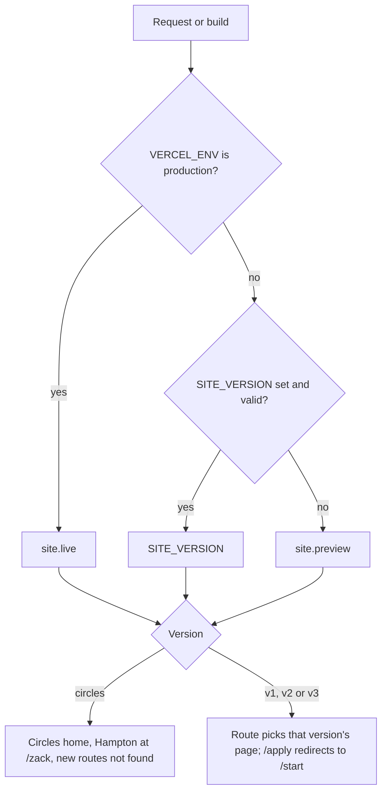
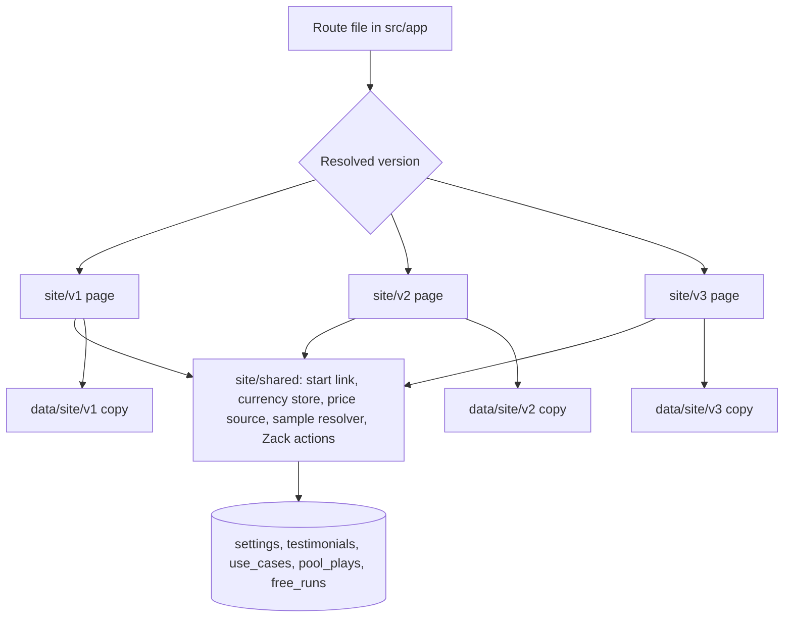

# Roger Marketing Site in Three Versions - Plan

## Goal Capsule

- **Objective:** A visitor to meetroger.ai understands in ten seconds what arrives on Monday, believes a real person runs it, sees what it costs and when the card is charged, and starts the free trial. Peter can see that same site at three levels of design ambition and choose which one is public.
- **Means:** One set of pages and behaviour, built three times in order: v1 in the current look, v2 in a look modelled on five example sites, v3 through the design guide's process.
- **Product authority:** Peter Kuperman. He builds this himself; James Camarota is not building it. The content authority is `artifacts/v3-marketing-website-spec.md`, corrected by this plan's Key Decisions. The app (`/start`, `/signin`, `/app`, `/admin`, billing) is not active scope.
- **Open blockers:** None for v1. v2 and v3 each stop for Peter's picks (R17, R22).
- **Execution profile:** Three pull requests, one per version, built in order. v1's branch comes off `main`; each later version's branch comes off the previous version's branch until that one is merged. Each unit is built, reviewed, fixed and pushed before the next starts.
- **Stop conditions:** Stop before merging any pull request, before changing the live version (KTD1), and at every pick gate (U11, U15, U16). Stop if build, lint or tests cannot be made green.
- **Who finishes:** The executor builds through each version's acceptance unit and opens its pull request. Peter reviews on preview, merges, and decides when a version goes live.
- **Product Contract preservation:** Unchanged in scope. The letter-source assumption was corrected from research, the planning questions were resolved into KTDs, and AE8 to AE11 were added as clarifications of R2, R3, R5 and R9.

---

## Product Contract

### Summary

Build the full public marketing site from the spec as v1, in the current design system.
Then redesign the whole site twice on the same content and behaviour: v2 follows a look Peter picks from five hero sketches and ships with placeholders plus an asset checklist; v3 runs the design guide's explore, pick, tune and verify process with the look left open.
The public site keeps showing Circles until Peter says which version goes live.

### Problem Frame

meetroger.ai still shows the Circles pitch: 8-person groups and a 45-day guarantee.
None of the v3 pages exist in code, and there is no switch to serve them.
A visitor cannot learn what Roger sends on Monday, what it costs, or when the card is charged.

Peter also does not know how good the site can look.
The spec fixes a restrained design system, the five example sites point somewhere much more visual, and the design guide describes a third way of working.
Reading about these does not settle which is best; seeing the same content in each does.

### Key Decisions

- **Three successive versions, one public at a time.** v1, then v2, then v3, each a full replacement. (session-settled: user-directed — chosen over a side-by-side bake-off: one site that gets better, not three to compare.) Governs R1, R2.
- **No deadline.** Build in order and see how far it gets; the Nov 30 date in the spec does not bind this work. (session-settled: user-directed — chosen over "v1 live by Nov 30": Peter said "no deadline, just build".)
- **Preview until Peter says go.** (session-settled: user-approved — chosen over going live when checks pass: publishing is Peter's call.) Governs R2, R3.
- **Single list is US$200 / CA$280.** The spec's US$100 / CA$140 is stale; Strategy v3.1 (Nov 25 revision) and the code agree on US$200. (session-settled: user-directed — chosen over the spec's price.) Governs R8.
- **The spec's design rules bind v1 only.** v2 may change fonts, colours, layout and imagery. Claims rules, vocabulary and product facts bind every version. (session-settled: user-directed — chosen over "imagery only" and "stay inside the tokens".) Governs R6, R15.
- **v3's look is open.** It uses the guide's process, with token-bound and free directions both on the table. (session-settled: user-directed — chosen over following the guide's token rules literally, and over refining v2's look.) Governs R20, R21.
- **Every version covers every page.** (session-settled: user-directed — chosen over redesigning only the homepage first.) Governs R5, R16, R23.
- **Copy is fixed in v1, free in v2 and v3.** (session-settled: user-directed — chosen over one verbatim copy file for all three.) Governs R7, R18.
- **The compounding section is animated in all three, with week labels and brick counts.** This is an exception to the spec's "no hard-coded numbers" rule. (session-settled: user-directed — chosen over a still picture in v1 and over hiding the counts.) Governs R10.
- **The sample idea card shows a real play now.** (session-settled: user-directed — chosen over leaving the section absent until an admin picks a play.) Governs R11.
- **v2 starts with five hero sketches.** (session-settled: user-directed — chosen over one blended look decided by the builder.) Governs R15, R17.
- **Generated art may show photo-real people in v2.** (session-settled: user-directed — chosen over "no realistic people", which was the recommendation.) Governs R19.
- **Peter generates the real assets with AI image tools.** (session-settled: user-directed — chosen over a designer brief.) Governs R18a.
- **The logo is decided through v2's asset list.** (session-settled: user-directed — chosen over keeping the placeholder throughout.) Governs R18a.
- **The app keeps its current look.** (session-settled: user-approved — chosen over restyling the app header and colours: it avoids touching files the app work uses.) Governs R4.

### Requirements

**All versions**

- R1. The three versions are built in order, and each is a complete site: v2 does not start until v1 passes R24, and v3 does not start until v2 does.
- R2. The public site keeps serving the Circles preview until Peter names a version to make live.
- R3. Which version is served is one setting, and any earlier version can be restored by changing it back.
- R4. No version changes how `/start`, `/signin`, `/app/*` or `/admin/*` look or behave.
- R5. Every version covers the public routes, header, footer, sitemap, robots and social card that `artifacts/v3-marketing-website-spec.md` assigns to the marketing site, with the spec's behaviour for each.
- R6. Every version follows the spec's claims rules, its "AI agent" vocabulary rule and its tone rules, with the one exception in R10.
- R7. Copy lives in one place per version, so a wording change by Peter is one edit.
- R8. Every price shown is US$200 a month, US$200 a list, CA$280 a month, CA$280 a list, with the US$400 / CA$560 rate described only as the spec describes it.
- R9. Unlisted partner pages and hidden legacy pages render exactly as they do today.

**Content shared by all versions**

- R10. "It compounds" is a scroll story that shows week 1, 2 and 3 and then week 26, labelled with week numbers and brick counts (3, 6, 9, then 78, 81), with no number about time or money. Under reduced motion it shows the finished stack and nothing moves.
- R11. The sample idea card shows one real play taken from the Zack runs or Cora report in `artifacts/`, with names, client details and every time-saved figure removed, including the card's time line and time tiles.
- R12. Peter approves the cleaned sample play text before any version goes live. A play later chosen in the admin replaces it.
- R13. Where Peter's inputs are missing, the spec's fallbacks apply: `/about` and "Who runs this" show only the letter paragraphs that are still true and lay out without the photograph and signature; testimonials are absent; privacy and terms are marked as unreviewed drafts.

**v1: current look, new message**

- R14. v1 uses the existing design system as the spec describes it: Mona Sans, ground and night, copper on the primary button and text links only, one 8px corner, bricks as the only illustration, and no photograph but Peter's.
- R14a. v1 uses the spec's draft copy word for word, except the lines that R8 makes false. Those are rewritten to say that monthly brings a list every Monday for the price of one list, and each rewritten line is listed for Peter.

**v2: the five examples**

- R15. v2 begins with five homepage hero sketches, one in the spirit of each of theacademysf.com, earth-ai.com, maticrobots.com, railcode.dev and olddogs.ai, each using placeholders where real art is missing.
- R16. After Peter's pick, the whole site is rebuilt in that look, including a logo placeholder position that a generated mark can drop into.
- R17. v2's full build does not start until Peter picks one sketch or names a mix.
- R18. v2 may shorten and rewrite copy for a more visual page, and every changed line is listed against its v1 wording for Peter's review.
- R18a. v2 ships with an asset checklist. Each entry gives what the asset shows, a ready-to-paste generation prompt, exact pixel size, format, file name and where it appears. The checklist includes magnifying-glass logo options.
- R18b. Every asset on the checklist has a placeholder in the build with the final asset's size and position, and dropping the real file in at the listed name replaces it without a code change.
- R19. Generated people never appear beside a quote, a name, a role or a testimonial heading, and no caption or alt text presents them as a Roger user.

**v3: the design guide**

- R20. v3 follows the process in `artifacts/marketing-site-design-guide-roger.md` (Parts C to F), with this plan's Key Decisions winning where the guide's fixed tokens or copy rules disagree.
- R21. v3's exploration round offers both directions that stay inside the current tokens and directions that do not.
- R22. v3 stops for Peter at each of the guide's gates: the restated brief, the hero picks, the approved variation, and the go-ahead to implement.
- R22a. Exploration takes two forms: image prompts Peter runs in his own tool, and browser mockups of the three or four strongest ideas.
- R23. v3 carries forward the logo Peter chose from v2's list, or the placeholder if he has not chosen.
- R23a. v3 includes the guide's anti-slop and claims checklist (Part E) as part of its checks.

**Done**

- R24. A version is finished when it passes the spec's acceptance checks (A.16, as restated in the guide's Part F) and its own requirements above. Peter then looks at it on a preview link and says go or sends edits.

### Key Flows

- F1. Version review
  - **Trigger:** A version passes R24's checks.
  - **Steps:** Peter opens the preview link. He says go, or sends edits; edits are applied and the checks rerun. On go, the next version starts. The public site does not change.
  - **Covered by:** R1, R2, R24
- F2. Going live
  - **Trigger:** Peter says "make v-n live".
  - **Steps:** Peter approves the sample play text if he has not. The serving setting changes to that version. Circles pages stay reachable but unlinked and noindex.
  - **Covered by:** R2, R3, R12
- F3. v2 pick
  - **Trigger:** Five hero sketches are ready.
  - **Steps:** Peter views them side by side and picks one or a mix. The site and the asset checklist are built for that look. Peter generates assets and drops them in as they are ready.
  - **Covered by:** R15, R16, R17, R18a, R18b

### Acceptance Examples

- AE1. **Covers R2, R3.** Given v1 is finished and Peter has not said go, when a visitor opens meetroger.ai, then they see the Circles preview.
- AE2. **Covers R3.** Given v2 is live, when the serving setting is changed back to v1, then every public page shows v1's look and v1's copy.
- AE3. **Covers R8, R14a.** Given v1's pricing page, when a visitor reads the comparison under the two columns, then it does not say "Two lists one at a time cost the same as a whole month."
- AE4. **Covers R18b.** Given a v2 hero placeholder, when Peter saves the generated image at the checklist's file name, then the hero shows it at the same size and position.
- AE5. **Covers R19.** Given v2 art that shows a person, when testimonials are later switched on, then that art is not adjacent to the testimonial section.
- AE6. **Covers R10.** Given a visitor with reduced motion set, when they reach "It compounds", then they see the week 26 stack with its labels and nothing animates.
- AE7. **Covers R4.** Given v2 is live with a new font, when a visitor clicks "Get two free Monday lists", then `/start` looks as it does today.
- AE8. **Covers R2.** Given production is serving Circles, when a visitor opens `/pricing`, `/agents`, `/faq`, `/how-it-works`, `/about` or `/zack/claude` by typing the address, then they get the not-found page.
- AE9. **Covers R9.** Given production is serving Circles, when a visitor opens `/zack`, then they see the Hampton partner page exactly as today.
- AE10. **Covers R3, R5.** Given a version is live, when a visitor opens `/apply`, then they are sent to `/start`; after switching back to Circles, `/apply` shows the Circles application page again.
- AE11. **Covers R5.** Given a Canadian visitor who chose CAD and arrived with campaign tags, when they read `/agents`, then `/pricing`, and click a start button, then the link carries `path=agents`, `cur=CAD` and the campaign tags.

### Success Criteria

- Peter can judge each version from a preview link without reading code or a changelog.
- Switching the public site between versions needs no rebuild of content.
- A v2 or v3 page would not be mistaken for a generic SaaS template, by the guide's Part E self-review.

### Scope Boundaries

- The demo video, the "one real week" example and the group-session line (the spec's version A2).
- Restyling sign-up, sign-in or the dashboard to match v2 or v3. From v2 on, a visitor sees a change of style at sign-up.
- New analytics, a keyword plan, or a blog.
- Final legal review of privacy and terms, and the model provider's training position.
- Designing a final logo by hand. Logo options are generated by Peter from v2's checklist.
- Producing the real v2 images. The build supplies prompts and placeholders.

### Dependencies / Assumptions

- The app's storage for free Zack runs, testimonials and settings already exists in `db/schema.sql`, so the `/zack` free run and testimonials can be built in v1.
- The app already has an idea card (`src/components/app/idea-card.tsx`, `src/components/app/idea-sheet.tsx`). The public sample card shares its data shape but is a separate component (KTD6).
- Peter's approved letter is section 10.2 of `artifacts/Archives/Circles/Roger (CTA Circles) - design spec.md`, marked "Approved by Peter, November 15, 2026". Two older variants exist and are not used.
- An admin-chosen sample play and its public reader already exist (`src/lib/cora/sample.ts`); no public page calls the reader yet.
- Nothing writes to `free_runs` today; the claim side on sign-up exists.
- Preview deployments use a separate database, so Peter reviews each version without testimonials or an admin-chosen sample play.
- Peter's photograph and signature are not in `public/media/`.
- No testimonial is cleared, so no version shows any.

### Outstanding Questions

None block the build. Each has a default the plan uses until Peter says otherwise.

- **Zack file version on `/zack`.** The spec says the public files stay at 1.9; the Hampton page and its downloads say 2.0. Default: the tool serves the files that exist in `public/zack/` and shows their real version.
- **Years in real estate finance.** The approved letter says "18+ years"; two older texts say 17. Default: the approved letter's wording.
- **Resume link for the Zack free run.** Default: the run token stays in the page address so a bookmark or reopened tab resumes; no email is sent. An emailed link would add a statement to the privacy text.
- **Comparing versions on one preview.** Default: a preview shows the newest built version, and an earlier one is viewed by setting the override in KTD1. A per-visit switch is decided in U12, when a second version exists.
- **Logo reach.** Default: a chosen logo changes the marketing header, favicon and social card; app screens keep the current mark (R4).

### Sources / Research

- `artifacts/v3-marketing-website-spec.md`: pages, sections, copy, claims rules, behaviour.
- `artifacts/marketing-site-design-guide-roger.md`: v3's process (Part C), rules (Part D), checklists (Parts E and F).
- `artifacts/Strategy/Roger-Strategy-v3.1.md`: section 15, the Nov 25 price revision.
- `artifacts/Roger v3 - design spec.md` (v1.3): the acceptance checks in A.16 and the design system in 0.7.
- `src/data/config.ts`: `flags` has only `circlesMode`; prices already US$200 / CA$280 / US$400 / CA$560.
- `src/components/circles/price.tsx`: the existing USD/CAD toggle.
- `src/app/library-actions.ts`: the form pattern the spec tells public forms to follow.
- `src/data/zack.ts`: the four agents with Zack files.
- `docs/plans/2026-11-22-001-feat-roger-v3-app-b1-plan.md`: the app plan whose files this work must not disturb.
- Verified absent: `src/components/v3/`, `src/data/v3-copy.ts`, and routes `/agents`, `/pricing`, `/how-it-works`, `/faq`, `/about`.

---

## Planning Contract

### Naming

"v3" already means the product generation in this repo (`v3Defaults`, `v3.*` settings, "Roger v3"). To avoid a clash, this plan calls the site versions `v1`, `v2`, `v3` only inside the `site` namespace: `src/components/site/`, `src/data/site/`, `src/lib/site/`. The spec's suggested paths `src/components/v3/` and `src/data/v3-copy.ts` are not created.

### Key Technical Decisions

- KTD1. **The served version is one constant, resolved on the server.** `siteConfig.site.live` holds `"circles" | "v1" | "v2" | "v3"` and stays `"circles"`. `siteConfig.site.preview` holds the newest built version, starts as `"circles"` and becomes `"v1"` only in U10, and applies wherever `VERCEL_ENV` is not `production`, including local development. A `SITE_VERSION` environment override is honoured only outside production. Going live is a one-line change to `site.live` plus a deploy. Rationale: static `metadata`, `sitemap()`, `robots()` and the social card read the value at module level, so a database setting would make each of them async and add cache lag on a switch. Implements R2, R3.
- KTD2. **One pure resolver; no component reads the constant directly.** `src/lib/site/version.ts` exposes the resolved version and a pure function that takes its inputs as arguments, so every version is testable without rebuilding. The resolved value is read only in server files, because `VERCEL_ENV` is not available in the browser; client components receive it as a prop from the root layout or their server parent. `circlesMode` stays in the code as the spec asks, and every one of its reads moves to the resolver.
- KTD3. **Every non-Circles version is its own branch, never "Circles off".** With `circlesMode` false the code falls back to the older setup-era site: the code banner, starter-pack offers and `/business` links. Each branch point therefore becomes three-way: Circles, a site version, and the legacy fallback that nothing selects.
- KTD4. **New routes are gated per request.** Each new public route calls not-found when the version is Circles. `/zack` renders the Hampton page under Circles and the free-run tool otherwise. `/apply` redirects to `/start` in the page when a version is serving, not in `next.config.ts`, so switching back restores it. Implements AE8, AE9, AE10.
- KTD5. **Three layers: behaviour, content, look.** Behaviour that must not differ between versions lives once in `src/lib/site/` and `src/components/site/shared/`: the start-link builder, currency store, price source, sample-play resolver, absent-data rules and Zack actions. Content lives in one copy file per version under `src/data/site/`. A shared copy type covers only the strings shared behaviour and fixed facts need: button labels, the card line, the trial line, price wording, the Zack warning line and the questions. Each version's file defines its own page shape beyond that, so v2 and v3 can restructure copy (R18). Look lives in `src/components/site/v1/`, `v2/`, `v3/`. A route file picks the version's page component and nothing else. Implements R3, R7.
- KTD6. **The public sample card is a marketing component, rendered inline.** It takes the same `IdeaView` data as the app card but renders no time line, no time tiles and no modal. Rationale: the app's sheet shows four time tiles even with empty figures and opens as a modal on load, and changing it would touch app files (R4). Cora's five score bars stay, with their names. Implements R11.
- KTD7. **The sample play is the admin's choice, else a bundled cleaned play.** `getPublicSamplePlay()` already returns the admin-chosen play or null; the fallback is a static play in `src/data/site/sample-play.ts`. The marketing card strips figures from either source.
- KTD8. **Amounts come from settings, never from copy.** Prices, the higher rate, the number of free lists and the 21-day close are read through `getV3SettingsForDisplay()` and substituted into copy. A test fails if `v3Defaults` drifts from R8's amounts.
- KTD9. **One start-link builder for every start button.** It adds `path` from the page's audience or the last audience seen this visit, `cur` from the currency store at click time, `zack` when present, and the campaign tags `ClientBoot` already captures. With no script, the plain `/start` link still works. Implements AE11.
- KTD10. **The currency default follows the existing pattern.** The country header is read in a child under `Suspense` with the USD block as fallback (`src/components/circles/home.tsx:2865`). The store keeps its current key and event so a choice survives a version switch. With no script, both currencies show.
- KTD11. **The compounding scroll story uses no animation library.** The default CSS state is the finished week 26 stack with its labels; motion is added only under `prefers-reduced-motion: no-preference` and only once script is running, as `src/app/globals.css:446` already does for reveals. A text equivalent of the sequence serves screen readers. Counts and week labels live in one data file. Each step advances as it crosses the middle of the screen, nothing is pinned, steps already shown stay shown on scroll back, and the labels stay readable at 375 pixels. Implements R10.
- KTD12. **The Zack free run stores as little as the spec allows.**
  - The server mints a token of the shape sign-up already accepts and writes `free_runs` in one statement.
  - A stored report is reachable only by its token. Paste-back finds its row by token alone, and no response ever returns an existing token.
  - A repeat email-step submit for the same email and agent, on an unclaimed row, mints a new token and clears any stored report, so someone who knows an email can force a redo but can never read or attach another person's report. A claimed row gets the same neutral answer and no change.
  - Unclaimed rows are deleted, and the report on claimed rows is cleared, once they pass the existing retention period, through the existing housekeeping job.
  - The token rides in the page address between steps.
  - "Top plays summarised" is a deterministic read of the report's play headings, with a plain message when none are found; no model is called.
  - Limits: per email first, with a high per-IP backstop (`docs/solutions/security-issues/per-ip-lockout-blocks-everyone-behind-an-agent-platform-2026-11-22.md`).
  - Every error path returns the submitted values (`docs/solutions/ui-bugs/react-19-form-action-reset-brings-back-stale-defaults-2026-11-23.md`).
- KTD13. **v2 and v3 looks are scoped by a wrapper attribute.** Marketing pages render a `data-site` wrapper, and token overrides are keyed on `html:has([data-site="v2"])`, so the shared header, footer and body follow on marketing pages while `/start`, `/signin`, `/app` and `/admin` never match. Rationale: there are no route groups, and moving the header out of the root layout would change files the app renders through. To verify in U12: `:has()` support, the Next 16 font-loading rules, that a second stylesheet builds through the Tailwind loader, and that the look does not follow a visitor into `/start` after a click, since Next may keep the previous page mounted but hidden. The named fallback is a marker on `html` keyed on the pathname. Implements R4, AE7.
- KTD14. **v2 assets are declared once.** One manifest lists each asset's file name, size, alt text, prompt and placement. The page reads it to render the real file when present and a same-size placeholder when not; the checklist is generated from it. The file-present check runs at build or inside a cached function, because `public/` is not on disk inside a server function at request time. Implements R18a, R18b, AE4.
- KTD15. **Claims and vocabulary are checked on rendered text.** A test renders every page of every built version and scans the text for the rules in R6, with an allow-list for the compounding labels only. Rationale: rewritten v2 and v3 copy breaks these rules easily, and a source search misses substituted text.
- KTD16. **No browser test tool is added.** Vitest stays in the node environment with server-rendered markup. Keyboard, reduced-motion and five-width checks run in a real browser during each version's acceptance unit and are recorded there. Considered and not built: Playwright. Evidence that would change this: the same manual checks failing to catch a regression twice.

### High-Level Technical Design

Version resolution, for every request and at build:



What each surface serves, by environment and version:

| Surface | Production, Circles | Production, a version live | Preview or local |
|---|---|---|---|
| `/` | Circles home | Version home | Newest built version |
| New routes (`/agents`, `/pricing`, `/how-it-works`, `/faq`, `/about`, `/zack/[agent]`) | Not found | Version page | Version page |
| `/zack` | Hampton page, no header | Free-run tool, public header | Free-run tool |
| `/apply` | Circles application | Redirect to `/start` | Redirect to `/start` |
| Sitemap | `/`, `/library`, `/privacy`, `/terms` | The spec's eleven paths | Same as the version |
| Robots | Current Circles rules | Spec's disallow list | Disallow all |
| `/start`, `/signin`, `/app/*`, `/admin/*` | Unchanged | Unchanged | Unchanged |
| Unlisted partner pages | Unchanged | Unchanged | Unchanged |

Layers:



### Output Structure

```text
src/
  lib/site/
    version.ts            resolver and route gate
    start-link.ts         start-link builder
    amounts.ts            prices and counts from settings
    sample.ts             admin choice, else bundled play
    free-run.ts           Zack free-run storage and limits
    claims.ts             rendered-text rules
  data/site/
    copy-types.ts
    v1.ts  v2.ts  v3.ts   one copy file per version
    compounding.ts        week labels and brick counts
    sample-play.ts        the cleaned real play
    letter.ts             approved letter, with still-true flags
    legal.ts              privacy and terms drafts
    v2-assets.ts          asset manifest
  components/site/
    shared/               currency store, start link, sample card data, forms
    v1/  v2/  v3/         pages and blocks per version
docs/site/
  v2-asset-checklist.md   generated from the manifest
  v3/                     brief, reference board, exploration, lock
```

### Assumptions

- `npm install` has not been run in this checkout, so Next 16's own docs in `node_modules/next/dist/docs/` could not be read during planning. U1 starts by installing and reading the guides on layouts, `next/font`, Cache Components and environment variables, as `AGENTS.md` requires. KTD1 and KTD13 are checked against them before code is written.
- `VERCEL_ENV` is available at build and on the server for preview deployments, as its existing uses in `src/app/robots.ts` and `next.config.ts` rely on.
- Signed-in visitors who click a body start button are handled by `/start`, which is app behaviour.

### Sequencing

v1 units run U1 to U10 in order; U6 to U9 depend only on U1 to U4 and may run in any order. v2 (U11 to U14) starts after U10's pull request is open and Peter has said go on v1. v3 (U15 to U18) starts after U14 passes and Peter has said go on v2, with placeholders still in place, so it does not wait on Peter's image generation.

### Go-live check

Previews use a separate database, so before `site.live` changes, the production values the pages read are checked once: the `v3.*` amounts against R8, whether a sample play is chosen and reads cleanly, and which testimonials are cleared. Peter approves the sample text (R12) at the same step.

### Risks & Dependencies

| Risk | Mitigation |
|---|---|
| Moving every flag read changes the live Circles site | U1 lands first with before-and-after tests under Circles: markup for home, `/zack`, `/library`, `/privacy`, `/terms`; sitemap and robots; and the exported metadata, noindex flags, JSON-LD and social card text |
| A new page throws "unstable value" under Cache Components and the build does not report it | Each page is loaded in development with a clean console as part of its unit (`docs/solutions/runtime-errors/next16-clock-read-during-render-2026-11-22.md`) |
| Unapproved sample text is reachable on a public preview link | Accepted: previews are noindex and unlinked. R12 still gates production |
| The token-override theme cannot carry a v2 look that needs a different header layout | U12 verifies the mechanism on the picked sketch before U13 builds on it |
| Rewritten v2 and v3 copy breaks a claims rule | KTD15's test runs on every built version |
| A scripted bulk edit corrupts copy or legal text on Windows | Copy and legal files are edited file by file (`docs/solutions/developer-experience/scripted-edits-mangle-escapes-and-crlf-2026-11-22.md`) |

---

## Implementation Units

| U-ID | Title | Key files | Depends on |
|---|---|---|---|
| U1 | Site version resolver and Circles parity | `src/lib/site/version.ts`, `src/data/config.ts`, 18 flag-reading files | none |
| U2 | Shared behaviour layer | `src/lib/site/`, `src/components/site/shared/` | U1 |
| U3 | v1 copy and shared blocks | `src/data/site/`, `src/components/site/v1/blocks/` | U2 |
| U4 | v1 chrome: header, footer, sitemap, robots, social card | `src/components/site-header.tsx`, `src/app/sitemap.ts` | U1, U3 |
| U5 | v1 homepage and compounding scroll story | `src/components/site/v1/home.tsx` | U3, U4 |
| U6 | v1 `/agents` | `src/app/agents/page.tsx` | U3, U4 |
| U7 | v1 `/pricing`, `/faq`, `/how-it-works`, `/about` | four route files | U3, U4 |
| U8 | Zack free run | `src/app/zack/`, `src/lib/site/free-run.ts` | U2, U4 |
| U9 | v1 library band, privacy and terms | `src/app/library/page.tsx`, `src/data/site/legal.ts` | U3, U4 |
| U10 | v1 claims check and acceptance | `src/lib/site/claims.ts` | U5 to U9 |
| U11 | v2 five hero sketches and pick | `src/app/site-preview/` | U10 |
| U12 | v2 theme scoping and asset manifest | `src/data/site/v2-assets.ts` | U11 |
| U13 | v2 full site and copy | `src/components/site/v2/` | U12 |
| U14 | v2 acceptance | `docs/site/v2-asset-checklist.md` | U13 |
| U15 | v3 brief, reference board, exploration | `docs/site/v3/` | U14 |
| U16 | v3 lock, hero prototype, tuning panel | `docs/site/v3/`, `src/components/site/v3/` | U15 |
| U17 | v3 full site | `src/components/site/v3/` | U16 |
| U18 | v3 acceptance | `docs/site/v3/` | U17 |

### PR1: v1, the spec in the current look

Waits on: nothing.

### U1. Site version resolver and Circles parity

**Goal:** One resolver decides what every public surface serves, and the live Circles site is unchanged.

**Requirements:** R2, R3, R4, R9; AE1, AE8, AE9, AE10. Implements KTD1 to KTD4.

**Dependencies:** none.

**Files:**
- Create `src/lib/site/version.ts`, `src/lib/site/version.test.ts`
- Modify `src/data/config.ts`, `src/app/layout.tsx`, `src/app/page.tsx`, `src/components/site-header.tsx`, `src/components/site-footer.tsx`, `src/components/footer-switch.tsx`, `src/app/sitemap.ts`, `src/app/robots.ts`, `src/app/opengraph-image.tsx`, `src/app/library/page.tsx`, `src/app/privacy/page.tsx`, `src/app/terms/page.tsx`, `src/app/apply/page.tsx`, `src/app/zack/page.tsx`, `src/components/use-case-card.tsx`, `src/components/library-browser.tsx` (passes the version by prop to the cards it renders in the browser)
- Modify the five hidden legacy pages that set noindex from the flag: `src/app/companies/page.tsx`, `src/app/setup/page.tsx`, `src/app/workshops/page.tsx`, `src/app/refunds/page.tsx`, `src/app/packs/[id]/page.tsx`
- Modify tests `src/components/site-header.test.ts`, `src/app/robots.test.ts`; create `src/app/sitemap.test.ts`, `src/lib/site/circles-parity.test.tsx`

**Approach:**
1. Run `npm install`, then read the Next 16 guides named in Assumptions.
2. Capture Circles output for the parity test before changing any read: page markup, plus the exported metadata of the root layout, home, terms and the five legacy pages, the layout's JSON-LD, and the social card's alt text.
3. Add `site.live` and `site.preview` to the config and the pure resolver (KTD1, KTD2).
4. Move each flag read to the resolver, making each branch three-way (KTD3). At this unit a site version renders a plain "not built yet" page for `/`, so the branch exists without v1 content.
5. Make `navFor` and the footer switch take the version as an argument; pass it from the root layout.
6. Add the route gate helper and apply KTD4 to `/apply` and `/zack`.

**Execution note:** Characterization first. The parity test must pass on untouched `main` before any flag read moves.

**Patterns to follow:** `navFor(path)` as a pure function; `vi.stubEnv("VERCEL_ENV", ...)` in `src/app/robots.test.ts`; `notFound()` in `src/app/apply/page.tsx`.

**Test scenarios:**
- Resolver returns `site.live` when the environment is production, whatever `SITE_VERSION` says.
- Resolver returns a valid `SITE_VERSION` outside production, and `site.preview` when the override is missing or not a known version.
- Covers AE1. With the version Circles, the home markup equals the markup captured before the change.
- Covers AE9. With the version Circles, `/zack` renders the Hampton page markup captured before the change, and the header returns no links for it.
- `navFor` for `/admin`, `/start`, `/signin`, `/app/zack`, `/hampton`, `/rlpsignature` and `/for/x` returns the same result under Circles and under v1.
- With the version Circles, the exported metadata, noindex flags, JSON-LD and social card alt text equal the values captured before the change.
- Sitemap under Circles lists exactly `/`, `/library`, `/privacy`, `/terms`.
- Robots: preview disallows everything for every version; production Circles keeps its current disallow list.
- Covers AE10. `/apply` redirects under v1 and renders under Circles.
- With the version v1, no rendered header, footer or library card links to `/apply`, `/setup`, `/companies`, `/packs/`, `/workshops`, `/refunds`, `/business` or `/families`.

**Verification:** Lint, tests and build pass. `main`'s production output is unchanged: the parity test passes and a local production-mode build with the default config serves the Circles home.

### U2. Shared behaviour layer

**Goal:** The behaviour that all three versions share exists once and is tested once.

**Requirements:** R5, R7, R8, R11, R13; AE11. Implements KTD5, KTD7 to KTD10.

**Dependencies:** U1.

**Files:**
- Create `src/lib/site/start-link.ts`, `src/lib/site/amounts.ts`, `src/lib/site/sample.ts`, `src/lib/site/testimonials.ts`, with a `.test.ts` beside each
- Create `src/components/site/shared/currency-store.ts`, `src/components/site/shared/start-link.tsx`, `src/components/site/shared/country-default.tsx`
- Create `src/data/site/copy-types.ts`

**Approach:**
- Lift the currency store from `src/components/circles/price.tsx` lines 7 to 48 unchanged in key and event name; leave the Circles component as it is.
- `amounts.ts` wraps `getV3SettingsForDisplay()` and formats per the spec's price rules; copy refers to amounts by name.
- `testimonials.ts` is a cached wrapper over `publicTestimonials` tagged `"testimonials"`, filtered by audience, returning an empty list with no database.
- `copy-types.ts` defines the shared strings every version's copy file must fill (KTD5), so a missing one is a type error.

**Patterns to follow:** `"use cache"` with `cacheTag` in `src/lib/cora/sample.ts`; `parseStartParams` in `src/lib/signup/params.ts` for accepted keys and shapes.

**Test scenarios:**
- Covers AE11. Audience `agents` remembered, currency CAD, tags present: the link carries `path=agents`, `cur=CAD` and one `utm` value `parseStartParams` accepts.
- A page with no audience and nothing remembered produces a link with no `path`.
- A `zack` token of valid shape is carried; an invalid one is dropped.
- Every output of the builder round-trips through `parseStartParams` without loss.
- Formatting: USD gives "US$200 / month USD" with "plus tax where it applies"; CAD gives "CA$280 / month CAD" with "plus HST"; no output contains a bare "$".
- `v3Defaults` equals R8's six amounts.
- Sample resolver returns the admin play when one exists and the bundled play when the reader returns null or throws.
- Testimonials with no database return an empty list without throwing.

**Verification:** Lint, tests and build pass.

### U3. v1 copy and shared blocks

**Goal:** v1's words and its reusable blocks exist, in the current design system.

**Requirements:** R6, R7, R8, R10 (static form only; the scroll story is U5), R11, R13, R14, R14a. Implements KTD6, KTD8.

**Dependencies:** U2.

**Files:**
- Create `src/data/site/v1.ts`, `src/data/site/sample-play.ts`, `src/data/site/letter.ts`, `src/data/site/compounding.ts`
- Create under `src/components/site/v1/blocks/`: `brick-stack.tsx`, `price-block.tsx`, `control-block.tsx`, `questions.tsx`, `closing-band.tsx`, `testimonials.tsx`, `sample-card.tsx`, `section-head.tsx`
- Create `src/components/site/v1/blocks/blocks.test.tsx`
- Create `docs/site/v1-copy-changes.md`

**Approach:**
- Copy comes from A.14 of `artifacts/Roger v3 - design spec.md` v1.3 and `artifacts/v3-marketing-website-spec.md`, word for word, with amounts replaced by names (KTD8). The lines R8 makes false are rewritten per R14a and listed in `docs/site/v1-copy-changes.md`.
- The sample play is chosen from `artifacts/Zack Runs/` for clarity to a real estate reader, with names, client details and every time figure removed. Its text is flagged in the file as awaiting Peter's approval (R12).
- `letter.ts` holds the approved letter with a still-true flag per paragraph; paragraphs mentioning Circles or applications are false.
- Bricks are SVG or CSS using `--color-level-1` to `--color-level-5`, each with a text label.
- The price block marks monthly "Most people choose this" and makes it the larger of the two.
- Testimonials render nothing when the list is empty: no heading, no wrapper.

**Patterns to follow:** `SectionHead` and `FaqSection` in `src/components/sections.tsx`; `ScoreBars` in `src/components/app/score-bars.tsx` for the data palette; `data-reveal` for entrances.

**Test scenarios:**
- Sample card markup for a play with figures contains no time line, no time tile and no "Not available" text, and contains five labelled score bars.
- Sample card markup contains no `dialog` element.
- Price block markup has two buttons with `aria-pressed`, the "Most people choose this" mark on monthly only, and the trial line directly after the prices.
- Testimonials with an empty list render an empty string.
- Every brick in the stack markup has an accessible label.
- No string in `src/data/site/v1.ts` contains a digit followed by "hour" or "minute", or a "$" not preceded by "US" or "CA".
- Letter data: at least three paragraphs are flagged still true, and none of them contains "Circle" or "appl".

**Verification:** Lint, tests and build pass. Each block is viewed in development on ground and on night.

### U4. v1 chrome: header, footer, sitemap, robots, social card

**Goal:** A site version has the spec's header, footer, sitemap, robots rules, metadata and social card.

**Requirements:** R5, R9; spec A.3 and the SEO section.

**Dependencies:** U1, U3.

**Files:**
- Modify `src/components/site-header.tsx`, `src/components/site-footer.tsx`, `src/app/sitemap.ts`, `src/app/robots.ts`, `src/app/opengraph-image.tsx`, `src/app/layout.tsx`, `src/app/not-found.tsx`
- Modify tests `src/components/site-header.test.ts`, `src/app/sitemap.test.ts`, `src/app/robots.test.ts`

**Approach:**
- Header links and buttons per A.3. The signed-in swap to "Open Roger" is a streamed slot that never blocks the first paint and reserves its width.
- `/zack` and `/zack/[agent]` get the public header and footer when a version is serving.
- `/getstarted` keeps its current look and is listed in the sitemap.
- The social card carries the v1 headline and no numbers.

**Test scenarios:**
- `navFor("/pricing")` under v1 returns How it works, Pricing, Use cases, FAQ, About, with the start button.
- `navFor("/start/plan")`, `/signin` and `/app` under v1 return no links and no button.
- Sitemap under v1 lists exactly the spec's eleven paths.
- Robots in production under v1 disallows `/app`, `/admin`, `/start`, `/api` and the hidden legacy paths.
- Footer under v1 contains the nine items in A.3 and no Circles link.

**Verification:** Lint, tests and build pass. Header checked in a browser signed out and signed in.

### U5. v1 homepage and compounding scroll story

**Goal:** The real estate homepage in the spec's eleven-section order, with the animated compounding section.

**Requirements:** R5, R10, R11, R13, R14; AE6. Implements KTD11.

**Dependencies:** U3, U4.

**Files:**
- Create `src/components/site/v1/home.tsx`, `src/components/site/v1/blocks/compounding.tsx`, `src/components/site/v1/blocks/who-runs-this.tsx`, `src/components/site/v1/blocks/how-it-works.tsx`
- Create `src/components/site/v1/home.test.tsx`
- Modify `src/app/page.tsx`, `src/app/globals.css` (compounding motion rules only)

**Approach:**
- Sections follow A.5. The hero is a night chapter with three bricks arriving; "how it works" grows the stack across four steps.
- "Who runs this" shows the first three still-true letter paragraphs and lays out without the photograph.
- When testimonials are absent, the ground and night rhythm still alternates.
- No link to `/zack` anywhere on the page.

**Test scenarios:**
- Home markup contains the eleven sections in order, minus testimonials when none are cleared.
- Covers AE6. Compounding markup without script contains the week 26 stack, the labels from `src/data/site/compounding.ts`, and a text description of the sequence.
- Home markup contains "Card required. Charged only with your third list." directly under the hero buttons.
- Home markup contains no link to `/zack`.
- Home markup with no photograph file contains no broken image element.

**Verification:** Lint, tests and build pass. In a browser: clean development console, the scroll story plays, and with reduced motion set nothing moves.

### U6. v1 `/agents`

**Goal:** The page for people who already run AI agents.

**Requirements:** R5, R6.

**Dependencies:** U3, U4.

**Files:** Create `src/app/agents/page.tsx`, `src/components/site/v1/agents.tsx`, `src/components/site/v1/agents.test.tsx`

**Approach:** Blocks in A.6's order with the control block above testimonials. The agent strip is generated from `src/data/zack.ts` and lists only agents whose file is available.

**Test scenarios:**
- Covers AE8. The route returns not-found when the version is Circles.
- Every start link on the page carries audience `agents`.
- The strip lists Claude, Duet, Grok Bot and Hark, and the sentence containing "adapts".
- The secondary button links to `/zack`.

**Verification:** Lint, tests and build pass; clean development console.

### U7. v1 `/pricing`, `/faq`, `/how-it-works`, `/about`

**Goal:** The four reading pages.

**Requirements:** R5, R8, R13, R14a; AE3, AE8.

**Dependencies:** U3, U4.

**Files:**
- Create `src/app/pricing/page.tsx`, `src/app/faq/page.tsx`, `src/app/how-it-works/page.tsx`, `src/app/about/page.tsx`
- Create `src/components/site/v1/pricing.tsx`, `faq.tsx`, `how-it-works.tsx`, `about.tsx`, and `src/components/site/v1/pages.test.tsx`

**Approach:**
- Each page follows its spec section: A.7, A.9, A.8 and A.10.
- `/how-it-works` lays the sample card out with one margin note per part, and shows the playbook preface first.
- `/about` shows only still-true paragraphs, with a typed name when the signature file is missing.
- The group-session line on `/pricing` stays off.

**Test scenarios:**
- Covers AE8. Each of the four routes returns not-found when the version is Circles.
- Covers AE3. Pricing markup does not contain "Two lists one at a time cost the same as a whole month".
- Pricing markup states the no-refund line and never presents the higher rate as a plan to choose.
- FAQ markup contains the four groups and every question in the v1 copy file.
- How-it-works markup has the anchor `zack` and a link to `/getstarted`.
- About markup renders with no photograph and no signature file.

**Verification:** Lint, tests and build pass; clean development console on all four.

### U8. Zack free run

**Goal:** An agent user picks an agent, runs Zack once, pastes the report back, sees their plays, and starts the trial with the report attached.

**Requirements:** R5, R9; AE8, AE9. Implements KTD12.

**Dependencies:** U2, U4.

**Files:**
- Create `src/lib/site/free-run.ts`, `src/lib/site/free-run.pg.test.ts`, `src/lib/site/report-plays.ts`, `src/lib/site/report-plays.test.ts`
- Create `src/app/zack/actions.ts`, `src/app/zack/actions.test.ts`, `src/app/zack/[agent]/page.tsx`
- Modify `src/lib/housekeeping/job.ts`
- Create `src/components/site/v1/zack.tsx`, `src/components/site/shared/free-run-form.tsx`
- Modify `src/app/zack/page.tsx`, `src/lib/rate-limit.ts`

**Approach:**
- Flow per A.11: agent, email, instructions with a copy button, paste-back, summary, one start button carrying the token.
- The warning line sits above the paste box, word for word.
- Agents without a file go to the "Agent not listed" path that starts from the Hark file.
- With no database, the instructions still show and the form explains that saving is not switched on.
- Form states: a pending state while submitting, a confirmation on copy, a return to the paste-back step when the address carries a valid token, and a neutral return to the agent picker for an unknown or claimed token.
- The retention purge joins `src/lib/housekeeping/job.ts`, using the existing retention setting.

**Execution note:** Write the storage tests against PGlite first, including two submits racing for the same email and agent.

**Patterns to follow:** `leadFrom()` in `src/app/start/actions.ts`; `hit()` and `emailKey()` in `src/lib/rate-limit.ts`; `testDb` in `src/test-helpers/pglite-db.ts`; `claimFreeRun` in `src/lib/zack/receive.ts` for the columns the claim reads.

**Test scenarios:**
- First submit for an email and agent creates one row with a token matching sign-up's accepted shape.
- A repeat email-step submit for an unclaimed email and agent keeps one row, issues a different token, and leaves the report empty; the old token no longer finds a row.
- A paste-back with a valid token stores the report on that row; a paste-back with an unknown token stores nothing.
- No action response for a repeat email contains the token that was issued before.
- A submit for a claimed row changes nothing and returns the same answer as success.
- The purge deletes an unclaimed row older than the retention period, clears the report on a claimed row of the same age, and leaves newer rows alone.
- Two concurrent submits for the same email and agent leave exactly one row.
- A report of 20,001 characters is refused with a message and the pasted text is returned to the form.
- An empty report is refused with a message.
- The sixth submit from one email inside the window is refused; twenty valid submits from twenty emails on one IP all succeed.
- A filled honeypot returns success and writes nothing.
- A report with three play headings yields three titles; a report with none yields the plain "could not read plays" message and is still saved.
- A row written here is claimable by `claimFreeRun` for a user with the same email and pending token.
- Covers AE9. Under Circles, `/zack` still renders Hampton and `/zack/claude` returns not-found.

**Verification:** Lint, tests and build pass. The whole flow is run once in a browser against a local database.

### U9. v1 library band, privacy and terms

**Goal:** The library carries the trial band, and the legal pages say what v3 does.

**Requirements:** R5, R8, R13.

**Dependencies:** U3, U4.

**Files:**
- Create `src/data/site/legal.ts`, `src/data/site/legal.test.ts`
- Modify `src/app/library/page.tsx`, `src/app/privacy/page.tsx`, `src/app/terms/page.tsx`, `src/components/use-case-card.tsx`

**Approach:**
- Privacy and terms cover each point listed in A.13, dated November 2026, rendered with `reviewed={false}`.
- The model provider's training position is left as a marked gap for Peter.
- Privacy also covers the free Zack run: what is stored, who reads it, and when it is deleted (KTD12).
- Amounts in the terms come from `amounts.ts`.
- The existing passages on the library, watches and analytics are kept as they are.

**Test scenarios:**
- Under v1, the library markup contains the band sentence and a start link, and no card links to `/setup`.
- Under Circles, the library markup equals U1's captured markup.
- Privacy under v1 renders the draft note and names Vercel, Neon, Resend, Stripe and Google.
- Terms under v1 state the no-refund line and contain no amount that differs from `v3Defaults`.

**Verification:** Lint, tests and build pass.

### U10. v1 claims check and acceptance

**Goal:** v1 passes R24 and is ready for Peter on a preview link.

**Requirements:** R6, R24; F1. Implements KTD15, KTD16.

**Dependencies:** U5 to U9.

**Files:**
- Create `src/lib/site/claims.ts`, `src/lib/site/claims.test.tsx`
- Create `docs/site/v1-acceptance.md`

**Approach:**
1. The claims test renders every v1 page and applies the rules from Part E of `artifacts/marketing-site-design-guide-roger.md`.
2. Run A.16 one check at a time in a browser at 375, 768, 1024, 1440 and 1920 pixels, by keyboard alone, and with reduced motion set.
3. Record each check's result, the sections absent for lack of data, and the items waiting on Peter in `docs/site/v1-acceptance.md`.
4. Set `site.preview` to `v1`, run the whole-branch review, and open the pull request.

**Test scenarios:**
- A page containing "agents" without "AI" outside `/agents` and `/zack` fails the check.
- A page containing "$200" without a currency prefix fails.
- A page containing "save 5 hours" fails; the compounding section's "Week 26" and "78" pass.
- A page containing an exclamation mark fails.
- Every v1 page passes.

**Verification:** Lint, tests and build pass. Every A.16 check is recorded as passed or as a named exception this plan settled. The pull request is open and not merged.

### PR2: v2, the five examples

Waits on: PR1, needed before this group can start, because v2 builds on PR1's shared layer and on Peter's go for v1. A separate pull request because v1 must be able to go live before v2 is ready.

### U11. v2 five hero sketches and pick

**Goal:** Peter sees five homepage heroes side by side and picks one or a mix.

**Requirements:** R15, R17, R19; F3.

**Dependencies:** U10.

**Files:**
- Create `src/app/site-preview/hero/[n]/page.tsx`, `src/app/site-preview/page.tsx`
- Create `src/components/site/v2/sketches/` with one file per sketch
- Create `docs/site/v2-reference-board.md`

**Approach:**
- Each sketch takes one thing from its reference site, as listed in B3 of the design guide, and uses the real headline, sub-line, buttons and card line.
- Placeholders are labelled boxes at the final size.
- The preview routes return not-found in production, following `src/app/app/dev/idea-card/page.tsx`.
- Stop for Peter's pick.

**Test scenarios:**
- The preview routes return not-found when `VERCEL_ENV` is production.
- Each sketch's markup passes the claims check.

**Verification:** Five sketches open from one index page on a preview link. Peter's pick is recorded in `docs/site/v2-reference-board.md`.

### U12. v2 theme scoping and asset manifest

**Goal:** The picked look can change fonts and colours on marketing pages only, and assets swap by file name.

**Requirements:** R4, R18a, R18b; AE4, AE7. Implements KTD13, KTD14.

**Dependencies:** U11.

**Files:**
- Create `src/data/site/v2-assets.ts`, `src/components/site/v2/asset.tsx`, `src/components/site/v2/asset.test.tsx`
- Create `src/app/site-v2.css`, `scripts/site-asset-checklist.mjs`, `docs/site/v2-asset-checklist.md`
- Modify `src/app/layout.tsx` (font variable only)

**Approach:**
- Verify KTD13's three open points on the picked sketch before building on it. If the look needs a different header layout, the header gains a v2 branch.
- The asset component renders the real file when it exists and a same-size placeholder when not, inside a fixed aspect-ratio box.
- The checklist script writes one entry per manifest item with its prompt, size, format, file name, placement and alt text, and reports any present file whose dimensions differ.
- Decide here whether a per-visit version switch on previews is worth building.

**Test scenarios:**
- Covers AE4. With the file present the markup references it; with it absent the markup contains the placeholder at the manifest's size.
- Covers AE7. Markup for `/start` and `/app` contains no `data-site` wrapper.
- Every manifest entry has alt text, and no alt text contains "user", "customer" or "client".
- The generated checklist has one entry per manifest item.

**Verification:** Lint, tests and build pass. In a browser, `/start` looks the same with the v2 font loaded.

### U13. v2 full site and copy

**Goal:** Every public page in the picked look, with copy rewritten where it helps.

**Requirements:** R5, R6, R10, R16, R18, R19; AE5.

**Dependencies:** U12.

**Files:**
- Create `src/data/site/v2.ts`, `src/components/site/v2/` pages and blocks, `src/components/site/v2/pages.test.tsx`
- Create `docs/site/v2-copy-changes.md`
- Modify the route files to select v2 pages

**Approach:**
- Pages reuse U2's shared layer unchanged.
- Each rewritten line is listed against its v1 wording.
- Art showing a person is never placed in or next to the testimonials block.
- The logo slot accepts a generated mark by file name.

**Test scenarios:**
- Every v2 page passes the claims check.
- Covers AE5. With fixture testimonials rendered, no asset marked as showing a person is adjacent to the testimonials block.
- Every start link on every v2 page round-trips through `parseStartParams`.
- v2 copy fills every shared string of the copy type.
- Covers AE2. With the version set to v1, page markup equals v1's.

**Verification:** Lint, tests and build pass; clean development console on every page.

### U14. v2 acceptance

**Goal:** v2 passes R24 with placeholders in place.

**Requirements:** R24; F1.

**Dependencies:** U13.

**Files:** Create `docs/site/v2-acceptance.md`; modify `src/data/config.ts` (`site.preview`)

**Approach:** As U10, for v2, plus the asset checklist handed to Peter. Whole-branch review, then open the pull request.

**Test expectation:** none -- acceptance run; the tests it relies on were added in U11 to U13.

**Verification:** Every A.16 check recorded. The pull request is open and not merged.

### PR3: v3, the design guide

Waits on: PR2, needed before this group can start, because v3 reuses v2's scoping and asset mechanisms. A separate pull request because v1 or v2 must be able to go live before v3 is ready.

### U15. v3 brief, reference board, exploration

**Goal:** Peter picks a hero direction from a wide exploration.

**Requirements:** R20, R21, R22, R22a.

**Dependencies:** U14.

**Files:** Create `docs/site/v3/brief.md`, `docs/site/v3/reference-board.md`, `docs/site/v3/exploration/PROMPTS.md`, and three or four mockups under `src/app/site-preview/v3/`

**Approach:** Steps 1 to 4 of Part C of the design guide. The brief is restated and Peter confirms it. Six to ten image prompts cover directions inside the current tokens and outside them. The strongest three or four ideas are coded as browser mockups. Stop for Peter's picks, then branch three or four variations per pick and stop again for approval.

**Test expectation:** none -- exploration artifacts; mockups sit behind the production not-found gate tested in U11.

**Verification:** Peter has approved one direction, recorded in `docs/site/v3/brief.md`.

### U16. v3 lock, hero prototype, tuning panel

**Goal:** The approved direction is locked, prototyped and tuned by Peter.

**Requirements:** R20, R22, R23.

**Dependencies:** U15.

**Files:** Create `docs/site/v3/lock.md`, `src/components/site/v3/hero.tsx`, `src/components/site/v3/tuning-panel.tsx`, `src/components/site/v3/tuning-panel.test.tsx`

**Approach:** Steps 5 to 7 of Part C. The lock names the token plan, brick dimensions, type scale and motion principles, checked against B4. The tuning panel loads only outside production and copies changed values as a diff. Stop for Peter's go-ahead to implement.

**Test scenarios:**
- The tuning panel renders nothing when `VERCEL_ENV` is production.
- The hero markup passes the claims check.

**Verification:** The prototype matches the approved mockup at its width and at the five check widths; differences are listed in `docs/site/v3/lock.md`.

### U17. v3 full site

**Goal:** Every public page in the locked direction.

**Requirements:** R5, R6, R10, R20, R23.

**Dependencies:** U16.

**Files:** Create `src/data/site/v3.ts`, `src/components/site/v3/` pages and blocks, `src/components/site/v3/pages.test.tsx`, `docs/site/v3/copy-changes.md`; modify the route files to select v3 pages

**Approach:** Steps 8 to 12 of Part C: the section loop in homepage order, then the other pages, then the brick moment within the guide's performance budget, then the detail pass.

**Test scenarios:**
- Every v3 page passes the claims check.
- Every start link round-trips through `parseStartParams`.
- v3 copy fills every shared string of the copy type.
- With the version set to v1 or v2, page markup equals that version's.

**Verification:** Lint, tests and build pass; clean development console; frame rate during the brick animation and its script size are measured and recorded.

### U18. v3 acceptance

**Goal:** v3 passes R24 and the guide's Part E.

**Requirements:** R23a, R24; F1.

**Dependencies:** U17.

**Files:** Create `docs/site/v3/acceptance.md`; modify `src/data/config.ts` (`site.preview`)

**Approach:** As U10, for v3, plus the Part E design checklist. Whole-branch review, then open the pull request.

**Test expectation:** none -- acceptance run; the tests it relies on were added in U15 to U17.

**Verification:** Every A.16 and Part E check recorded. The pull request is open and not merged.

---

## Verification Contract

| Gate | Command or method | Applies to |
|---|---|---|
| Dependencies present | `npm install` | once, before U1 |
| Lint | `npm run lint` | every unit |
| Unit and component tests | `npm test` | every unit |
| Types and production build | `npm run build` | every unit |
| Circles unchanged | `src/lib/site/circles-parity.test.tsx` within `npm test` | every unit that touches a shared file |
| Clean development console | `npm run dev`, load each new or changed page | U5 to U9, U13, U17 |
| Claims and vocabulary | `src/lib/site/claims.test.tsx` within `npm test` | U10 onward |
| Keyboard, reduced motion, five widths | Real browser, recorded in the version's acceptance file | U10, U14, U18 |
| Money and weekly-cycle scenarios | `npm run test:scenarios` | once per pull request, to confirm the app is untouched |

There is no CI workflow in the repo, so these gates are run locally before each push.

## Definition of Done

**Per unit**
- Its test scenarios exist and pass, and lint, tests and build are green.
- It has been reviewed, real findings are fixed, and it is committed and pushed to the version's branch.
- No file under `src/app/start`, `src/app/signin`, `src/app/app` or `src/app/admin` changed, and no file under `src/components/app` changed.

**Per version**
- Every requirement in its group and every shared requirement holds, and its acceptance file records each A.16 check.
- `site.live` is still `"circles"`.
- Experimental and abandoned code from the build is removed from the diff. After each pick, the unpicked sketches and mockups are removed and screenshots of all of them stay in the version's docs folder as the record.
- Its pull request is open with a preview link, and nothing is merged without Peter.

**Whole plan**
- v1, v2 and v3 each restore by changing `site.live`, and Circles restores the same way.
