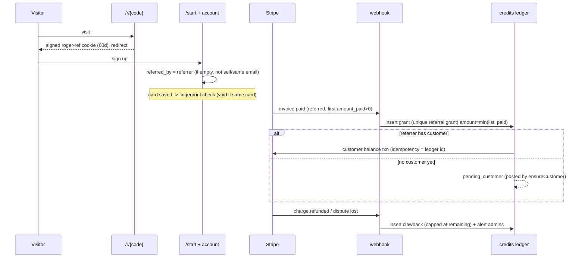

# feat: Roger v3 B2 (growth) and the intake check for Zack 2.1

## Overview

There are two deliveries:

1. **Intake check PR** (Unit 0). Its own branch off `main`, merged before anything else. It confirms that B1 intake ignores an unknown fenced block, and adds the tests that prove it. This lets Zack 2.1 ship without waiting for B2–B4.
2. **B2: growth** (Units 1–11). One branch, `feat/v3-b2-growth`, and one PR:
   - referral links and credit, with credit shown in every B1 charge display;
   - points and an opt-in leaderboard;
   - the Wednesday stats email;
   - the Season rename and the 26-week brick graph;
   - group sessions;
   - sponsors;
   - quiz question 5 offering Levels 0–9.

B3 and B4 get their own plans.

## Problem Frame

See origin: `docs/brainstorms/2026-11-27-roger-v3-b2-b3-b4-requirements.md` (R4–R15). The behaviour is specified in `artifacts/Roger v3 - design spec.md` B.15 and in B.18 checks #48, #51 and #52. Peter's decisions of November 27 cover credit as a path to free use, capped at what was paid, posted at once and clawed back if the payment is reversed. They also cover the opt-in leaderboard and quiz names with symptoms.

## Requirements Trace

| Req | What | Unit |
|---|---|---|
| R4 | Intake ignores unknown fences | 0 |
| R5 | Admin checks on the server, logged in `admin_actions` | 7, 9, 10 (all admin work) |
| R6 | `/r/{code}`, 60-day memory, first referrer wins, no self-referral, `/app/referrals` | 3 |
| R7 | Credit: amount, posting, used before the card, shown in displays | 4, 5 |
| R8 | Clawback on refund or dispute | 4 |
| R9 | Credit edge cases (no customer, closed, sponsored) | 4 |
| R10 | Wednesday stats email and its unsubscribe | 8 |
| R11 | Season rename, #51 | 2 |
| R12 | Opt-in leaderboard and points | 6, 7 |
| R13 | Group session and guests | 9 |
| R14 | Sponsors, #48 | 10 |
| R15 | Quiz Q5, Levels 0–9 with symptoms, #52 | 1b |
| R2 | Dark on production until ready | 1, and each surface |

## Scope Boundaries

- Anything in B3 or B4, including the Level line in the stats email.
- Any change to B1 behaviour beyond these deliberate touch points:
  - the credit display and invoice-balance handling (R7);
  - the unknown-block stripping before the intake model (Unit 0);
  - referral and sponsor capture in sign-up and account creation (Units 3 and 10);
  - the confirmation stamp in Cora merge (Unit 6);
  - extracting the contributor test as a pure function with unchanged behaviour (Unit 10).
- Quiz Q5 isn't behind a switch: "the B2 release" (origin R15) means the B2 merge, and sign-up as a whole stays behind `v3.signupOpen`.
- Zack 2.1 content.
- The per-run (one-list) code, which stays untouched.

## Context & Research

### Relevant Code and Patterns

- **Schema.** `db/schema.sql` is append-only below the freeze line, with dated, idempotent statements. Its rules are enforced by `db/schema.test.ts`, which also holds a per-version table list. `db/schema.pglite.test.ts` checks that a second apply changes nothing. Test databases come from `src/test-helpers/pglite-db.ts` `testDb()`.
- **Settings.** `src/lib/v3-settings.ts` `readV3Settings()` is uncached and fails closed. `src/lib/v3-settings-display.ts` serves pages. Defaults are in `src/data/config.ts` `v3Defaults`, which already has `statsAt`, `sessionDay`, `sessionTime` and `sessionLink`.
- **Cron.**
  - Schedules live in `vercel.json`. The route pattern is `src/app/api/cron/send/route.ts`: `cronAuthorized`, `cronNow`, a day-of-week guard, `readV3Settings`, then the job.
  - The clock comes from `src/lib/clock.ts` and `src/lib/cron.ts` (`asOf`, used only on preview).
  - Leases use the `leases` table, as in `src/lib/cora/merge.ts`.
  - Hourly tasks go in `src/lib/housekeeping/job.ts` `HOURLY_TASKS`.
- **Mail.**
  - Templates are in `src/lib/mail/templates/*.ts`, with `monday.ts` as the model to follow.
  - `src/lib/mail/send.ts` `sendToUser` deduplicates on `notifications (recipient, kind, ref)` and has `alertAdmins`.
  - Optional emails are wired through `optionalKinds` and `EMAIL_PREF_KEYS` in `src/lib/app/settings.ts`.
- **Stripe.**
  - Gateways: `src/lib/billing/gateway.ts` (`CardGateway`) and `src/lib/billing/subscriptions.ts` (`BillingGateway` and the others).
  - Webhooks: `src/lib/billing/webhook.ts` `handleStripeEvent`, deduplicated by `stripe_events` and replayed by `reconcileStripe`.
  - First charge: `src/lib/billing/first-charge.ts` compares `quote.totalCents` with the preview's invoice `total`, which excludes the customer balance.
  - Customers are created in `src/lib/billing/card-setup.ts` `ensureCustomer`.
  - Fakes: `src/test-helpers/fake-card-gateway.ts`, `fake-plans.ts`, `fake-adjustments.ts`.
- **Admin.** `src/lib/admin-auth.ts` `requireAdmin()`, `src/lib/admin/log.ts` (`logAdminAction`, `audited`), and the tabs array in `src/components/admin-ui.tsx`.
- **App.** `src/lib/auth/access.ts` (`requireUser`, `requireUserForAction`). The nav is `src/components/app/app-nav.tsx`. Pages call `await connection()` inside Suspense.
- **Sign-up.**
  - `src/lib/signup/params.ts` already carries `ref`, which goes into the draft cookie (`src/lib/signup/draft.ts`, 7 days) and then into `users.ref` (`src/lib/auth/login-link.ts`, `src/lib/auth/google.ts`).
  - `referred_by` and `sponsor_id` exist but nothing writes them.
  - Sponsored handling, `sponsor_id is not null`, is already read across billing and Cora (`has-card.ts`, `deliver.ts`, `charge-job.ts`, `contribution.ts`, `quote.ts`, `payment-page.ts`, `housekeeping/trial.ts`).
- **Quiz.** `src/lib/signup/quiz.ts` (level 0–8, stored in `users.profile`), `src/components/app/quiz-form.tsx`, and the v1.0 names in `src/data/agent-levels.ts` (deleted in Unit 1b).
- **History.** `src/app/app/history/page.tsx` shows a list and a count from `src/lib/app/week.ts` `bricks()`. The graph is new. The `--color-level-1..5` tokens in `src/app/globals.css` are used nowhere else.
- **Picks.**
  - "I set this up" writes `picks.setup_marked_at`.
  - **`picks.setup_confirmed_at` is never written.** Spec B.10 says "confirmed by Zack", so B2 adds that confirmation (Unit 6).
  - Contributors come from `pool_play_contributors` (`user_id::text` or `seed:<id>`).

### Institutional Learnings

- **Stripe and money.**
  - `docs/solutions/integration-issues/stripe-endive-embedded-setup-tax-promo-gotchas-2026-11-26.md`: spike the real API version, and record what it does in the fakes.
  - `docs/solutions/logic-errors/one-money-rule-two-mechanisms-double-charges-2026-11-23.md`: one mechanism (the customer balance) and one ledger row per credit, with a unique index.
  - `docs/solutions/logic-errors/retry-must-replay-claimed-parameters-2026-11-26.md`: idempotency keys with fixed parameters, and fakes that reject the same key sent with different parameters.
  - `docs/solutions/logic-errors/side-effect-tied-to-winning-transition-is-lost-2026-11-22.md`: emails and alerts re-run on every pass through the new state, and the webhook returns 500 if a send fails.
  - `docs/solutions/logic-errors/closing-an-account-must-settle-in-flight-external-flows-2026-11-26.md` and `keep-forever-guard-needs-exit-on-terminal-failure-2026-11-26.md`: settle open flows before a close, and give every "never replace" rule an exit.
- **Jobs and the database.**
  - `docs/solutions/best-practices/job-clock-not-database-now-2026-11-23.md`: write `coalesce($n::timestamptz, now())`.
  - `docs/solutions/best-practices/lease-must-guard-every-write-not-just-entry-2026-11-23.md`.
  - `docs/solutions/logic-errors/dependent-stamp-before-job-succeeds-strands-state-2026-11-26.md`.
  - `docs/solutions/best-practices/test-claim-sql-on-pglite-2026-11-22.md`: Neon HTTP has no transactions, so race claims on PGlite with `Promise.all`.
  - `docs/solutions/database-issues/data-modifying-cte-runs-even-when-insert-conflicts-2026-11-22.md`: put irreversible writes last, gated on `exists(ins)`.
- **Security.** `docs/solutions/security-issues/per-ip-lockout-blocks-everyone-behind-an-agent-platform-2026-11-22.md`: check the code first, and rate-limit only failures.
- **UI.**
  - `docs/solutions/ui-bugs/react-19-form-action-reset-brings-back-stale-defaults-2026-11-23.md`.
  - `docs/solutions/ui-bugs/stale-response-guard-not-enough-when-actions-mutate-2026-11-26.md`.
  - `docs/solutions/runtime-errors/next16-clock-read-during-render-2026-11-22.md`.
- **Edits.** `docs/solutions/developer-experience/scripted-edits-mangle-escapes-and-crlf-2026-11-22.md`: use Edit, not sed sweeps, for the token rename.

### External References

- None gathered. The local patterns are strong. Stripe customer-balance behaviour on API `2026-11-18.endive` is checked by a sandbox spike in Unit 4, as the endive learning advises.

## Key Technical Decisions

- **Credit runs through one mechanism, the Stripe customer balance, with a local ledger as the record.**
  - Each posting is a `credits` row with a unique index on `(referral_id, kind)`, where kind is `grant` or `clawback`, and a Stripe customer balance transaction whose idempotency key comes from that row.
  - Stripe applies the balance to `amount_due` automatically, and the card is charged only for what's left. This includes the first charge at the third list and the higher-rate difference line.
  - The figures "Earned" and "remaining" on `/app/referrals` come from Stripe `customer.balance`, refreshed and cached on the user, with the ledger as a fallback.
  - Why: one money rule, one mechanism; there's no coupon path to double-apply.
- **Credit posts from `invoice.paid` only, and is based on the invoice's value** (Peter, November 27).
  - It fires on the referred member's first paid invoice whose `total_excluding_tax` (subtotal after discounts, before tax) is above 0. Paying with their own earned credit still counts as paying.
  - The amount is the lesser of one month at the referrer's list price and that `total_excluding_tax`. If the currencies differ, the cap is converted at the price list's fixed 1.4 ratio (200↔280). The ratio is recorded in the code with this reason, so it isn't reopened.
  - A 100%-off invoice earns nothing. The next invoice above 0 grants, once.
  - The synchronous first-charge path doesn't post. The webhook, which `reconcileStripe` replays, is the single trigger.
  - Why: a single trigger keeps it idempotent.
- **Posting needs a saved card.** A grant posts to Stripe only when the referrer has a saved card, because the customer's currency is fixed at card save (1.4 R15). Until then it's `pending_customer`. An idempotent sweep posts pending rows, running at card-save completion and as an `HOURLY_TASKS` entry. It never runs inside `ensureCustomer`.
- **Posting is safe to replay.** Each balance transaction carries `metadata.credit_ledger_id`. Before posting a row that's still unposted, the sweep lists the customer's recent balance transactions and adopts one that already carries that id. Stripe's idempotency keys expire after 24 hours, while reconcile looks back 7 days.
- **While `v3.referralsOn` is off,** attribution still runs and grants are recorded as `pending_switch` with no Stripe call. Turning the switch on posts them through the same sweep.
- **Clawback** comes from `charge.refunded` and from `charge.dispute.closed` with status `lost`, matched by payment intent to the credited invoice (endive links charges to invoices only through invoice payments, so the grant stores `source_payment_intent`).
  - **Amount:** proportional to the refund (credit × refunded / paid), never more than the grant minus what has already been clawed back. Each row is keyed by the Stripe refund or dispute id.
  - **No debt:** the balance transaction is capped at the referrer's remaining balance, so the balance never becomes a debt. Any shortfall is recorded as `amount_uncollected` and offset against that referrer's future grants.
  - **Disputes:** `charge.dispute.created` freezes the related ungranted or unposted credit. A won dispute unfreezes it.
  - Both admins are alerted, with the shortfall shown.
  - Why: a refund or dispute is the only way a payment reverses under the no-refunds terms. Clawback limits loss but doesn't prevent it; the real anti-farming controls are the self-referral checks and the cap.
- **On account close,** pending rows lapse, and any unused posted balance is zeroed with a balance transaction recorded as a `lapse` row (origin R9).
- **Displays:** the quoted `total` stays the comparison value (no "amount changed" hold from credit). Views add "Credit applied −X · Card charged Y", using the customer balance at render time. Emails state that the credit shown is what's on the balance when the email is sent.
- **Self-referral** covers the same user, the same normalised email (lowercase, Gmail dots and plus-tags stripped), or the same `card_fingerprint` as the referrer.
  - The email check runs when the account is created.
  - The fingerprint check runs when the card is saved and voids the referral (stage `void`, no credit).
- **Referral memory** is a signed, httpOnly cookie `roger-ref` lasting 60 days, set by `/r/{code}` (and by `/g/{token}` for the inviter).
  - **Contents:** the referral code, the date it was issued and a purpose tag, signed with a dedicated key (`REF_SECRET`, falling back to the draft-cookie key).
  - **Resolved when the sign-up link is requested,** not when the account is created. The email link is often opened on another device, and `userForToken` has no cookies. The referrer and the sponsor code travel in `NewAccount` next to `ref`.
  - **One shared function** applies them in every account-creating path: `login-link.ts` `userForToken`, `google.ts` and `src/lib/signup/pilot.ts`. It acts only on newly created rows (the insert reports whether it created the row), and sets `referred_by` if it's empty (first referrer wins).
  - `/r` is a route handler: it sets the cookie and redirects to `/` or `/start`, and an unknown code gets the same redirect with no cookie.
  - The existing `ref` param keeps flowing into `users.ref` unchanged.
- **Set-up confirmation:**
  - **Trigger:** a later accepted run from the picked member whose play merges into the same `pool_play_id` stamps `picks.setup_confirmed_at` (job clock), in the merge step.
  - **Points:** that stamp gives the contributor's second point.
  - **Plays only:** matching through "Also runs" waits for Cora change 8 (B4).
- **Points are computed, not stored as events,** from picks (delivered, not dry run) joined to `pool_play_contributors`.
  - A pick counts for a contributor only if they contributed before the pick was delivered. This uses a new `pool_play_contributors.contributed_at`; existing rows are null and count as earlier than everything.
  - So the confirming merge doesn't earn the picked member points for their own earlier pick.
  - A `points` table caches weekly totals for rank and history. Past weeks in it are authoritative once written.
- **Leaderboard opt-in** is a new `users.leaderboard_opt_in_at`, set only from the leaderboard prompt. Names are unique case-insensitively among opted-in members and limited to 2–30 characters. An admin can clear one.
- **Group sessions** use `session_guests` and `sessions_attendance`. A new table isn't called `sessions`, because that name is taken by sign-in sessions.
- **Sponsors:**
  - A `sponsors` table holds the name, currency, two prices, seats, a code hash, billing email, billing address, Stripe customer, and `revoked_at`.
  - Sign-up runs through `?sponsor=` into the draft and is checked again at account creation. The seat check and the `sponsor_id` stamp happen in one statement (a CTE with the guarded write last).
  - **The monthly invoice is calendar-month, per seat** (resolving the origin's deferred question):
    - a seat is billed for a whole month once its member has had three delivered, non-dry-run list weeks;
    - **the contributor rule is applied per seat** (Peter, November 27). B1's contributor job skips sponsored members, so `src/lib/sponsors/invoice.ts` runs B1's weekly "contributed?" test, extracted from `src/lib/billing/contribution.ts` as a pure function, for each sponsored member over the calendar month. Two or more missed, unexcused weeks bill that seat at the higher price. Sponsored members get no contributor notices, and their account state is never changed;
    - the admin page prepares a draft Stripe invoice with automatic tax, and "Send" finalizes it.
- **The Wednesday stats job:**
  - **Schedule:** a new route, `/api/cron/stats`, runs every 10 minutes on Wednesdays from 12:00 to 18:00 UTC and acts after `v3.statsAt` Toronto time.
  - **`statsAt`:** `v3Schema` accepts only 08:00–12:00, which fits inside the window in both summer and winter time.
  - **Dedup and failure:** it's leased and deduplicated by `notifications (user, 'stats', <Toronto Wednesday date>)`. If the window closes with members still unsent, both admins are alerted.
  - **Who gets it:** active members (trial with a card, paying, or sponsored) who haven't turned it off.
  - **Unsubscribe:** an HMAC-signed `/u/{token}` page sets `email_prefs.stats=false`.
    - It needs a dedicated `UNSUB_SECRET`, with no fallback to `ADMIN_SECRET`. Without it the job sends nothing and alerts.
    - The key is derived per purpose (`unsub:v1`), and the token carries a key-version byte so the secret can be rotated.
    - The page sends `noindex` and `Referrer-Policy: no-referrer`.
  - **Mail transport:** a `List-Unsubscribe` header and one-click are added to the transport for this kind.
- **New per-feature switches** in `v3Schema`: `v3.referralsOn`, `v3.leaderboardOn`, `v3.statsOn` and `v3.sponsorsOn`, all off by default on production. The session card is gated by S11's settings.
- **Quiz Q5:** the stored answer gets a `levelQuiz: "1.1"` marker. The level names and symptoms come from a new `src/data/roger-levels.ts`, generated by hand from the levels file v1.1 §1. It's the seed of the B4 data file. As built, the old `agent-levels.ts` is deleted, because nothing read it. v1.0 answers (no marker) refer to the v1.0 levels file, where 8 meant "8 or above". Q5 shows each level's own description plus "Next: Level N+1 when…" (Peter, November 27), and a pre-v1.1 draft leaves Q5 unselected.

## Open Questions

### Resolved During Planning
- **Sponsor billing period:** calendar month, a whole month per active seat, and B1's contributor result per seat.
- **Stats job timing:** Wednesday, every 10 minutes from 13:00 to 17:00 UTC, gated by `v3.statsAt`, clear of the Monday window.
- **Credit idempotency:** a single trigger (`invoice.paid`), plus a unique ledger row and a key derived from it.
- **Where set-up confirmation comes from:** a merge into the same pool play.

### Deferred to Implementation
- **Stripe shapes.** The sandbox spike in Unit 4 confirms the following on endive, and the fakes are updated to match what's observed:
  - the shapes of balance transactions, invoice payments and disputes;
  - that the balance applies to a first subscription invoice created with `error_if_incomplete`, and that a $0 `amount_due` leaves the subscription active with no payment attempt;
  - that `total_excluding_tax` is the figure to use.
- **The `List-Unsubscribe` header.** Whether the current mail transport supports custom headers, or needs a small extension.

## High-Level Technical Design

> *This illustrates the intended approach and is directional guidance for review, not implementation specification. The implementing agent should treat it as context, not code to reproduce.*



## Implementation Units

- [ ] **Unit 0: Intake ignores unknown fenced blocks (separate PR off `main`)**

**Goal:** Prove, and harden, that a run or profile carrying a ` ```roger-level ` (or any unknown) fence is accepted unchanged, and that the unknown block never reaches the model or the FIGURES check.

**Requirements:** R4, build spec T3.

**Dependencies:** None. Branch `fix/intake-ignore-unknown-blocks` off `main`.

**Files:**
- Modify: `src/lib/intake/process.ts` (strip unknown `roger-*` fences other than `roger-run` and `roger-profile` before `readWithModel`, `slicePlaybook` and `statedIn`)
- Modify: `src/lib/intake/parse-block.ts` (a helper that removes the known private fences)
- Test: `src/lib/intake/process.test.ts`, `src/lib/intake/parse-block.test.ts`

**Approach:**
- The parser already ignores unknown fences. The only real gap is the model-fallback path, which sends the raw text. Remove the unknown `roger-*` fenced blocks from the text passed to the model and to the figures checks, so private inventory is never read by the model and its numbers can't make a figure count as "stated".

**Patterns to follow:**
- The `report()` and `fakeModel()` helpers in `src/lib/intake/process.test.ts`.

**Test scenarios:**
- Happy path: a `roger-run` block plus a `roger-level` block is accepted, and the parsed plays are the same as without the level block.
- Happy path: with no `roger-run` block plus a `roger-level` block, the model is called and the captured text doesn't contain the level block's contents.
- Edge case: a figure that appears only inside the `roger-level` block isn't counted as stated.
- Happy path: a `roger-profile` plus a `roger-level` block in a profile submission is accepted, and the profile fields are unchanged.
- Edge case: a malformed or unclosed unknown fence doesn't break parsing of the run block.

**Verification:** The tests pass. The PR is open and can merge on its own.

- [x] **Unit 1: B2 schema and settings switches**

**Goal:** Add every B2 table and column, and the per-feature switches.

**Requirements:** R2, plus the data foundation for R6–R14.

**Dependencies:** None (B2 branch).

**Files:**
- Modify: `db/schema.sql` (append the dated B2 section)
- Modify: `db/schema.test.ts` (B2 table list), `src/lib/v3-settings.ts`, `src/data/config.ts`
- Test: `db/schema.test.ts`, `db/schema.pglite.test.ts`, `src/lib/v3-settings.test.ts`

**Approach:**
- New tables:
  - `referrals`: referrer, referred user or email, source (`link`, `guest`), generation, stage (`invited`, `trial`, `paying`, `void`), void reason and dates. `referred_user` is unique.
  - `credits`: a ledger with referral, kind (`grant`, `clawback`, `lapse`), amount, `amount_uncollected`, currency, and status (`pending_customer`, `pending_switch`, `frozen`, `posted`, `lapsed`). It also holds the Stripe transaction id, `source_payment_intent`, the source Stripe object id and dates. Grants are unique per referral (`(referral_id) where kind='grant'`); clawbacks are unique per `(referral_id, source_object_id)`.
  - `points` (cache), `session_guests` (token stored hashed), `sessions_attendance` and `sponsors`.
- New columns:
  - on `users`: `leaderboard_opt_in_at`, plus `credit_balance_cents` and `credit_balance_at` (a cache of Stripe's balance);
  - on `pool_play_contributors`: `contributed_at`;
  - `email_prefs.stats`, a key in the JSON that defaults to true.
- A unique index on `users.referral_code` already exists, so codes are backfilled lazily, and the stats job also creates them.
- **Gating:** every B2 surface is also behind the existing `v3.signupOpen` / `v3.cycleLive` switches as well as its own (origin R2). A switch that's off hides its surface; pages and jobs read the switches in later units.

**Patterns to follow:**
- The dated append sections at the end of `db/schema.sql`, and the B1 table-list assertion.

**Test scenarios:**
- Happy path: the schema applies twice on PGlite with no change, and the B2 tables exist.
- Edge case: a second `credits` row with the same `(referral_id, kind)` is rejected.
- Happy path: the new switches parse, with defaults off, and an invalid value fails closed.

**Verification:** The schema tests and the settings tests pass.

- [x] **Unit 1b: Quiz question 5, Levels 0–9 with symptoms**

**Goal:** Acceptance #52.

**Requirements:** R15.

**Dependencies:** Unit 1.

**Files:**
- Create: `src/data/roger-levels.ts` (levels 0–9: name, one-line description, the "you need it when…" symptom, from levels file v1.1 §1)
- Modify: `src/lib/signup/quiz.ts` (accepts 0–9 and stores `levelQuiz: "1.1"`), `src/components/app/quiz-form.tsx`
- Test: `src/lib/signup/quiz.test.ts`, `src/components/app/quiz-form.test.tsx` (create if missing)

**Approach:**
- Show each option as "Level N · Name", with its symptom underneath.
- Readers of an old "8" without the version marker treat it as "8 or above". No backfill.
- Check the copy against the symptom column of the levels file word for word.

**Patterns to follow:**
- The existing quiz tests ("takes levels 0 to 8 only" becomes 0 to 9).

**Test scenarios:**
- Happy path: level 9 is accepted and stored with `levelQuiz: "1.1"`.
- Error path: 10 or −1 is rejected with the level error.
- Happy path: the form renders ten options, each with the symptom text for its level.
- Edge case: a draft cookie saved before the change with `level: 8` still resumes.

**Verification:** #52. The quiz works on a mobile viewport.

- [x] **Unit 2: Season rename and the 26-week brick graph**

**Goal:** Acceptance #51, plus the compounding graph on `/app/history`.

**Requirements:** R11.

**Dependencies:** Unit 1.

**Files:**
- Modify: `src/app/globals.css` (`--color-level-*` becomes `--color-season-*`, using the Edit tool)
- Modify: `src/app/app/history/page.tsx`, `src/lib/app/week.ts` (weekly brick series)
- Create: `src/components/app/brick-graph.tsx`
- Test: `src/lib/app/week.test.ts`, `src/components/app/brick-graph.test.tsx`

**Approach:**
- **The graph is new:** B1 shows only a list and a count, and origin R11's "the brick graph" refers to the graph B2 builds.
- **Series:** bricks (one per idea set up), cumulative within the current Season, per week since the member's first delivered list.
- **Seasons:** each Season is 26 weeks, and the graph starts again at 0 for each new Season, as in spec B.15 ("After week 26 the graph starts again in the next Season's colour"). The line is drawn in `--color-season-{n}` (capped at 5), a larger marker shows the current week, and the lifetime total is shown as text.
- **Chart:** an inline SVG with an accessible label and a text summary.
- **Wording:** the page copy says "Season", and "Level" doesn't appear.

**Patterns to follow:**
- The existing `bricks()` query, and design system 0.7.

**Test scenarios:**
- Happy path: 3 set-ups across weeks 1, 2 and 4 give a series of 1, 2, 2, 3.
- Edge case: week 27 starts Season 2 (a new colour) and the count restarts on the chart.
- Edge case: week 200 caps at Season 5.
- Edge case: a member with no delivered lists sees an empty state with no graph.
- Happy path: the rendered history page contains no "Level" text.

**Verification:** #51. The graph is readable at 375px wide and in both themes.

- [x] **Unit 3: Referral links, attribution, self-referral and `/app/referrals`**

**Goal:** R6, with stages tracked.

**Requirements:** R6, R9 (the sponsored side).

**Dependencies:** Unit 1.

**Files:**
- Create: `src/app/r/[code]/route.ts`, `src/lib/referrals/code.ts` (generation and lookup), `src/lib/referrals/attribution.ts`, `src/lib/referrals/stage.ts`
- Create: `src/app/app/referrals/page.tsx`, `src/components/app/referrals-panel.tsx`
- Modify: `src/app/start/actions.ts` (resolve the referrer and the sponsor code when the sign-up link is requested, and carry them in `NewAccount`), `src/lib/signup/account.ts`, `src/lib/auth/login-link.ts` `userForToken`, `src/lib/auth/google.ts`, `src/lib/signup/pilot.ts` (all call the shared attribution function on newly created rows only), `src/lib/billing/card-setup.ts` (fingerprint void check), `src/components/app/app-nav.tsx`
- Test: `src/lib/referrals/attribution.test.ts`, `src/lib/referrals/stage.test.ts`, `src/app/r/[code]/route.test.ts`, `src/app/app/referrals/page.test.tsx`

**Approach:**
- **Codes:** 10 characters of unguessable base32, made lazily the first time `/app/referrals` is viewed (a race-safe upsert).
- **Cookie:** signed, httpOnly, SameSite=Lax, 60 days. The first referrer wins: a newer `/r` visit doesn't overwrite an existing valid cookie.
- **Account creation:** set `referred_by` if it's empty and the referrer isn't the same user or the same normalised email.
  - If an `invited` row from the same referrer exists for this normalised email (a guest), promote it to `trial`. Otherwise insert one at `trial`.
  - A guest invited by referrer A who arrives through B's link keeps whichever referrer was resolved first: the cookie, unless it's absent, then the invitation.
- **Card save:** if the fingerprint matches the referrer's, set the stage to `void`.
- **Stages:** these advance on lifecycle hooks: account created → `trial`, first paid invoice → `paying` (Unit 4). Guest invitations create `invited` rows (Unit 9).
- **The page:** link with Copy, the referral script (spec copy), and a list of referred people with stage and credit.
  - People referred by link are shown as "Someone you invited", and guests by the name the member typed.
  - Emails never appear on the page, and neither does any name the referred person entered themselves.
- **Switch:** with `v3.referralsOn` off, the page and link render "coming soon", and `/r` still stores the cookie so links shared early aren't lost.
- **One switch helper** (from the Unit 1 review): add a single helper that combines a feature switch with `v3.signupOpen` / `v3.cycleLive`. Every B2 surface uses it.
- **Retention** (from the Unit 1 review):
  - When a referral links to an account, `referred_email` is nulled.
  - Unlinked `invited` rows lose their email after 90 days, via `src/lib/housekeeping/retention.ts`.
  - When a referred account is deleted, the referral is voided.
  - Each of these has a test.

**Patterns to follow:**
- `src/lib/signup/params.ts`, the cookie handling in `src/lib/signup/draft.ts`, and `requireUser` pages.

**Test scenarios:**
- Happy path: visiting `/r/{valid}` sets the cookie and redirects, and signing up within 60 days sets `referred_by` and a `trial` referral.
- Integration: the email sign-up link is requested on the browser that has the cookie and opened on another one without it. The referral still applies, because it travels in `NewAccount`.
- Edge case: an existing member signing in again through a link with a referral cookie gets no referral (the row isn't newly created).
- Happy path: a Google sign-up and a pilot account each apply attribution through the shared function.
- Edge case: an unknown code redirects the same way and sets no cookie.
- Edge case: a second `/r` visit with a different code keeps the first.
- Edge case: a cookie 61 days old is ignored.
- Error path: the referrer signing up through their own link gets no referral.
- Error path: `jane.doe+x@gmail.com` referred by `janedoe@gmail.com` gets no referral.
- Error path: a card fingerprint that matches the referrer's voids the referral.
- Integration: two concurrent first visits to `/app/referrals` produce one code.
- Happy path: the page lists referred people with their stages, and no email appears in the HTML.

**Verification:** Attribution works end to end in a PGlite test from cookie to user row.

- [x] **Unit 4: Referral credit ledger, posting and clawback**

**Goal:** R7 (posting), R8 and R9.

**Requirements:** R7, R8, R9.

**Dependencies:** Unit 3.

**Files:**
- Create: `src/lib/referrals/credit.ts` (grant, post, clawback, lapse), `src/lib/referrals/credit.test.ts`
- Modify: `src/lib/billing/webhook.ts` (`invoice.paid` → grant; add `charge.refunded`, `charge.dispute.created` and `charge.dispute.closed`), `src/lib/billing/reconcile.ts` (add those three to `HANDLED_EVENT_TYPES`), `src/lib/billing/gateway.ts` (create a balance transaction with metadata, list balance transactions, get the balance, and get an invoice with `payments` expanded), `src/lib/billing/card-setup.ts` (run the pending sweep when a card save completes), `src/lib/housekeeping/job.ts` (the pending sweep in `HOURLY_TASKS`), `src/lib/housekeeping/*` (lapse on close), `src/test-helpers/fake-card-gateway.ts`
- Test: `src/lib/billing/webhook.test.ts`, `src/lib/billing/reconcile.test.ts`, `src/lib/referrals/credit.test.ts`

**Approach:**
- **Spike first.** In the Stripe sandbox, on endive, confirm:
  - that a negative customer balance transaction is applied to the next invoice's `amount_due`, including the first subscription invoice under `error_if_incomplete`, and that a $0 `amount_due` leaves the subscription active;
  - what `total_excluding_tax` looks like when the payer's own balance was used, and how an invoice links to its payment intent through invoice payments;
  - the shapes of refunds, `dispute.created` and `dispute.closed`.

  Record the findings in the fakes and in a short note in the PR.
- **Grant** (see Key Technical Decisions for the amount): when the referred member's first invoice with `total_excluding_tax > 0` is paid, and the referral isn't void, and the referred member isn't sponsored on the invoice date:
  - compute the amount, less any `amount_uncollected` that referrer owes from earlier clawbacks;
  - insert the ledger row (unique) with `source_payment_intent`, and the irreversible Stripe call comes last;
  - post with metadata `credit_ledger_id`, or mark `pending_customer` (no saved card) or `pending_switch` (`v3.referralsOn` off);
  - set the referral stage to `paying`;
  - send the referrer a "you earned a credit" notification, keyed by the notification claim and re-sent on replay.
- **Pending sweep:** posts `pending_customer` rows for referrers who now have a saved card, and `pending_switch` rows once the switch is on. It adopts any existing balance transaction that carries the row's ledger id.
- **Clawback:** a refund, or a dispute closed as lost, on the credited payment intent inserts a proportional clawback row keyed by the refund or dispute id. It posts a positive transaction capped at the remaining balance, records any shortfall, and alerts the admins. `dispute.created` freezes an unposted grant, and a won dispute unfreezes it.
- **Lapse:** closing an account marks pending rows `lapsed` and zeroes any unused posted balance with a `lapse` row.
- **Sponsored:** a sponsored referrer's grant is recorded as `lapsed` with reason `sponsored`. A sponsored referred member never triggers a grant.
- **From the Unit 1 review:**
  - The ledger outlives account deletion: `credits` foreign keys are set to null on delete. `deleteAccount` (`src/lib/admin/users.ts`) refuses while any credit is `pending_customer`, `pending_switch` or `frozen`.
  - A shortfall offset is recorded on the consuming grant (`offset_cents`), and what's outstanding is `sum(uncollected_cents) - sum(offset_cents)`.
  - Every ledger timestamp is written from the job clock.
  - A lapse row's `source_object_id` is the close event's key.
  - Once a referral or user is deleted, their key column is null and the unique indexes no longer dedupe. Webhook handlers therefore look up an existing clawback or lapse by `source_object_id` alone before inserting.
  - A referral is required on every kind except `lapse`. The database no longer enforces this after the change to set-null deletes, so the code does.
- **From the Unit 3 review:**
  - The move to `paying` and the grant happen in one statement, guarded on `stage = 'trial'`.
  - That statement re-runs the same-card check (referrer's fingerprint against the referred member's) and refuses the grant on a match. Older members with no stored fingerprint can't be checked; that gap is accepted.
  - The grant skips a referral whose `referrer_id` is null (referrer deleted) and a referrer whose account is closed.
  - **Late attribution:** the hourly retry can record a referral after the referred member's first invoice was paid. So the grant is also attempted whenever a referral is recorded (the same idempotent grant path), not only on `invoice.paid`. Test: a referral recorded after payment still grants once.
  - Give the pending-referral retry an attempt cap, so permanently failing rows can't starve newer ones.
  - The void sweeps only touch `invited` and `trial`. A `paying` row that later shares a card with its referrer alerts the admins rather than being voided. Whether to claw that credit back is the admin's call.

**Execution note:** Write the ledger and webhook tests first, against fakes that reject a reused idempotency key sent with different parameters.

**Patterns to follow:**
- `settleFromInvoice` in `webhook.ts`, the `claimEvent` dedup, `docs/solutions/database-issues/data-modifying-cte-runs-even-when-insert-conflicts-2026-11-22.md`, and `docs/solutions/logic-errors/side-effect-tied-to-winning-transition-is-lost-2026-11-22.md`.

**Test scenarios:**
- Happy path: a referred CAD member's first invoice paid at CA$280 gives the CAD referrer a CA$280 credit, posted to the balance.
- Edge case: a promo makes the referred member's first invoice CA$140, so the credit is CA$140.
- Edge case: the referred member's own credit covers CA$270 of a CA$280 invoice, and the referrer still earns CA$280 (it's based on invoice value).
- Edge case: a USD referrer and a CAD payer at CA$280 give the referrer US$200.
- Edge case: a 100%-off first invoice gives no grant. The next invoice above 0 grants, and only once.
- Edge case: a referrer without a saved card gets a pending grant, which posts at card save and then comes off their first invoice.
- Edge case: a grant recorded while `v3.referralsOn` is off is `pending_switch`, and turning the switch on posts it once.
- Error path: the Stripe call succeeds but the response is lost. A replay more than 24 hours later adopts the existing transaction (by metadata) and doesn't post twice.
- Edge case: a partial refund of half the payment claws back half the credit. A later lost dispute on the rest claws back the remainder, and never more than the grant.
- Edge case: a clawback larger than the remaining balance leaves the balance at 0 and records the shortfall, which the referrer's next grant reduces.
- Edge case: `dispute.created` before posting freezes the grant, and a won dispute posts it.
- Integration: reconcile replays a missed `charge.dispute.closed` and the clawback happens once.
- Edge case: the same `invoice.paid` delivered twice (or replayed by reconcile) gives one ledger row and one Stripe call.
- Edge case: a referrer with no customer gets a `pending_customer` row. Saving their card posts it once.
- Edge case: a closed referrer's pending row lapses and never posts, and their unused posted balance is zeroed.
- Error path: if the Stripe balance call fails, the ledger row stays unposted, the webhook returns 500, and the retry posts with the same key.
- Happy path: a dispute lost on the credited charge claws back the full amount when the balance covers it.
- Edge case: when the remaining balance is lower than the credit, the clawback is capped and the balance ends at 0, never in debt.
- Error path: a refund on an unrelated invoice does nothing.
- Edge case: a sponsored referred member gives no grant, and a sponsored referrer's grant is lapsed.
- Integration: after a grant, the referrer's next subscription invoice in the fake charges the card the total minus the credit.

**Verification:** All the money tests pass, and the spike results are noted in the PR.

- [x] **Unit 5: Credit shown in every B1 charge display**

**Goal:** Members see the credit applied and the amount the card is charged. This creates no "amount changed" hold.

**Requirements:** R7 (displays).

**Dependencies:** Unit 4.

**Files:**
- Modify: `src/lib/billing/payment-view.ts`, `src/lib/billing/quote.ts`, `src/lib/app/billing.ts`, `src/components/app/billing-panel.tsx`, `src/lib/billing/first-charge.ts` (the "subscribed" email's amounts only), plus `quote.ts`, `charges.ts`, `held.ts`, `held-reminder.ts`, `renewal.ts`, `invoice-itemised.ts` and the subscribed-email template (all in `src/lib/mail/templates/`). Leftover per-run order invoices also consume the balance, which is acceptable, and their displays are left as they are because nothing offers them.
- Create: `src/lib/billing/credit-lines.ts` (the shared pure helper and every label), `src/lib/billing/credit-display.ts` (`displayCredit` from the cache, `emailCredit` live with the cache as fallback, `cacheInvoiceBalance`)
- Modify (review round): `src/lib/app/status.ts` (the three told-first-charge lines, credit passed through `StatusFacts` from `src/lib/app/home.ts`, `src/lib/cora/send-job.ts` and `src/lib/admin/user-detail.ts`), `src/lib/billing/switch.ts` (the plan-changed email's first charge), `src/lib/billing/webhook.ts` (cache each `invoice.finalized`/`invoice.paid` ending balance), `src/lib/billing/subscriptions.ts` (invoice credit and card figures), `src/lib/billing/payment-page.ts` and `src/app/start/payment/page.tsx` (`paymentCredit`), `src/app/app/billing/page.tsx`, `src/lib/housekeeping/job.ts`, `src/app/api/cron/send/route.ts`, `src/app/app/zack/actions.ts` (live balance for the emails), `artifacts/wording-signoff.md` (section 9)
- Test: the matching `*.test.ts` files, and `src/lib/billing/first-charge.test.ts`, `src/lib/billing/credit-lines.test.ts`, `src/lib/billing/credit-display.test.ts`, `src/lib/mail/templates/charge-templates.snapshot.test.ts` (no-credit output recorded from B1)

**Approach:**
- A shared helper returns `{ totalCents, creditAppliedCents, cardChargedCents }` from the preview total and the cached or fresh customer balance.
- Each display adds the two lines only when the credit is above 0.
- Receipts use the paid invoice's real figures (`starting_balance` and `ending_balance`).
- `first-charge.ts` comparison logic is unchanged.

**Test scenarios:**
- Happy path: with a CA$280 credit and a CA$316.40 total, the 48-hour email shows "Credit applied −CA$280.00 · Card charged CA$36.40".
- Edge case: when the credit is more than the total, the card is charged CA$0.00 and the remaining credit is shown.
- Edge case: no credit gives the output unchanged (a snapshot of the existing templates).
- Integration: a credit posted between the quote and the charge gives no `amount_changed` hold.

**Verification:** The B1 billing tests still pass, and the new cases pass.

- [ ] **Unit 6: Set-up confirmation and points**

**Goal:** A data source for both leaderboard points.

**Requirements:** R12 (points).

**Dependencies:** Unit 1.

**Files:**
- Modify: `src/lib/cora/merge.ts` (add a `now` option to `mergePending`. Inside the `placed` CTE of the match branch, so it runs only when the claim wins, stamp `picks.setup_confirmed_at` with `coalesce($n::timestamptz, now())` and set `pool_play_contributors.contributed_at` on insert.)
- Modify: `src/lib/cora/job.ts`, `src/lib/cora/seed-import.ts` (pass `now`)
- Create: `src/lib/growth/points.ts` (computes each contributor's points; refreshes the `points` cache), `src/lib/cora/merge.test.ts`
- Test: `src/lib/cora/merge.test.ts`, `src/lib/growth/points.test.ts`

**Approach:**
- Confirmation uses the job clock, applies only to picks delivered before the run, and is stamped once.
- Points: 1 per delivered, non-dry-run pick of a play that the member contributed to, for another member; plus 1 when that pick is confirmed.
- Seed contributors (`seed:` records) score only once an admin links them to an account.
- `/app/history` already shows "confirmed by Zack" from `week.ts`, so this lights it up.

**Test scenarios:**
- Happy path: A's play is picked for B, then B's next run merges into it: the pick is confirmed and A has 2 points.
- Edge case: a pick of A's own play for A gives no point.
- Edge case: dry-run picks are excluded, and a second matching run doesn't stamp again.
- Edge case: a run accepted before the pick was delivered doesn't confirm it.
- Edge case: a play with two contributors gives each of them the points.
- Edge case: C becomes a contributor in week 10, so C gets no points for picks of that play delivered in weeks 1–9.
- Edge case: B's confirming merge makes B a contributor, but B earns nothing for their own earlier pick.

**Verification:** Point totals match a hand calculation on a seeded week.

- [ ] **Unit 7: Leaderboard (opt-in)**

**Goal:** `/app/leaderboard` with an explicit opt-in.

**Requirements:** R12.

**Dependencies:** Unit 6.

**Files:**
- Create: `src/app/app/leaderboard/page.tsx`, `src/app/app/leaderboard/actions.ts`, `src/lib/growth/leaderboard.ts`
- Modify: `src/components/app/app-nav.tsx`, `src/app/admin/users/[id]/page.tsx` (a "Clear display name" admin action, logged)
- Test: `src/lib/growth/leaderboard.test.ts`, `src/app/app/leaderboard/actions.test.ts`

**Approach:**
- The board shows opted-in members ranked by points, with counts only ("2 users adopted your idea").
- A member who isn't opted in sees their own points and rank privately, plus a form to choose a name and join.
- Leaving clears `leaderboard_opt_in_at`.
- Name uniqueness is enforced by the `users_leaderboard_name` unique index (Unit 1). The action catches the unique violation and shows "That name is taken", not a 500 error.
- The rank used in the stats email is computed across every member, so it means the same thing whether or not the member is opted in.

**Patterns to follow:**
- Settings actions with `requireUserForAction`, and `docs/solutions/ui-bugs/react-19-form-action-reset-brings-back-stale-defaults-2026-11-23.md`.

**Test scenarios:**
- Happy path: opting in with "Ken R." makes the member appear at their rank.
- Edge case: a member with `display_name` already set but not opted in doesn't appear.
- Error path: a name already taken case-insensitively by an opted-in member is rejected with a message. A name of 1 or 31 characters is rejected.
- Happy path: leaving removes the member from the board.
- Happy path: an admin clearing a name removes the member from the board and logs the action.
- Edge case: no names of the adopting members appear anywhere in the HTML.

**Verification:** The page works on a phone, and is hidden when `v3.leaderboardOn` is off.

- [ ] **Unit 8: Wednesday stats email and unsubscribe**

**Goal:** R10.

**Requirements:** R10.

**Dependencies:** Units 2, 3, 4, 6 and 7. The job calls Unit 3's race-safe code upsert for any recipient without a code, and uses Unit 7's rank.

**Files:**
- Create: `src/app/api/cron/stats/route.ts`, `src/lib/growth/stats-job.ts`, `src/lib/mail/templates/stats.ts`, `src/lib/mail/unsubscribe.ts`, `src/app/u/[token]/page.tsx`, `src/app/u/[token]/actions.ts`
- Modify: `vercel.json`, `src/lib/mail/send.ts` (`optionalKinds` stats, the `List-Unsubscribe` header), `src/lib/app/settings.ts` (`EMAIL_PREF_KEYS`)
- Test: `src/lib/growth/stats-job.test.ts`, `src/lib/mail/templates/stats.test.ts`, `src/lib/mail/unsubscribe.test.ts`

**Approach:**
- **Content:** Season, bricks, points, rank, credit balance, and an invitation link (`/r/{code}`).
- **Job:** leased, uses the job clock, and deduplicated by week. A member who turns it off in settings or through `/u` is skipped. Dry run on preview.
- **Unsubscribe:** the token is an HMAC of (user id, `stats`), with no expiry and constant-time compare. The page confirms with one button (a POST), and one-click POST is supported for the header.

**Patterns to follow:**
- `src/app/api/cron/send/route.ts`, `src/lib/cora/send-job.ts` and `src/lib/mail/templates/monday.ts`.

**Test scenarios:**
- Happy path: on Wednesday after 09:00 Toronto, one email goes to each active member. A second run sends nothing.
- Edge case: before `statsAt`, or on a day other than Wednesday, nothing is sent.
- Error path: setting `statsAt` to 13:30 is rejected by the settings schema.
- Error path: with `UNSUB_SECRET` unset, nothing is sent and the admins are alerted.
- Edge case: when the window closes with recipients still unsent, the admins are alerted once.
- Happy path: a member who never opened `/app/referrals` gets a code made, and the email carries their link.
- Edge case: trial members without a card and closed members are skipped, and sponsored members are included.
- Happy path: a valid token turns stats off, and Monday emails are still sent.
- Error path: a tampered token shows a generic error and changes nothing.
- Edge case: with `v3.statsOn` off, nothing is sent.
- Happy path: the email contains the member's `/r` link and no "Level" text.

**Verification:** A test run with `asOf` on preview sends to the test members.

- [ ] **Unit 9: Group session card and guests**

**Goal:** R13.

**Requirements:** R13, R5.

**Dependencies:** Unit 3 (guest → referral).

**Files:**
- Create: `src/app/app/sessions/page.tsx`, `src/app/app/sessions/actions.ts`, `src/lib/growth/sessions.ts`, `src/app/g/[token]/page.tsx`, `src/lib/mail/templates/guest-invite.ts`, `src/app/admin/sessions/page.tsx`, `src/app/admin/sessions/actions.ts`
- Modify: `src/components/app/app-nav.tsx`, `src/components/admin-ui.tsx`
- Test: `src/lib/growth/sessions.test.ts`, `src/app/app/sessions/actions.test.ts`, `src/app/admin/sessions/actions.test.ts`

**Approach:**
- **The next session** is computed from `sessionDay` and `sessionTime` in Toronto time, with an .ics "Add to calendar" link.
- **Who sees it:** paying and sponsored members see the card. Trial members see it greyed out, with "Opens when you subscribe". It's hidden while any of S11's settings is empty.
- **Guests:**
- A member invites one guest per session (name and email), up to a global cap of 50 guest emails a day.
  - This creates a `session_guests` row and a `referrals` row at stage `invited`, source `guest`, and emails the guest.
  - The token is 128-bit random and stored hashed.
  - No email goes to an address that has unsubscribed or bounced.
  - Unconverted guest rows and their emails are purged 90 days after the session (`session_date`), by `src/lib/housekeeping/retention.ts`, with a test.
- `/g/{token}` shows the session's day and time and the inviter's display name, or "A Roger member" (origin R13: display name only).
  - The Meet link appears once the guest RSVPs.
  - Visiting sets the signed `roger-ref` cookie for the inviter if none is set.
  - The page expires after the session, sends `noindex` and `no-referrer`, and an unknown token gets a generic page.
- **Admin:** the admin page ticks who attended (`sessions_attendance`), and each action is logged.

**Test scenarios:**
- Happy path: a paying member sees the next Tuesday session and the Meet link.
- Edge case: a trial member sees the card greyed out with no link in the HTML.
- Edge case: when settings are empty, the card is hidden.
- Error path: a second guest invitation for the same session is rejected.
- Happy path: a guest opens `/g/{token}` and sees the session. After the session it shows "This session has passed".
- Happy path: a guest who then signs up through the cookie set by `/g` becomes the inviter's referral. The `invited` row is promoted to `trial`, with no second row.
- Edge case: before the RSVP, the page HTML has no Meet link.
- Edge case: after 90 days an unconverted guest's email is gone.
- Happy path: an admin ticks attendance and the action is logged with the admin's email.

**Verification:** The card and the guest flow work on a phone.

- [ ] **Unit 10: Sponsors**

**Goal:** R14, acceptance #48.

**Requirements:** R14, R5.

**Dependencies:** Unit 1.

**Files:**
- Create: `src/app/admin/sponsors/page.tsx`, `src/app/admin/sponsors/actions.ts`, `src/lib/sponsors/sponsors.ts`, `src/lib/sponsors/invoice.ts`
- Modify: `src/lib/billing/contribution.ts` (extract the weekly "contributed?" test, with behaviour unchanged and covered by its existing tests), `src/lib/signup/params.ts` (`sponsor`), `src/lib/signup/draft.ts`, `src/lib/auth/login-link.ts`, `src/lib/auth/google.ts`, `src/lib/billing/gateway.ts` (sponsor customer, draft invoice, finalize), `src/components/admin-ui.tsx`, the sign-up copy where Step 3 mentions the card
- Test: `src/lib/sponsors/sponsors.test.ts`, `src/lib/sponsors/invoice.test.ts`, `src/app/admin/sponsors/actions.test.ts`, `src/app/start/actions.test.ts`

**Approach:**
- **Creating a sponsor:**
  - The admin creates the sponsor; the code is generated, 12 characters of base32, and shown once, with only its hash stored. The Stripe customer is created with the billing email and address.
  - The sponsor can be revoked or have its seats edited, and an admin can release one member's seat.
  - **Logging:** create, revoke, seat edit, seat release, prepare and send are all logged through `logAdminAction` / `audited` with the sponsor id, and never with the plaintext code.
  - **The code in transit:** `/start` captures `?sponsor=` into the signed draft cookie, then redirects to a clean URL, so the code leaves the address bar and browser history.
- **Sign-up:**
  - `?sponsor={code}` → draft → account creation. In one statement, check that the sponsor isn't revoked and has a free seat, then set `sponsor_id`.
  - An invalid or full code shows a uniform message ("This sponsor link isn't valid. Write to us"), and sign-up continues as a normal trial. Code failures are rate-limited per IP; correct codes are never limited.
  - At 80% of the seats, the admins are alerted.
- **What sponsored members see:** Step 3 shows no prices or card copy. The existing B1 sponsored paths handle the rest (no teaser, no Payment).
- **Monthly invoice:** for each sponsor and calendar month, the admin page lists the active seats: a member who had three delivered, non-dry-run list weeks by the end of the month and who isn't closed.
  - Each seat's price comes from the per-seat contributor test (Key Technical Decisions). The test is extracted as a pure function from `src/lib/billing/contribution.ts`, and B1's own job keeps calling it with unchanged behaviour.
  - "Prepare invoice" creates a Stripe draft with one line per price tier (quantity × price), automatic tax, and idempotency per (sponsor, month).
  - "Send" finalizes and sends it. Both actions are logged.

**Patterns to follow:**
- `requireAdmin` and `logAdminAction`, the `src/lib/admin/*` pages, and `docs/solutions/database-issues/data-modifying-cte-runs-even-when-insert-conflicts-2026-11-22.md` for the seat claim.

**Test scenarios:**
- Happy path: signing up with a valid code makes a sponsored member who never sees a teaser or Payment and gets their list on the first Monday (#48).
- Error path: a revoked code, or a code with every seat taken, gives a normal trial and the uniform message.
- Integration: two concurrent sign-ups racing for the last seat give exactly one sponsored member.
- Edge case: reaching 8 of 10 seats alerts the admins once.
- Happy path: in November, with 3 seats active, one of whose members missed 2 unexcused weeks, the draft has 2×standard plus 1×higher, in the sponsor's currency, with tax. That member gets no notice and their account is unchanged.
- Edge case: one missed week, or an excused week, keeps the seat at standard.
- Edge case: the existing `contribution.test.ts` tests pass unchanged after the extraction.
- Edge case: the `admin_actions` row for creating a sponsor doesn't contain the code.
- Happy path: `/start?sponsor=X` redirects to a clean URL with the code kept in the draft.
- Edge case: a member whose third list comes in December isn't billed for November.
- Edge case: preparing the same month twice gives one draft.
- Error path: a non-admin calling the actions is refused.

**Verification:** The admin flow works in test mode, and #48 passes.

- [ ] **Unit 11: Docs write-back and launch list**

**Goal:** Keep the spec and the launch list true.

**Requirements:** Every R, plus the repo convention of written-back as-built notes (design spec 1.2/1.4).

**Dependencies:** Units 1–10.

**Files:**
- Modify: `artifacts/Roger v3 - design spec.md` (a "What changed in 1.6" note for the B2 as-built decisions: credit rules, opt-in, sponsor billing period, `v3.*On` switches, and the `/u` unsubscribe)
- Modify: `artifacts/launch-list.html`. Add these items:
  - the sandbox Stripe spike result;
  - `UNSUB_SECRET` and `REF_SECRET`;
  - **apply `db/schema.sql` (setup.mjs) to roger-db before merging B2**, because nothing applies it on deploy, and the hourly referral tasks read new columns;
  - one launch caution: **referral credit paid from earned credit chains**. Peter chose invoice value, so one cash payment can fund several months down a chain of referrals. Add `charge.refunded`, `charge.dispute.created` and `charge.dispute.closed` on both endpoints to S16.

**Test expectation:** none, because these are documentation only.

**Verification:** The spec's B.15 rows point to 1.6 notes for every place this build differs from it.

## System-Wide Impact

- **Interaction graph:**
  - The webhook gains three event types.
  - `ensureCustomer` gains the pending-credit post.
  - Cora merge gains the confirmation stamp.
  - Account creation (both sign-in paths) gains attribution and sponsor stamping.
- **Error propagation:** a Stripe failure while posting returns 500 to the webhook, so Stripe retries. Housekeeping reconcile replays missed events.
- **State lifecycle risks:**
  - Credit is posted once (a unique ledger row plus an idempotency key).
  - The last-seat race is handled by a single statement.
  - Clawback is capped, never a debt.
- **API surface parity:** every account-creating path (`login-link.ts` `userForToken`, `google.ts` and `pilot.ts`) must apply the same attribution and sponsor logic. Extract one shared function.
- **Unchanged invariants:**
  - The first-charge quote comparison, held lists, trial clocks and the per-run code are unchanged.
  - The contributor rule for non-sponsored members is unchanged; only its weekly test is extracted.
  - Leaderboard points cover user contributors only. Admin-linked seed records score from the moment they're linked.
  - The sponsored paths in B1 are reused, not altered.

## Risks & Dependencies

| Risk | Mitigation |
|---|---|
| Stripe balance behaviour differs on endive | Spike in Unit 4 before writing the posting code. The fakes match what's observed. |
| Credit and B1 charge views drift | One shared helper (Unit 5), and snapshot tests on every template |
| Referral farming | Prevention: email, card-fingerprint and self checks, and the cap at invoice value. Detection and recovery: clawback with a recorded shortfall offset against future grants, the dispute freeze, and admin alerts. Credit already spent before a reversal is a known, accepted loss (credit posts at once, Peter's decision) |
| Missed refund or dispute events | Reconcile replays all three charge events, and S16 lists them for both endpoints |
| Sponsor code leak | Hash only, revocable, seat cap, alert at 80% |
| B2 is large (13.5 half-days) | Per-unit review and push, with switches off on production until Peter turns each one on |

## Documentation / Operational Notes

- New environment variables: `UNSUB_SECRET` (required for the stats email; no fallback) and `REF_SECRET` (falls back to the draft-cookie key).
- New Stripe webhook events to enable on both endpoints: `charge.refunded`, `charge.dispute.created` and `charge.dispute.closed`. Add them to launch list S16.
- New cron: `/api/cron/stats` in `vercel.json`.
- Switches to turn on after go-live: `v3.referralsOn`, `v3.leaderboardOn`, `v3.statsOn` and `v3.sponsorsOn`.

## Sources & References

- **Origin document:** `docs/brainstorms/2026-11-27-roger-v3-b2-b3-b4-requirements.md`
- Spec: `artifacts/Roger v3 - design spec.md` B.15 and B.18
- Levels names and symptoms: `artifacts/Roger AI Agent Levels and Check Charts v1.1.md` §1
- Prior plans: `docs/plans/2026-11-22-001-feat-roger-v3-app-b1-plan.md`, `docs/plans/2026-11-26-001-feat-payment-at-first-curation-plan.md`
