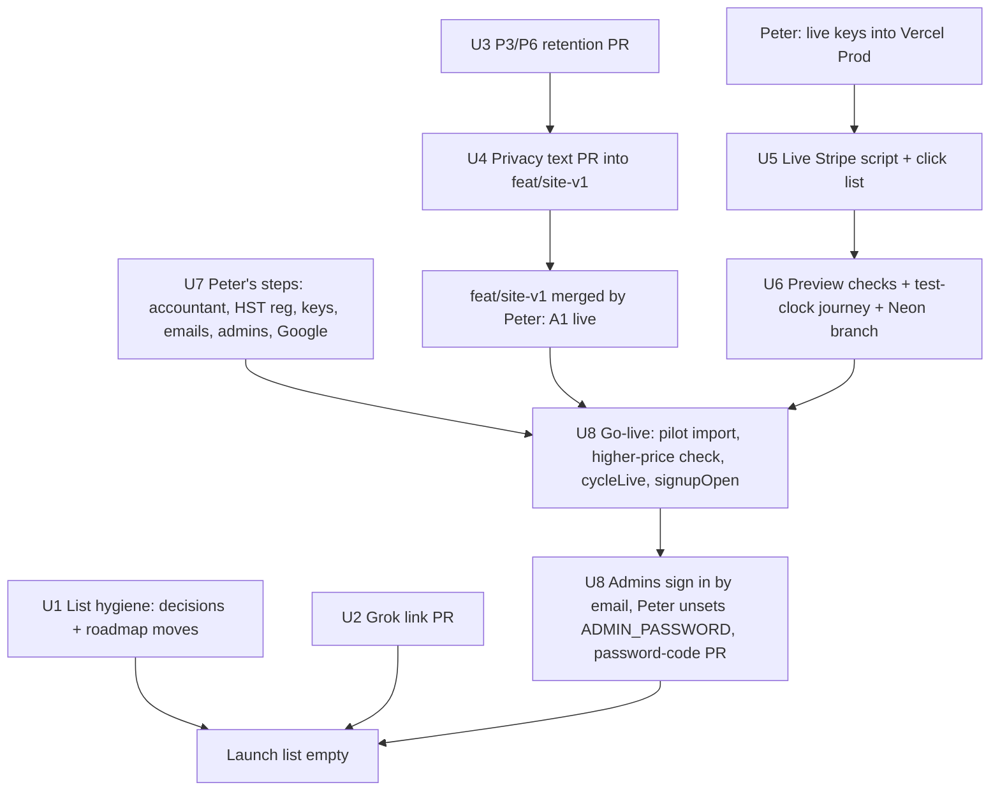

# feat: Roger v3 launch close-out (empty the launch list)

## Overview

Work through every item on the Roger v3 launch list (`artifacts/launch-list.html`, published at https://claude.ai/artifact/PvCLU9uLcV2abfxwNqd7tE): the 25 checklist items on "Everything else" and every open S and D row on "Reference". Each one ends as **done** (launch work, A1 + B1), **moved** (named in the plan for a later version), or **removed** (no longer needed). The project is finished when the page has no items and no rows (see origin).

Most of the work is operational: live Stripe, preview checks, production steps and Peter's own steps. Only four units change code: the Grok link, two retention jobs, the privacy text and the password removal.

## Problem Frame

Peter cannot officially launch v3 while the list holds open items. The list mixes four kinds of item: code, live-account setup, checks only a live environment can prove, and decisions or actions only Peter can take. Other sessions are working in the same repo at the same time: B2 in `../roger-b2`, and the public site on `feat/site-v1` and `feat/site-v2`. All work here runs in the `../roger-launch` worktree (branch `launch/v3-close-out`) or in short branches off `origin/main` (see origin: Problem Frame).

## Requirements Trace

- R1–R4. Working rules: remove items as they finish, merge PRs on green, wait for Peter's yes on production data and live Stripe, and script live Stripe with Peter approving → Units 1, 5, 8 and the pruning rule below.
- R5–R6. Defaults and Cora rulings applied, with Cora changes 8, 11 and 15 moved → Unit 1.
- R7. Privacy behaviour P3 and P6 → Unit 3. Privacy disclosures P1–P6 → Unit 4.
- R8. Privacy and terms: draft label, training position, links from sign-up → Unit 4.
- R9. Grace's testimonial → Unit 1.
- R10. Grok Bot link → Unit 2.
- R11. Live Stripe → Unit 5.
- R12–R14. HST test invoice, preview checks, scenario-test branch → Unit 6.
- R15–R16. Pilot import, higher-price check, password removal → Unit 8.
- R17–R22. Peter's own steps → Unit 7, and the switches in Unit 8.
- R23. Public site tracked, not built here → Unit 8 (tick on merge of `feat/site-v1`), and Unit 4 (privacy text lands on that branch).
- R24. Roadmap moves → Unit 1.

## Scope Boundaries

- No building of the public site, B2, A2, B3 or B4 (see origin).
- No new product behaviour beyond P3, P6 and the password-code removal.
- **New in planning:** sandbox mode for the scenario tests (`SCENARIO_TARGET=sandbox`) is not built. A manual journey on preview with a Stripe test clock replaces it, and sandbox mode moves to B3 (Peter, 2026-11-27).
- The page chrome stays as Peter trimmed it. No headings, intros or footers get added back.

## Context & Research

### Relevant Code and Patterns

- **Launch list:** `artifacts/launch-list.html`. Its rules sit in the header comment: ticks live in the artifact's `checks` collection, items are never renamed, and the page only shrinks. No item is ticked today.
- **Retention:** `src/lib/housekeeping/retention.ts` (`applyRetention` erases runs, private plays and Zack profiles 90 days after `access_ends_at`; `cleanUpExpired` deletes expired auth rows). It runs every hour from `src/lib/housekeeping/job.ts` (cron `/api/cron/housekeeping`, `5 * * * *` in `vercel.json`). Tests: `src/lib/housekeeping/retention.test.ts`.
- **Tables relevant to P6:** `leads` (sign-up interest), `notifications`, `stripe_events` (`db/schema.sql`).
- **Legal pages:** on `main`, `/privacy` serves `circlesPrivacyPreview` while `circlesMode` is on. The v3 text is on `feat/site-v1` in `src/data/site/legal.ts` (header comment: reviewed and confirmed by Peter on November 26, rendered without the draft note), with `src/data/site/legal.test.ts`. It still carries a placeholder, `trainingPosition` ("We are confirming the model provider's position…"). It already describes pooled plays staying anonymised (P4) and has sections "How long we keep your runs" and "Asking what we hold, correcting it or deleting it".
- **Models:** every Gateway model is Anthropic (`src/lib/intake/model.ts`, `src/lib/cora/merge.ts`, `src/lib/cora/fit.ts`: `anthropic/claude-sonnet-5.5`; `src/lib/ingest/extract.ts`: `anthropic/claude-haiku-4.5`).
- **Grok step:** `src/app/getstarted/page.tsx` ("Go to the Grok Bot site and download it."). `feat/site-v1` also changes this file.
- **Admin password:** `src/lib/admin-auth.ts` (password switch, its cookie MAC and the 5-tries limit), `src/app/admin/layout.tsx`, `src/app/admin/settings/page.tsx`, and test `src/lib/admin/admin-check.test.ts`.
- **Scenario harness:** `tests/scenarios/helpers.ts`. `sandbox` is an empty slot that throws on purpose.
- **Live-environment checks:** `docs/v3-app-b1-first-pass.md` has 7 checks that need a live environment (1, 2, 6, 26, 35, 36, 40), plus "Needs the live environment (beyond the seven checks)".
- **Seed import:** `scripts/seed-import.ts`, `/admin/cora`, run files in `artifacts/Zack Runs/`.
- **Roadmap homes:**
  - `artifacts/Roger v3 - design spec.md`, sections A2 (around line 498), B.15 (B2), B.16 (B3) and B.16a (B4).
  - `docs/brainstorms/2026-11-27-roger-v3-b2-b3-b4-requirements.md` and `docs/plans/2026-11-27-001-feat-roger-v3-b2-growth-plan.md`. Both exist only on `feat/v3-b2-growth` for now. They already name S11 (group session), D5 (60 days, first referrer), D6 (sponsor billed from the third list), Cora change 8 (R23, a B4 prerequisite), S23 and S24.
  - Not found in any roadmap home: Cora change 11 (upgrades; noted in `content/cora/cora.md` as not built), Cora change 15 (adoption counts) and admin-read logging.

### Institutional Learnings

- `docs/solutions/integration-issues/stripe-endive-embedded-setup-tax-promo-gotchas-2026-11-26.md`: read it before scripting live Stripe.
- `docs/solutions/best-practices/job-clock-not-database-now-2026-11-23.md`: the new retention cut-offs use the job's clock, not `now()`, the same as `applyRetention`. (`cleanUpExpired` deliberately uses the database clock for auth rows. P6 record purges follow `applyRetention`, not that.)
- `docs/solutions/best-practices/test-claim-sql-on-pglite-2026-11-22.md`: test SQL against PGlite.
- `docs/solutions/logic-errors/keep-forever-guard-needs-exit-on-terminal-failure-2026-11-26.md`: check that a purge never deletes a `stripe_events` row a reconcile still needs.
- Memory: commit from a worktree, never from the shared checkout. Run the tests as their own step before any merge. Commit and push every change to `artifacts/`, and republish the page.

### External References

- Anthropic's commercial terms on training with API data. Check the current wording at implementation and quote it with the date checked (Unit 4).

## Key Technical Decisions

- **The privacy text goes on `feat/site-v1`, not `main`.** The v3 legal text only exists there, and it goes live when that branch merges. Unit 4 is a small PR into `feat/site-v1` that touches only `src/data/site/legal.ts` and its test. The other session's owner (Peter) reviews it as part of site v1. Rejected: editing the Circles-era `src/data/legal.ts` on `main`, which v3 will never serve.
- **Code PRs come off `main` and stay small.** `feat/site-v1` also changes `src/app/getstarted/page.tsx` and `src/lib/housekeeping/job.ts`. Units 2 and 3 keep their diffs minimal so that whichever branch merges second has a trivial rebase. New logic goes into `retention.ts`, and `job.ts` gets a one-line task registration.
- **When an item counts as done:** Peter's word in this conversation, a merged PR, or a verified live state (API or Vercel read-back). Each counts as evidence under the list's rule 4. The commit that removes a row says which kind of evidence it is.
- **Roadmap authority is the design spec on `main`.** An item moves off the list once the spec's matching version section names it. Where the B2–B4 docs (still unmerged) also name it, the commit cites both. Items found nowhere (Cora changes 11 and 15, admin-read logging, scenario sandbox mode) are added to spec B.16 (B3, measurement and self-improvement).
- **Live Stripe is scripted to be safe to rerun.** Objects are found by lookup key or metadata before anything is created. A dry run is the default; applying needs an explicit flag. The script refuses to run with a test key when asked for live, and the reverse. Peter puts `sk_live` and `pk_live` into Vercel Production himself. The script writes only ids and the webhook signing secret into Vercel.
- **The live webhook's signing secret is shown only once, when the endpoint is created.** The script writes it straight into Vercel Production (`STRIPE_WEBHOOK_SECRET`) and never prints it.

## Open Questions

### Resolved During Planning

- **AI provider for the training sentence:** Anthropic, for every model (see Context).
- **Where P3 and P6 run:** in the existing hourly housekeeping pass, as new bounded tasks. No new cron.
- **Where the moved items live:** see Context, Roadmap homes. Three items are added to spec B.16.
- **Sandbox scenario run:** replaced by a manual walk on preview with a test clock (Peter, 2026-11-27).

### Deferred to Implementation

- **The exact definition of "held" and "one-at-a-time" members for P3:** read from `users.status` and plan fields in `db/schema.sql`. The rule is no run, no order and no sign-in for 12 months. Sign-in time comes from `sessions` or `login_tokens` if `users` has no last-seen column. If neither holds it, use the latest of run, order and account creation, and say so in the PR.
- **Whether `stripe_events` rows past 18 months are still referenced by any reconcile cursor:** check before purging, and keep any row a cursor points to.
- **The product tax code for the live products:** use the test product's current code unless the accountant (Unit 7) says otherwise. Change it afterwards if needed.
- **Whether S4 still exists:** the accountant item cites "S4", which is not on the Reference tab. The item is removed on the accountant's answer, whichever row it once pointed to.

## High-Level Technical Design

> *This illustrates the intended approach and is directional guidance for review, not implementation specification. The implementing agent should treat it as context, not code to reproduce.*

### Where every list entry goes

| Everything else item | Reference rows | Unit | Ends as |
|---|---|---|---|
| g-defaults | D1–D4, D7, D8, D11, D12 (confirmed); D5, D6 (to B2) | 1 | done / moved |
| g-cora-decisions | S20 | 1 | done; changes 8, 11, 15 moved |
| — | S11 (B2), S12 (A2), S23, S24 (B4) | 1 | moved |
| g-grok-link | — | 2 | done |
| g-privacy | S10, S22 | 3, 4 | done when `feat/site-v1` merges |
| g-live-prices, g-live-keys, g-live-webhook, g-live-settings | S13 (live part), S16 (live part) | 5 | done |
| g-old-webhooks, g-old-key | — | 5 (click list) / 7 | done or dropped by Peter |
| g-hst-invoice, g-ai-gateway, g-live-checks, g-scenario-db | S15, S16 (test part), S17, S13 (preview part) | 6 | done; sandbox mode moved to B3 |
| g-accountant, g-hst-registration, g-resend-key, g-admin-accounts, g-google, g-emails | S5, S18 | 7 | done (or S5 moved, if Peter defers Google) |
| g-public-site | S6, S7, S8 | 8 (track) | done on `feat/site-v1` merge |
| g-pilot-runs, g-higher-price, g-open, g-password | S14, S21 | 8 | done |

## Implementation Units

- [ ] **Unit 1: List hygiene: apply today's decisions and move later work**

**Goal:** Clear every entry that today's conversation settled or that belongs to a later version.

**Requirements:** R1, R5, R6, R9, R24

**Dependencies:** None

**Files:**
- Modify: `artifacts/launch-list.html`
- Modify: `artifacts/Roger v3 - design spec.md` (B.16 gets Cora changes 11 and 15, admin-read logging, and scenario sandbox mode. Make sure the default text for D1–D4, D7, D8, D11 and D12 is marked confirmed wherever the spec lists defaults.)
- Modify: `content/cora/cora.md` (record that the six literal readings were confirmed on 2026-11-27)

**Approach:**
- Remove D1–D4, D7, D8, D11 and D12 (confirmed by Peter, 2026-11-27).
- Confirm D5 and D6 in spec B.15 and on the B2 branch docs, then remove them. After that, remove g-defaults.
- Remove S20 and g-cora-decisions, citing B4 R23 (change 8) and the new B.16 entries (changes 11 and 15).
- Remove S11, S12, S23 and S24 once each one is named in its spec section.
- S8: check `/admin/testimonials` on preview for Grace's own quote, switched on. If it's there, remove S8. If not, narrow the S8 row to "Grace's quote" and leave it.
- Delete the matching `checks` docs (none exist today), republish, then commit and push.

**Test expectation:** none. This unit changes documents and the artifact only.

**Verification:**
- The Reference tab no longer shows those rows, and the page's counts match.
- `git grep` finds each moved item in its destination section.

---

- [ ] **Unit 2: Grok Bot download link**

**Goal:** The "Install your AI agent" step links to https://x.ai/bot.

**Requirements:** R10

**Dependencies:** None

**Files:**
- Modify: `src/app/getstarted/page.tsx`
- Test: the page's existing test, if there is one. Otherwise a render assertion next to the page.

**Approach:**
- Turn "Go to the Grok Bot site" into a link that opens in a new tab with `rel="noopener"`.
- Keep the diff to that one line, since `feat/site-v1` also edits this file.

**Test scenarios:**
- Happy path: the rendered `/getstarted` contains a link to `https://x.ai/bot` with the text naming Grok Bot.

**Verification:**
- The link works on the preview of the PR. After the merge to `main`, remove g-grok-link.

---

- [ ] **Unit 3: Retention for idle members and old records (P3, P6)**

**Goal:**
- P3: erase runs from one-at-a-time and held members who have been idle for 12 months.
- P6: purge old sign-up interest, notifications and Stripe event records.

**Requirements:** R7 (P3, P6)

**Dependencies:** None

**Files:**
- Modify: `src/lib/housekeeping/retention.ts`
- Modify: `src/lib/housekeeping/job.ts` (register the tasks only)
- Modify: `src/lib/v3-settings.ts`, if retention periods are settings there (follow how `retentionDays` is read)
- Test: `src/lib/housekeeping/retention.test.ts`, `src/lib/housekeeping/job.test.ts`

**Approach:**
- **P3** erases exactly what `applyRetention` erases (runs become stubs, plays outside the pool go, Zack profiles go). It applies to members on one-at-a-time or hold with no run, order or sign-in in 365 days. Bounded per pass. Cut-offs use the job clock.
- **P6** deletes `leads` rows that never became an account, older than 12 months, and `notifications` older than 12 months. It deletes `stripe_events` older than 18 months, except any row a reconcile cursor still references. Bounded per pass.
- Periods are named constants, or settings if the 90-day period already is one.

**Execution note:** Write the tests first against PGlite. These jobs delete data.

**Patterns to follow:**
- `applyRetention`: a single CTE, the `limit` bound, and counts returned.
- The task registration and failure isolation already in `job.ts`.

**Test scenarios:**
- Happy path (P3): a one-at-a-time member with their last run, order and sign-in 366 days ago has their runs stubbed, private plays deleted and profile emptied. Their pooled plays stay.
- Edge (P3): exactly 365 days idle is untouched. A held member who signed in 30 days ago is untouched. An active subscriber idle for 400 days is untouched (P3 covers only one-at-a-time and held members).
- Edge (P3): rerunning on an already-erased member changes nothing and counts 0.
- Happy path (P6): a 13-month-old unconverted lead is deleted. A 13-month-old lead whose email became an account is kept. An 11-month-old lead is kept.
- Happy path (P6): a 13-month-old notification is deleted. A 19-month-old `stripe_events` row is deleted. A 17-month-old one is kept.
- Edge (P6): a 19-month-old `stripe_events` row that a reconcile cursor points to is kept.
- Integration: the hourly pass runs both tasks. One throwing doesn't stop the others (the existing `job.test.ts` pattern).
- Edge: the limit holds. With more due rows than the limit, one pass handles only the limit and the next pass finishes the rest.

**Verification:**
- The full suite is green, the PR is merged, and housekeeping on preview logs both tasks without errors.

---

- [ ] **Unit 4: Privacy text: training position and S22 disclosures**

**Goal:** The v3 privacy page states Anthropic's training position and each S22 decision. It has no draft label and is linked from sign-up.

**Requirements:** R7 (P1–P6 text), R8

**Dependencies:** Unit 3 (the text describes P3 and P6 as built). Lands on `feat/site-v1`.

**Files:**
- Modify: `src/data/site/legal.ts` (on `feat/site-v1`)
- Test: `src/data/site/legal.test.ts` (on `feat/site-v1`)

**Approach:**
- Replace `trainingPosition` with a factual sentence based on Anthropic's commercial terms (checked at implementation, with the date): models are reached through Vercel's AI Gateway, and the provider does not train on this data.
- Add or adjust sentences in the existing sections:
  - "Asking what we hold…": a minimal record of a deletion is kept (P1), and you can ask us to withdraw your pooled plays (P5).
  - "What happens to a run": the Roger team can read runs to run the service (P2).
  - "How long we keep your runs": 12 months idle for one-at-a-time or held members (P3).
  - A records line for P6: sign-up interest 12 months, notifications 12 months, payment events 18 months.
  - P4 is already stated. Check that it is.
- Check that `/start` links Privacy and Terms on `feat/site-v1`. The draft label is already off there.
- The PR lists every new sentence for Peter, since the read he confirmed predates them.

**Test scenarios:**
- Happy path: the privacy doc no longer contains "We are confirming". It names the provider's position.
- Happy path: the privacy doc mentions each of 12 months (idle runs), 12 months (sign-up interest and notifications), 18 months (payment events), and withdrawal on request.
- Integration: `/start` renders links to `/privacy` and `/terms`.

**Verification:**
- The PR into `feat/site-v1` is merged by its owner. g-privacy, S10 and S22 are removed when `feat/site-v1` reaches `main` (Unit 8).

---

- [ ] **Unit 5: Live Stripe setup**

**Goal:** Production has the live products, the four monthly prices, the live webhook and the live settings. Vercel Production holds every Stripe value.

**Requirements:** R4, R11. Clears the live parts of S13 and S16.

**Dependencies:** Peter places `STRIPE_SECRET_KEY` (sk_live) and `NEXT_PUBLIC_STRIPE_PUBLISHABLE_KEY` (pk_live) in Vercel Production.

**Files:**
- Create: `scripts/stripe-live-setup.ts`
- Test: `scripts/stripe-live-setup.test.ts` (logic only, against a fake Stripe client)

**Approach:**
- The script:
  - Takes the key from the environment. Defaults to a dry run; `--apply` makes changes.
  - Checks that the key's mode matches the requested mode.
  - Finds or creates the product(s) and the four prices: US$200, CA$280, US$400 and CA$560 monthly, tax exclusive, with the lookup keys the test prices use.
  - Finds or creates the endpoint `https://meetroger.ai/api/stripe/webhook` on API version `2026-11-18.endive` with the seven S16 events.
  - Prints the four price ids. Writes the webhook secret and the price ids to Vercel Production through the Vercel CLI without echoing the secret.
- Before the `--apply` run, Claude shows Peter the dry-run output and waits for his yes.
- A click-by-click list goes to Peter for the live dashboard-only settings:
  - Link off.
  - Radar on for saved payment methods.
  - Stripe's failed-payment and upcoming-renewal customer emails off.
  - Failed renewals end with the subscription marked unpaid.
  - HST registration in Stripe Tax (g-hst-registration, also in Unit 7).
  - Delete the leftover "the120" sandbox webhook (g-old-webhooks).
- After Peter's clicks, read back what the API exposes (prices, endpoint events and version, tax registrations, webhook list). Peter's confirmation covers the rest.
- Production redeploys so it picks up the new env vars.

**Patterns to follow:**
- The gotchas doc in Institutional Learnings.
- How the existing billing code reads the price ids (`STRIPE_PRICE_MONTHLY_*`).

**Test scenarios:**
- Happy path: the dry run against an empty fake plans 1 product, 4 prices and 1 endpoint, and writes nothing.
- Edge: a second `--apply` against the fake after a first one creates nothing new and reports every object as existing.
- Error: an `sk_test_` key with mode live, or an `sk_live_` key with mode test, exits before any API call.
- Edge: an existing endpoint with a missing event is reported as needing an update and fixed on apply.

**Verification:**
- The API read-back shows the four live prices and the endpoint with seven events on `2026-11-18.endive`.
- `vercel env ls production` lists every S13 Stripe variable.
- A live-mode test event from the dashboard reaches production and is recorded in `stripe_events`.
- Remove g-live-prices, g-live-keys, g-live-webhook and g-live-settings, and g-old-webhooks once Peter has deleted the leftover webhook.

---

- [ ] **Unit 6: Preview checks and the test-clock journey**

**Goal:** Prove on preview everything that only a live environment can prove.

**Requirements:** R12, R13, R14. Clears S15, S17, the test part of S16 and the preview part of S13.

**Dependencies:** None for preview. Can run in parallel with Unit 5.

**Files:**
- Modify: `docs/v3-app-b1-first-pass.md` (record each result with the date)
- Modify: `tests/scenarios/helpers.ts` (comment only: sandbox mode moved to B3; the branch exists)

**Approach:**
- **AI Gateway and crons (S15):** send one run without a `roger-run` block to preview and see the model read it. Confirm the seven crons in the Vercel project, and that the plan allows the 10-minute Monday schedules and 300-second functions. Run a Cora dry run on preview to completion.
- **Test-clock journey (replaces the sandbox run):** a member on a Stripe test clock against preview, CAD and Ontario:
  - Sign up through `/start` at 390px and 1440px (check 1).
  - Two free lists.
  - Card saved on Payment, with the statement shown (check 2).
  - First charge at the third list, with HST on its own row (g-hst-invoice, check 26).
  - Then advance to a renewal with a difference line, and to a one-at-a-time order, checking the HST row on each.
  - Webhook events are recorded at every step.
  - An automatic email arrives from the support address (S13).
- **Remaining first-pass checks:**
  - Check 6: a real agent run appears on `/app/zack` and `/admin/runs` within a minute.
  - Check 35: legacy pages open.
  - Check 36: the Vercel build of the merge commit.
  - Check 40: the public pages, which follow `feat/site-v1`.
- **Neon (S17):** create the scenario-test branch in `roger-db`, write the non-production marker row, and set `SCENARIO_DATABASE_URL` in Preview and in local `.env.local`. Sandbox wiring goes to spec B.16 (done in Unit 1).

**Test expectation:** none. These are manual verification and environment setup. Results are recorded in `docs/v3-app-b1-first-pass.md`.

**Verification:**
- Every live-environment check in the first-pass record shows a dated pass, or a linked fix PR.
- Remove g-ai-gateway, g-live-checks, g-hst-invoice, g-scenario-db, S15 and S17. Remove S16 and S13 once Unit 5 is done too, and S13 also needs both admins to open `/admin` (Unit 8).

---

- [ ] **Unit 7: Peter's steps, with exact instructions and verification**

**Goal:** Every item only Peter can do gets a precise instruction from Claude and a way to verify it.

**Requirements:** R17–R21

**Dependencies:** None. Runs in parallel with everything else.

**Files:**
- Modify: `artifacts/launch-list.html` (removals only)
- Modify: `artifacts/wording-signoff.md`, if Peter's email changes need recording

**Approach:** One short message per item, asked as it becomes relevant.
- **g-accountant:** Peter reports the answer. If US customers should be taxed, or the tax code changes, that becomes a follow-up change to Stripe Tax.
- **g-hst-registration:** verified by the Stripe Tax registrations read-back (Unit 5).
- **g-resend-key:** Peter confirms. Verified by `RESEND_API_KEY` still sending (a preview email).
- **g-old-key:** Peter traces it, or drops it as optional.
- **g-google and S5:** optional. Ask Peter whether he wants Google sign-in for launch. If yes, give him the Google Cloud steps, he sets the env vars, and Claude verifies on preview and production. If no, move S5 to spec B.16 and remove it.
- **g-emails and S18:** Claude prepares one reading page (an artifact) of every automatic email as rendered, with the three open points flagged. Changes Peter asks for become a PR in `src/lib/mail/templates/`.
- **g-admin-accounts:** both addresses sign up on production. Verified by their rows in `users` and by `/admin` opening by email link.

**Test expectation:** none, except that any email-wording PR updates the template tests it touches.

**Verification:**
- Each item is removed with Peter's word, or the read-back cited in the commit.

---

- [ ] **Unit 8: Go-live, then the password removal**

**Goal:** Real members can sign up and get lists. The shared admin password is gone. The list is empty.

**Requirements:** R15, R16, R22, R23

**Dependencies:**
- Units 5 and 6.
- Unit 7's admin accounts.
- `feat/site-v1` merged by Peter (A1 live). That also brings Unit 4.

**Files:**
- Modify: `src/lib/admin-auth.ts`, `src/app/admin/layout.tsx`, `src/app/admin/settings/page.tsx` (password removal)
- Test: `src/lib/admin/admin-check.test.ts`
- Modify: `artifacts/launch-list.html` (the final removals)

**Approach:**
- **When `feat/site-v1` merges:** remove g-public-site, S6 and S7 (if their files are in), S8 (if not cleared in Unit 1), g-privacy, S10 and S22.
- **Pilot import (S14), each step on Peter's yes:**
  - Run the 13 files through the real model (`INTAKE_LIVE=1`).
  - Import them on production.
  - Link each pilot's record to their account once they have one. Pilots without accounts stay unlinked; linking happens on the user page later and does not block the launch.
  - An admin reads a Cora dry run.
- **g-higher-price:** query live Stripe and the database for any subscription on a higher-rate price. Every one found is explained by its contribution weeks, or fixed with Peter.
- **g-open:** Peter turns on `v3.cycleLive`, then `v3.signupOpen`, in `/admin/settings`. Claude watches the first housekeeping pass and the first Monday's jobs.
- **g-password and S21:** after both admins sign in by email link, Peter unsets `ADMIN_PASSWORD` in Vercel. Then a PR removes the password-login code path and its rate limit.
- **Finally:** confirm the page has no items and no rows, the `checks` collection is empty, and the last version is republished and pushed.

**Test scenarios (password removal):**
- Happy path: an admin email in `ADMIN_EMAILS` with a session opens `/admin`.
- Error path: a request carrying an old password cookie is refused.
- Error path: posting to the old password form route returns not-found or refuses. There is no route left that checks a password.
- Integration: `/admin/settings` no longer shows anything about the password.

**Verification:**
- Production takes a real card at a member's third list.
- `ADMIN_PASSWORD` is absent from `vercel env ls production`.
- The published launch list is empty.

## System-Wide Impact

- **Interaction graph:**
  - Units 2 and 3 touch files that `feat/site-v1` also changes, so whichever merges second rebases.
  - Unit 4 adds commits to another session's branch. Keep it to the two legal files.
  - Unit 5 changes production env vars, which needs a production redeploy.
- **State lifecycle risks:**
  - P3 and P6 delete data for good, so they are bounded per pass, use the job clock, and have tests written first.
  - The pilot import writes to production, so it waits for Peter's yes.
- **Unchanged invariants:**
  - The 90-day retention after access ends is unchanged.
  - The test-mode Stripe setup on preview is unchanged.
  - The two sign-up switches stay off until Unit 8.

## Risks & Dependencies

| Risk | Mitigation |
|------|------------|
| `feat/site-v1` stalls, which blocks A1 and therefore the launch | The rest of the list proceeds. The page shows what's left: g-public-site and the legal rows. |
| The B2–B4 docs never merge, so moved items lose their home | The roadmap authority is the spec on `main`. Unit 1 makes sure each moved item is named there. |
| The live Stripe script creates duplicates or touches the wrong mode | It finds before it creates, dry run is the default, and it checks the key's mode before any call. |
| The webhook secret leaks into logs or chat | It goes straight into Vercel and is never printed. |
| A purge deletes a `stripe_events` row that reconcile still needs | Rows a cursor references are kept, and a test covers it. |
| Removing the password locks the admins out | It is removed only after both admins sign in by email on production. |

## Documentation / Operational Notes

- `docs/v3-app-b1-first-pass.md` gets the dated live results.
- Every launch-list change is committed, pushed and republished to the artifact, with its `checks` docs deleted.
- After go-live, watch the first Monday's cron runs (Cora, charge, send) and the first hourly passes running P3 and P6.

## Sources & References

- **Origin document:** [docs/brainstorms/2026-11-27-v3-launch-close-out-requirements.md](docs/brainstorms/2026-11-27-v3-launch-close-out-requirements.md)
- Launch list: `artifacts/launch-list.html`
- Design spec: `artifacts/Roger v3 - design spec.md`
- B1 first-pass record: `docs/v3-app-b1-first-pass.md`
- Marketing site plan: `docs/plans/2026-11-26-1218-feat-marketing-site-three-versions-plan.md`
- B2–B4 requirements (on `feat/v3-b2-growth`): `docs/brainstorms/2026-11-27-roger-v3-b2-b3-b4-requirements.md`
