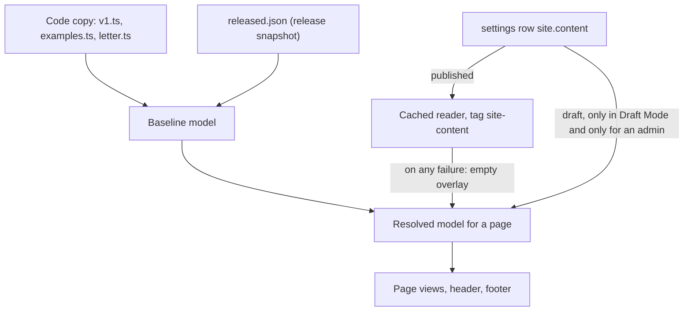
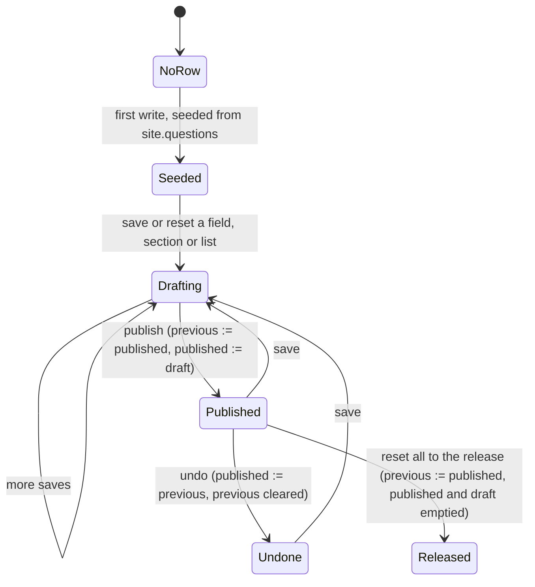
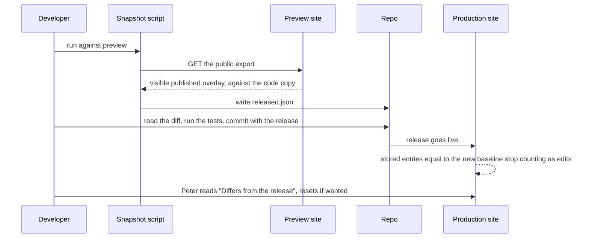

# Admin Organization and Website CMS - Plan

## Goal Capsule

- **Objective:** Peter changes the words, sections and lists of Roger's marketing site himself on the preview site, those changes reach production with the next release without retyping, he finds any admin screen at a glance, and a returning user sees "Sign in" at once.
- **Means:** Stored edits layered over the built-in copy, with a release snapshot that folds preview's published edits into the repo (KTD1, KTD9).
- **Product authority:** Peter Kuperman (owner). Decisions below were made in the brainstorm of November 27, 2026, and the "To production" part was changed by Peter the same day.
- **Authority order:** Product Contract requirements, then Key Technical Decisions, then unit text. A unit never overrides a requirement.
- **Execution profile:** One branch, `feat/admin-cms`, one pull request's worth of work. Units are built, reviewed and committed one at a time in the order of the Unit Index, each leaving the branch green. The branch is merged into `preview` for Peter to look at. Merging to `main` is Peter's step and is not part of this plan.
- **Stop conditions:** Stop and report if the draft-mode preview (KTD7) cannot keep public pages' static shells and its fallback also fails, or if any unit would need a change to `db/schema.sql`.
- **Open blockers:** None.

---

## Product Contract

**Product Contract preservation:** changed: R19 to R22, the Key Decisions on reaching production, F2, AE5, AE6, the Summary's last sentence, one Dependencies bullet, one Scope Boundaries bullet, two Outstanding Questions, and AE10 added. Reason: Peter replaced the push button with "content travels with each release" on November 27, 2026. Everything else is unchanged.

### Summary

The admin gets a grouped sidebar in place of its 16 unsorted tabs.
Under its Website group, a new Pages editor lets an admin edit text, switch sections on or off, reorder them and manage list items on the homepage and the four nav pages, as drafts that are previewed, then published.
At each release, what is published on preview becomes the built-in wording and layout that production shows, and "Sign in" in the site header becomes an outlined button.

### Problem Frame

Peter runs the site and the admin alone.
On November 26 and 27, 2026 he made four rounds of homepage edits, each a list of wording changes, deleted sections and reordered blocks, and every one went through a developer and a code release.
The one exception, the Edit Questions screen added on November 27, covers 18 questions and nothing else.

The admin (`src/components/admin-ui.tsx`) shows 16 tabs in one wrapping row, in the order they were built: screens used weekly sit beside one that no public page reads any more (Sample idea).

In the site header, "Sign in" is small grey text beside the filled start button and is hidden below 375 pixels, so a returning user has to look for it.

Peter's way of working is fixed: build and edit on preview.meetroger.ai until it is right, then send everything to meetroger.ai once. Preview is always ahead of production.

### Key Decisions

- **Sidebar, not two rows or a cards page.** Every screen is visible at once under group headings. (session-settled: user-directed — chosen over a two-row tab bar and a cards home page: one click to anything, nothing hidden.) Governs R1, R3.
- **Five groups: Today, People, Cora, Website, Setup.** (session-settled: user-approved — proposed in the layout sketch with the mapping of all 16 tabs shown; Peter picked the sidebar without changing the groups.) Governs R2.
- **CMS depth is words, sections and lists.** (session-settled: user-directed — chosen over words only, words plus sections, and a full page builder: covers the edits Peter actually makes without the cost of composing new pages.) Governs R6, R7, R8.
- **Draft, preview, then publish.** (session-settled: user-directed — chosen over live-on-save and live-on-save with history: a half-finished structural edit is never public.) Governs R13, R14, R15.
- **The wording check warns and does not block.** (session-settled: user-directed — chosen over refusing the save and over no check: Peter is the final judge of wording, and several of his own lines needed exceptions.) Governs R16.
- **CMS covers Home, How it works, Use cases, FAQ, About, the header, the footer and shared buttons only.** (session-settled: user-directed — chosen over also covering Privacy and Terms, the free Zack run pages, and page titles and search descriptions.) Governs R5.
- **Content travels with each release.** (session-settled: user-directed — chosen over a push button between the sites: no shared secret to set up; minor edits between releases are made in production's own admin.) Section order and lists are released together with the code that understands them, so production never holds content its code cannot read. Governs R19, R20, R21, R22.
- **"Sign in" is an outlined button left of the start button.** (session-settled: user-directed — chosen over a bold text link, swapping emphasis with the start button, and moving it to the far right.) Governs R23.
- **Edit Questions becomes part of Pages.** One place to edit site wording. Governs R10.
- **Sample idea leaves the admin.** No public page reads its choice since the examples section of November 27, 2026. Governs R4.

### Requirements

**Admin navigation**

- R1. Every admin screen is reachable in one click from a sidebar that stays in view on every admin page, with the current screen marked.
- R2. The sidebar lists screens under five headings, in this order and with these names:
  - Today: This week (was Overview), Needs attention (was Operations), Flags.
  - People: Users, Sign-ups, Interest.
  - Cora: This week's run (was Cora), Runs.
  - Website: Pages, Testimonials, Use cases, Watches.
  - Setup: Settings, Connections, Setup file.
- R3. On a phone the sidebar folds into a menu that opens and closes, and no admin page scrolls sideways because of it.
- R4. The Sample idea screen and its tab are removed, and the Edit Questions tab is replaced by Pages (R10).

**What Pages can edit**

- R5. Pages covers the homepage, How it works, Use cases, FAQ and About, plus the header, the footer and the shared buttons. On Use cases it covers the page's own headings and lines; the rows stay on the Use cases screen.
- R6. An admin can edit any visible text on a covered page: headings, lines, button labels, link labels, questions and answers, and the text of each list item.
- R7. An admin can switch a section of a covered page off and on, and move it up or down among that page's sections.
- R8. An admin can add, remove and reorder the items of each list: nav links, footer links, questions, the problem statements, the hero steps, the control columns, the Cora Curation examples and the steps on How it works.
- R9. A nav or footer link points at a covered page, a section of one, or an address the admin types, and a link with no label or no destination cannot be saved.
- R10. The questions and answers editing that Edit Questions offers today is part of Pages, and edits already saved there are kept.
- R11. Text is plain text. Amounts are written as the existing placeholders and filled from Settings, so a price is changed in one place.
- R12. Each edited field shows that it differs from the built-in wording and can be reset to it. An edit stays in force when the built-in wording later changes in code.

**Draft, preview, publish**

- R13. Saving an edit stores a draft that no visitor sees. A page with drafts is marked in Pages.
- R14. An admin can open a preview of any covered page with all current drafts applied, at full fidelity, before publishing. A signed-out visitor cannot open a preview.
- R15. Publish makes all current drafts live on the site the admin is on, within a few seconds, and Undo last publish restores what was live before it.
- R16. Before publishing, Pages lists each wording rule the drafts break, with the rule and the words. The admin may publish anyway, and each override is written to the admin log.
- R17. Before publishing, Pages warns when a link would point at a section that is switched off or an item that was removed.
- R18. If the stored content cannot be read, public pages show the built-in wording and layout.

**To production**

- R19. At each release, the content published on preview becomes the built-in wording and layout the release carries to production, with no retyping and no secret to set up.
- R20. Production has the same Pages tools as preview. An edit published there between releases is live on production only, and drafts never leave the site they were made on.
- R21. After a release, an edit made on production stays in force on top of the newly released wording (R12). Pages lists every field, section and list where the site's published content differs from the release, with one action that resets all of them to the release.
- R22. An edit made on production is not carried back to preview. The owner repeats it on preview if it should survive the next release.

**Launch list**

- R25. The Pages screen shows a note at its top, on every site: each page must be read and its checks ticked on the launch list before a release, with a link to https://claude.ai/artifact/3A2CqfXuFDnr7PDYq776Wj that opens in a new tab. Each covered page's own editing screen repeats the link. The address is one setting in code, so it can be changed in one place. (Peter, November 27, 2026.) **Removed by Peter on November 28, 2026:** the note, the line on each editing screen and the component are gone.

**Header**

- R23. For a signed-out visitor, "Sign in" in the site header is an outlined button of the same height as the start button, placed left of it, at every width where the header shows both. The start button stays the filled one.
- R24. Below the width where both fit, "Sign in" keeps its place in the phone menu, and the header does not scroll sideways at 360 pixels.

### Key Flows

- F1. Edit a page on preview
  - **Trigger:** Peter wants to change the homepage.
  - **Steps:** Admin sidebar, Website, Pages. Pick Home. Change a heading, switch a section off, move another up, add a question. Save. Open the preview and read the page. Read the warnings. Publish.
  - **Outcome:** preview.meetroger.ai shows the new page to everyone. Production is unchanged.
  - **Covered by:** R5 to R18.
- F2. Release content to production
  - **Trigger:** Preview reads the way Peter wants and a release is being prepared.
  - **Steps:** The developer runs the release snapshot against preview, reads the change it made to the repo, and commits it with the release. Peter merges the release. On production, Peter opens Pages, reads the list of what still differs from the release, and resets it if production should match preview.
  - **Outcome:** meetroger.ai shows the content preview had published when the snapshot was taken, plus any production edits Peter chose to keep.
  - **Covered by:** R19 to R22.
- F3. Take back a mistake
  - **Trigger:** A publish went wrong.
  - **Steps:** Pages, Undo last publish.
  - **Outcome:** The site shows what it showed before that publish; the drafts are still there to fix.
  - **Covered by:** R15.

### Acceptance Examples

- AE1. **Covers R13, R14, R15.** Given a draft that changes the hero headline, when a signed-out visitor loads the homepage, they see the old headline; when the admin opens the preview, they see the new one; after Publish, the visitor sees the new one.
- AE2. **Covers R16.** Given a draft answer containing "agent" with no "AI" before it, when the admin goes to publish, the rule and the word are listed; when they publish anyway, the page shows the text and the admin log has one entry naming the rule.
- AE3. **Covers R17.** Given the Price section switched off while the nav still has "Pricing" pointing at it, when the admin goes to publish, the warning names that link.
- AE4. **Covers R12.** Given an edited hero sub-line, when a code release changes the built-in sub-line, the site still shows the edit; after Reset, it shows the new built-in line.
- AE5. **Covers R19.** Given a hero headline edited and published on preview and the release snapshot taken, when the release goes live, production shows the new headline with no edit made in production's admin, and Pages on preview shows that headline as built-in wording, not as an edit.
- AE6. **Covers R20, R22.** Given a FAQ answer edited and published in production's admin, a visitor to production sees the edit, and preview still shows its own answer.
- AE7. **Covers R18.** Given the database cannot be reached, when a visitor loads the homepage, it renders with the built-in wording and all built-in sections.
- AE8. **Covers R7, R8.** Given the questions list reordered and one example removed in drafts, after Publish the homepage and FAQ show the new order and the example's tab is gone, with the first remaining example selected.
- AE9. **Covers R23, R24.** At 1440, 1024, 768 and 375 pixels a signed-out visitor sees an outlined "Sign in" left of the filled start button; at 360 pixels the header shows the start button only and the menu holds "Sign in"; a signed-in visitor sees "Open Roger" as today.
- AE10. **Covers R21, R12.** Given production has an edited note under the price and a release brings a different built-in note, production still shows its edit and Pages on production lists that field as differing from the release; after "Reset all to the release", production shows the released note and the list is empty.

### Scope Boundaries

- New kinds of sections, new pages, and visual design (colours, type, layout of a section) stay in code.
- Privacy, Terms, the free Zack run pages, `/getstarted`, sign-up, the app, emails, and page titles and search descriptions are not editable in Pages.
- Text is plain: no rich text, no images or uploads, no links inside a paragraph.
- No editor role separate from admin: whoever can open the admin can edit and publish.
- No scheduled publishing, no per-page publish, and no history beyond undoing the last publish.
- Content moves one way, from preview to production, and only with a release. An edit made on production is never copied back to preview; it lasts until Peter resets it or repeats it on preview (R22).
- No push button, no call between the two sites and no shared secret.
- The screens inside each admin group keep their current content and behaviour; only their place and, where R2 says, their label change.
- The version 2 hero sketches under `/site-preview` are not editable and need not reflect CMS edits.

### Dependencies / Assumptions

- Preview and production use separate databases. This was stated to Peter and not contradicted, and cannot be confirmed from the repo. Nothing in this plan calls from one site to the other, so a shared database would only mean that a publish on either site is live on both.
- A developer prepares each release and can run a command against the public preview site.
- Admin access stays as it is: `ADMIN_EMAILS`, and the shared password while that variable is still set.
- The wording check (`src/lib/site/claims.ts`) can be run on drafted text at publish time, as the questions editor already does on save.

### Outstanding Questions

**Deferred to Planning**

- Which list items carry a stable identity so that an edit, a reorder and a later code change to the same list combine predictably (R8, R12).

### Sources / Research

- Admin tabs and shell: `src/components/admin-ui.tsx` (16 tabs), `src/app/admin/layout.tsx`.
- The existing editor to fold in: `src/app/admin/questions/`, `src/lib/site/questions.ts` (one `settings` row, key `site.questions`; cached reader with a tag; validation with `checkClaims`).
- Built-in copy: `src/data/site/v1.ts`, `src/data/site/examples.ts`, `src/data/site/compounding.ts`.
- Header: `src/components/site-header.tsx` (the account block and the phone menu).
- Wording rules: `src/lib/site/claims.ts`; `docs/site/v1-acceptance.md` notes that database-published text is not read by the test-time check.
- Lessons that apply: `docs/solutions/runtime-errors/catch-inside-use-cache-stores-the-fallback-2026-11-27.md`, `docs/solutions/ui-bugs/previous-page-stays-in-the-document-after-a-click-2026-11-26.md`, `docs/solutions/best-practices/feature-switch-module-holds-only-the-read-2026-11-27.md`.
- Release model: branch `preview` serves preview.meetroger.ai; merge to `main` is go-live.

---

## Planning Contract

### Key Technical Decisions

- KTD1. **Content is three layers, each an overlay on the one below.** The code copy (`src/data/site/v1.ts`, `examples.ts`, `letter.ts`) is the bottom. `src/data/site/released.json`, written by the release snapshot, is the middle. The site's own published edits in its database are the top. One pure function applies an overlay to a resolved model, and it is applied twice. "Built-in wording" in R12 and "the release" in R21 both mean the bottom two layers together, called the baseline here. Why: R12 and R18 need the code copy to stay the fallback, and R19 needs preview's edits to become built-in without anyone rewriting a hand-commented TypeScript file.
- KTD2. **One overlay format for all three uses.** An overlay has `format` (a number), `text` (field id to string), `sections` (page id to `order` and `off`), and `lists` (list id to `order`, `removed` and `added` item ids). The fields of an added item live in `text` under that item's id. Drafts, published content, the previous published content and `released.json` all hold this shape. Why: one parser, one apply function and one differ serve the editor, the public pages and the release.
- KTD3. **No editable thing is addressed by its position.** A field id is its path in the copy (`home.hero.headline`, `buttons.start`), and every array of editable items in the copy carries an `id` on each item, as the questions already do. Ids are added to: problem statements, hero steps, control points, the days of "The week", the Zack points, the anatomy notes and the first-weeks steps. Nav and footer links become lists whose item ids are today's keys (`howItWorks`, `pricing`, `library`, `faq`, `about`). An item added in the admin gets a generated id with an `x-` prefix. A test walks the copy and fails on an editable array whose items lack unique ids. Why: this is what lets an edit, a reorder and a later code change to the same list combine predictably, and it is what AE4 depends on. This settles the Product Contract's deferred question on list identity.
- KTD4. **List and section order merge by id, never replace.** Applying an overlay keeps the overlay's order for the ids it names, drops ids the base no longer has, and places a base item the overlay does not name after its predecessor in the base. Why: a new built-in item or section added in code appears on a site whose stored order predates it, and an id removed from code cannot break a page.
- KTD5. **Everything stored lives in one `settings` row, key `site.content`, holding `draft`, `published` and `previous`.** Departure from the starting direction, which suggested separate values or a dedicated table. Reason: Neon over HTTP has no transactions, and with one row every transition (save a field, publish, undo, reset all) is a single-row `update`, atomic without CTE choreography. A dedicated table would add a schema change and still need multi-row transitions. `db/schema.sql` does not change. The only unfiltered reader of `settings` is `src/lib/settings.ts`, which ignores keys it does not know.
- KTD6. **A stored entry that equals the baseline is not an edit.** The reader drops such entries in memory, and every save and publish stores the overlay with them removed. This is how the release snapshot and each site's own overlay stay consistent with no clearing step: once a release makes preview's edit part of the baseline, that entry compares equal, stops showing as edited, and is deleted the next time anything is saved there. On production, what survives this is exactly the R21 list.
- KTD7. **Preview is Next's Draft Mode on the real pages, gated by the admin check.** A server action checks the admin, enables Draft Mode and redirects to the public address. The cached reader reports whether Draft Mode is on (`isEnabled` is documented as readable inside `use cache`), and the plain function around it reads the draft only when that is true and `isAdmin()` passes. Why: the header, the footer and every block render from the same components at the same addresses, which is what "full fidelity" means, and the bypass cookie alone shows a non-admin nothing but published content. Fallback if the build shows this costs public pages their static shell: an admin route that renders the page view components with the draft applied.
- KTD8. **Published content is read through one cached, tagged reader, with the catch outside the cached function.** `cacheLife` matches the questions reader's so a page can await it outside Suspense and keep its shell. Every write is a server action, so each calls `updateTag` and `refresh()`. The module holds only the read; anything derived from content lives in the callers, per `docs/solutions/best-practices/feature-switch-module-holds-only-the-read-2026-11-27.md`.
- KTD9. **The release snapshot is a script that reads a public, read-only export from preview and writes `released.json`.** Why a public endpoint over an admin download: the developer's command needs no session and Peter has no extra step. The export holds only what a visitor to preview can already see: the published overlay merged with preview's own `released.json`, expressed against the code copy. For a field in a switched-off section or a removed item, it carries the value preview's `released.json` already has and ignores the database, so hidden text is never newly exposed and a wording released earlier is not lost. It reads through a published-only function that Draft Mode cannot switch to the draft, it carries no admin name or timestamp, and it answers with an error instead of a partial result when the published content cannot be read. (session-settled: user-directed — instantiates "Content travels with each release", chosen over a push button; governs R19 to R22.)
- KTD10. **The wording check runs on each drafted text that differs from what is published, one field at a time.** Each is filled with the amounts and checked with `textPage` under its page's path and its field's zone, as `refusal` in `src/lib/site/questions.ts` does today. Rendering a page to markup inside a server action is not used: importing `react-dom/server` into the app's server layer is refused by Next. Saving refuses only what would break a page: empty text, text over its limit, a placeholder that does not exist, and a link with no label or an unusable destination (R9). Everything else is a warning at publish (R16).
- KTD11. **Publish stores the exact draft that was checked.** The publish statement carries the checked draft and applies only if the stored draft still equals it. Otherwise the admin is sent back to the review. Why: R16 says each broken rule is listed before publishing, and a save from another tab between review and publish would otherwise go live unlisted and unlogged.
- KTD12. **Link destinations are validated wherever they enter and wherever they are read.** A destination must start with one `/`, or with `https://`, or with `mailto:`. The save refuses anything else, and the reader and the strict parse of `released.json` drop it. Why: an admin-typed address is rendered into an `href`, and `javascript:` must never reach one.
- KTD13. **Tests that pin the code copy render with an empty middle layer.** View components take the composed overlay as a prop that defaults to empty, so the strict homepage, pages and claims tests keep proving the code copy. A separate test loads the real `released.json` and requires that it parses strictly (every id known, every placeholder real, every destination usable) and that every covered page renders with it. Released text is not put through the claims rules at test time: it was checked at publish, where Peter's overrides were logged (R16).

### High-Level Technical Design

How a public page gets its words:



The states of the stored row on one site:



A release:



### Output Structure

```text
src/data/site/released.json
src/lib/site/content/
  format.ts      overlay type, format number, empty overlay, lenient and strict parse
  registry.ts    pages, sections, fields and lists, with labels, limits, zones and anchors
  model.ts       baseline, apply an overlay, diff a model back to an overlay
  text.ts        tidy text, placeholder and destination checks
  store.ts       every statement on the site.content row
  read.ts        the cached reader and the function around it, nothing else
  check.ts       wording warnings and link warnings
  export.ts      the visible published overlay for the release
src/app/admin/pages/         index, one editor route per page, review, actions
src/app/api/site-content/published/route.ts
scripts/snapshot-content.mjs
docs/site/content-release.md
```

### Assumptions

- "The steps on How it works" in R8 means the days of "The week" and the first-weeks steps. The Zack points and the anatomy notes are editable as text only, because each anatomy note is paired with a playbook part by position.
- "Visible text" in R6 leaves out names only a screen reader hears (the hero graphic's name, the examples row's name, brick labels, the currency switch label, image alt text) and the titles and descriptions the Scope Boundaries already exclude.
- On Use cases, "the page's own headings and lines" are the heading, the intro line, the watch link, the "Not in the library yet?" heading and its paragraph, and the band. The words inside the search and filter controls are not included.
- Where a renamed screen's own heading repeats its old tab name ("Operations", "Cora"), the heading takes the new name too.
- Saving a built-in field as empty is refused, as the questions editor does today. Hiding a line is done by switching its section off.
- "Reset all to the release" also discards unpublished drafts on that site, and says how many before it runs. Undo last publish restores the published content it replaced.
- The code on the `preview` branch and the code being released agree on field, section and list ids when the snapshot is taken. Where they do not, the strict test on `released.json` fails before the release.
- Draft Mode behaves as `node_modules/next/dist/docs/01-app/02-guides/draft-mode.md` describes for Cache Components: cached functions re-execute on every request and nothing is stored. U9 proves it with a build and a browser check before relying on it.

### Implementation Constraints

- Next.js 16.4.6 with `cacheComponents: true`. `updateTag` works only in server actions; a clock or cookie read during render needs `connection()` or sits behind Draft Mode.
- Every database write is one statement. Statements on `site.content` are tested on PGlite through `src/test-helpers/pglite-db.ts`, never against a mocked `sql`.
- Forms that use a server action with uncontrolled fields follow `docs/solutions/ui-bugs/react-19-form-action-reset-brings-back-stale-defaults-2026-11-23.md`: `refresh()` on success, typed values returned on error, fields keyed by what they show.
- No page is styled from `html`, `body`, `:root` or `:has(` selectors; the preview bar and the sidebar style their own wrappers.
- Every server action under `src/app/admin/pages/` calls `requireAdmin()` first.

### Risks

| Risk | Mitigation |
|---|---|
| Draft Mode read in the root layout's data path makes public pages dynamic | U9 runs `npm run build` and checks the route table before anything depends on it; KTD7 names the fallback |
| A snapshot taken while preview's database is down would drop every unreleased edit from the release | The export answers 503 on a failed read and the script writes nothing (U10) |
| A stored overlay that the code no longer understands breaks a page | Lenient parse drops unknown ids and unusable values; whole-read failure gives the empty overlay (R18) |
| An entry in `released.json` shadows a later wording change made in code | Documented in `docs/site/content-release.md`: change the entry, or delete it, in the same commit |
| The outlined "Sign in" does not fit at 375 pixels beside a two-line start button | U1 measures in a browser at 375 and 360 with the real labels and may tighten phone padding and gaps, never hide the button at 375 |
| A long label typed in Pages overflows the header or a tab row | Preview (R14) is where Peter sees it; the schema's length limits bound the worst case |
| Strict markup and copy tests break when list items gain ids | U3 changes shapes and tests together and keeps rendered markup byte-identical, proved by the existing tests |

### Sources / Research

- `node_modules/next/dist/docs/01-app/03-api-reference/04-functions/updateTag.md` and `revalidateTag.md`: `updateTag` is server-action only and makes the next request wait for fresh data.
- `node_modules/next/dist/docs/01-app/02-guides/draft-mode.md` and `03-api-reference/04-functions/draft-mode.md`: Draft Mode with Cache Components, `isEnabled` inside `use cache`, toggling only from a server action or route handler.
- `src/lib/site/questions.ts`: the pattern for the cached reader, single-statement merges into a JSON row, `plainLine` and its unseen-character stripping, and `refusal`.
- `src/components/site/v1/home.tsx`: today's section order and the hairline rule, which is "between two neighbouring ground sections" and can be computed from any order.
- `src/components/site/v1/blocks/hero-steps.tsx`: the step tabs use a fixed four-column grid that must follow the step count.
- `docs/solutions/ui-bugs/previous-page-stays-in-the-document-after-a-click-2026-11-26.md` is cited by the Product Contract but is not on this branch; it is in the main checkout. Its rule is restated under Implementation Constraints.
- `src/app/api/push/route.ts` is the daily-intake endpoint and is unrelated; the new export lives at a different address.
- `docs/solutions/database-issues/data-modifying-cte-runs-even-when-insert-conflicts-2026-11-22.md` and `docs/solutions/best-practices/test-claim-sql-on-pglite-2026-11-22.md`: why one row and PGlite tests.
- `src/lib/site/testimonials.ts` still has a catch inside its cached function; see Deferred to Follow-Up Work.

### Scope Boundaries (planning)

**Considered and not built**

- A warning when two dark sections become neighbours after a reorder. Peter sees it in the preview; it would be built if a published page shipped that way unnoticed.
- A fixed cap on list length for layout reasons. The schema bounds a list at 30 items for storage only.
- Putting `released.json` through the claims rules at test time with a list of acknowledged exceptions. The check and its log happen at publish (KTD13).
- Rate limiting on the public export. It is one cached read of public content.
- Refusing `<` and `>` in text. React prints text as typed, so the old refusal protected nothing.

#### Deferred to Follow-Up Work

- Move the catch in `clearedTestimonials` (`src/lib/site/testimonials.ts`) outside its cached function, as the solutions doc asks. (Done in the U11 review. The same shape is still in `getUseCases` and `getVerifiedUseCaseCount`, `src/lib/library-source.ts`, and `getV3SettingsForDisplay`, `src/lib/v3-settings-display.ts`.)
- Delete the `site.questions` row once both sites have run this release for a while. It is left in place so a rollback still shows the old edits.

---

## Implementation Units

| U-ID | Title | Key files | Depends on |
|---|---|---|---|
| U1 | Outlined "Sign in" | `src/components/site-header.tsx`, `src/app/globals.css` | none |
| U2 | Admin sidebar, new labels, Sample idea removed | `src/components/admin-ui.tsx`, `src/app/admin/layout.tsx` | none |
| U3 | Content model: ids, registry, layers | `src/lib/site/content/`, `src/data/site/v1.ts` | none |
| U4 | Storage, reader, public pages read published text | `src/lib/site/content/store.ts`, `read.ts`, page views, `chrome.ts` | U3 |
| U5 | Pages editor for text, with review, publish and undo | `src/app/admin/pages/` | U2, U4 |
| U6 | Sections on, off and order | `model.ts`, page views, editor | U5 |
| U7 | Lists of text items, and the questions | `model.ts`, blocks, editor | U6 |
| U8 | Nav and footer links, and the examples | `chrome.ts`, `examples.ts`, editor | U7 |
| U9 | Preview, link warnings | `read.ts`, `check.ts`, root layout | U8 |
| U10 | Release snapshot, and "Differs from the release" | `export.ts`, route, script, editor | U9 |
| U11 | Notes, acceptance record, leftovers | `docs/site/`, `README.md` | U10 |

### U1. Outlined "Sign in"

- **Goal:** A signed-out visitor sees "Sign in" as an outlined button left of the start button.
- **Requirements:** R23, R24, AE9.
- **Dependencies:** none.
- **Files:** `src/components/site-header.tsx`, `src/app/globals.css`, `src/components/site-header.signed-in.test.tsx`, `src/components/site-header.test.ts`.
- **Approach:**
  1. Add an outlined variant beside `.btn-ink` and `.btn-light` in `globals.css`: transparent ground, a visible border, ink text, a quiet hover. There is no outlined variant today.
  2. In `AccountLinks`, give the "Sign in" link `btn btn-m` plus the variant, keep it before the start link, and keep `max-[374px]:hidden`.
  3. Make the pair stretch to one height, so "Sign in" matches the start button when the start button's words take two lines on a phone.
  4. Keep the hidden signed-out pair that holds the width for "Open Roger", and keep the comment that records the 360 pixel constraint true.
- **Execution note:** Mostly styling. Prove it in a browser at 1440, 1024, 768, 375 and 360 with the real labels before writing the markup test.
- **Patterns to follow:** the phone sizing already on the start button in `AccountLinks`; the `.btn` family in `globals.css`.
- **Test scenarios:**
  - Signed-out markup: "Sign in" is an anchor to `/signin` with the button and outlined classes, placed before the start link, and carries the class that hides it under 375 pixels.
  - Signed-in markup: "Open Roger" is unchanged and the signed-out pair is hidden from assistive technology, as today.
  - The phone menu still ends with "Sign in" for a signed-out visitor and "Open Roger" for a signed-in one.
  - The stylesheet test that guards pressed-button motion still passes with the new variant present.
- **Verification:** Covers AE9. In a browser, both buttons have the same height at the four widths, the start button is the only filled one, and at 360 the document is no wider than the window.

### U2. Admin sidebar, new labels, Sample idea removed

- **Goal:** Every admin screen is one click away in a grouped sidebar, and the unused screen is gone.
- **Requirements:** R1, R2, R3, R4.
- **Dependencies:** none.
- **Files:** `src/components/admin-ui.tsx`, `src/app/admin/layout.tsx`, `src/app/admin/ops/page.tsx`, `src/app/admin/cora/page.tsx`, `src/app/admin/sample/page.tsx` (delete), `src/components/app/admin-v3.tsx`, `src/app/admin/v3-actions.ts`, `src/lib/admin/content.ts`, `src/lib/cora/sample.ts` (delete if nothing else imports it), `src/components/admin-ui.test.tsx` (new), `src/lib/admin/admin-check.test.ts`, `src/app/admin/v3-actions.test.ts`, `src/lib/admin/content.test.ts`, `src/lib/site/claims.test.tsx`, `src/app/robots.test.ts`, `src/components/site-header.test.ts`.
- **Approach:**
  1. Replace `AdminTabs` with a sidebar component driven by one exported list of five groups and fifteen screens, in R2's order and names. "Pages" points at `/admin/questions` until U5 moves it.
  2. In the layout, put the sidebar in a left column that stays in view from the `lg` breakpoint, with the Stripe badge and "Sign out" in it, and give the content column `min-w-0`.
  3. Below `lg`, fold the sidebar behind one button with `aria-expanded`, closed again on navigation, following the phone menu in `SiteHeader`.
  4. Mark the current screen with `aria-current="page"`: `/admin` by exact match, the rest by path prefix, so `/admin/users/[id]` marks Users.
  5. Rename the two page headings that repeat an old tab name.
  6. Delete the Sample idea page, `SampleChooser`, `chooseSampleAction`, `chooseSample`, `clearSample`, `sampleCandidates` and the public-sample reader, after a search shows no other caller. No column or table is dropped.
  7. Update the tests that import the deleted page or mock the deleted module. Where a test only uses `/admin/sample` as an example of an admin address, switch it to another one.
- **Patterns to follow:** `PhoneMenu` and the `openOn === path` state in `src/components/site-header.tsx`.
- **Test scenarios:**
  - The exported list has exactly the five headings in R2's order, each with R2's screens in R2's order and names, fifteen in all.
  - No entry is named "Sample idea", "Edit Questions", "Overview", "Operations" or "Cora".
  - Rendered at `/admin/users/abc`, only "Users" carries `aria-current`; at `/admin`, only "This week".
  - Every entry's address has a page file under `src/app/admin/`.
  - `/admin/sample` has no page file, and no source file imports the deleted names.
  - An admin still gets every remaining page from the admin check test.
- **Verification:** In a browser at 375, 768, 1024 and 1440, each of the fifteen screens opens in one click, the menu opens and closes on a phone, and no screen's document is wider than the window because of the sidebar.

### U3. Content model: ids, registry, layers

- **Goal:** The pure core exists: stable ids in the copy, a registry of what is editable, and functions that apply an overlay and diff one back, with no change to any page.
- **Requirements:** R6, R11, R12, R18; groundwork for R7, R8, R19.
- **Dependencies:** none.
- **Files:** `src/data/site/v1.ts`, `src/data/site/copy-types.ts`, `src/data/site/released.json` (new, an empty overlay), `src/lib/site/content/format.ts`, `registry.ts`, `model.ts`, `text.ts` (all new), `src/lib/site/content/model.test.ts`, `registry.test.ts`, `format.test.ts` (new), `src/app/library/page.tsx`, the blocks and views that read the reshaped arrays, and their existing tests.
- **Approach:**
  1. Give every editable array item an `id` (KTD3). Where an item was a bare string it becomes an object with `id` and `text`, and the block that prints it reads `text`. Rendered markup must not change by one byte.
  2. Move the Use cases page's own lines for a site version into `v1.library`, with the count written as `[count]`, since names in braces are amounts.
  3. `format.ts`: the overlay type, the format number, the empty overlay, a strict schema (zod, already a dependency) with length and count bounds, and a lenient parse that keeps what is usable and never throws.
  4. `registry.ts`: for each covered page and for "Shared" (header, footer, buttons, price words), its sections and each field's id, label, kind (line, block, destination, toggle), length limit, allowed placeholders, claims path and zone. It is built from the copy, so a field cannot exist in one and not the other.
  5. `model.ts`: the code model, the baseline (code model with `released.json` applied), `applyOverlay` and `diffToOverlay`. In this unit they handle text; sections and lists arrive in U6 to U8 behind the same functions.
  6. `text.ts`: move `plainLine`, the unseen-character stripping and the placeholder check out of `src/lib/site/questions.ts`, and add the multi-line tidy for block fields and the destination check (KTD12).
  7. `v1Copy` takes an overlay as its second argument, default empty, in place of the question overrides. Callers and tests that passed question overrides pass the equivalent overlay.
- **Execution note:** Start by running the existing homepage, pages, blocks and claims tests; they are the proof that reshaping the copy changed no markup.
- **Patterns to follow:** `V1Question` and `builtInQuestions` in `src/data/site/v1.ts`; `parseOverrides` in `src/lib/site/questions.ts`.
- **Test scenarios:**
  - Every editable array in the copy has items with unique ids; a fixture array without ids fails the walk.
  - Every registry field id resolves to a string in the code model, and no two fields share an id.
  - Applying the empty overlay to the baseline returns the baseline.
  - Covers AE4. With an overlay holding `home.hero.sub`, changing the code model's sub-line leaves the resolved sub-line as the overlay's; removing the entry gives the new code wording.
  - An overlay entry for an unknown field id, a non-string value, or a placeholder that does not exist is dropped by the lenient parse and the field shows its baseline.
  - `diffToOverlay(base, applyOverlay(base, o))` equals `o` with entries equal to the base removed.
  - An overlay entry equal to the baseline is absent after normalising, and present when it differs by one character.
  - The strict parse rejects an unknown key, a string over its limit, and more than 30 items in a list.
  - A question edit expressed as an overlay prints on the homepage and `/faq` with its amounts filled, as the two existing tests on admin-edited answers assert.
- **Verification:** The full test suite passes with no change to any rendered page, and `released.json` is an empty overlay.

### U2b. Sidebar groups fold (added November 27, 2026)

- **Goal:** Peter asked that the sidebar's main sections can be folded "to create less clutter".
- **Behaviour:** each of the five headings is a button that folds or unfolds its screens, with a small arrow for the state and `aria-expanded`. Everything is folded on first visit (Peter, November 28, 2026; it was unfolded until then); a stored `[]`, the owner having opened every group, keeps them all open. The choice is remembered in that browser. A folded group that holds the current screen keeps its heading marked. The same applies inside the phone menu. With no script every group is open.
- **Files:** `src/components/admin-ui.tsx`, its test, `src/app/globals.css` if needed.
- **Test scenarios:** all open by default in server markup; folded state hides the links from the tab order; the current group's heading is marked when folded; stored state with unknown group names is ignored; no hydration mismatch (stored state is applied after mount).
- **Verification:** browser check signed in at 1440 and 375 with the U2 helpers.

### Notes for U4 to U10 from the U3 review (November 27, 2026)

- U4: every caller of `v1Copy` must pass the overlay. `about.tsx`, `how-it-works.tsx`, `library/page.tsx` (two calls) and `zack.tsx` pass none today, and would silently ignore `released.json` after the first snapshot.
- U5: client components must not import `content/text.ts` or `registry.ts` (they pull in the settings reader); pass limits and placeholders as props. Save with `plainLine` for `line` fields and `plainBlock` for `block` fields, then normalise against the baseline. Label a list item by position or current text, never by its raw id.
- U7: the text of an added item (`<listId>.x-….<field>`) is dropped by both parsers and by `normaliseOverlay` today, because they look ids up among built-in fields only. U7 needs a resolver for added-item fields before anything stores one. List semantics (`order` against items, an id both removed and ordered) are not validated yet. Never key a plain object by item id.
- U6, U10: an empty entry (`{order: [], off: []}`) is accepted by the strict parse and dropped by the lenient one, so the differ must never write one.
- Everyone: never rename an id. A rename orphans the edit and the next save deletes it.

### U4. Storage, reader, public pages read published text

- **Goal:** Published text edits reach every covered page and the header and footer through one cached reader, and the questions edits saved before this release are still live.
- **Requirements:** R10, R12, R13, R15, R18, AE7.
- **Dependencies:** U3.
- **Files:** `src/lib/site/content/store.ts`, `read.ts` (new), `src/lib/site/content/store.pg.test.ts`, `read.test.ts` (new), `src/lib/site/chrome.ts`, `src/lib/site/chrome.test.ts`, `src/components/site/v1/home.tsx`, `how-it-works.tsx`, `faq.tsx`, `about.tsx`, `src/app/library/page.tsx`, `src/app/not-found.tsx`, `src/app/layout.tsx`, `src/lib/site/questions.ts` (reduced), `src/lib/site/questions.test.ts`, `src/app/admin/questions/actions.test.ts`.
- **Approach:**
  1. `store.ts`, each operation one statement on the `site.content` row (KTD5): read the row; seed it; save one entry into the draft; remove one entry; publish (KTD11); undo. Each write that changes what is live also writes its admin log row after it succeeds.
  2. Seeding: when the row is absent, read `site.questions`, convert each `{ q, a }` to text entries, and insert the row with that overlay as both `draft` and `published`, with `on conflict do nothing`. The legacy row is left in place.
  3. `read.ts`: the cached function reads `published` (or, with no row, the converted legacy edits), throws on failure, and returns "no database" as a true empty answer. The exported function around it catches a failure and treats it as no site edits (KTD8).
  4. What the reader hands a page is one overlay against the code copy: `released.json` composed with the site's published overlay, the latter normalised against the baseline in memory (KTD6). With no database, or on a failure, it is `released.json` alone, which is the baseline R18 asks for.
  5. Each page's server component awaits the reader beside `getAmounts` and passes the overlay to its view. `getSiteChrome` does the same for the header, the footer and the not-found page, resolving only the parts the chrome shows.
  6. Remove `getQuestionOverrides`, `saveQuestion` and `resetQuestion`. Until U5 replaces it, the old Edit Questions screen keeps today's behaviour on the new store: its action still refuses what `refusal` refuses, then saves the entry and publishes in the same action, so a saved answer is live as it is now.
- **Execution note:** Write the PGlite tests for the statements first; the row's shape is what later units build on.
- **Patterns to follow:** `cachedQuestionOverrides` and `getQuestionOverrides`; `src/test-helpers/pglite-db.ts`; `logAdminAction`.
- **Test scenarios:**
  - With no row and no legacy row, the reader gives the released overlay alone and every page shows the baseline. A fixture released overlay with one headline proves the composition; the real file is empty on this branch.
  - A published edit to a field the released overlay also holds wins over it; a published entry equal to the released value is dropped as no edit.
  - Until U5, a save on the old Edit Questions screen is live on `/faq` at the next view, and a refused answer stores nothing.
  - With a legacy `site.questions` row and no content row, the reader gives those edits; after the first save, the content row holds them as both draft and published and the reader's answer is unchanged.
  - Two saves of different fields run together both survive.
  - Two first-ever writes run together leave one seeded row holding both changes.
  - Saving a field stores it in the draft only; the reader's answer does not change until publish.
  - Publish makes `published` equal the checked draft and `previous` equal the old published content, in one statement.
  - Publish with a checked draft that no longer equals the stored draft changes nothing and reports it.
  - Undo makes `published` the previous content, clears `previous`, and leaves the draft as it was; a second undo changes nothing.
  - Saving a value equal to the baseline removes the entry.
  - Covers AE7. When the query throws, the reader gives the released overlay alone, and gives the stored content again on the next call that succeeds.
  - The cached function's body contains no `catch`, as the existing shape test asserts for the questions reader.
  - A published edit to `buttons.start` appears in the header's start button and in a page's start band; an edit with a placeholder that does not exist does not take the chrome down.
  - A row holding nonsense (a string, an array, unknown keys) gives the baseline on every page.
- **Verification:** With a local database, a published text edit shows on the homepage, `/faq` and in the header on the next view; with the database switched off, every page renders its built-in wording.

### Notes for U5 to U10 from the U4 build and review (November 27, 2026)

- Store API (`src/lib/site/content/store.ts`): `saveDraft`, `publish(q, by, checkedDraft, {note})`, `undoPublish`, `readStored`, `readPublished`. Handle `"busy"` and `"draft-changed"`. `transition` writes exactly `{draft, published, previous}`: add a key there, not beside it. Keep reading the row as `value::text`.
- Call `updateTag(CONTENT_TAG)` after every publish, undo or reset-all that gets as far as the write, whatever `changed` says, and also when the call throws.
- `saveDraft` does not tidy text: pass `plainLine` or `plainBlock` output.
- The old questions screen publishes the whole draft, so it must be replaced in the same unit that introduces draft-only saves (U5).
- `composeOverlays` replaces a page's section entry or a list's entry wholesale; the merge by id (KTD4) is still to do in U6 and U7.
- Do not bump `OVERLAY_FORMAT` without a guard: older code reads a newer-format row as empty and its next save overwrites it.
- Any client that calls `fetch` from inside `"use cache"` needs `cache: "no-store"` (`docs/solutions/runtime-errors/next-build-answers-queries-from-the-previous-builds-fetch-cache-2026-11-27.md`).
- Tests that render pages with a database switched on must mock `@/lib/db-query`.
- For U11: Pages could flag when `site.questions` was updated after `site.content` (an edit saved by the previous release's code during a deploy); a failed log insert after a publish leaves the publish live and unlogged; `getSettings` reads the whole settings table and has a catch inside `use cache`.

### U5. Pages editor for text, with review, publish and undo

- **Goal:** An admin edits any registered text under Website, Pages, sees what is edited and what is drafted, reviews the wording warnings, publishes and can undo.
- **Requirements:** R5, R6, R10, R11, R12, R13, R15, R16, AE2.
- **Dependencies:** U2, U4.
- **Files:** `src/app/admin/pages/page.tsx`, `src/app/admin/pages/[page]/page.tsx`, `src/app/admin/pages/review/page.tsx`, `src/app/admin/pages/actions.ts`, `src/app/admin/pages/field-editor.tsx`, `src/app/admin/pages/actions.test.ts`, `src/lib/site/content/check.ts`, `check.test.ts` (new), `src/app/admin/questions/page.tsx` (becomes a redirect), `src/app/admin/questions/actions.ts`, `editor.tsx`, `actions.test.ts` (delete), `src/components/admin-ui.tsx`, `src/lib/admin/admin-check.test.ts`.
- **Approach:**
  1. The index lists Home, How it works, Use cases, FAQ, About and Shared, each marked when it has drafts, with the count of draft changes and the buttons "Review and publish" and "Undo last publish".
  2. A page's editor shows its fields grouped by section, each with its current draft value, a mark when it differs from the baseline, the baseline wording on request, Save and Reset. The placeholders an admin may type are listed once per page.
  3. Save tidies the text, refuses only what KTD10 names, and stores the draft entry. Reset removes it.
  4. `check.ts` gives the wording warnings for the draft against the published content (KTD10), each with the field's label, the rule in plain words and the words found. The rule wording moves from `ruleNames` in the old questions module.
  5. The review page lists the changes and the warnings. Publish recomputes them on the server, publishes under KTD11, writes one log row for the publish and one for each override, then calls `updateTag` and `refresh()`.
  6. Undo calls the store, logs, and expires the tag the same way.
  7. `/admin/questions` redirects to the FAQ editor, and the sidebar's "Pages" points at `/admin/pages`.
- **Patterns to follow:** `saveQuestionAction` and `QuestionEditor` for the action state, the keyed form and the refused-save handling; `docs/solutions/ui-bugs/react-19-form-action-reset-brings-back-stale-defaults-2026-11-23.md`.
- **Test scenarios:**
  - Every action refuses a signed-in member who is not an admin before reading the form, and stores, logs and expires nothing.
  - Saving a new hero headline stores a draft, marks Home as having drafts, and leaves the public reader's answer unchanged.
  - Saving text with `{monthlyUsd}` is accepted; `{monthlyUsdd}` is refused with the list of real placeholders, and what was typed comes back to the form.
  - Text over its limit is refused by its length, not cut.
  - Covers AE2. A draft answer saying "agent" without "AI" saves; the review lists the vocabulary rule with the word; publishing puts the text on the page and writes exactly one override row naming the rule and the field, beside the publish row.
  - A draft with no broken rule publishes with no override row.
  - A warning is raised only for text that differs from what is published: an override published earlier is not listed again.
  - A field in the compounding section is checked under its zone, so its week numbers are not reported; the same words in the hero are.
  - Publish expires the content tag; a refused publish does not.
  - Undo restores the earlier published content, logs who, and leaves the drafts.
  - Reset on an edited field removes the mark and shows the baseline wording.
  - `/admin/questions` answers with a redirect to the FAQ editor.
- **Verification:** In a browser, change the hero headline, see Home marked, publish, see it on the homepage within a few seconds, undo, and see the old headline with the draft still in the editor.

- **Added November 27, 2026 (R25), removed November 28, 2026 (Peter):** a note at the top of the Pages screen, and a one-line link on each page's editing screen, pointing at the launch list. Plain text and one external link (`target="_blank"`, `rel="noopener noreferrer"`); the address lives in one constant. Test: the note and link render on the Pages screen and on a page's editing screen; the link has the address and both attributes.

### U6. Sections on, off and order

- **Goal:** An admin switches a section of a covered page off or on and moves it up or down, and the page follows.
- **Requirements:** R7; part of AE8.
- **Dependencies:** U5.
- **Files:** `src/lib/site/content/model.ts`, `registry.ts`, `store.ts`, `src/components/site/v1/home.tsx`, `how-it-works.tsx`, `faq.tsx`, `about.tsx`, `src/app/library/page.tsx`, `src/app/admin/pages/[page]/page.tsx`, `src/app/admin/pages/section-controls.tsx`, `src/app/admin/pages/actions.ts`, and tests: `model.test.ts`, `store.pg.test.ts`, `src/components/site/v1/home.test.tsx`, `pages.test.tsx`, `src/app/admin/pages/actions.test.ts`.
- **Approach:**
  1. The registry names each page's sections with an id, a label, its ground (night, ground or ground-2) and its anchor. Home has nine; How it works has six and the start band; FAQ has its four groups and the start band; About has the letter and the start band; Use cases has the intro, the rows, the watch block and the band. A page's title block is not a section.
  2. `applyOverlay` resolves each page's section sequence by KTD4.
  3. Each view renders from that sequence through a map from section id to its element. A hairline goes between two neighbouring rendered sections that are both on ground, which reproduces today's hairlines exactly.
  4. A section that renders nothing by itself (testimonials with no cleared quote) does not count as a neighbour.
  5. The editor shows each section with an on/off switch and up and down buttons. Each press saves one page's `order` and `off` as one draft entry.
  6. The review lists section changes in words ("Price switched off on Home", "Questions moved above Price").
- **Patterns to follow:** the numbered section comments and hairline placement in `home.tsx` and `how-it-works.tsx`; `moveTestimonial` for up and down.
- **Test scenarios:**
  - With no section entry, each page's markup is byte-identical to today's, including every hairline.
  - Home with `compounds` off: the section and its heading are absent and no hairline is added or lost around the gap beyond the neighbour rule.
  - Home with `questions` moved above `price`: the order in the markup follows, and both keep their ids.
  - Problem and Control made neighbours get a hairline between them; Price and Closing made neighbours get none.
  - A stored order that names an unknown section id ignores it; a section added to the registry later appears after its registry predecessor.
  - FAQ with one group off shows the other three in order; `/faq` still has one `h1`.
  - How it works with `zack` off has no element with id `zack`.
  - Moving the first section up, or the last down, changes nothing.
  - A section change is a draft: the public page is unchanged until publish.
- **Verification:** In a browser, switch "It compounds" off and move Questions above Price in drafts, publish, and see the homepage follow with correct hairlines.

### Notes for U7 to U10 from the U5 and U6 builds and reviews (November 27, 2026)

- `reviewKey` takes `{draft, published}` and `publish` takes `over`: a new publish path passes both. "Nothing waiting" is `sameOverlay(draft, published)`.
- Labels the owner reads come from `fieldLabelWith`; text shown in a review comes from `asRead` / `namesFilled`. Item numbering follows built-in order today: U7 makes it follow the draft's order and names added items. Keep the naming field first in each item's spec.
- Client components may import `content/caption.ts` only; not `labels.ts`, `registry.ts` or `text.ts`.
- Every id on an editing screen is page-specific (`sectionAnchor`, `sectionsAnchor`): Next keeps the screen you left in the document, hidden, and a test fails on a shared id. Effects re-run on return with old refs and state.
- Lists reuse the section pattern (`applySectionEdit` / `diffSectionEdit`, `saveSections`) and its generated-overlay laws. `composeOverlays` still replaces list entries wholesale. A partial stored order pulls unnamed followers along with their predecessor (KTD4).
- The editor's form sends `page`, `text:<fieldId>` and `reset`; section presses have their own action. New controls need their own keys or actions.
- Check anything that can move on screen under `next dev` as well as a production build, with `.next` deleted first. A `data-reveal` block that can be first on screen needs `suppressHydrationWarning`.
- Full-page screenshots: capture at scale 1 and keep them under 16,384 device pixels, or the picture repeats the page.
- No block-kind (multi-line) field exists yet; U8's playbook field is the first, and multi-line tidying is untested in a browser.
- U9: replace the `builtInLinks` table in `check.ts` with the links the draft would render; add the no-main-heading warning for Home's hero and for the Use cases page's intro; the Preview button belongs in the editing screen's header and the review's publish panel (`editorAddress`, `pageBySlug`).
- U10: the export takes a switched-off section's fields from `released.json` (`layoutOn`, `sectionLayout`); "Differs from the release" must list a page whose site entry holds a whole section order, because a site that has moved anything names every section and so will not follow a release that later switches one off.
- U11: the wording check's time-saved rule fires on the ordinary word "Saved"; a failed log insert after a publish leaves override rows missing.

### U7. Lists of text items, and the questions

- **Goal:** An admin adds, removes and reorders the problem statements, hero steps, control columns, the days of "The week", the first-weeks steps and the questions.
- **Requirements:** R8 (all but links and examples), R10, R6; part of AE8.
- **Dependencies:** U6.
- **Files:** `src/lib/site/content/model.ts`, `registry.ts`, `store.ts`, `format.ts`, `src/components/site/v1/blocks/hero-steps.tsx`, `sections.tsx`, `control-block.tsx`, `questions.tsx`, `src/components/site/v1/how-it-works.tsx`, `src/data/site/v1.ts`, `src/app/globals.css`, `src/app/admin/pages/list-editor.tsx`, `src/app/admin/pages/actions.ts`, and tests: `model.test.ts`, `store.pg.test.ts`, `src/components/site/v1/blocks/blocks.test.tsx`, `home.test.tsx`, `pages.test.tsx`, `src/app/admin/pages/actions.test.ts`.
- **Approach:**
  1. The registry declares each list: its id, its item fields, and which fields a new item must have.
  2. `applyOverlay` resolves a list by KTD4: remove, add, then order. An added item's fields come from `text` under its id.
  3. Each question group is a list. A question has a "show on the homepage" toggle, built-in from today's `on`, so the homepage's subset and its order still follow `/faq`.
  4. Blocks key their items by id and take any count. The hero's step tabs lay out by the number of steps, and its stacks grow by three per step as now.
  5. The list editor shows items in order with their fields, up and down, Remove, and "Add". Add creates the item with its required fields in one draft entry. Remove of a built-in item records its id; remove of an added item deletes it and its text.
  6. The review lists list changes in words.
- **Patterns to follow:** `questionsOn` and `questionsWith` in `src/data/site/v1.ts`; the keyed `li` items in `ExampleTabs`.
- **Test scenarios:**
  - With no list entry, every block's markup is byte-identical to today's.
  - Problem statements reordered third, first, second print in that order.
  - A removed hero step is gone from the still picture and the tab row, and three steps lay out as three.
  - An added control point with a title and a body prints last; moved up one, it prints second to last.
  - Adding an item with a required field empty is refused and nothing is stored.
  - Covers AE8 (questions). Questions reordered within a group show in the new order on `/faq` and on the homepage; a question whose homepage toggle is off leaves the homepage and stays on `/faq`.
  - An added question with an answer naming `{monthlyUsd}` prints with the amount filled.
  - A built-in item added to the copy later appears after its predecessor on a site whose stored order predates it; an id removed from the copy is ignored in a stored order.
  - A list emptied of every item renders its section without the list and does not throw.
  - Removing an added item also removes its text entries from the draft.
  - The questions accordion still shares one name across all groups on `/faq`.
- **Verification:** In a browser, reorder the questions, remove a hero step and add a problem statement in drafts, publish, and see all three on the pages.

### Notes for U8 to U10 from the U7 build and review (November 27, 2026)

- Look up any field id from storage or a form with `resolveField(id)`, never `registry.fields.get`: added items' fields exist only through the resolver.
- "Nothing waiting" is `shownOverlay(baseline, draft)` equal to `published`. The draft keeps the wording of removed items, so never compare `draft` with `published` directly.
- `draftChanges` marks added and put-back items `fresh`; pass all of them to `wordingWarnings`; count with `draftCount`. `PageStatus` has `ticks` for tick boxes. List sentences come from `listChanges`.
- A new list needs `min`/`max` in its spec, a title in `listWords`, and item fields that are each one key of the item (nested fields need flattening or a `notEditable` entry). `ListBlock` and `saveList` are generic.
- Lowering a field's limit leaves longer stored text live (lenient read) but fails the strict read of `released.json` at the next snapshot.
- U9: a link to a removed item's anchor must warn. Labels take the draft's order through `placesIn`.
- U10: "Differs from the release" should count `pageStatus().relisted`, say that an item a release removed cannot be brought back by a site, and report a site's added items that a release pushed out of a full list (they are dropped without a message and the next save deletes them).
- U11: `src/lib/auth/email-change.test.ts` "supersedes an earlier, already approved, confirm link" fails about one run in three, on this branch and unrelated to it (not changed here); likely two tokens issued in the same instant. Make it deterministic.
- For Peter, not yet decided: the homepage shows every question ticked "Show on the homepage", with no limit.
- Browser checks: build fresh per run (`next start` on an old build serves the last run's regenerated pages); wait for the list to redraw, not for the message.

### U8. Nav and footer links, and the examples

- **Goal:** An admin manages the header's and footer's links with their destinations, and the Cora Curation examples.
- **Requirements:** R8 (links and examples), R9, R6, AE8.
- **Dependencies:** U7.
- **Files:** `src/lib/site/chrome.ts`, `src/lib/site/content/registry.ts`, `model.ts`, `text.ts`, `src/data/site/examples.ts`, `src/lib/site/sample.ts`, `src/components/site/v1/home.tsx`, `how-it-works.tsx`, `src/components/site/v1/blocks/example-tabs.tsx`, `src/app/admin/pages/link-editor.tsx`, `src/app/admin/pages/actions.ts`, and tests: `src/lib/site/chrome.test.ts`, `src/components/site-header.test.ts`, `src/app/redirects.test.ts`, `model.test.ts`, `home.test.tsx`, `pages.test.tsx`, `src/app/admin/pages/actions.test.ts`.
- **Approach:**
  1. The header's links and the footer's links are two lists whose built-in items carry a label and a destination, replacing the fixed list in `chromeFrom`. The two legal links stay fixed, with editable labels.
  2. The link editor offers each covered page and each of its sections that has an anchor, plus "another address". A save without a label or with a destination that fails KTD12 is refused (R9).
  3. The examples are a list. Each item's fields are its short title, category, title, summary, playbook (a block field, printed through `SimpleMarkdown`, which builds elements and never markup) and install prompt. An added example has no scores and no figures.
  4. The homepage shows the resolved examples; the first in the list is the one selected. How it works takes apart the first resolved example, or the first built-in one when the list is empty.
  5. Example text is checked under the sample zone at review.
- **Patterns to follow:** `chromeFrom` and `PRICE_SECTION_HREF`; `exampleViews` and `publicIdeaView`; `ExampleTabs`.
- **Test scenarios:**
  - With no entry, the header has today's five links and the footer today's five, in today's two orders, and "Pricing" still goes to `/#price`.
  - A nav link added with label "Run Zack" and destination `/zack` appears last in the header and the phone menu, and not in the footer.
  - A link saved with an empty label, an empty destination, `javascript:alert(1)`, `//evil.test` or `http://x.test` is refused; `/faq`, `/#price`, `https://x.test` and `mailto:a@b.test` are accepted.
  - A stored destination that fails the check is dropped by the reader and the link is not rendered.
  - Footer links reordered print in the new order; the two legal links stay where they are.
  - Covers AE8 (examples). With the first example removed, its tab and its card are gone and the first remaining example is the one shown.
  - An added example with a playbook of three headed parts renders as a card with three steps, folded, with its text in the page.
  - With every example removed, the homepage has no examples section and How it works still shows its anatomy from the first built-in example.
  - An added example's text saying "save 5 hours" is listed at review under the time-saved rule and can be published anyway.
  - No public page prints a time figure from an example, built-in or added.
- **Verification:** In a browser, add a nav link to a section, remove an example and reorder the footer in drafts, publish, and see the header, the phone menu, the homepage and the footer follow.

### Notes for U9 and U10 from the U8 build and review (November 27, 2026)

- Header and footer links are lists (`nav`, `footer.links`) of `{id, label, href}`; header and footer labels are separate. Old stored `nav.<key>` edits are read into both by the lenient reader only; the strict reading of `released.json` refuses the old names, so U10's export must diff resolved models and write only `nav.<id>.label` / `footer.links.<id>.label`. An old header label of 25 to 80 characters still shows but will fail the strict check against the new 24-character limit at the first snapshot.
- Destinations: same-site paths with one leading `/`, `https://` without credentials, `mailto:` with one `@`. External links open in the same tab.
- The header measures its own words (`header-fit.ts`, decided on the server) and moves the links into the menu when they would not fit; the signed-in button is counted.
- U9: build link warnings on `chromeLinks` / `linksToSections` in `check.ts` (the header and footer already come from the draft); `builtInLinks` holds only the control-block and watch links; typed links to item anchors and the no-main-heading warning are still to do. `linkTargets` and `destinationOptions` map an address to a page and section.
- Wording-check zones follow where the page prints a field, not where its words come from (an example's short title prints outside the card).
- `/how-it-works` pairs notes with the first example's parts strictly; the paper example's seventh part ("Pitfalls to watch for") does not pair, so with paper first the page lists the notes beside the whole playbook.
- U11: with the browser's text size at 32px, the header's content runs past its pixel-wide column at 2048 and wider (no sideways scroll); older than this work.

### U9. Preview, and link warnings

- **Goal:** An admin opens any covered page with all drafts applied, exactly as it will look, and the review warns about links that would go nowhere.
- **Requirements:** R14, R17, AE1, AE3.
- **Dependencies:** U8.
- **Files:** `src/lib/site/content/read.ts`, `check.ts`, `src/app/admin/pages/actions.ts`, `src/app/admin/pages/[page]/page.tsx`, `src/app/admin/pages/review/page.tsx`, `src/components/site/preview-bar.tsx` (new), `src/app/layout.tsx`, `src/app/admin/actions.ts`, and tests: `read.test.ts`, `check.test.ts`, `src/app/admin/pages/actions.test.ts`, `src/components/site/preview-bar.test.tsx` (new).
- **Approach:**
  1. A "Preview" button on each page's editor and on the review posts a server action that requires an admin, enables Draft Mode and redirects to the page's public address (KTD7). The action takes a page id and looks the address up in the registry; it never redirects to an address from the form.
  2. The cached reader also returns whether Draft Mode is on. The preview-aware function around it reads the draft, uncached, only when that is true and the admin check passes; any failure there falls back to published content. A second exported function gives published content only and has no draft branch; U10's export uses it.
  3. The root layout shows a bar on every page while the viewer is an admin in Draft Mode: "Preview: drafts are shown", with "Back to Pages" and "Exit preview". Whether to show it comes from the preview-aware reader's answer, so the layout reads no cookie of its own. Exit is a form posting a server action that disables Draft Mode. The bar styles its own wrapper.
  4. Signing out of the admin also disables Draft Mode.
  5. `check.ts` gains link warnings: for every link the draft would render, built-in or typed, whose destination is a section of a covered page or an item's anchor, warn when that section is off or that item is gone. It also warns when Home's hero is off, since the page then has no main heading.
  6. The review lists these warnings beside the wording ones. They do not block and are not logged as overrides.
- **Execution note:** First prove KTD7's premise: with the reader change in place and no admin UI yet, `npm run build` must show the public pages with the same static shells as before, and a browser on `next start` must show published content to a visitor who holds only the bypass cookie. If either fails, switch to the fallback in KTD7 before building the rest.
- **Technical design:** directional only.

```text
cachedContent():            "use cache", tagged
  draftRequested = draftMode().isEnabled
  return { published: readPublished(), draftRequested }

getSiteContent():
  try
    c = cachedContent()
    if c.draftRequested and isAdmin(): return readDraft()   (only on draft requests, which are dynamic)
    return c.published
  catch: return empty overlay
```

- **Patterns to follow:** `signOutAction`; the form-not-link advice in the Draft Mode guide, since a prefetched link would toggle the cookie.
- **Test scenarios:**
  - The preview action refuses a non-admin and does not enable Draft Mode.
  - The preview action given an unknown page id, or an address in place of an id, enables nothing and redirects nowhere outside the admin.
  - The published-only function gives published content for an admin in Draft Mode with drafts present.
  - Covers AE1. With a draft headline: the reader gives the published headline when Draft Mode is off; the draft headline when it is on and the viewer is an admin; the published headline when it is on and the viewer is not an admin.
  - When reading the draft throws, the reader gives the published content.
  - The bar renders only for an admin in Draft Mode, and holds a form, not a link, for "Exit preview".
  - Admin sign-out disables Draft Mode.
  - Covers AE3. With Price off on Home and the nav's "Pricing" still pointing at `/#price`, the review's warning names the "Pricing" link in the header and in the footer.
  - With the Zack section off on How it works, the warning names the control block's "How Zack works" link.
  - A typed link to the anchor of a removed example is named; a link to `/faq` or to an outside address is not.
  - With Home's hero off, the review warns that Home has no main heading.
  - Link warnings never add an override row to the admin log.
- **Verification:** In a browser on a production build: a signed-out window shows the old headline while the admin's preview shows the new one at the real address with the real header and footer; after "Exit preview" the admin sees published content; a client click from a previewed page to another keeps the preview and leaves no stale styling.

### Notes for U10 from the U9 build and review (November 27, 2026)

- Read published content through `publishedOverlay()` in `read.ts`: it throws when the published content cannot be read (answer 503) and has no draft branch. Never read Draft Mode, cookies or the admin inside a cached function (`docs/solutions/runtime-errors/draft-mode-read-inside-use-cache-is-the-prerenders-answer-on-navigation-2026-11-27.md`).
- Tests of the export route need the `draftMode` stand-in in `src/test-helpers/next-fakes.ts` (`DRAFT_COOKIE`).
- Preview is entered and left through route handlers (`/admin/pages/preview`, `/admin/pages/preview/exit`); sign-out ends it.
- After deploying, check on preview.meetroger.ai that `/` in preview shows drafts in the page shell: Vercel's bypass of its page cache for the Draft Mode cookie cannot be tested locally.
- U11: a second tab still in preview after sign-out keeps the bar and drafted header labels until a reload (the root layout is not re-rendered on client navigation; the page body is published).

### U10. Release snapshot, and "Differs from the release"

- **Goal:** One command folds preview's published content into the repo for the release, and each site's Pages lists what still differs from the release with one action to reset it.
- **Requirements:** R19, R20, R21, R22, AE5, AE6, AE10.
- **Dependencies:** U9.
- **Files:** `src/lib/site/content/export.ts`, `export.test.ts` (new), `src/app/api/site-content/published/route.ts`, `route.test.ts` (new), `scripts/snapshot-content.mjs` (new), `package.json`, `src/data/site/released.test.ts` (new), `src/lib/site/content/store.ts`, `store.pg.test.ts`, `src/app/admin/pages/page.tsx`, `src/app/admin/pages/actions.ts`, `src/app/admin/pages/actions.test.ts`, `docs/site/content-release.md` (new).
- **Approach:**
  1. `export.ts` builds the release overlay (KTD9): resolve the baseline with the published overlay, take the fields of switched-off sections and removed items from the site's own `released.json` instead of the database, and diff the result against the code model.
  2. The route answers `GET` only, with that overlay and the format number. It reads published content through the cached function that throws, so a failed read answers 503 with no overlay, and Draft Mode cannot make it read the draft. It sets `Cache-Control: no-store` and `X-Robots-Tag: noindex`, and has no other method.
  3. The script takes the site's address (default `https://preview.meetroger.ai`), requires `https` unless the host is localhost, fetches with a timeout and a size bound, requires a 200 answer that is an object with a numeric format, and writes `src/data/site/released.json` with sorted keys so the commit's diff is readable. It writes no other path and prints a count of what changed.
  4. `released.test.ts` holds the real file to KTD13's strict parse and renders every covered page with it. The strict homepage, pages and claims tests that render through the server components replace the released file with an empty overlay, so a snapshot never breaks a test that pins the code copy.
  5. The Pages index gains "Differs from the release": every field, section and list where this site's published content differs from the baseline, each with its label, the release's wording and the site's. It is empty on a site with no edits since its last release. Since November 28, 2026 (Peter) the card shows only on production, and only when something differs (a row of the list, or a site item a release pushed out); preview and local runs never show it. The same day the Pages index dropped its intro and showed the Publish card only while something is waiting (Undo last publish stays, on its own, when there is a publish to undo), and each editing screen kept only the Preview button under its heading.
  6. "Reset all to the release" is one server action: one statement sets `previous` to the published content and empties `published` and `draft`, then logs, expires the tag and refreshes. The panel states how many unpublished drafts it will discard.
  7. `docs/site/content-release.md` is the release checklist: run the snapshot, read the diff, run the tests, commit with the release, and after go-live read the list on production. It also says that a later code change to a released field's wording means changing or deleting that field's entry in `released.json`.
- **Patterns to follow:** `db/setup.mjs` for a plain Node script in this repo; `src/app/api/library/search/route.ts` for a public `GET` handler.
- **Test scenarios:**
  - Covers AE5. Given a published headline edit, the export holds it; with that export written as the released file, the baseline's headline is the new one and the same stored entry is no longer counted as an edit.
  - The export never contains a draft-only change.
  - A text edit published in the database for a field of a switched-off section, or of a removed item, is not in the export; the section's off state and the item's removal are.
  - A wording the site's released file already holds for a field whose section is now off is still in the export, unchanged.
  - Called by an admin in Draft Mode with drafts present, the route still returns published content.
  - The export of a site whose own released file already holds an edit, with nothing new published, equals that released file.
  - The route's body has only the format and the overlay: no admin address, no timestamp, no `draft` or `previous` key.
  - The route answers `GET` with `no-store` and `noindex`, and exports no other method.
  - With the database unreachable the route answers 503 with no overlay, and the script given that answer writes nothing and exits with an error.
  - Covers AE6. A publish on one database changes that database's reader answer and nothing in the exported file of another.
  - Covers AE10. With a published note under the price and a released file that brings a different note, the page shows the site's note and the panel lists that one field with both wordings; after reset all, the page shows the released note, the panel is empty, and undo brings the site's note back.
  - Reset all refuses a non-admin and logs who ran it.
  - The real `released.json` parses strictly and every covered page renders with it; a fixture with an unknown field id, an unknown placeholder or a `javascript:` destination fails.
  - The script refuses an `http://` address that is not localhost, an answer that is not 200, and an answer that is not an object with a numeric format, writing nothing in each case.
- **Verification:** Against a local production build with a published edit, the script rewrites `released.json`; after restarting on the new file the edit is built-in wording, Pages shows it as not edited, and "Differs from the release" is empty.

### Notes for U11 and U12 from the U10 build and review (November 27, 2026)

- The release steps are in `docs/site/content-release.md`; U12 step 2 follows it. The export is `GET /api/site-content/published` (public, `no-store`), read straight from the database (`readPublishedForRelease`), never through the pages' cached reader; 503 on any read failure, 409 with a fix list for anything the strict reading refuses or the lenient reading would drop.
- A field counts as hidden only when every place that prints it is switched off (`printedIn`, `shownElsewhere` in `export.ts`).
- U11: `priceBlock.sub` is editable but no page prints it. Add `npm run snapshot-content` to the README. The repo has no CI workflow and Vercel runs only `next build`, so the gates are run by hand before every release.
- U12: production's panel will list production's own edits after the launch; Peter decides whether to reset.

### U11. Notes, acceptance record, leftovers

- **Goal:** The repo's notes say how the site's words now work, and nothing from abandoned attempts or the old editor is left behind.
- **Requirements:** R4, R10; supports all.
- **Dependencies:** U10.
- **Files:** `docs/site/v1-acceptance.md`, `docs/site/v1-copy-changes.md`, `README.md`, `src/data/site/v1.ts` (header comment), `src/lib/site/questions.ts` (delete if empty), `src/lib/site/questions.test.ts`.
- **Approach:**
  1. Add a section to `docs/site/v1-acceptance.md` recording the browser checks of U1, U2, U5 to U10 at the widths used, and correcting its note on database-published text: such text is checked at publish, not at test time.
  2. Note in `docs/site/v1-copy-changes.md` and in the header of `v1.ts` that wording may now come from `released.json` or a site's Pages, and where to look.
  3. Add Pages and the release command to `README.md`. No new environment variable exists to document.
  4. Remove whatever remains of the old questions module and its tests once nothing imports them, keeping any test whose subject moved to `text.ts` or `check.ts`.
  5. Search for names deleted in U2 and U4 and for unused exports left by earlier units.
- **Test expectation:** none -- documentation and deletion only; the full suite and the build are the proof.
- **Verification:** Every command in the Verification Contract passes, and a search finds no reference to `/admin/sample`, `getQuestionOverrides` or `QUESTIONS_TAG`.

- **Carried from the U2 review (November 27, 2026), to settle in this unit:** (1) the not-found page's header hydrates with the browser's path against one shared shell, so a mistyped address can change every 404 page's header for five minutes (`docs/solutions/runtime-errors/not-found-shell-hydrates-with-the-browsers-path-2026-11-27.md` has the suggested fix); (2) a play still flagged `is_public_sample` is skipped by the Cora job and no screen can clear the flag any more: clear the flag or drop the guard; (3) `docs/site/v1-acceptance.md` still describes the Edit Questions tab and `/admin/sample`.

### Notes for U12 from the U11 build (November 27, 2026)

- `priceBlock.sub` is no longer a field (it printed nowhere). If preview has a published entry for it, the snapshot answers 409 for it; publish any change in Pages on preview to drop it, as `docs/site/content-release.md` says.
- The not-found page now always carries the ordinary header (`useShownPath` in `src/components/site-header.tsx`). After launch, open an unknown address under `/start` and one under none on meetroger.ai and read the console: no React #418.
- A publish, undo or reset whose admin log rows cannot be written now stays live and says so on screen; the rows are in the server log (Vercel) as "[admin] A change is live and its admin log rows could not be written".
- Pages shows "Saved on the old questions screen, and not on the site" if a deploy's previous code (the Edit Questions screen) saved after Pages took over. `main` never had that screen, so production cannot show it; preview, which ran it, can. Glance at Pages on preview before the snapshot, and before saving anything there: the next save in Pages ends the note whether or not the wording was typed again.
- Owner's guide to Pages: `docs/site/pages.md`. README has the release command and the hand-run gates.
- From the U11 review: the wording check's narrowed "save" rule let "saves your mornings", "saves agents an afternoon", "Saves, on average, an afternoon" and "hours are saved" through; it now names parts of a day or week, vague amounts, words between and the passive, and catches "time saver" / "timesaving" (`src/lib/site/claims.ts`). Older than this work and not changed: an address under a route that calls `notFound()` itself (`/zack/nope`, `/for/nope`, `/start/zack/nope`, `/packs/nope`) answers 200 with no header in the served HTML (the browser draws it), on HEAD as on the branch; a failed first try of an admin log insert whose response was lost after it committed is written twice by the retry.

### U12. Launch: version 1 of the marketing site, the admin and the Pages editor go live

Added November 27, 2026 at Peter's request. The v1 launch list (https://claude.ai/artifact/3A2CqfXuFDnr7PDYq776Wj) has every review check ticked and was confirmed on November 27, 2026 at 16:27 UTC. This unit is the release, not new code.

- **Goal:** meetroger.ai serves everything on `feat/admin-cms` (which contains `feat/site-v1`): the v1 marketing site, the admin sidebar, the outlined "Sign in" and the Pages editor, with preview's published content carried in the release (R19). (session-settled: user-directed — chosen over launching the v1 site alone now, or alone at the end: one launch, and production has the editor from the first day.)
- **Who merges:** Claude prepares and checks everything, reports that it is ready, and merges to `main` only after Peter replies "go" in that conversation. (session-settled: user-directed — chosen over merging without asking again, and over Peter pressing merge on GitHub.) No earlier message counts as that "go".
- **Not included:** the version 2 hero sketches (`feat/site-v2`) and anything else that exists only on the `preview` branch.
- **Depends on:** U1 to U11 committed and pushed, and the whole-branch review done with its findings fixed.
- **Steps, in order:**
  1. Whole-branch review of `main...feat/admin-cms` (the seams between units), findings fixed, all gates green.
  2. Release snapshot (U10): read preview's published content into `src/data/site/released.json`, commit.
  3. Production prerequisites, listed for Peter with what each is for: any database change the branch needs applied to the production database (compare `db/schema.sql` on `main` and on the branch, and how this repo applies schema changes); the environment variables the branch reads that production may not have (`ADMIN_EMAILS` and any site-version variable); the six prices in the production admin. Claude cannot see Vercel or the production database: Peter confirms each.
  4. Merge `main` into the branch first, fix conflicts there, rerun lint, typecheck, tests, scenarios and build.
  5. Report readiness to Peter: what will go live, what changes for a visitor and for a signed-in user, what was last checked on the launch list and what has changed on preview since it was confirmed, and how to go back (revert the merge commit on `main`).
  6. On "go": merge to `main` with a merge commit, push. Do not delete branches.
  7. After-launch checks on the real site, from the launch list's last section: the homepage is v1, `/pricing` lands on the price section, a start button reaches sign-up, an existing account can sign in and see its dashboard, `/hampton`, `/rlp` and `/founders` land on `/zack`, `robots.txt` allows search engines, the admin opens with the sidebar, Pages opens and shows no edits that differ from the release.
  8. Update the launch list artifact: remove each line whose check is done and merged, per the standing rule, and tick or report the after-launch lines.
- **Test scenarios:** none new; this unit runs the existing gates on the merged tree and the after-launch checks above against production.
- **Verification:** the merge commit is on `origin/main`; each after-launch check is reported with what was observed; anything that fails is reported at once with the revert option.
- **Stop conditions:** any gate red on the merged tree; a production prerequisite Peter has not confirmed; no "go".

---

## Verification Contract

| Gate | Command or check | Applies to |
|---|---|---|
| Unit and PGlite tests | `npm test` | every unit |
| Scenario tests | `npm run test:scenarios` | every unit (must stay green; none added) |
| Lint | `npm run lint` | every unit; no new warnings beyond the six recorded in `docs/site/v1-acceptance.md` |
| Types | `npx next typegen && npx tsc --noEmit` | every unit |
| Build | `npm run build` | every unit; in U4 and U9 also confirm the covered pages keep their static shells |
| Browser, public site | Headless Chrome over the DevTools protocol with real input, on `next start`, at 360, 375, 768, 1024 and 1440 | U1, U6, U7, U8, U9 |
| Browser, admin | Same tool, signed in as an admin, at 375, 768, 1024 and 1440 | U2, U5 to U10 |
| No-database run | `SITE_VERSION=v1` with no `DATABASE_URL`: every covered page renders its built-in wording | U4, U10 |
| Markup unchanged | The existing `home.test.tsx`, `pages.test.tsx`, `blocks.test.tsx` and `claims.test.tsx` pass without loosening an assertion about rendered copy | U3, U6, U7, U8 |

Git Bash on this machine needs `export PATH="/c/Program Files/nodejs:$PATH"` before these commands.

---

## Definition of Done

**Every unit**

- Its test scenarios exist as tests and pass, and its Verification line was observed, not inferred.
- All Verification Contract gates that apply to it pass.
- Every new server action calls `requireAdmin()` before reading its input, and a test proves the refusal.
- No code from an approach that was tried and dropped remains in the diff.
- `db/schema.sql` is unchanged.

**The whole plan**

- AE1 to AE10 each have a passing test or a recorded browser check.
- With no database, every covered page and the header and footer render the baseline (R18).
- The public export returns nothing a visitor to that site could not already read.
- `released.json` is an empty overlay on this branch, since no snapshot has been taken yet, and the strict test on it passes.
- `docs/site/content-release.md` exists and its steps were followed once against a local build.
- The branch is merged into `preview`. Nothing is merged to `main`.
