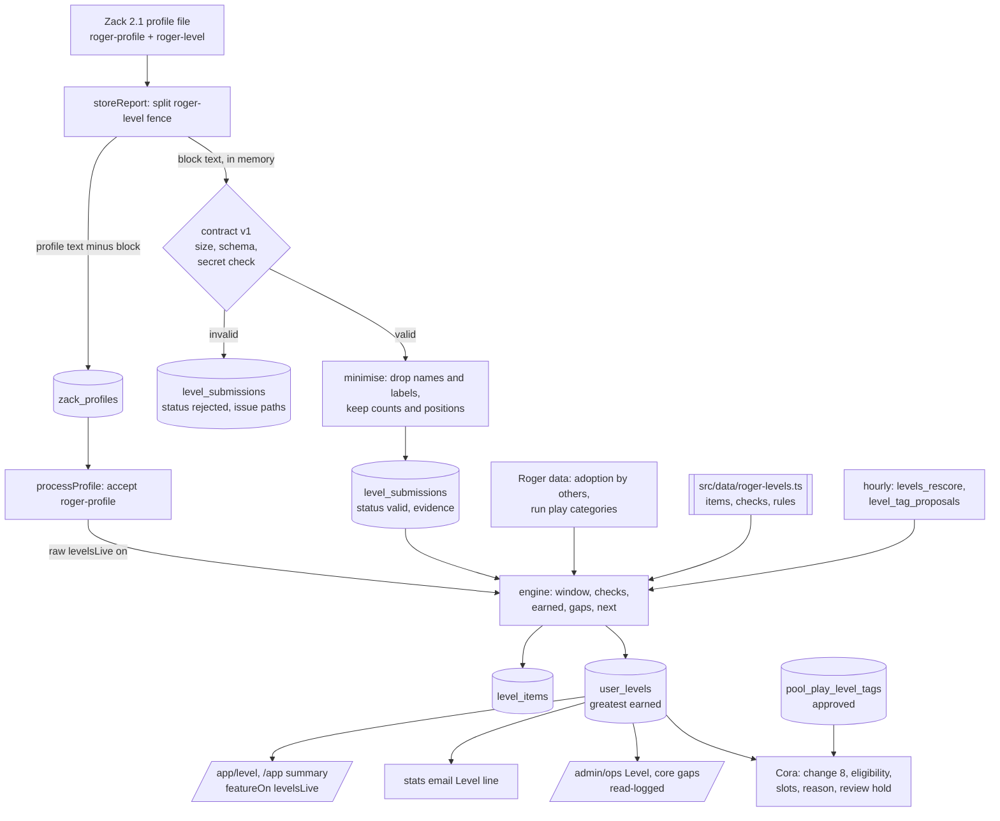
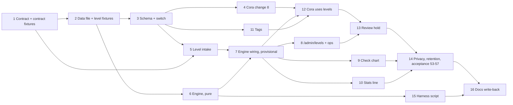

# feat: Roger v3 B4 (levels, built on fixtures, switched off)

## Overview

B4 is one branch, `feat/v3-b4-levels`, and one PR. It builds the Roger AI Levels system from `artifacts/Roger AI Agent Levels and Check Charts v1.1.md` ("the levels file") and `artifacts/Roger Levels Build Spec - Zack 2.1, Cora 2.1 and Dashboard v1.2.md` ("the build spec"), in full, against sample `roger-level` blocks, behind a new setting `v3.levelsLive` that stays off (origin R22). It adds:

- **A frozen contract** for the `roger-level` block (build spec 1.1), versioned, which Zack 2.1 must emit, and fixtures generated from it that cover every level and every edge case.
- **One levels data file**: the ten levels, all 148 check items, every threshold, and for each item the contract fields that settle it (R26). S23 rulings change this file, not the code.
- **Cora 2.0 change 8**, the matching of "Also runs" and the profile's Setup to pool plays, as its own unit with regression tests against B1's Cora (R23).
- **Level intake** (C1): the block arrives with the private profile, is validated against the contract with a size limit, minimised, privacy-checked, and only the validated fields are stored (R24).
- **The level engine and storage** (C2, C3), with rules 2.2 and 2.3 exactly: never lower, at least three core items verified by Zack or Roger data, and a provisional level that is not a floor (R25, R27).
- **Surfaces**: the member's check chart (C4), the stats email Level line (C5), the operations view's Level and core gaps (C6), and `/admin/levels` for the go-live checks (R29, R30).
- **Cora's use of levels**: pool play tags, eligibility, the three slots, reason lines (R31), and the review hold for high-level newcomers with its "goes out as picked" fallback (R32).
- **A harness script** for check #58 (R33), and the docs write-back.

**Stacked branch.** B4 branches from B3's tip (`feat/v3-b3-measurement`, PR #74), which is stacked on B2 (`feat/v3-b2-growth`, PR #66). B4 reads B3's `picks.idea_code`, adoption stamps and read log, and B2's stats job. Until B3 merges, the B4 PR targets `feat/v3-b3-measurement`. Once B3 is on `main` (after B2), rebase and retarget to `main` (origin R1). Merging waits for Peter.

**The one finding that matters most (from the mapping below).** With the build spec 1.1 block as written, Zack 2.1 can settle 69 of the 148 items outright and 25 more through a stated proxy. **36 items coded Zack- or Roger-verified have no field in the block**, 6 of them core (2.04, 6.03, 7.04, 7.06, 8.05, 8.06). Scored strictly, nobody could earn Level 1: 5 of its 6 standard electives are needed, and only 2 can be evidenced, plus the design item. Nobody could earn Level 6, 7, 8 or 9 either. B4 therefore builds a **self-report fallback** for those 36 items (counted as self-reported, so rule 2.1's three-verified-core test still holds), and S24 must widen Zack's Z4 to ask them. See "Verification-code mapping" and "Blockers and spec contradictions".

**From the feasibility review (2026-11-28).** This revision changes:

1. **PR #60:** no longer "carry `a1a3a94` unchanged, the rebase drops it". Unit 5 starts by merging `origin/fix/intake-ignore-unknown-blocks` as its own merge commit, with the `process.ts` conflict resolution recorded (B3's `recordAdoption` kept). The parse-block refactor is a separate later commit. Once #60 merges to `main`, rebasing B4 needs the conflict resolved once more, or #60 is rebased onto the B2/B3 stack first. Recommended: ask Peter to merge #60 first.
2. **Three verified core items, stated plainly:** a data-file property (each level ≥ 3 Full/Proxy core items; a test asserts 3, 3, 6, 5, 5, 5, 5, 4, 3 and flags Levels 1, 2 and 9 as at the minimum) plus an engine rule tested with injected items through `scoreMember(input, rules, items)`. `source` is defined for mixed codes (verified when the Z evidence is present; 9.01 counts, per levels file line ~372). Every "every X" check has `nonEmpty`. Fallback answers fill at most half of a level's needed electives. Z4's ≤ 5 questions a run is a go-live constraint.
3. **Switch-off proof:** the query-trace helper normalises ids, holders, timestamps and method stamps and sorts concurrent batches; every unit touching a B1–B3 path commits a baseline before its change; a select that gains a column gets a separate SQL constant chosen by the switch; an explicit, reviewed exception list.
4. **Cora change 8:** a switch-on "nothing to match" test against the B1 snapshot; a dedicated exclusion matcher with its own prompt ("when in doubt, treat it as already run") and an adapter from member text, not `MergeModel.sameJob`; matches merged into `u.ctx` after `loadUsers`; at most 200 model calls a run.
5. **Review hold:** `sent_unreviewed` only after `deliverWeek` reports delivered; "newcomer" reuses B1's first-list SQL and covers the teaser case (held once); a read-logged picks view and "Drop this pick" (replaced by the next-best eligible pick); a per-day cap on hold alerts.
6. **Rescoring:** a `no_valid_submission` marker so test-only members aren't re-selected; drain until the slice deadline; the `level_items` write depends on the `user_levels` upsert's `returning`, in one statement.
7. **Never lower:** a one-line before-update trigger (`create or replace`, per `schema.test.ts`), an audited admin reset (one email admin plus a logged reason), and gaps computed from the row the upsert writes.
8. **Tags:** the card shows a play excerpt; a deterministic entry-level bound computed in code; tags go stale when item IDs change; seed tagging through the budgeted hourly task (`v3.levelTagsOn`), not a server action; no tools, play text tagged as data.
9. **Scope cuts:** no `runs.level_blocks_dropped` or run-fence handling (#60 covers runs); no service allowlist or ordinals (counts only); one "Validate a block" form kept, `/admin/levels/[id]` dropped for the member admin page; no contributor rescoring for 9.03/9.06; retention erases the earned number with the evidence (the keep-it option is a "for Peter" note); member texts trimmed to the statement plus one "How this is checked" text per code, all in wording section 15.

## Problem Frame

See origin: `docs/brainstorms/2026-11-27-roger-v3-b2-b3-b4-requirements.md` (R1, R2, R5, R22–R33, the B4 success criteria and scope boundaries). The behaviour is specified in the levels file (rules 2.1–2.6, the check charts in section 3, the item counts in section 4) and the build spec (sections 1.1–1.3, 2.1–2.4, 3.6, 3.7), with the design spec (`artifacts/Roger v3 - design spec.md`) B.4 quiz question 5, B.16a, B.17, 0.9 and B.18 checks 53–58.

Today a member's level is the Roger team's judgment (build spec 3.3), and Cora's three ideas ignore it, so a Level 3 member can be sent a self-evolving loop. B4 makes the level a measurement: Zack reports what the agent account actually does, Roger scores it against the check charts, the member sees the next level's chart, and Cora fills one slot with a gap fix and one with a step to the next level. Nothing of this can be tested on real runs yet: Zack 2.1 isn't written (S24) and B1 isn't live. So B4 is built against a frozen contract and generated fixtures, and goes live in three steps once Zack 2.1 is approved and live.

## Requirements Trace

| Req | What | Unit |
|---|---|---|
| R1 | Own branch and PR, stacked on B3 | All (Overview) |
| R2 | Dark on production; `v3.levelsLive` off, in the 0.9 settings table | 3, 16; each unit's "switch-off proof" |
| R5 | Admin role checked on the server; every admin action in `admin_actions` | 8, 11, 13 |
| R22 | Build now on fixtures; the block layout frozen as a versioned contract; fixtures generated from it; go live after S23, S24 and one validated real run per agent | 1, 2, 8, 16 |
| R23 | Cora change 8 first, its own unit, regression tests against B1's Cora | 4 |
| R24 | Level intake with the private profile: contract validation, size limit, only validated fields stored, privacy check, not in the pool, review bot or any PR, owner and admins only (read-logged), deleted with the account | 5, 8, 9, 14 |
| R25 | Engine: live states (rule 2.2), earned level (rule 2.3, never lower), gaps and next items, three verified core items | 6, 7 |
| R26 | One data file with every level, item, threshold and settling field; rulings are data edits | 2 |
| R27 | Provisional level from quiz Q5 or an admin, replaced up or down by the first Zack 2.1 run; Cora uses it for eligibility | 7, 8, 12 |
| R28 | S23 questions built as each file recommends, listed for Peter | 2, "Built as recommended" |
| R29 | Dashboard check chart; Seasons stay on `/app/history`; operations view Level and core gaps | 8, 9 |
| R30 | Stats email Level line and "1 step from Level N" | 10 |
| R31 | Tags (proposed by a review step, approved by an admin, seed plays tagged once), eligibility, slots, reason lines, no other member's level | 11, 12 |
| R32 | Verified Level 7 or 8 newcomer's first list held for review; never on a provisional level; goes out as picked with both admins alerted if unreviewed by send time | 13 |
| R33 | Harness script for #58; doesn't block the PR | 15 |
| Success: #53–57 on the fixture set; three-step go-live | Acceptance suite and go-live checks | 14, 8, 16 |

## Scope Boundaries

- **No Zack 2.1 content** (S24). B4 freezes the contract Zack 2.1 must emit and documents it for whoever writes Zack 2.1; it writes nothing in `content/zack/`.
- **Out of scope (build spec 3.7):** the fuller multi-question provisional level (C7), Level 9 verification from referrals (so 9.09, and the R part of 9.07, are not evidenced; see the mapping), level-based group sessions, and "beyond 9".
- **No public display of anyone's Level.** Not on the leaderboard, not on the public sample, not in any idea another member sees (R28, R31).
- **No change to B1, B2 or B3 behaviour while `v3.levelsLive` is off,** except for the entries on one explicit, reviewed exception list (`src/test-helpers/switch-off-exceptions.ts`, see "Switch-off proof, the shared harness"). The main one is for an input those versions never receive: a `roger-level` fence is cut out of a stored profile at receipt whatever the switch (Unit 5, privacy). Every unit states how it proves the rest.
- **No privacy check on the existing `roger-profile` fields.** R24's check covers the level block (see Built as recommended 12). The `roger-profile` stays as B1 stores and reads it.
- **No admin override of a verified level.** An admin sets only a provisional level, and only until the first Zack 2.1 run.
- **No new cron schedule.** The engine runs in profile intake, the rescore and tag proposals in the hourly pass, Cora's use of levels in the Monday job.
- **No renumbering** of versions; the per-run code stays unreachable and untouched.

## Context & Research

### Relevant Code and Patterns

- **The levels already in code.** `src/data/roger-levels.ts` (B2 Unit 1b) holds the ten levels word for word (`level`, `name`, `does`, `symptom`) and `LEVEL_QUIZ_VERSION = "1.1"`. Quiz question 5 stores `users.profile.level` with `levelQuiz: "1.1"` (`src/lib/signup/quiz.ts`); answers without the marker are on the v1.0 list (0–8, same names for 0–8, where 8 meant "8 or above"). `src/components/app/quiz-form.tsx` imports `rogerLevels`.
- **Receipt.** `src/lib/zack/receive.ts`:
  - `checkReport` (size `MAX_REPORT_CHARS` 80,000, `kindOf` run or profile);
  - `storeReport` inserts a profile into `zack_profiles` keyed `(user_id, week_of, is_test)` where not deleted. **One profile per member per week**: a second profile in the week, from any agent, replaces the first (`revision + 1`). The same holds for runs.
  - Profiles carry no agent column. The member's agent is `users`' primary agent (`zackFileFor`).
- **Profile intake.** `src/lib/intake/process.ts` `processProfile(q, id, now)`: parses the `roger-profile` block by regex (`parseProfileBlock`), stores `parsed` as is (**no privacy check**), then `recordAdoption` (B3 change 15), which never fails the profile. Called on arrival (`src/lib/intake/arrival.ts`) and in the batch pass `processPending`.
- **PR #60 is not in this branch's base.** Commit `a1a3a94` ("keep private roger-* blocks away from the intake model", branch `fix/intake-ignore-unknown-blocks`, PR #60, open against `main`) adds `withoutPrivateBlocks` to `src/lib/intake/parse-block.ts`: it pairs Markdown fences line by line (same character, closer at least as long, bare closer, any case or underscore) and drops every `roger-*` block other than `roger-run` and `roger-profile` from the text the run pipeline gives the model. It is not an ancestor of `feat/v3-b3-measurement`. It conflicts with B3 in `src/lib/intake/process.ts` (B3 added `recordAdoption` there). Launch list `b2-pr60` already requires it merged before Zack 2.1 ships. It also covers the run path for B4: a `roger-level` fence in a run file never reaches the intake model. How B4 handles this: Unit 5.
- **Privacy scrub.** `src/lib/intake/privacy-patterns.ts`: `normalise`, `replacePatterns` (emails, links, phones, addresses, postal codes, long numbers), `replaceNeverWords`, `harmFlags`, `replaceIdeaIds`. There is no secret-token pattern (API keys, bearer tokens) today.
- **Cora.**
  - `src/lib/cora/context.ts` `loadUsers`: `alreadyRuns` is only the member's own plays from the last four weeks (by `pool_play_id`); "Also runs" (`runs.parsed.also_runs`, title, category, job) and the profile's `setup.skills/routines/bots[].job` are **not** matched to pool plays (change 8 unbuilt; `content/cora/cora.md` "Not built"). `declined` holds `past_ideas[].idea_id` strings (B3's `R-XXXXXXXX` codes) but `eligible.ts` compares it with pool play ids, so it never matches today. It has no effect, since a delivered idea is already excluded as `already_sent`. Change 8 maps codes to pool plays (Unit 4).
  - `src/lib/cora/eligible.ts`: the one definition of an eligible play (picking and the ops count both use it).
  - `src/lib/cora/pick.ts` `pickThree`: installable first, Fit 3+ by personal score, then Fit 1 by network score, at most one upgrade.
  - `src/lib/cora/job.ts`: phases `started → intake_closed → merged → scored → picked → ready`, leased; `pickFor` per member (Fit model with a breaker, upgrade, `RECORD_PICKS_SQL`). `src/lib/cora/merge.ts` `MergeModel.sameJob(play, candidates)` is the merge "same job" judgment; change 8 uses its call shape but its own exclusion prompt (Unit 4).
  - `src/lib/cora/send-job.ts` and `deliver.ts`: the Monday send (`deliverWeek` reports whether the list was delivered). "Held" already means a no-card list (B.7 "Held lists"), so the R32 hold is named the **review hold** everywhere. `FIRST_LIST_PENDING_SQL` in `deliver.ts` (lines ~48–49) is B1's "nothing ever delivered" test: no real `picks.delivered_at` and no real `cora_user_weeks.delivered_at`. A no-card teaser sets `users.first_teaser_at` and delivers nothing.
- **Settings and switches.** `src/lib/v3-settings.ts` `v3Schema`, `readV3Settings()` (fail-closed), defaults in `src/data/config.ts` `v3Defaults`. `src/lib/v3-features.ts` `featureOn` (own switch + `signupOpen` + `cycleLive`) with documented raw-switch exceptions (credit posting, `reviewBotOn`, `coraUpgradesOn`). Admin switches: `B3SwitchesForm` in `src/components/app/admin-v3.tsx`, `saveB3SwitchesAction` in `src/app/admin/v3-actions.ts`, shown on `src/app/admin/settings/page.tsx`.
- **Schema.** `db/schema.sql` append-only below the freeze line, dated, idempotent; `setup.mjs` splits on a line-ending semicolon and strips text after two dashes (no comment line ends in a semicolon, no string holds two dashes). `db/schema.test.ts` has a table list per version; `db/schema.pglite.test.ts` checks a second apply changes nothing. Nothing applies the schema on deploy.
- **Neon over HTTP has no transactions.** Guarded writes are single-statement CTEs with the irreversible write last and gated on `exists(...)`.
- **Job clock and leases.** `src/lib/cron.ts` `cronNow`; never act ahead of the real clock; stamps `coalesce($n::timestamptz, now())`. `src/lib/leases.ts` `takeLease`/`releaseLease`, every protected write checks the holder.
- **Hourly pass.** `src/lib/housekeeping/job.ts` `HOURLY_TASKS`, `runHourly` (returns early while `cycleLive` is off), per-task deadlines (B3's `review_pr_sync` slice is the pattern for a budgeted model task).
- **Read logging (B3 Unit 6).** `src/lib/admin/read-log.ts` `ReadWhat` (`read_runs`, `read_picks`, `read_feedback`, `read_profile`, `read_emails`), `logAdminReads`/`readsLogged`, `READ_NOT_LOGGED`, fail-closed before render, ids capped at 200, the member page's "Who read this member's data".
- **Admin.** `src/lib/admin-auth.ts` (`isAdmin`, `requireAdmin`), `src/lib/admin/log.ts` (`logAdminAction`, `audited`), tabs in `src/components/admin-ui.tsx`. The ops screen: `src/lib/admin/ops.ts` (`Attention`, `ATTENTION_LABELS`, `FEW_ELIGIBLE`, reads `loadUsers` + `eligiblePlays`), `src/app/admin/ops/page.tsx`. The approve/edit/reject pattern for a review queue: `src/lib/admin/flags.ts` with `/admin/flags`.
- **Stats email.** `src/lib/growth/stats-job.ts` (leased, windowed, `featureOn(statsOn)`), `src/lib/mail/templates/stats.ts` `statsEmail({ season, … })`; `stats.test.ts` asserts the email never contains "level" (check 51).
- **Models.** AI SDK v7 through the AI Gateway; `dataTag()` and `call()` exported from `src/lib/intake/model.ts` (B3); zod `Output.object`; no tools; `rethrowIfUnavailable`.
- **Deletion and retention.** `src/lib/admin/users.ts` `deleteAccount` deletes the `users` row (cascades). `src/lib/housekeeping/retention.ts` `ERASE_SQL` and `HOLDS_DATA_SQL` (runs, plays, profiles, feedback), used by `applyRetention` and `applyIdleRetention`.
- **Review bot inputs.** `src/lib/review/evidence.ts` builds the bot's evidence (runs, flags, rejections, picks, set-up rates, feedback); `src/lib/review/safety.ts` and `github.ts` build the PR payload.
- **Scripts.** `scripts/seed-import.ts` runs with `node --env-file=.env.local node_modules/vite-node/vite-node.mjs --config vitest.config.ts`.
- **zod 4.6** is installed, so `z.toJSONSchema` is available for the contract snapshot.

### Institutional Learnings

- `docs/solutions/logic-errors/tightening-a-fail-closed-settings-read-schema-bricks-saved-data-2026-11-27.md`: `levelsLive` gets a default in `v3Schema`, and any new rule goes on the write path, never the fail-closed read.
- `docs/solutions/database-issues/data-modifying-cte-runs-even-when-insert-conflicts-2026-11-22.md` and `docs/solutions/best-practices/test-claim-sql-on-pglite-2026-11-22.md`: the profile-plus-submission insert, the never-lower upsert and the hold claim are single statements, raced on PGlite with `Promise.all`.
- `docs/solutions/best-practices/job-clock-not-database-now-2026-11-23.md` and `lease-must-guard-every-write-not-just-entry-2026-11-23.md`: engine stamps (`earned_at`, `computed_at`) take the job clock; the rescore and tag tasks are leased per write.
- `docs/solutions/best-practices/fail-closed-read-log-one-statement-before-render-2026-11-28.md`: every admin page that shows a member's level data writes a `read_levels` row first.
- `docs/solutions/logic-errors/side-effect-tied-to-winning-transition-is-lost-2026-11-22.md`: the review hold's alerts (at hold and at "sent unreviewed") are retried on every pass, not only by the run that set the state.
- `docs/solutions/best-practices/purging-a-guard-table-and-idle-clocks-2026-11-27.md`: before retention erases level evidence, list every reader that tests for its absence (the rescore task, the hold's "newcomer" test).
- `docs/solutions/best-practices/windowed-email-job-needs-spread-retries-and-an-independent-check-2026-11-27.md`: the Level line adds no new send path; the stats job's retries are unchanged.
- `docs/solutions/security-issues/model-edits-for-a-public-repo-anchor-discard-and-guard-the-gateway-2026-11-28.md`: level data must never reach the review bot's evidence or a PR body; proven by a payload-search test (Unit 14).
- `docs/solutions/developer-experience/scripted-edits-mangle-escapes-and-crlf-2026-11-22.md` and the memory note on Unicode escapes: the data file copies 148 statements with curly quotes, ellipses and dashes. It is checked against the levels file by a test that parses the Markdown tables (Unit 2), not by eye.
- From PR #60 (not yet in this base): `markdown-fences-by-pairing-not-regex-2026-11-27.md`. A single regex leaked or truncated private blocks in five ways, so fences are paired line by line.

### External References

None needed. Every layer B4 touches has strong local patterns (settings, schema, Cora, intake, admin, mail, the hourly pass).

## Key Technical Decisions

- **The contract is JSON, fenced ` ```roger-level `, version 1, defined once in code.**
  - The layout in build spec 1.1 is written YAML-like, but Zack 2.0's blocks (`roger-run`, `roger-profile`) are JSON, parsed with `JSON.parse`. The contract keeps that: one JSON object per block, the keys and nesting of build spec 1.1, `zack_version: "2.1"`.
  - `src/lib/levels/contract.ts` holds the zod schema `levelBlockV1`, the limits, and `LEVEL_CONTRACT_VERSION = 1`. Contract v1 is the schema for `zack_version` 2.1. A later Zack that emits another layout gets a new schema version, never an edit to v1.
  - **Frozen by test:** `z.toJSONSchema(levelBlockV1)` is snapshot-tested. Any change to the contract fails the snapshot unless the version is bumped and the snapshot rewritten on purpose.
  - The human-readable contract for whoever writes Zack 2.1 is `artifacts/Roger Level Block Contract v1.md`, with the full example block. A test parses the example out of that file and validates it, and checks the document lists every key the schema has.
- **The contract fixes what build spec 1.1 left loose** (each decision is in the contract document):
  - Counts are integers 0 to 10,000. Dates are `YYYY-MM-DD`, not before 2020-01-01 and not after the receipt date + 1 day.
  - `cadence` is an enum: `hourly`, `several_daily`, `daily`, `weekdays`, `weekly`, `monthly`, `other`. Rules 4.09 and 4.17 compare cadences, which free text can't support.
  - `activity_7d` counts the agent account's own work in the 7 days **excluding Zack's own run** (otherwise 1.02 is always 1).
  - `history_flags` are counts of events **since the previous Zack run** (not running totals), so the engine can apply horizons.
  - `self_report[]` entries are `{ item, answer: 0 | 1, date }` with an item ID from the data file (S items, and the fallback items below). Duplicates: the latest date wins.
  - `domains[].stages_covered` ⊆ `intake`, `work`, `delivery`, `follow_up`.
  - `platform` is the agent account's platform: one of the Zack agents (`claude`, `grok-bot`, `hark`, `duet`) or `other`.
  - Unknown keys are not an error and are never stored (only validated fields are kept).
- **Strict validation; a bad block never costs the profile.** A block that fails the schema (not JSON, wrong type, enum out of range, over a limit) is **rejected whole**. The submission records the reason as issue paths only (`inventory.routines[3].cadence: invalid`), never values. The profile is still accepted and Cora still matches on it; the member's run is still scored on its other evidence (R24, #53). Chosen over field-level leniency because the go-live step "a real Zack 2.1 run from each agent validates" needs a yes-or-no answer, and a frozen contract is only useful if drift is visible. Rejections are visible on `/admin/levels`, with a count.
- **Size limits.** The block's text at most 30,000 characters (the whole report is already capped at 80,000). Arrays: agents 60, routines 200, skills 200, connections per agent 40, `models_used` 20, `self_report` 160, `domains` 12. Strings at most 120 characters. More than one `roger-level` block in one profile is rejected ("one block per agent account", build spec 1.1).
- **Minimise, then check, then store.** Only what the engine reads is stored, in a normalised shape:
  - **No free text is kept.** Agent, routine, skill and domain names, `job_sentence`, connection labels and model names are used only inside the block, then dropped. Links (`owner_agent`, `used_by`) become array positions in the stored arrays, `job_sentence` becomes `has_job_sentence`, domains keep only kind and stages.
  - **Labels become counts, not allowlists.** The checks that compare labels need only counts, so minimise computes them from the normalised labels and keeps the numbers: `distinct_services` (across agents), each agent's `distinct_connections`, and `distinct_models`. "No agent holds every service" (5.05) is "no agent's `distinct_connections` equals `distinct_services`". So no label, no service allowlist and no opaque index is stored, and no model pass is needed.
  - **The privacy check (R24)** runs on the block's raw text before anything is kept. A string that looks like a secret (API keys, bearer tokens, private keys, passwords after `password:`; new `secretFindings` in `privacy-patterns.ts`), a card or bank number, or a government ID rejects the block ("contained what looks like a secret or an ID number; nothing from it was kept"). Since no free text is kept, there's no label scrub.
- **The block is cut out of the profile at receipt, never written raw.** `storeReport` splits each `roger-level` fence off a profile before the insert, using PR #60's fence-pairing walker. The profile's `raw_text` is stored without it, and the validated, minimised submission goes into `level_submissions` **in the same statement**. So no unvalidated block ever reaches the database through the profile path, the admin's raw views, retention's erase list or the review bot. **Run files are left to PR #60:** a `roger-level` fence in a run is stored as B1 stores any run text, never reaches the intake model (#60's `withoutPrivateBlocks`), and is never evidence: the block belongs to the profile (build spec 1.1). B4 adds no run column and no run-path handling.
- **Capture always; earn only with the switch.**
  - Intake (validate, minimise, store) runs whatever `v3.levelsLive` says. It's private data, deleted with the account, and the go-live steps need it: "validate one real run per agent" reads the stored submissions, and the evidence window needs past runs when the switch goes on.
  - The engine (live states, earned level), every member surface, the ops column and Cora's use of levels wait for the switch. When it's turned on, the hourly rescore scores every member from their stored submissions under the rules in force then. So no level is earned under rules that later change (R26).
  - With no Zack 2.1 live, no block ever arrives, so production holds nothing.
- **Submissions are kept per platform.** `level_submissions` is unique on `(user_id, week_of, platform, is_test)`. A replacement from the same platform in the same week replaces its submission. A profile from a second platform the same week replaces B1's profile row (unchanged B1 behaviour) but adds its own submission. That's how all of a member's platforms combine into one level (R28) without changing B1's one-profile-a-week storage.
- **The data file is declarative; rulings are data edits.**
  - `src/data/roger-levels.ts` stays the one levels file (the quiz keeps importing `rogerLevels` unchanged). It adds `levelItems` (148), `LEVEL_RULES` (window, grace, elective share, minimum verified core, self-report age, hold levels) and `LEVELS_RULES_VERSION`.
  - Each item: `id`, `level`, `kind` (`core`, `elective`, `design`), `code` (as printed, for example `ZI + ZH`), `statement` (word for word), `guardrail`, `short` (the plain label, used only where the statement is too long: reason lines and the admin core-gap lists), `settledBy` (the contract fields and Roger facts, as text, for the admin page and this plan; not member-facing), `check` (a declarative rule), `status` (`full`, `proxy`, `fallback`, `self`), `source` (for mixed codes, below), `nonEmpty` (for every "every X" check, below), `horizonWeeks` (when the item names a period), and `ruling` (when its threshold is an S23 recommendation).
  - **Member-facing text is trimmed to what the check chart shows:** the statement (word for word) and one "How this is checked" text **per verification code** (`VERIFICATION_CODES`: ZI, ZA, ZH, S, R, plus one for fallback items), not per item. The `short` labels and the code texts are all listed in wording sign-off section 15.
  - **Mixed codes** (S + ZA, ZI + S, S + R, ZI + ZA, ZI + ZH, ZA + ZH, ZI + R): `source` says how a live 1 is counted for rule 2.1. An item that needs both a Zack part and a self-report part is live only when both hold, and its source is the Zack (or Roger) part: verified when that evidence is present, self otherwise. **9.01** (S + ZA) follows the levels file (line ~372, "9.01's activity part, 9.03, 9.06"): it's live when the self-report is 1 and `act.others_served_directly ≥ 1`, and then counts as verified (`zack`), since the ZA part is required. A 9.01 self-report of 1 with no ZA evidence is live 0, not a self-sourced 1. 7.01 and 7.08 (ZI + S) work the same way. 9.07 (S + R, the R part out of scope) is `self`.
  - **`nonEmpty`:** every "every X has Y" check carries `nonEmpty: true`, so an empty collection is 0, never a vacuous 1: 4.04, 4.05, 4.06, 4.18, 4.19 (every `Rt`), 6.01, 6.16, 6.21, 7.07 (every `A`), and 6.06 (every `A` with connections: at least one such agent). A data-file test asserts every `every(...)` check has `nonEmpty: true`.
  - `check` is a small vocabulary interpreted by `src/lib/levels/checks.ts`: `count_at_least(path, min)`, `some(collection, where)`, `every(collection, where, nonEmpty)`, `count_where(collection, where, min)`, `distinct_at_least(path, min)`, `memory_has(any)`, `within_weeks(path, weeks)`, `changed_between_runs(kind)`, `roger(fact, min)`, `self_report`, `all_of`, `any_of`. Thresholds live in the data (6.02's five clean runs, 70%, three verified core). A ruling that changes a threshold or a kind is a one-line data edit. A ruling that needs a new kind of evidence needs a contract version, which the docs say plainly.
- **The unevidenced items fall back to self-report, counted as self-reported.** An item coded ZI, ZA, ZH or R whose evidence has no field in contract v1 (36 items, marked `fallback`) is settled by Zack's `self_report` answer for it, and counts as **self-reported** for rule 2.1. Without this, Levels 1, 2 and 6 to 9 can't be earned at all (see "Blockers"). The fallback keeps every level reachable, while the three-verified-core rule still stops a level resting on self-report. S24 must widen Z4 ("ask self-report questions only for items with code S") to "code S or marked fallback in the contract document", still at most 5 a run, for the next level and the last blocker. Built as recommended 9.
  - **Fallback answers are capped toward the elective share:** at most half (rounded down) of a level's required electives may come from fallback answers (`LEVEL_RULES.maxFallbackElectiveShare: 0.5`). S items aren't capped (self-report is their design). With the cap, Levels 1, 7, 8 and 9 are still reachable, but only at the margin: Level 1 needs 5, 3 are reachable without fallback, and the cap allows 2; Level 7 needs 7 (4 + 3); Level 8 needs 6 (3 + 3); Level 9 needs 5 (3 + 2).
  - **Z4 throughput is a go-live constraint.** At most 5 self-report questions a run, across 54 fallback and S items, means answers accumulate over several weekly runs (self-reports aren't windowed, so they add up). Level 1 alone needs about 6 answers, so a new member needs at least two runs. Before switch-on, S24 must confirm Z4 asks the next level's core items first, then the electives still needed, and the team accepts that pace. The chart shows an unanswered fallback item as "Zack will ask about this".
- **The evidence window (rule 2.2), exactly:**
  - Per platform, the window is that platform's latest 4 accepted submissions (the current run and the previous three), counted only when the submission's week is within the last 8 weeks. A platform that stopped running drops out of the live chart instead of showing stale 1s (Built as recommended 10).
  - An item is 1 when its evidence appears in any submission in the window, on any platform (R28: an item is 1 if any run shows it).
  - **The cadence rule:** an inventory routine whose `last_run` is inside its own cadence plus grace (daily: 2 days, weekly: 9 days, monthly: 5 weeks, per rule 2.2) counts as running, even if its run fell outside the 7 days.
  - **ZH horizons:** items that name a period look back that long across all of the member's stored submissions, not just the window: 6.14 (3 months, 13 weeks), 8.03 (8 weeks), 7.04 and 6.09 ("monthly", 5 weeks). The rest use the window.
  - **Self-reports** aren't windowed. The latest answer per item stands until replaced. A guardrail item's answer expires after one Season (26 weeks), which makes it 0 until Zack re-asks (R28).
- **Earning a level (rule 2.3) and the verified-core rule (2.1), exactly:**
  - The Level is the highest L in 1–9 for which, for every level K from 1 to L: every core item of K is live 1; at least `ceil(0.7 × standard electives of K)` of K's standard and design electives are live 1 (design counts when met, never against; fallback answers count for at most half of that number, rounded down); and **at least 3 core items of K are live 1 from Zack or Roger evidence** (source `zack` or `roger`, not a self-report or a fallback answer).
  - **The three-verified-core rule is two things, tested separately:**
    1. **A property of the data file:** each level has at least 3 core items with status `full` or `proxy`. A data-file test asserts the exact per-level counts, 3, 3, 6, 5, 5, 5, 5, 4, 3 for Levels 1–9, and the file flags **Levels 1, 2 and 9 as at the minimum**: one ruling that moves a core item of theirs to fallback or self breaks rule 2.1 for that level, and the test fails.
    2. **An engine rule:** tested with injected items through `scoreMember(input, rules, items)`, not only the real data. For example, a level whose four core items are all live but only two have a verified source isn't earned.
  - A member with no valid submission is not scored.
  - **Never lower:** the stored `level_earned` is `greatest(stored, computed)` in SQL, and a before-update trigger refuses any decrease except an audited admin reset (Unit 7). The rescore can raise it, and nothing else can lower it (#54).
- **Live level, gaps, next items.** Besides `level_earned`, the engine stores `live_level` (what today's chart alone supports, which can be lower), `core_gaps` (live-0 core items at or below the earned level), elective gaps, and the next level's open items. "1 step from Level N" means exactly one core item open for N = earned + 1 (C5). Gaps sort core first.
- **The provisional level (R27).**
  - Until a member's first scored Zack 2.1 submission: from quiz question 5 (`levelQuiz` "1.1": the answer; no marker: the v1.0 answer, the same number for 0–8, where 8 reads "8 or above" and is placed at 8), or a level an admin sets (which wins over the quiz), shown as "about Level N".
  - **Not a floor:** the first scored submission replaces it with the computed level, up or down. From then on the earned level never drops, and the provisional value is kept only for the record.
  - An admin can set a provisional level only while no verified level exists.
  - Cora uses it for eligibility (R31). It never triggers the review hold (R32).
- **`v3.levelsLive` is a member-facing switch through `featureOn`, with two raw-switch exceptions.**
  - The dashboard chart, the `/app` summary and nav link, and the stats line ask `featureOn(settings, "levelsLive")` (switch + `signupOpen` + `cycleLive`).
  - The engine and Cora's use of levels (change 8, eligibility, slots, the hold) read the raw switch, documented in `v3-features.ts` like `coraUpgradesOn`. Cora runs only while `cycleLive` is on anyway, and pausing sign-up mustn't change members' picks mid-cycle.
  - Admin surfaces: `/admin/levels` works whatever the switch (admin-only, new, needed before go-live). The ops screen's Level column appears only with the raw switch on, so the B1 screen is unchanged while it's off.
- **Change 8 sits behind `v3.levelsLive`** (raw, in the Cora job). It changes live Cora matching. `loadUsers` is unchanged; with the switch on, the matches are merged into each member's context after it. It could have its own switch if Peter wants it live before levels (Built as recommended 14).
- **Tagging reuses the review pattern, not the flags queue** (the origin's deferred question):
  - Tags live in `pool_play_level_tags` and are reviewed on a new `/admin/levels/tags`, built like `/admin/flags` (approve, edit, reject, audited, admin-checked).
  - `/admin/flags` is the privacy queue for plays entering the pool. Putting level tags in it would make a privacy review wait behind a tagging decision, and the reverse.
  - Tag proposals come from a model (pool play text only, which is already scrubbed and shared: no member data), always in the budgeted hourly task. The one-time seed tagging runs through that same task, started by an admin toggle (`v3.levelTagsOn`), never by a server action that calls the model.
- **Untagged plays are ineligible while levels are live.** Eligibility needs an approved entry level (R31), and treating an untagged play as eligible would let a Level 3 member get an untagged self-evolving loop. So the seed pool must be tagged before switch-on (launch list). A play new this week waits for its approval, and the ops "Fewer than 3 eligible" count, using the same `eligible.ts` rule, shows the effect. Built as recommended 16.
- **Slots are picked around B1's ordering, not instead of it.** `pickThree` is unchanged. With levels on, a new `pickBySlots` (`src/lib/cora/levels.ts`) fills:
  1. **Slot 1:** the best candidate, by B1's order (installable, Fit tier, personal score, friction, rank), that unlocks a core gap; else an elective gap; else it is treated as Slot 2.
  2. **Slot 2:** the best that unlocks an open core item of Level + 1.
  3. **Slot 3:** the best remaining by B1's order.
  - A slot with no candidate falls through to the next rule. When exactly one core item is open for the next level, Slots 1 and 2 both target it with different plays.
  - The one-upgrade cap still applies. Plays that only unlock items already live are excluded unless they're upgrades (build spec 2.2).
- **Reason lines are code templates.** Slot 1: "Closes a gap: {short}." Slot 2: "A step toward Level {N}: {short}.", or the next level's symptom ("For when {symptom}") when the member's live chart shows that symptom: their next level's core items are mostly open. Slot 3 keeps B1's reason line. Only the member's own level and the item's general label appear, never anyone else's level or name (R31). The wording waits for sign-off (section 15).
- **The review hold (R32) never stops a send.**
  - At pick time, a member whose **verified** level is 7 or 8 (not provisional) and who is a newcomer (B1's "nothing ever delivered" test, and never held before) gets `cora_user_weeks.review_hold = 'waiting'`, and both admins are alerted with a link to `/admin/levels#holds`.
  - An admin opens the held list there (a read-logged picks view) and either approves it or drops a pick, which is replaced by the next-best eligible pick (both logged).
  - At send time, a list still waiting goes out as picked. Only after `deliverWeek` reports it delivered does the hold become `sent_unreviewed`, and both admins get a second alert. Both alerts are retried by every pass until sent, under a per-day cap.
  - Dry runs never hold.
  - Review can change what is sent (drop and replace), never delay it (Built as recommended 19).
- **Retention erases the evidence and the earned number together.** Retention's erase (90 days after access ends, and 12 months idle) deletes the member's `level_submissions`, `level_items`, `cora_job_matches` and their `user_levels` row, along with the account's other data (R24: deleted with the account). A returning member starts again from the provisional level. Account deletion cascades everything. Keeping the earned number through retention is only a "for Peter" note (Built as recommended 13).
- **Roger data for 9.03 and 9.06 uses Zack-confirmed adoption.** Another member's delivered pick of a pool play this member contributed to (`pool_play_contributors`, including a linked seed contributor), counted when `setup_confirmed_at` or `used_at` is set (Zack saw it), not on a self-mark. Distinct people, as Cora counts them. It's read at the member's own next score; nothing rescores a contributor when someone else adopts (Built as recommended 18).

## Verification-code mapping (origin deferred question, done first)

**How to read it.** Paths are contract v1 fields. `A` = `inventory.agents[]`, `Rt` = `inventory.routines[]`, `Sk` = `inventory.skills[]`, `M` = `inventory.memory`, `act.` = `activity_7d`, `hist.` = `history_flags`, `dom` = `domains[]`, `sr` = `self_report`, `R:` = Roger's own data.

Zack 2.1 column:

- **Full**: the fields settle it.
- **Proxy**: the fields settle a stated approximation; the gap is named.
- **Gap**: **no field in contract v1 can evidence it.** Settled by the self-report fallback (counted as self-reported).
- **Self**: self-reported by design.

Every Full and Proxy item is windowed by rule 2.2 unless a horizon is given.

| ID | Kind | Code | Settled by | Zack 2.1 |
|---|---|---|---|---|
| **Level 1** |||||
| 1.01 | C | ZI | a valid block (an AI account exists) | Full |
| 1.02 | C | ZA | `act.active_days ≥ 1` (Zack's own run excluded) | Full |
| 1.03 | C | ZA | `act.active_days ≥ 1` and (`act.multi_step_completions ≥ 1` or R: the week's accepted run has a play) | Proxy: "a real task, not a test" isn't a field |
| 1.04 | C | S | `sr` (guardrail) | Self |
| 1.05 | C | S | `sr` (guardrail) | Self |
| 1.06 | E | ZA | none: no device field | **Gap** |
| 1.07 | E | ZA | `act.voice_inputs ≥ 1` | Full |
| 1.08 | E | ZA | none: no conversation-shape field | **Gap** |
| 1.09 | E | ZA | none: activity carries no home or work tag (`dom` is Level 7's declaration) | **Gap** |
| 1.10 | E | ZA | R: ≥ 3 distinct play categories across the window's accepted runs | Proxy: from Roger's run data, not the activity |
| 1.11 | E | ZA | none | **Gap** |
| 1.D1 | D | ZA | any `act.design_activity` count ≥ 1 | Full |
| **Level 2** |||||
| 2.01 | C | ZA | `act.active_days ≥ 3` | Full |
| 2.02 | C | ZI | `M` has `instructions`, `profile_file` or `project_pages` | Full |
| 2.03 | C | ZI | `Sk ≥ 1` or `M` has `project_pages` | Full |
| 2.04 | C | ZA | none: prompt content is never recorded (Z2) | **Gap (core)** |
| 2.05 | C | S | `sr` (guardrail) | Self |
| 2.06 | E | ZI | none: skills carry name, origin and used_by only | **Gap** |
| 2.07 | E | ZA | `M` has `project_pages` or `knowledge_base` | Proxy |
| 2.08 | E | ZA | none | **Gap** |
| 2.09 | E | ZA | `act.voice_inputs ≥ 1` | Full |
| 2.10 | E | ZH | `hist.rule_fixes_after_error ≥ 1` | Proxy: any rule fix, not only about the user |
| 2.11 | E | ZA | none | **Gap** |
| 2.12 | E | S | `sr` | Self |
| 2.D1 | D | ZA | `act.design_activity.iterations ≥ 3` | Full |
| 2.D2 | D | ZA | none | **Gap** |
| **Level 3** |||||
| 3.01 | C | ZI | a valid block (every Zack 2.1 platform is an agent platform) | Full |
| 3.02 | C | ZI | some `A.fields_present` ⊇ owns, inputs, may, must_ask, done_when | Full |
| 3.03 | C | ZI | some `A.connections` non-empty | Full |
| 3.04 | C | ZA | `act.multi_step_completions ≥ 1` | Full |
| 3.05 | C | ZI | some `A.rules` has `do_ask_stop` | Full |
| 3.06 | C | S | `sr` (guardrail) | Self |
| 3.07 | C | ZI | some `A.rules` has `stop_when_unsure` | Full |
| 3.08 | E | ZA | none | **Gap** |
| 3.09 | E | ZI | some `A.fields_present` has `done_when` | Proxy: presence, not "checkable" |
| 3.10 | E | ZA | none (`Rt.has.receipt` is per routine, not per job) | **Gap** |
| 3.11 | E | ZI | ≥ 3 distinct services across `A.connections` | Full |
| 3.12 | E | ZA | `act.voice_inputs ≥ 1` and `act.multi_step_completions ≥ 1` | Proxy: "away from my desk" isn't visible |
| 3.13 | E | ZA | `act.browser_only_tasks ≥ 1` | Full |
| 3.14 | E | ZA | `act.approvals.parked ≥ 1` | Full |
| 3.15 | E | ZA | none | **Gap** |
| 3.16 | E | ZI | some `A.fields_present` has `owns` | Proxy |
| 3.D1 | D | ZA | `act.design_activity.iterations ≥ 1` and `directions_generated ≥ 1` | Proxy |
| **Level 4** |||||
| 4.01 | C | ZI | some `Rt` with `trigger`, `cadence`, `last_run` inside its cadence (cadence rule); `act.proactive_starts ≥ 1` (Z3) | Full |
| 4.02 | C | ZI | some `Sk.used_by` non-empty | Full |
| 4.03 | C | S | `sr` | Self |
| 4.04 | C | ZA | every `Rt.has` has `receipt` and `nothing_today_rule` (at least one Rt) | Full (from inventory) |
| 4.05 | C | ZI | every `Rt.has` has `source_check` | Full |
| 4.06 | C | ZI | every `Rt.has` has `retry_limit` | Full |
| 4.07 | E | ZI | ≥ 3 `Rt` running inside cadence | Full |
| 4.08 | E | ZI | some `Rt` with `trigger = event` and `event_scope = narrow` | Full |
| 4.09 | E | ZI | one `Rt` at daily or more often and one at weekly or less | Full (cadence is an enum) |
| 4.10 | E | ZI | some `Rt.delivers_to` in phone, email, text, slack | Full |
| 4.11 | E | ZI | some `dom.kind = home` | Proxy: routines carry no domain |
| 4.12 | E | ZI | some `A.created_by = installed` or `Sk.origin = installed` | Full |
| 4.13 | E | ZI | none: connections are names only, no auth method | **Gap** |
| 4.14 | E | ZH | `hist.usage_cuts ≥ 1`, or a routine slowed or gone between runs | Full |
| 4.15 | E | S | `sr` | Self |
| 4.16 | E | ZI | some `Rt.has` has `end_condition` | Full |
| 4.17 | E | ZI | some `Rt` at daily or more often has `change_check` | Full |
| 4.18 | E | ZI | every `Rt.away_rule` is `allow` or `draft` | Full |
| 4.19 | E | ZI + ZA | every `Rt.has` has `verify_checklist`, and `act.verify_reports.pass + fail ≥ 1` | Full |
| 4.20 | E | ZI + ZH | some `A.rules` has `general_rule_on_correction`, and `hist.rule_fixes_after_error ≥ 1` | Full |
| 4.D1 | D | ZA | `act.design_activity.directions_generated ≥ 4` | Full |
| **Level 5** |||||
| 5.01 | C | ZI | ≥ 3 `A` with a job sentence | Full |
| 5.02 | C | ZI | some `A.role = coordinator` | Full |
| 5.03 | C | ZA | `act.agent_to_agent_handoffs ≥ 1` | Full |
| 5.04 | C | ZI | ≥ 2 `A` and `M` has `project_pages`, `decisions_log` or `knowledge_base` | Proxy: "read before, update after" isn't visible |
| 5.05 | C | ZI | with ≥ 2 `A` and ≥ 3 services, no `A` holds every service | Proxy: "what its job needs" isn't visible |
| 5.06 | C | S | `sr` (guardrail) | Self |
| 5.07 | E | ZH | `A.created` dates span ≥ 2 weeks | Full |
| 5.08 | E | ZI | none: no handoff-format field | **Gap** |
| 5.09 | E | ZI | some `A.role = checker` | Full |
| 5.10 | E | ZA | none: no per-agent chat share | **Gap** |
| 5.11 | E | ZI | ≥ 3 `dom` | Proxy: lanes aren't a field |
| 5.12 | E | ZI | some `dom.kind = home` | Proxy |
| 5.13 | E | ZI | none: a routine's purpose isn't a field | **Gap** |
| 5.14 | E | ZI | `inventory.pages_dashboards ≥ 1` | Full |
| 5.15 | E | ZI | some `A.rules` has `usage_rules` and `loop_cap` | Full |
| 5.16 | E | ZI | ≥ 2 distinct `models_used` | Proxy: "on purpose" isn't visible |
| 5.17 | E | ZI | some `Rt` whose owner agent has `role = routines_only` | Full |
| 5.18 | E | ZI | some `A.role = catch_all` | Full (its flagging habit isn't visible) |
| 5.D1 | D | ZA | `act.design_activity.playground_built ≥ 1` | Full |
| **Level 6** |||||
| 6.01 | C | ZI | every `A.autonomy` set | Proxy: Z6 has Zack derive autonomy for every agent, so this is 1 for any account with agents; "recorded" by the member isn't a field |
| 6.02 | C | ZH | `hist.promotions ≥ 1`, or an agent's autonomy moving up to schedule, coordinate or own between runs | Proxy: the R28 ruling (5 clean runs, one tested undo) can't be checked; there are no clean-run or undo fields |
| 6.03 | C | ZI | none: a weekly cross-routine receipt with keep, fix or fire isn't a field | **Gap (core)** |
| 6.04 | C | ZH | `hist.rule_fixes_after_error ≥ 1` | Full (the re-run isn't visible) |
| 6.05 | C | ZA | `act.approvals.parked ≥ 1` | Full |
| 6.06 | C | ZI | every `A` with connections has `untrusted_content` | Full |
| 6.07 | C | S | `sr` (guardrail) | Self |
| 6.08 | E | ZH | `hist.demotions ≥ 1`, or autonomy down or a routine off between runs | Full |
| 6.09 | E | ZI | `memory_last_cleanup` within 5 weeks | Full |
| 6.10 | E | ZI | `M` has `decisions_log` | Full |
| 6.11 | E | ZI | none: no heartbeat field | **Gap** |
| 6.12 | E | ZH | `hist.usage_cuts ≥ 1` | Proxy: the monthly review isn't visible |
| 6.13 | E | S | `sr` | Self |
| 6.14 | E | ZH | `hist.access_reviews ≥ 1` within 13 weeks | Full |
| 6.15 | E | ZH | `hist.retirements ≥ 1`, or a routine gone between runs | Full |
| 6.16 | E | ZI | every `A.rules` has `no_raw_errors` | Full |
| 6.17 | E | ZI | none | **Gap** |
| 6.18 | E | ZI | some `A.rules` has `fetch_live_facts` | Full |
| 6.19 | E | ZI | `inventory.scripts ≥ 1` | Full |
| 6.20 | E | ZH | `act.chat_resets ≥ 1` | Full |
| 6.21 | E | ZI | every `A.needs_own` non-empty | Full |
| 6.22 | E | S | `sr` (guardrail; Z9) | Self |
| 6.D1 | D | ZA | `act.design_activity.screenshot_check ≥ 1` | Full |
| **Level 7** |||||
| 7.01 | C | ZI + S | some `dom` with all four stages (declared, confirmed by Zack, Z5) | Full |
| 7.02 | C | ZA | `act.exceptions_escalated ≥ 1` and `act.proactive_starts ≥ 1`, with a full domain | Proxy: "only for exceptions" isn't a field |
| 7.03 | C | ZA | `act.proactive_starts ≥ 1` | Full |
| 7.04 | C | ZI | none: an audit routine's purpose isn't a field | **Gap (core)** |
| 7.05 | C | ZA | `act.others_served_directly ≥ 1` | Full |
| 7.06 | C | ZI | none: domains carry no authority, spending limit or escalation path | **Gap (core)** |
| 7.07 | C | ZI | every `A.rules` has `do_ask_stop`, and `act.approvals.batched ≥ 1` | Proxy: "irreversible" isn't told apart |
| 7.08 | E | ZI + S | ≥ 2 `dom` with all four stages | Full |
| 7.09 | E | ZI | none | **Gap** |
| 7.10 | E | S | `sr` | Self |
| 7.11 | E | ZI | none: no watchdog role | **Gap** |
| 7.12 | E | ZA | `act.approvals.batched ≥ 1` | Full |
| 7.13 | E | ZA | none | **Gap** |
| 7.14 | E | ZI | none | **Gap** |
| 7.15 | E | ZA | none | **Gap** |
| 7.16 | E | ZA | `act.others_served_directly ≥ 1` and some `Rt.delivers_to = slack` | Proxy |
| **Level 8** |||||
| 8.01 | C | ZI | `hist.rule_fixes_after_error ≥ 1` and some `Rt.has` has `verify_checklist` | Proxy: "each failure becomes a test" isn't a field |
| 8.02 | C | ZA + ZH | `act.self_change_proposals.proposed ≥ 1`, and `adopted ≥ 1` in the window | Full |
| 8.03 | C | ZI | some `A.created_by = system` or `Sk.origin = system`, created within 8 weeks | Full |
| 8.04 | C | ZH | `hist.retirements ≥ 1` | Full (the approval isn't visible) |
| 8.05 | C | ZI | none: no change log or undo field | **Gap (core)** |
| 8.06 | C | ZI | none: no rule value for "widening access needs a direct yes" | **Gap (core)** |
| 8.07 | E | ZI | none | **Gap** |
| 8.08 | E | ZI | `M` has `knowledge_base` | Proxy |
| 8.09 | E | ZI | none | **Gap** |
| 8.10 | E | ZI | none | **Gap** |
| 8.11 | E | ZI | none: no improver role | **Gap** |
| 8.12 | E | ZI | none | **Gap** |
| 8.13 | E | ZI + R | R: the latest accepted `roger-profile` lists past ideas, and `act.self_change_proposals.proposed ≥ 1` | Proxy |
| 8.14 | E | ZI | ≥ 2 distinct `models_used` | Proxy |
| **Level 9** |||||
| 9.01 | C | S + ZA | `sr` = 1 and `act.others_served_directly ≥ 1` | Proxy: served directly isn't "a system I built for them" |
| 9.02 | C | S | `sr` | Self |
| 9.03 | C | R | R: another person's delivered pick of a pool play this member contributed to, confirmed by Zack or used | Full |
| 9.04 | C | S | `sr` (guardrail) | Self |
| 9.05 | C | S | `sr` (guardrail) | Self |
| 9.06 | C | R | R: ≥ 3 distinct other people, as in 9.03, on one pool play | Full |
| 9.07 | E | S + R | `sr` (the R part is referrals, out of scope: build spec 3.7) | Self only |
| 9.08 | E | S | `sr` | Self |
| 9.09 | E | R | none in B4: referrals verification is out of scope (build spec 3.7) | **Gap** |
| 9.10 | E | ZI | none: skills carry no version, review or owner | **Gap** |
| 9.11 | E | ZA | none: no cross-account field | **Gap** |
| 9.12 | E | S | `sr` | Self |

**Totals:** 69 Full, 25 Proxy, 36 Gap, 18 Self (the 17 self-only items plus 9.07). That's 148.

- **Core items Zack 2.1 can't evidence:** 2.04, 6.03, 7.04, 7.06, 8.05, 8.06.
- **Core items on a proxy:** 1.03, 5.04, 5.05, 6.01, 6.02, 7.02, 7.07, 8.01, 9.01.
- **Rule 2.1 still holds in the data:** every level keeps at least 3 Full or Proxy core items: Level 1 (1.01, 1.02, 1.03), 2 (2.01–2.03), 3 (3.01–3.05, 3.07), 4 (4.01, 4.02, 4.04–4.06), 5 (5.01–5.05), 6 (6.01, 6.02, 6.04–6.06), 7 (7.01–7.03, 7.05, 7.07), 8 (8.01–8.04), 9 (9.01, 9.03, 9.06). The counts are 3, 3, 6, 5, 5, 5, 5, 4, 3; **Levels 1, 2 and 9 are at the minimum** (a data-file test asserts these counts, Unit 2). 9.01 counts because its ZA part is required (levels file line ~372).

**Electives reachable without the fallback.** This counts Full, Proxy and S items (S answers are legitimate by design), standard plus craft, against what 70% needs:

| Level | 1 | 2 | 3 | 4 | 5 | 6 | 7 | 8 | 9 |
|---|---|---|---|---|---|---|---|---|---|
| Reachable | 3 | 5 | 7 | 14 | 10 | 14 | 4 | 3 | 3 |
| Needed | 5 | 5 | 7 | 10 | 9 | 11 | 7 | 6 | 5 |

So without the fallback:

- Level 1 is unreachable on electives, so nobody gets past Level 0.
- Level 2 is unreachable on core item 2.04.
- Levels 6, 7 and 8 are unreachable on core items.
- Levels 7, 8 and 9 are also unreachable on electives.
- Levels 2 and 3 are reachable only with every possible elective met.

## Open Questions

### Resolved During Planning

- **Map every verification code to the contract fields that settle it** (origin, deferred): the table above. It becomes the data file's `settledBy`, `check` and `status`, and is tested item by item in Unit 2.
- **Whether tagging reuses the existing admin Cora review flow** (origin, deferred): it reuses the pattern (an audited approve, edit and reject queue like `/admin/flags`), on its own page `/admin/levels/tags`, not the flags queue itself (Key Technical Decisions).
- **How B4 handles the `roger-level` fence while PR #60 is open:** Unit 5 (below).
- **Where the block is validated:** at receipt, before storage, inside the profile path. B.6's "store as received" keeps the report minus the private block. R24's "in profile intake" is met: receipt is intake's first step, and `processProfile` triggers the engine.
- **Which tables:** B.16a names `level_items` and `user_levels`. B4 adds `level_submissions`, `pool_play_level_tags` and `cora_job_matches`, and columns on `cora_user_weeks` and `picks`. B.16a's `user_levels.peak` becomes `level_earned` (it never drops, so the peak is the earned level) plus `live_level`.

### Blockers and spec contradictions (for Peter)

- **Zack 2.1 can't evidence 36 items, 6 of them core** (the mapping). Scored strictly, nobody gets past Level 0 (Level 1's electives), and Levels 2 and 6 to 9 are unreachable too.
  - **Built as recommended:** the self-report fallback (counted as self-reported).
  - **S24 must** widen Z4 to ask fallback items, and decide whether contract v2 should add fields for the core six (for example a weekly receipt routine flag for 6.03, a domain `authority` record for 7.06, a self-change log flag for 8.05, an `access_change_needs_yes` rule for 8.06, and routine purposes for 7.04).
  - This doesn't block B4's PR, but it blocks go-live: S23 and S24 must settle it before `v3.levelsLive` goes on.
- **R28's 6.02 ruling can't be checked with contract v1.** "Five clean runs in a row with one tested undo" is recorded in the data file as the ruling. But the block has only `history_flags.promotions` and the agents' autonomy across runs, so 6.02 is a proxy. To enforce the ruling, Zack 2.1 needs a per-promotion record (clean runs before it, undo tested): a contract v2 field.
- **6.01 is always 1 under Z6.** Z6 tells Zack to derive every agent's autonomy, so "each agent has a *recorded* autonomy level" can't fail for an account with agents. It's kept as a proxy. Peter may want 6.01 rephrased, or a contract field for "the member recorded it".
- **Combining platforms: R28 vs build spec 3.7.** The build spec lists "combining several agent platforms per user" under "Later". R28 builds it now as recommended, and the origin wins. Note also that B1 keeps **one profile per member per week**, so a second platform's profile replaces the first for Cora matching. B4 keeps level evidence per platform anyway (`level_submissions`), so levels combine even though matching doesn't.
- **Build spec 1.1 is YAML-like, while Zack 2.0's blocks are JSON.** The contract freezes it as JSON. Zack 2.1 must emit JSON.
- **`activity_7d` would count Zack's own run.** The contract says it excludes it. Otherwise 1.02 (used AI in the last 4 weeks) is always 1.
- **Build spec C1 says "run the privacy check on it like the rest of the profile",** but profile intake has none (origin R24). The check is built for the block only. The `roger-profile` fields are still stored unscrubbed, as B1 does.
- **The "Before B4 starts" gate** (build spec 3.6, design spec B.16a) is overridden by R22. The docs unit records it.
- **9.09 and the R part of 9.07** rely on referrals, which build spec 3.7 puts out of scope. They fall back to self-report.
- **Existing `declined` matching never matches** (`context.ts` compares B3 idea codes with pool play ids). It has no effect today. Change 8 (behind the switch) maps codes to pool plays. With the switch off it's left exactly as B1 has it.
- **PR #60 must merge before Zack 2.1 ships** (launch list `b2-pr60`), and it conflicts with B3 in `process.ts`. B4 merges its branch in as its own merge commit (Unit 5). That makes a later rebase of B4 onto `main` resolve the same conflict again, unless #60 is rebased onto the B2/B3 stack first. **Recommended: ask Peter to merge #60 first** (see Unit 5).

### Deferred to Implementation

- How connection and model labels are normalised before counting distinct ones (case, spacing, "Google Calendar" vs "GCal"), after reading the 13 pilot runs in `artifacts/Zack Runs/`.
- The exact secret patterns, after collecting the shapes the four platforms use (prefixes such as `sk-`, `xox`, `ghp_`, `AKIA`, JWT shape, PEM headers), tested against the pilot runs for false positives.
- The 148 `short` labels and the per-code "How this is checked" texts are drafted in Unit 2. Peter rewords them at sign-off (section 15), and that's a data edit.
- The tag model's prompt and its choice of model (`LEVEL_TAG_MODEL`, default `anthropic/claude-sonnet-5.5`), measured on the seed pool from preview.
- Whether change 8's per-member matching stays under the Cora job's time budget at pilot scale, measured with a dry run on preview. It's bounded, cached and capped at 200 model calls a run (Unit 4).
- The cadence grace for `several_daily`, `hourly` and `weekdays` (the default is 2 days).

## High-Level Technical Design

> *This illustrates the intended approach and is directional guidance for review, not implementation specification. The implementing agent should treat it as context, not code to reproduce.*



The engine, in outline:

```text
score(member, submissions by platform, self reports, roger facts, previous):
  window[p]   = latest 4 valid, non-test submissions of platform p within 8 weeks
  for item in levelItems:
    if item.status is self or fallback: live = latest self-report (guardrail answers expire after 26 weeks), source = self
    else: live = check(item, window, horizon history, roger facts), source = zack | roger
          (mixed S + Z codes: live needs both parts; source is the Z part)
    lastEvidence = latest week the check held
  L = highest level where, for every K in 1..L:
        all core(K) live
        and needed = ceil(0.7 * standard count of K)
        and met(standard + design electives of K, fallback ones capped at floor(needed / 2)) >= needed
        and count(core(K) live with source zack | roger) >= 3
  earned = greatest(previous.earned, L)  -- in SQL; a trigger refuses decreases
  if previous has no earned level: the provisional level is replaced (up or down)
  gaps = live 0 at or below the earned level the upsert returns (core first); next = open items of earned + 1
```

## Implementation Units



**Build order.** Units in number order. Units 1 and 2 are pure code and come first. Unit 4 (change 8) lands before Unit 12, which makes Cora use levels. Unit 15 depends only on Units 1, 2 and 6, so it can be built any time after them; it doesn't block the PR. Unit 16 writes back what was built.

**Switch-off proof, the shared harness.** Unit 3 adds `src/test-helpers/query-trace.ts`: a recording `Query` that captures every statement and parameter list.

- **Normalised, so the comparison is stable:** generated ids (uuids, idea codes), lease holders, timestamps and method stamps (job-clock values, `now()` results, `computed_at`-style parameters) are replaced by placeholders numbered in order of first appearance, and statements issued concurrently (a `Promise.all` batch) are sorted within their batch. Whitespace in SQL text is not normalised: the text must match.
- **Baseline first:** every unit that touches a B1–B3 path (Units 4, 5, 7, 8, 10, 12, 13 and 14) records the trace of the existing test path with `levelsLive` off and **commits that baseline before its change**, in its own first commit. After the change the same path must give the same normalised trace: same statements, same order, no level table touched.
- **Byte-identical off-path SQL:** a select that needs a new column on the switch-on path gets a separate SQL constant, chosen by the switch (for example `SEND_SELECT_SQL` and `SEND_SELECT_LEVELS_SQL`). The off path keeps the original constant, so its SQL text is byte-identical, not "the same plus a column".
- **The exception list** (`src/test-helpers/switch-off-exceptions.ts`) is explicit and reviewed in the PR: each entry names the path, the difference and why. It starts with: (1) the `roger-level` fence cut out of a profile at receipt, and its submission write, for inputs carrying a fence (privacy; Unit 5); (2) one settings read in `processProfile` when receipt reports a level block (Unit 7); (3) retention's erase of level rows, which runs whatever the switch because intake captures whatever the switch (Unit 14); (4) the hourly task list gaining tasks that return at once while off (Units 7, 11). A trace difference not on the list fails the test.
- Page and email units compare rendered output against the existing snapshots.

- [ ] **Unit 1: The frozen `roger-level` contract v1 and its fixtures**

**Goal:** Freeze build spec 1.1 as a versioned, typed contract with limits, document it for Zack 2.1, and generate a fixture set from it covering every contract edge case.

**Requirements:** R22, R24 (validation and size limit).

**Dependencies:** None.

**Files:**
- Create: `src/lib/levels/contract.ts` (zod `levelBlockV1`, limits, `LEVEL_CONTRACT_VERSION`, the cadence and enum lists, `validateLevelBlock(text, receivedOn)` returning `{ ok, block } | { ok: false, issues: path[] }`)
- Create: `src/test-helpers/level-fixtures.ts` (a typed builder: `levelBlock({...overrides})`, generated with every field the schema allows; and `contractEdgeCases()`)
- Create: `tests/fixtures/roger-level/contract/*.json` (generated, checked in: valid minimal, valid maximal, each invalid case), `tests/fixtures/roger-level/README.md` (what each fixture is, and how to regenerate)
- Create: `artifacts/Roger Level Block Contract v1.md` (the layout, each field's meaning and type, the limits, the decisions in Key Technical Decisions, the fallback item list for Z4, one full example)
- Test: `src/lib/levels/contract.test.ts`, `src/lib/levels/__snapshots__/contract.test.ts.snap`

**Approach:**
- Keys and nesting exactly as build spec 1.1, as JSON. Enumerated fields are zod enums. `agents[].rules` and `routines[].has` are arrays of enum values, except `away_rule`, which is its own enum field on the routine (the build spec writes it inside `has`; the contract makes it a sibling, `away_rule: allow | draft | none`, so the "every routine" check can't miss it).
- Cross-references are validated: `owner_agent` and `used_by` must name an agent or skill in the same block, and `self_report[].item` must be an item ID (the ID list is imported from the data file once Unit 2 lands; until then it's a placeholder regex, `^[1-9]\.(\d{2}|D\d)$`).
- `validateLevelBlock` checks the character limit before parsing, then `JSON.parse`, then the schema. Issues are paths and codes, never values.
- The fixture generator writes JSON files deterministically (sorted keys, fixed dates relative to a fixed receipt date). A test regenerates in memory and compares with the checked-in files, so the files can't drift from the contract.
- The contract document's example block is the "valid maximal" fixture, pasted. A test extracts the fenced example from the Markdown and validates it.

**Execution note:** Test-first. The snapshot and the edge-case list come before the schema.

**Patterns to follow:** `src/lib/intake/validate.ts` (zod `runSchema`, aliases), `src/lib/cora/adoption.ts` (size limits as named constants).

**Test scenarios:**
- Happy path: the minimal fixture (platform, `zack_version`, empty inventory, zero activity) validates. So does the maximal fixture, with every enum value used at least once.
- Edge case: exactly 30,000 characters validates; 30,001 is rejected as `size` before parsing.
- Edge case: each array at its limit validates; one over is rejected with that path.
- Edge case: an unknown top-level key and an unknown agent key validate, and the parsed block doesn't contain them.
- Edge case: a date before 2020-01-01, a date after receipt + 1 day, and a non-ISO date are each rejected with their path.
- Edge case: `owner_agent` naming an absent agent, a `used_by` naming an absent agent, and a `self_report.item` that isn't an item ID are rejected.
- Error path: YAML text (as build spec 1.1 is written), invalid JSON, a JSON array, `zack_version: "2.0"`, a missing `platform`, and an unknown `cadence` are each rejected, with issues that contain no field values.
- Integration: `z.toJSONSchema(levelBlockV1)` matches the stored snapshot. The contract document lists every key in the schema, and its example validates.
- Integration: regenerating the fixtures gives byte-identical files.

**Verification:**
- Anyone writing Zack 2.1 can read one document and one folder of examples. Any change to the contract fails a snapshot test.

**Switch-off proof:** new modules; nothing in `src/app` or `src/lib` imports them yet.

- [ ] **Unit 2: The levels data file, its check vocabulary, and per-level fixtures**

**Goal:** One data file with the ten levels, all 148 items and every threshold, matching the levels file word for word, with the contract fields that settle each item as declarative checks. Plus fixtures that put a member at each level 0 to 9, and at each boundary.

**Requirements:** R26, R28 (rulings as data), R25 (the rules' constants), R22 (fixtures for every level).

**Dependencies:** Unit 1.

**Files:**
- Modify: `src/data/roger-levels.ts` (keep `rogerLevels`, `RogerLevel` and `LEVEL_QUIZ_VERSION` unchanged; add `LevelItem`, `levelItems`, `LEVEL_RULES`, `LEVELS_RULES_VERSION`, `VERIFICATION_CODES` with their member-facing "how this is checked" text, `FALLBACK_ITEM_IDS`)
- Create: `src/lib/levels/checks.ts` (the check vocabulary's interpreter over a window of minimised submissions plus Roger facts; pure)
- Modify: `src/lib/levels/contract.ts` (`self_report.item` validated against the item IDs)
- Modify: `src/test-helpers/level-fixtures.ts` (`blockForLevel(L)`, `blockForItems(ids)`, and boundary builders)
- Create: `tests/fixtures/roger-level/levels/*.json` (generated: `level-0` to `level-9`, and for each L from 1 to 9 `level-L-missing-core`, `level-L-elective-short`, `level-L-self-only-core`)
- Test: `src/data/roger-levels.test.ts`, `src/lib/levels/checks.test.ts`

**Approach:**
- Each item carries the fields in Key Technical Decisions. `status` and `settledBy` come from the mapping table. `check` encodes its "Settled by" column. Fallback and self items have `check: self_report`.
- `LEVEL_RULES`: `windowRuns: 4`, `windowMaxAgeWeeks: 8`, `cadenceGrace` (daily: 2 days, weekly: 9 days, monthly: 5 weeks), `electiveShare: 0.7` (rounded up), `maxFallbackElectiveShare: 0.5` (of the needed electives, rounded down), `minVerifiedCore: 3`, `guardrailSelfReportMaxWeeks: 26`, `reviewHoldLevels: [7, 8]`, `reviewHoldAlertsPerDay: 5`, `platformsCombine: true`.
- Item thresholds are data: 6.02 `{ cleanRuns: 5, undoTested: true }` with `ruling: "S23 recommended"`. They're recorded even where the check can't enforce them, and the item's `settledBy` says so.
- `LEVELS_RULES_VERSION` is a hash of `levelItems` and `LEVEL_RULES`, computed at module load, and stored with every computed level. The hourly rescore (Unit 7) re-scores when it changes.
- `short` labels (third person, no "I", used only in reason lines and admin gap lists) and the per-code "How this is checked" texts in `VERIFICATION_CODES` are drafted here, kept to what the check chart shows, and all listed in wording sign-off section 15. There are no per-item `howChecked` texts.
- Mixed-code items carry `source` as in Key Technical Decisions (9.01: both parts required, counted `zack`). Every `every(...)` check carries `nonEmpty: true`.
- `blockForLevel(L)` builds, from the data file's checks, the least evidence that makes every core and exactly the needed electives of Levels 1 to L live, through the Unit 1 builder (so every fixture is a valid contract v1 block). Fallback and self items are answered in `self_report`.
- Characters: statements keep the source's curly quotes, dashes and ellipses. Edits are made with the file editor, never scripted escapes (learning).

**Execution note:** Characterization-first: the test that parses the levels file's tables is written before the items are typed in.

**Patterns to follow:** the existing `rogerLevels` (word-for-word copy, comments citing the source), `src/data/config.ts` (named constants).

**Test scenarios:**
- Happy path: parsing the check-chart tables of `artifacts/Roger AI Agent Levels and Check Charts v1.1.md` gives 148 rows whose ID, statement (with the Markdown `**…**` markers stripped), type and verification code equal the data file's, item by item.
- Happy path: the counts match section 4: core 5, 5, 7, 6, 6, 7, 7, 6, 6 (55); standard 6, 7, 9, 14, 12, 15, 9, 8, 6 (86); design 7; and 70% needs 5, 5, 7, 10, 9, 11, 7, 6, 5.
- Happy path: every guardrail item (statement starts "Guardrail:") has `guardrail: true`. 6.12 is elective and 9.06 core (R28).
- Edge case (rule 2.1 in data): the count of core items with status `full` or `proxy` per level is exactly 3, 3, 6, 5, 5, 5, 5, 4, 3 for Levels 1–9 (every level ≥ 3). The test names Levels 1, 2 and 9 as at the minimum, so a ruling that moves one of their verified core items fails with a message saying rule 2.1 would break.
- Edge case (mixed codes): 9.01 with a self-report of 1 and `others_served_directly = 0` is live 0; with both it's live 1 with source `zack`. 7.01 and 7.08 likewise. 9.07 is `self`.
- Edge case (`nonEmpty`): every `every(...)` check in the data file has `nonEmpty: true`, and each of 4.04, 4.05, 4.06, 4.18, 4.19, 6.01, 6.06, 6.16, 6.21 and 7.07 is 0 on a block with an empty collection (no routines, no agents, no agent with connections).
- Edge case: the 36 `fallback` items and the 18 `self` items equal the mapping's lists exactly. Every `full` or `proxy` item's `check` names only paths that exist in contract v1 (checked against the JSON Schema).
- Happy path (checks): for each item, `blockForItems([id])` makes that item 1 and leaves every other non-dependent item 0. For each Full item, the same block without its settling field makes it 0.
- Edge case (checks): the cadence grace makes a monthly routine whose `last_run` is 34 days old count, and 36 days old not. The 4.09 fast and slow lane needs both.
- Edge case: `rogerLevels` is deep-equal to its value before this unit, and the quiz tests pass unchanged.
- Integration: every generated level fixture validates against contract v1. Regenerating gives identical files.

**Verification:**
- One file answers "what is item N.xx, how is it checked, what settles it", and a ruling is a one-line edit.

**Switch-off proof:** `rogerLevels` is unchanged and asserted. The new exports aren't imported by any route.

- [ ] **Unit 3: B4 schema and the `v3.levelsLive` switch**

**Goal:** Every B4 table and column, the never-lower trigger, the switches (off), their admin toggles, and the query-trace test helper with its exception list.

**Requirements:** R2, the data foundation for R24–R32.

**Dependencies:** Unit 2 (item ID format).

**Files:**
- Modify: `db/schema.sql` (append "2026-11-28, B4" section), `db/schema.test.ts` ("creates every B4 table"), `db/schema.pglite.test.ts`
- Modify: `src/lib/v3-settings.ts`, `src/data/config.ts` (`levelsLive: false`), `src/lib/v3-features.ts` (`levelsLive` added to `FeatureSwitch`; the comment adds the two raw-switch readers: the engine and Cora), `src/app/admin/settings/page.tsx`, `src/components/app/admin-v3.tsx` (a "B4 switches" form with two toggles, `levelsLive` and `levelTagsOn`, and their hints), `src/app/admin/v3-actions.ts` (`saveB4SwitchesAction`, audited, admin-checked, fixed failure message as B3's)
- Create: `src/test-helpers/query-trace.ts`, `src/test-helpers/switch-off-exceptions.ts`
- Test: `src/lib/v3-settings.test.ts`, `src/lib/v3-features.test.ts`, `src/app/admin/v3-actions.test.ts`, `src/test-helpers/query-trace.test.ts`

**Approach:**
- New tables (every `user_id` references `users (id) on delete cascade`):
  - `level_submissions`: `id`, `user_id`, `week_of` date, `platform` text (check: the agent list or `other`), `is_test`, `zack_version`, `contract_version` int, `status` (`valid`, `rejected`), `reason` (issue codes only, at most 1,000 characters), `evidence` jsonb (minimised, null when rejected), `received_at`, `revision`. Unique `(user_id, week_of, platform, is_test)`.
  - `level_items`: `user_id`, `item_id` (check on the ID format), `live` boolean, `source` (`zack`, `roger`, `self`), `last_evidence_on` date, `updated_at`. Primary key `(user_id, item_id)`.
  - `user_levels`: `user_id` primary key, `score_status` (`scored`, `no_valid_submission`; null for a provisional-only row), `level_earned` int (0–9, null until scored), `earned_at`, `first_scored_at`, `live_level` int, `core_gaps` text[], `elective_gaps` text[], `next_open` text[], `next_open_core` int, `provisional_level` int (0–9), `provisional_source` (`quiz`, `admin`), `provisional_set_by`, `provisional_at`, `level_reset_at`, `level_reset_by`, `level_reset_reason` (at most 300 characters), `rules_version` text, `computed_from` timestamptz (the newest submission it read), `computed_at`.
  - **The never-lower trigger:** `user_levels_never_lower`, a before-update trigger. The function and the trigger are one line each, `create or replace`, as `db/schema.test.ts` requires (the existing `users_leave_board_on_close` is the pattern). It raises an exception when `old.level_earned` is not null and `new.level_earned` is null or lower, unless `new.level_reset_at is distinct from old.level_reset_at` and `new.level_reset_reason` is not null (the audited admin reset, Unit 7). Retention deletes the row, which the trigger doesn't cover.
  - `pool_play_level_tags`: `pool_play_id` primary key (references `pool_plays`, cascade), `unlocks` text[], `entry_level` int (0–9), `entry_bound` int (0–9, computed in code), `status` (`proposed`, `approved`, `rejected`, `stale`), `rationale` (at most 300 characters), `proposed_by` (`model`, `admin`), `proposed_at`, `decided_by`, `decided_at`, `item_ids_version` (a hash of the data file's item ID set).
  - `cora_job_matches` (change 8): `user_id`, `source` (`also_runs`, `setup`), `text_key` (sha-256 of the normalised job text), `pool_play_id` (null = no match; references `pool_plays`, on delete set null), `pool_through` timestamptz (the newest pool play considered), `judged_at`. Primary key `(user_id, source, text_key)`.
- New columns, all nullable with no default (no table rewrite):
  - `cora_user_weeks.review_hold` (check: `waiting`, `approved`, `sent_unreviewed`), `review_hold_level`, `review_hold_by`, `review_hold_at`, `review_hold_alerted_at`, `review_hold_sent_alerted_at`, `review_hold_reserve` jsonb (the next-best eligible candidates at pick time, at most 5: pool play id, slot, item, reason);
  - `picks.slot` (check: `gap`, `next`, `fit`), `picks.moves_item` text;
  - `zack_profiles.has_level_block boolean not null default false` (a constant default, so no table rewrite), set at receipt when a block was split off, whatever its validity.
- `v3Schema` gains `levelsLive: z.boolean()` and `levelTagsOn: z.boolean()` (starts the seed tagging, Unit 11), each with a default, so old settings rows read fine (learning).
- `query-trace.ts` wraps the PGlite `Query`, records `(sql, params)`, normalises ids, lease holders, timestamps and method stamps to numbered placeholders, sorts statements within a concurrent batch, and exposes `expectSameTrace(baseline, actual, exceptions)` and a helper that asserts no statement mentions a B4 table. `switch-off-exceptions.ts` holds the reviewed exception list.

**Patterns to follow:** the B3 section of `db/schema.sql` (dated comments, one statement per line ending), `B3SwitchesForm`/`saveB3SwitchesAction`.

**Test scenarios:**
- Happy path: the schema applies twice on PGlite with no change, and every B4 table exists.
- Edge case: a second submission for the same member, week, platform and test flag conflicts. A second platform the same week doesn't.
- Edge case: `level_earned` 10 and `provisional_level` -1 are rejected. An item ID `10.01` is rejected.
- Edge case (trigger): updating `level_earned` from 5 to 4, or to null, raises. The same update with a new `level_reset_at` and a reason succeeds. Raising 5 to 6 succeeds. The function and trigger are one line each, and a second schema apply replaces them without error.
- Edge case (trace helper): two runs of the same path with different uuids, lease holders and clock values give equal normalised traces; a changed SQL text, even by one column, doesn't; a concurrent batch in a different order still matches.
- Edge case: deleting a user removes their submissions, items, levels and matches. Deleting a pool play removes its tag.
- Happy path: settings saved before B4 read with `levelsLive: false`. `featureOn(s, "levelsLive")` is true only with `levelsLive`, `signupOpen` and `cycleLive` all on.
- Error path: `saveB4SwitchesAction` refuses a non-admin, logs an admin action on success, and returns "Not saved. Try again." on a failed write.

**Verification:**
- The switch exists, is off, and is visible on the settings page.

**Switch-off proof:** adds tables, nullable columns and a trigger on a new table only. The existing schema, settings and features tests pass unchanged. The settings page gains one admin-only form; no member page changes.

- [ ] **Unit 4: Cora change 8, "Also runs" and Setup matched to pool plays**

**Goal:** Build change 8: leave out every pool play matching the member's "Also runs" from the last four weeks, every job in their profile's Setup, and every past idea that was used, installed, changed or skipped. Behind the raw `v3.levelsLive`, with regression tests proving B1's Cora is unchanged while it's off.

**Requirements:** R23.

**Dependencies:** Unit 3.

**Files:**
- Create: `src/lib/cora/exclusion-model.ts` (`ExclusionModel.alreadyRuns(memberJob, candidates)`: its own prompt and zod output, no tools, the member's text in `dataTag()`; **"when in doubt, treat it as already run"**, the opposite bias to merging; and `memberJobFromText(source, { title?, category?, job })`, the adapter from a member's also-run or Setup entry to the job shape the prompt takes)
- Create: `src/lib/cora/already-runs.ts` (`matchMemberJobs(q, model, user, pool, o)`: gathers the texts, reads `cora_job_matches`, judges only new or stale texts with `ExclusionModel`, writes results; `applyJobMatches(users, matches)`: merges matched pool play ids into each member's `u.ctx.alreadyRuns` and maps `declined` to pool play ids; `pastIdeaPlays(q, userId, pastIdeas)`: maps idea codes, then exact titles, to the member's own delivered picks' pool plays)
- Modify: `src/lib/cora/job.ts` (in the `scored` phase, after `loadUsers` and before `pickFor`, when the raw switch is on: `matchMemberJobs` with the per-run breaker and call cap, then `applyJobMatches`; a failure or no credits means no extra exclusions for that member this week, logged, never a failed week)
- Modify: `src/lib/cora/eligible.ts` (comment only: change 8 now built behind the switch)
- Modify: `src/lib/admin/ops.ts` (with the raw switch on: after `loadUsers`, reads the cache and calls `applyJobMatches`, so the eligible count matches what Cora will pick; it never calls a model)
- Not modified: `src/lib/cora/context.ts` (`loadUsers` stays exactly B1's; matches are merged after it).
- Test: `src/lib/cora/exclusion-model.test.ts`, `src/lib/cora/already-runs.test.ts`, `src/lib/cora/change8-regression.test.ts`, `src/lib/cora/job.test.ts`, `src/lib/admin/ops.test.ts`

**Approach:**
- **Texts:**
  - the member's accepted runs' `parsed.also_runs` (title, category, job) from the four weeks before the list week;
  - the latest accepted profile's `setup.skills[]`, `setup.routines[]` and `setup.bots[]` jobs (with category when given).
  - Each text is normalised (NFKC, case, spacing), hashed, and capped at 40 texts a member.
- **Candidates:** for each text, at most 8 pool plays, prefiltered in code by the same category or by shared words of four or more letters in the job (as `couldUse` does). With no candidate there's no model call.
- **Judgment:** a dedicated exclusion matcher, not `MergeModel.sameJob`. Merging asks "are these two pool plays one play?" and leans "keep them separate"; exclusion asks "does this member already run this play's job?" and leans **"when in doubt, treat it as already run"** (sending a member something they run is the worse error). The member's text is adapted by `memberJobFromText` into the job shape the prompt takes. A text is re-judged only when a pool play newer than `pool_through` exists. The result is written per text in one statement.
- **Order:** `loadUsers` (unchanged, B1's `alreadyRuns`) → `matchMemberJobs` (judges and caches) → `applyJobMatches` (merges the matches into `u.ctx.alreadyRuns` and maps `declined`) → `pickFor`. The ops view uses the same order with the cache only.
- **Past ideas:** statuses through `statusLevel` (B3): used, installed or changed exclude the play; "skipped" or "removed" go to `declined`, now as pool play ids; "could not install" stays resendable as today.
- **Bounds:** the model calls are made in the `scored` phase in the same `FIT_AT_ONCE` batches as Fit, under the lease and time budget. A member already decided this week isn't re-matched. **At most 200 exclusion calls a run** (`CHANGE8_CALLS_PER_RUN`). The first run after switch-on has every text uncached; texts past the cap exclude nothing this week, are counted in the job log, and are judged next week (the cache fills over a few weeks).

**Execution note:** Characterization-first. Before touching `context.ts` or `job.ts`, add `change8-regression.test.ts`: a fixed seeded week (pool, members with also-runs, setups and past ideas, Fit model fake), run through `runCoraJob` with the switch off, with the picks and the query trace snapshotted. The snapshot is taken on the unchanged code, in the first commit of the unit.

**Patterns to follow:** `mergePending` and `sameJob` in `src/lib/cora/merge.ts` (the call shape only, not the prompt); `src/lib/cora/upgrade.ts` (a no-tools structured call); the Fit breaker in `pickFor`; `recordAdoption`'s ID-then-title matching.

**Test scenarios:**
- Integration (regression): with `levelsLive` off, the seeded week's picks, outcomes, reasons and query trace equal the snapshot from before the change, and no `cora_job_matches` row is written. Every existing test in `src/lib/cora/` passes unchanged.
- Integration (switch on, nothing to match): with the switch on and a seeded week where no member has also-runs or a Setup, or every judgment is "no match", the picks, outcomes and reasons equal the B1 snapshot.
- Happy path (bias): the exclusion prompt carries the "when in doubt, treat it as already run" rule and the member text inside `dataTag()`; a model answer of "unsure" counts as a match.
- Edge case (cap): with 250 uncached texts, 200 calls are made, the other 50 exclude nothing and are logged, and next week's run judges them.
- Happy path: with the switch on, a pool play whose job matches a member's also-run is left out of their eligible plays and the ops count. So is one matching a Setup routine job.
- Happy path: a past idea with status "used this week (3 times)", identified by its idea code, leaves its pool play out. One identified only by an exact title does too. "Removed" makes the play `declined`.
- Edge case: a model answer of "no match" excludes nothing. An answer naming a pool play outside the candidates is ignored (no match).
- Edge case: a text judged last week isn't judged again, unless a pool play was created after `pool_through`. Then it is, and a new match is written.
- Error path: an exclusion-model failure for one member excludes nothing extra for them and leaves their picks as B1 would make them. After 3 failures the rest are skipped. A no-credits error doesn't fail the week (logged).
- Edge case: a member with no profile and no also-runs makes no model call.
- Integration: two Cora workers racing on the same member write one cache row per text.

**Verification:**
- Change 8 works with the switch on, B1's Cora is provably unchanged with it off, and the ops "eligible" count agrees with Cora.

**Switch-off proof:** the regression snapshot (picks and query trace, committed before the change) plus the unchanged existing Cora tests, plus the switch-on "nothing to match" test against the B1 snapshot. `loadUsers` isn't touched. The Cora job already holds `settings`, so reading the raw switch adds no statement.

- [ ] **Unit 5: Level intake (C1)**

**Goal:** Take the `roger-level` block out of the private profile at receipt, validate it against contract v1 with its size limit, run the privacy check, minimise it, and store only the validated fields.

**Requirements:** R24, #53 (first half).

**Dependencies:** Units 1, 3.

**Files:**
- **First, merge PR #60** (if it isn't yet in the base): `git merge origin/fix/intake-ignore-unknown-blocks` into `feat/v3-b4-levels`, as **its own merge commit**, before any other change of this unit. It brings `withoutPrivateBlocks` and its tests, the `process.ts` model-path change and the learning document. It conflicts in `src/lib/intake/process.ts`: the resolution keeps both #60's model-path change and B3's `recordAdoption` call (unchanged, after acceptance, never failing the profile). The merge commit message records the conflict and exactly how it was resolved, and the existing intake and adoption tests must pass on the merge commit alone.
- **Then, a separate later commit:** modify `src/lib/intake/parse-block.ts` (refactor the walker so `withoutPrivateBlocks` and a new `splitLevelBlocks(text)` share it: `{ rest, levelBlocks: string[] }`, where `rest` is the text with each `roger-level` fence removed). #60's own tests pass unchanged after the refactor.
- Create: `src/lib/levels/intake.ts` (`prepareLevelSubmission(blockText, ctx)`: the secret and ID check, `validateLevelBlock`, `minimise`; returns the row to store or the rejection)
- Create: `src/lib/levels/minimise.ts`
- Modify: `src/lib/intake/privacy-patterns.ts` (`secretFindings` and an ID-number finding, both exported; `replacePatterns` unchanged)
- Modify: `src/lib/zack/receive.ts` (`storeReport`, profiles only: store `rest` and, when there is a block, write the profile and the submission in one statement, and report `levelBlock: true` to the caller; runs are untouched)
- Test: `src/lib/intake/parse-block.test.ts`, `src/lib/levels/intake.test.ts`, `src/lib/levels/minimise.test.ts`, `src/lib/intake/privacy-patterns.test.ts`, `src/lib/zack/receive.test.ts`

**Approach:**
- **The split** uses the fence-pairing walker (same character, closer at least as long, bare closer, any case or underscore in the name, CRLF tolerated, `~~~` fences, an unclosed block runs to the end). The text outside the fences is kept byte for byte.
- **Profile path:**
  - No `roger-level` fence: the insert is exactly today's (same SQL, same parameters).
  - One fence: the profile row (with `has_level_block = true`) and a `level_submissions` row are written in one statement. The platform comes from the block, and `week_of` is the profile's week as today. A replacement (same member, week, platform and test flag) bumps the revision and replaces the evidence.
  - Two or more fences: the profile is stored without any of them, and one rejected submission records "more than one roger-level block". Its platform is `other`, since it can't be known.
- **Validation outcomes:**
  - A rejected block stores `status = 'rejected'`, the issue codes, and no evidence.
  - A secret or ID finding rejects with "contained what looks like a secret or an ID number; nothing from it was kept".
  - Neither ever changes the profile's own status.
- **Minimise:** links inside the block are resolved by name, then every name is dropped. Agents, routines, skills and domains stay arrays in block order, and links become array positions. Connection and model labels are normalised and reduced to counts (`distinct_services`, each agent's `distinct_connections`, `distinct_models`); no label is stored. The output is a fixed shape, `LevelEvidence`, which the engine reads.
- **Run path:** not handled by B4. PR #60 already keeps any `roger-*` block other than `roger-run` and `roger-profile` away from the intake model, and run text is never level evidence.
- **The PR #60 merge and later rebases.** Once #60 merges to `main`, its content is already in B4 through the merge commit, but the B3 conflict in `process.ts` comes back when B4 is rebased onto `main`. Two ways through:
  1. Rebase B4 and resolve the `process.ts` conflict once more, the same way (the merge commit's message says how).
  2. Rebase #60 onto the B2/B3 stack before it merges, so the conflict is resolved once, in #60.
  - **Recommended: ask Peter to merge #60 first** (to `main`, before B2 and B3 are rebased), so B2, B3 and B4 each pick it up through their normal rebase and B4 needs no merge commit at all. If #60 is on `main` and in B3's base before Unit 5 starts, skip the merge step.
- **Who reads submissions:** the engine, `/admin/levels` (read-logged, Unit 8) and the harness (files only). Nothing in `src/lib/cora`, `src/lib/review` or the pool reads `level_submissions`.

**Execution note:** The #60 merge commit comes first. Then record and commit the receive and intake query-trace baseline (no level fence in any input) before changing `storeReport`. Then test-first for `splitLevelBlocks` and the "no fence: identical insert" case.

**Patterns to follow:** PR #60's walker and its five leak cases; `storeReport`'s one-statement upsert; `cleanStrings` in `process.ts`.

**Test scenarios:**
- Happy path: a profile with a `roger-profile` block and a valid `roger-level` block is stored without the level fence, with one `valid` submission whose evidence holds no agent, routine, skill or domain name, and no job sentence. `processProfile` then accepts the profile as before.
- Happy path (#53): a profile with no level block is stored byte for byte as received, with no submission. Its run is processed and scored on its other evidence as before.
- Edge case: a `roger-level` fence with a longer closer, a `~~~` fence, `Roger_Level`, CRLF line endings, an inner ` ``` ` line inside the block, and an unclosed block each come out of the stored text completely, and the text around them is unchanged.
- Edge case: two level blocks give one rejected submission, and neither block is stored.
- Edge case: a second profile in the week from the same platform replaces the submission. One from a different platform replaces the profile row (B1) and adds a second submission.
- Error path: an invalid block (each Unit 1 invalid fixture) stores a rejected submission with issue paths only. The test greps the stored row for every string in the invalid fixture's values and finds none. The profile is still accepted.
- Error path: a block with `sk-…`, a PEM header, `password: hunter2`, a 16-digit card number or a SIN-shaped number in a name field is rejected whole, and none of those strings is anywhere in the database (profile, submission, run).
- Edge case: two agents connected to "Gmail", "gmail " and "Smith Realty CRM" give `distinct_services = 2`, and no connection label appears in the stored evidence. An email address in a domain name is never stored (names are dropped).
- Edge case: a block of 30,001 characters is rejected as `size` without parsing. A whole profile over 80,000 is refused at `checkReport` as today.
- Integration: on the #60 merge commit alone, the intake tests (including `recordAdoption`'s) and #60's walker tests pass.
- Integration: a test profile (`is_test`) stores a submission with `is_test = true`.

**Verification:**
- No unvalidated block text is ever written. A valid block becomes minimised evidence, and a profile is never rejected because of its level block.

**Switch-off proof:** for every existing receive and intake test input (none has a level fence), the stored `raw_text` equals the input and the query trace equals the committed baseline. The profile-with-a-fence path is exception (1) on the list, made whatever the switch, for privacy.

- [ ] **Unit 6: The level engine (C2), pure**

**Goal:** From a member's minimised submissions, self-reports and Roger facts, compute every item's live state and last evidence date, the earned level (rules 2.2 and 2.3 exactly), the gaps and the next level's items.

**Requirements:** R25, R28 (combine platforms, self-report re-checks), #54, #55.

**Dependencies:** Unit 2.

**Files:**
- Create: `src/lib/levels/engine.ts` (`scoreMember(input, rules = LEVEL_RULES, items = levelItems)` returning `{ items, level, liveLevel, coreGaps, electiveGaps, nextOpen, nextOpenCore, verifiedCoreByLevel }`)
- Test: `src/lib/levels/engine.test.ts`

**Approach:**
- **Input:**
  - `submissions` (each: platform, week, received, evidence, test flag);
  - `rogerFacts` (adoption by others per pool play, run play categories per week, past-ideas present);
  - `asOf`, `previousEarned`.
  - Self-reports are taken from the newest valid submission that answers each item, so a later block replaces an earlier answer.
- **Window:** test submissions are ignored. Per platform: the latest 4 with `week_of` within 8 weeks of `asOf`. Horizon items look back over all submissions within their horizon.
- **Item state:** Full and Proxy items are evaluated by `checks.ts` over each submission, then OR-ed over the window and platforms; `source` is `zack`, or `roger` for R checks; `last_evidence_on` is the newest week it held. Fallback and self items come from the latest self-report (guardrail answers older than 26 weeks are 0), with `source = self`. Mixed codes need both parts (4.19, 4.20, 8.02, 8.13, and the S + Z items 7.01, 7.08, 9.01); an S + Z item's source is the item's data-file `source` (the Z part, so 9.01 live counts `zack`).
- **Earned level:** as in Key Technical Decisions, with `ceil` on 70%, design electives counted only when met, and fallback electives counted for at most `floor(needed × maxFallbackElectiveShare)`. `verifiedCoreByLevel` records the count of core items live from `zack` or `roger`, for the admin page and #55. Every rule reads `rules` and `items` from its arguments, never the module constants, so tests inject their own.
- **Combine:** `previousEarned` isn't applied here; the never-lower rule is enforced in SQL (Unit 7). The function returns the computed level, and the caller takes the greater.
- **Gaps and next:** gaps are live 0s at or below `max(previousEarned, level)`, core first, then by ID. Next is that level + 1 (none at 9).
- Pure and deterministic: no clock read, no database.

**Execution note:** Implement test-first, against the Unit 2 fixtures.

**Patterns to follow:** `src/lib/cora/score.ts` (pure scoring, fixtures in tests).

**Test scenarios:**
- Happy path: each `level-L` fixture scores exactly L, for L from 0 to 9.
- Edge case: each `level-L-missing-core` fixture scores L − 1, with that core item in the next-level list. Each `level-L-elective-short` scores L − 1. A fixture one elective short but with an extra design elective met scores L (design counts toward 70%). A fixture missing only a design elective still scores L (never against).
- Edge case (#55): `level-L-self-only-core`, where every core item of L is a 1 but fewer than 3 come from Zack or Roger (the rest through self-report fallback), scores L − 1. No level is earned on self-report alone. This holds for every L.
- Edge case (rule 2.1 as an engine rule, injected items): `scoreMember(input, rules, items)` with a made-up level of four core items, all live, two `zack` and two `self`, isn't earned; with three `zack` it is. With `rules.minVerifiedCore = 4` the real `level-3` fixture still scores 3 (six verified core) but `level-1` scores 0.
- Edge case (fallback cap): a level needing 5 electives, met with 3 non-fallback and 3 fallback, is earned (2 fallback count); met with 2 non-fallback and 3 fallback, it isn't. S answers aren't capped.
- Edge case (9.01): a self-report of 1 with no `others_served_directly` leaves 9.01 at 0 and Level 9 unearned; with both, 9.01 counts toward the three verified core items.
- Edge case (window): evidence only in the 4th most recent submission counts. Only in the 5th, it doesn't. Only in a submission 9 weeks old, it doesn't.
- Edge case (cadence): a monthly routine whose `last_run` is 34 days before the latest submission keeps 4.01 live after three runs that don't show it.
- Edge case (horizons): 6.14 with `access_reviews` 12 weeks ago is 1; 14 weeks ago, 0. 8.03 with a system-created agent 7 weeks old is 1; 9 weeks old, 0.
- Edge case (platforms): Claude shows 5.02, Grok Bot shows 5.03 → both live, and Level 5 is reached from the two together. A test submission from a third platform is ignored.
- Edge case (self-reports): a later answer of 0 replaces an earlier 1. A guardrail answer 27 weeks old is 0; a non-guardrail answer 27 weeks old stands.
- Edge case: with no valid, non-test submissions, the result says "not scored" (`no_valid_submission`, level null), not 0.
- Happy path (gaps, #54): a member earned 5, and the latest window loses 5.03. The computed level is 4 and `liveLevel` 4. With `previousEarned = 5`, the gaps list 5.03 first as a core gap, and next is Level 6.
- Edge case: `nextOpenCore = 1` exactly when one core item is open for the next level.
- Edge case: 9.03 and 9.06 from Roger facts: two other people confirmed → 9.03 is 1 and 9.06 is 0; three → both are 1. The member's own picks and a linked seed contributor's don't count as others.

**Verification:**
- Every rule in the levels file 2.1–2.6 that B4 implements has a named test, and every level fixture scores as labelled.

**Switch-off proof:** a pure module; nothing calls it yet.

- [ ] **Unit 7: Engine wiring, storage (C3) and the provisional level (R27)**

**Goal:** Run the engine after each accepted profile (switch on), store items and levels with the never-lower rule in SQL, rescore everyone hourly when the switch turns on or the rules change, and give every member a provisional level until their first scored run.

**Requirements:** R25, R27, R26 (no level under changing rules), #54.

**Dependencies:** Units 5, 6.

**Files:**
- Create: `src/lib/levels/store.ts` (`scoreAndStore(q, userId, now)`: loads submissions and Roger facts, calls `scoreMember`, writes `user_levels` and `level_items` in one statement, `SCORE_WRITE_SQL`, and returns the row the upsert returned; `NO_VALID_SUBMISSION_SQL`; `resetEarnedLevel(q, by, userId, reason, now)`, the audited admin reset)
- Create: `src/lib/levels/provisional.ts` (`provisionalFromQuiz(profile)`; `setProvisional(q, by, userId, level)`, refusing once a verified level exists; `levelFor(q, userId)`, the one reader: earned if scored, else provisional, else none)
- Create: `src/lib/levels/roger-facts.ts` (SQL for adoption by others, run categories, past ideas present)
- Modify: `src/lib/intake/process.ts` (`processProfile`: after acceptance and adoption, **only when the caller passes `levelBlock: true`** (receipt reported a block, Unit 5), read `readV3Settings().levelsLive` (raw) and, if on, `scoreAndStore`, never failing the profile, like `recordAdoption`. Without the flag nothing new runs: no settings read, no extra select. The batch pass `processPending` doesn't pass it; the hourly rescore catches those members up.) Modify `src/lib/intake/arrival.ts` to pass the flag from `storeReport`'s result.
- Modify: `src/lib/housekeeping/job.ts` (a `levels_rescore` task with its own time slice: members with any submission whose `user_levels.rules_version` differs or is missing, or whose `computed_from` is older than their newest submission; it **drains until the slice deadline** (no fixed 50), leased `levels-rescore` and checked per write, only with the raw switch on)
- Test: `src/lib/levels/store.test.ts`, `src/lib/levels/provisional.test.ts`, `src/lib/intake/process.test.ts`, `src/lib/housekeeping/job.test.ts`

**Approach:**
- **The write** is one CTE, and the item write depends on the level upsert:
  - `ul`: upsert `user_levels` with `score_status = 'scored'`, `level_earned = greatest(coalesce(user_levels.level_earned, -1), $computed)`; `earned_at` changes only when the level rises (job clock); `first_scored_at` is set once. It's guarded by `where excluded.computed_from >= user_levels.computed_from`, so a slower worker that read older data updates nothing, and it ends `returning level_earned, live_level, core_gaps, next_open_core`.
  - **Gaps from the row the upsert writes:** `core_gaps`, `elective_gaps`, `next_open` and `next_open_core` are computed inside the upsert from the item states passed as parameters (`unnest` of ids, levels, kinds, live) against the same `greatest(...)` expression that sets `level_earned`, never against the engine's own computed level. So a raised floor is never shown below, and two writers can't pair one's level with the other's gaps.
  - `items`: upsert every `level_items` row `where exists (select 1 from ul)`. A stale worker whose `ul` updated nothing writes no items, so it can't overwrite a newer worker's items.
  - The caller uses the returned row (logging, tests), never its own computed level.
  - The never-lower trigger (Unit 3) backs `greatest` up: any other statement that would lower `level_earned` fails.
- **No valid submission:** a member selected by the rescore whose submissions are all test or rejected gets `NO_VALID_SUBMISSION_SQL`: an upsert of `score_status = 'no_valid_submission'`, `rules_version` and `computed_from` (their newest submission), touching no earned level. The selection then skips them until a newer submission arrives or the rules change, so test-only members aren't re-selected every pass.
- **Admin reset (wrongly earned levels):** `resetEarnedLevel` sets `level_earned` to null with `level_reset_at` (job clock), `level_reset_by` and `level_reset_reason` (required, at most 300 characters) in one statement, which is what the trigger allows. The member is rescored at once from their current evidence (so the level comes back at whatever the evidence supports). It's `requireAdmin` (any one email admin; the shared-password admin is refused) and logged in `admin_actions` with the reason. Recommended: one email admin plus a logged reason, not two-person approval; Peter may ask for two (for Peter, below).
- **Provisional:**
  - Set from the quiz when `user_levels` has no provisional and no earned level: on the first `levelFor` read or the hourly pass, from `users.profile` (v1.1 answer; v1.0 answer, the same number, 8 as 8).
  - An admin's value replaces the quiz's (`provisional_source = 'admin'`, by whom, logged).
  - Once `level_earned` exists, the provisional stays only for the record. `levelFor` returns the earned level, which may be lower (not a floor).
- **Roger facts** are read live at scoring. When another member confirms an adoption, a contributor's 9.03 and 9.06 change at the contributor's own next score (their next profile, or a rules change). Nothing rescores contributors on someone else's adoption.
- **Switch on:** the hourly task finds every member with submissions and no `rules_version` and scores them, with no admin step needed. `/admin/levels` also has "Score everyone now" (Unit 8).
- **The clock:** `processProfile` passes its job clock. The hourly task uses the pass's `now`, never ahead of the real clock.

**Patterns to follow:** `recordAdoption`'s never-fail call in `processProfile`; `review_pr_sync`'s slice in the hourly pass; the B2 points rebuild marker.

**Test scenarios:**
- Happy path: switch on, a profile with a `level-4` block is accepted → `user_levels.level_earned = 4`, `earned_at` set, 148 item rows.
- Happy path (#54): the next profile scores 3 → `level_earned` stays 4, `live_level` is 3, `core_gaps` lists the lost item, and `earned_at` is unchanged. A later profile scoring 6 raises it to 6 and moves `earned_at`.
- Edge case (R27): provisional 7 from the quiz; the first Zack 2.1 profile scores 3 → `levelFor` returns 3 (verified), not 7. Provisional 2; the first profile scores 5 → 5. Then the next scores 4 → 5 (now a floor).
- Edge case: a v1.0 quiz answer of 8 gives provisional 8. A v1.1 answer of 9 gives 9. No quiz level and no admin level → `levelFor` is none.
- Edge case: `setProvisional` after a verified level exists is refused ("This member has a verified level"). It's admin-only and logged.
- Integration (race): two profiles from two platforms processed at once → one `user_levels` row, earned = the higher of the two computations, and items and gaps both from the newer `computed_from`. A stale worker (older `computed_from`) writes neither the level row nor any item. Run on PGlite with `Promise.all`.
- Edge case (no valid submission): a member with only test submissions gets `score_status = 'no_valid_submission'` and is not selected by the next pass; a new valid submission selects them again.
- Edge case (drain): with more members due than fit in one slice, the task scores until the slice deadline, then stops; the next pass continues.
- Happy path (reset): an admin resets a wrongly earned 6 with a reason → `level_earned` null, then rescored to 4 from current evidence; `admin_actions` holds the reason. A reset without a reason is refused. A plain `update user_levels set level_earned = 3` on a 6 raises (trigger).
- Error path: an engine or database error after acceptance is logged; the profile stays `accepted`, and the hourly pass scores the member later.
- Happy path (rules change): bumping `LEVELS_RULES_VERSION` makes the hourly task rescore members, and no earned level goes down.
- Integration: with the switch on, a member whose pool play got a third Zack-confirmed adopter has 9.06 at 1 after their own next profile is scored.

**Verification:**
- Levels are stored per member, never go down, and appear for everyone within an hour of switch-on.

**Switch-off proof:** the intake and hourly baselines are committed before the change. `processProfile` reaches the new step only when its caller passes `levelBlock: true`, which no existing input produces, and no existing select changes. So for every existing test input the normalised trace equals the baseline, byte for byte, and no B4 table is touched. For a profile with a block and the switch off, the only added statement is the settings read (exception (2)). The hourly task list gains a task that returns at once with the switch off (exception (4)), and the `HOURLY_TASKS` order test is updated to expect it after the existing tasks.

- [ ] **Unit 8: `/admin/levels` and the operations view (C6)**

**Goal:** Give the team what go-live needs (validation of a real run per agent, the rulings in force, provisional placement, "score everyone"), each member's level and core gaps on the ops view, and a per-member chart. All read-logged.

**Requirements:** R29 (operations view), R22 (go-live validation), R27 (admin-set level), R24 (admins only, read-logged), R5.

**Dependencies:** Unit 7.

**Files:**
- Create: `src/app/admin/levels/page.tsx`, `src/lib/admin/levels.ts` (loaders and exported SQL), `src/app/admin/levels-actions.ts` (`setProvisionalAction`, `resetLevelAction`, `scoreEveryoneAction`, `validateBlockAction`; admin-checked, audited, rate-limited like B3's admin jobs)
- Modify: `src/lib/admin/read-log.ts` (`read_levels` added to `ReadWhat`), `src/lib/admin/ops.ts` and `src/app/admin/ops/page.tsx` (Level and core gaps columns, and a "Core gap" attention reason, only with the raw switch on; a `read_levels` row first), `src/components/admin-ui.tsx` (a "Levels" tab), `src/app/admin/users/[id]/page.tsx` (a "Level" section, only with the raw switch on, read-logged as `read_levels`)
- Not built: a separate `/admin/levels/[id]` page. The ops view and the member admin page cover it.
- Test: `src/lib/admin/levels.test.ts`, `src/lib/admin/ops.test.ts`, `src/lib/admin/read-log.test.ts`, `src/app/admin/levels-actions.test.ts`

**Approach:**
- **`/admin/levels`** sections:
  1. **Go-live checks:** for each Zack agent (`claude`, `grok-bot`, `hark`, `duet`), the newest submission (test or real): when, valid or rejected, the issue codes. Plus a "Validate a block" form that validates pasted text in memory and stores nothing (it shows the issues and the level the block alone would score; logged without the text). This is go-live step 1.
  2. **Rules in force:** `LEVELS_RULES_VERSION`, and every item or rule marked `ruling: "S23 recommended"`, with its value. This is go-live step 2: confirm the rulings.
  3. **The switch**, with a link to settings, and "Score everyone now" (leased with the hourly task's lease).
  4. **Members:** level (earned, or "about N" provisional with its source), live level, core gaps by ID and short label, last submission date, and set provisional. 200 a page, read-logged. Each row links to the member admin page.
  5. **Review holds** (filled by Unit 13).
  6. **A tags summary** linking to `/admin/levels/tags` (Unit 11).
- **The member admin page's "Level" section** (instead of a separate page): the member's chart (every item: live, source, last evidence), their submissions (dates, platform, status, issue codes; never evidence values beyond counts), `verifiedCoreByLevel`, any past reset with its reason, and two actions: set provisional (only before a verified level) and **"Reset earned level"** (needs a reason; Unit 7's `resetEarnedLevel`). Read-logged as `read_levels` before render.
- **Ops:** the columns read `user_levels` only. "P" marks a provisional level. Core gaps show as a count with IDs on hover text.
- Every page checks the admin role on the server and writes its read log before rendering, fail-closed with `READ_NOT_LOGGED`.

**Patterns to follow:** `src/app/admin/review/page.tsx` (sections and counts), `src/app/admin/flags/page.tsx` (actions), `src/lib/admin/interest.ts` (exported SQL plus loader), `readsLogged` usage in `src/app/admin/users/[id]/page.tsx`.

**Test scenarios:**
- Happy path: with submissions from Claude (valid) and Hark (rejected, issue `activity_7d.active_days: too_big`), the go-live section shows both, with the issue code and no value.
- Happy path: "Validate a block" with the `level-5` fixture shows "valid, would score 5" and stores nothing (no row in any table except the admin action and its read log).
- Error path: a non-admin gets the admin refusal for every page and action. The shared-password admin can view but `setProvisionalAction` records its identity.
- Error path: when the read log can't be written, the page shows `READ_NOT_LOGGED` and no member data.
- Happy path: the ops view with the switch on shows "4" for a verified Level 4 with one core gap, "P 6" for a provisional 6, and lists "Core gap" under needs attention. With the switch off, the ops page output equals the B3 snapshot and writes no `read_levels` row.
- Happy path: `setProvisionalAction` sets 6 with the admin's identity, logged. A second call after a verified level exists is refused.
- Happy path: `resetLevelAction` with a reason resets and rescores the member, and logs the reason; without a reason, or from a non-admin, it's refused and nothing changes.
- Happy path: with the switch on, the member admin page's Level section writes a `read_levels` row before render; with it off, the member page output and trace equal the B3 baseline.
- Edge case: the rulings section lists 6.02's `cleanRuns: 5` and the platform-combining rule, from the data file.

**Verification:**
- The team can complete go-live steps 1 and 2 on this page, and every view of a member's level data is in the read log.

**Switch-off proof:** the ops page and member admin page baselines (snapshot and query trace) are committed before the change and unchanged with the switch off. `/admin/levels` is new and admin-only.

- [ ] **Unit 9: The member's check chart (C4)**

**Goal:** Show members their Level and name, the next level's chart with live 0s and 1s, gaps first, and how each item is checked. Seasons stay on `/app/history`.

**Requirements:** R29, #56 (dashboard half), R24 (owner only), R28 (private).

**Dependencies:** Unit 7.

**Files:**
- Create: `src/app/app/level/page.tsx`, `src/lib/app/level.ts` (`loadLevelView(q, userId)`), `src/components/app/check-chart.tsx`
- Modify: `src/app/app/page.tsx` (one Level line linking to `/app/level`, only with `featureOn(levelsLive)`), `src/components/app/app-nav.tsx` (a "Level" item, only then)
- Test: `src/lib/app/level.test.ts`, `src/components/app/check-chart.test.tsx`, `src/app/app/level/page.test.tsx`, `src/components/app/app-nav.test.tsx`

**Approach:**
- **`/app/level`:** `requireUser`, then `featureOn(settings, "levelsLive")`, else `notFound()`. It reads only the signed-in member's own rows (by session user id; no id in the URL).
- **Header:**
  - verified: "Level N · Name", with "what the system does";
  - provisional: "About Level N · Name", plus "From your sign-up answer. Your first Zack 2.1 run sets your Level, up or down.";
  - neither: "Not placed yet", plus what places them.
- **Gaps first:** "Stopped running", core gaps flagged ("Your Level was earned on this"), then elective gaps. Each shows the statement, "Done" or "Not yet" in text (never colour alone), the last evidence date, and "How this is checked".
- **The next level's chart:** core, then standard electives, then design (marked "optional craft"), each live, with its code's "How this is checked" text (one per code, `VERIFICATION_CODES`). An unanswered fallback or S item shows "Zack will ask about this". At the top: "N of M core items done" and "K of the J electives needed". At Level 9: the Level 9 chart, live.
- **Never another member's anything:** no counts of members at a level, no comparisons.
- 375px-first layout in the design system. Statements render as plain text.

**Patterns to follow:** `src/app/app/history/page.tsx` and `src/components/app/brick-graph.tsx` (a member-only data view), `src/components/app/idea-card.tsx` (cards), `featureOn` uses in `src/app/app/page.tsx`.

**Test scenarios:**
- Happy path: a verified Level 4 member with a core gap on 4.05 sees "Level 4 · Automator", 4.05 first under "Stopped running" with the core flag, and the Level 5 chart with 5.01 "Done" and 5.03 "Not yet", each with its "How this is checked" text.
- Happy path: a provisional member sees "About Level 6" and the provisional line. A member with neither sees "Not placed yet".
- Edge case: Level 9 shows the Level 9 chart and no "next level". Level 0 shows the Level 1 chart.
- Edge case: a design elective not met is labelled optional and isn't counted in "electives needed".
- Error path: with the switch off, `/app/level` is a 404, `/app` renders exactly as B3's snapshot, and the nav has no Level item.
- Integration: the page's queries filter by the session's user id. A second member's rows in the same database never appear.
- Edge case: `/app/history` still says "Season" and renders unchanged (check 51 test untouched).

**Verification:**
- With the switch on, a member can see where they are and exactly what moves them up, and nothing about anyone else.

**Switch-off proof:** a 404 for the new route; existing `/app` and nav snapshots unchanged.

- [ ] **Unit 10: The stats email Level line (C5)**

**Goal:** Add a Level line to the Wednesday stats email, with "1 step from Level N" when exactly one core item is open.

**Requirements:** R30, R10 (B2's email otherwise unchanged).

**Dependencies:** Unit 7.

**Files:**
- Modify: `src/lib/growth/stats-job.ts` (reads `levelFor` and `next_open_core` per recipient, only with `featureOn(levelsLive)`), `src/lib/mail/templates/stats.ts` (an optional `level` field: `{ level, name, provisional, oneStepTo }`)
- Test: `src/lib/mail/templates/stats.test.ts`, `src/lib/growth/stats-job.test.ts`

**Approach:**
- The line comes after the Season line:
  - "Level 4 · Automator.";
  - with one core item open: "Level 4 · Automator. 1 step from Level 5.";
  - provisional: "About Level 4 · Automator, from your sign-up answer.";
  - no level: no line.
- Level 9 has no "1 step" line.
- With the switch off, the template gets no `level` field, and the existing assertion that the email never contains "level" stays as is. A new test covers the on case.

**Patterns to follow:** the credit line's optional field in `statsEmail`.

**Test scenarios:**
- Happy path: a Level 4 member with exactly one open core item for Level 5 gets "1 step from Level 5". With two open, no "1 step". In both cases the email has the Season, bricks, points, credit and link lines unchanged.
- Edge case: a provisional member gets the "About Level N" line, never "1 step". A Level 9 member gets no "1 step".
- Error path: with the switch off (or `statsOn` off, or sign-up closed), the email text and HTML equal the B2 snapshot, and the "no level" test passes.
- Integration: the job's query trace with the switch off is unchanged.

**Verification:**
- Members see their Level weekly once both switches are on.

**Switch-off proof:** the stats snapshot and query-trace baseline are committed before the change and unchanged after it. If the recipient select needs a level column, the switch-on path uses its own SQL constant and the off path keeps the original text.

- [ ] **Unit 11: Pool play level tags (R31: tags)**

**Goal:** Tag every pool play with the items installing it would turn to 1 (`unlocks`) and its entry level: proposed by a review step, approved by an admin, with the existing seed plays tagged once.

**Requirements:** R31 (tags), R5.

**Dependencies:** Units 2, 3.

**Files:**
- Create: `src/lib/levels/tag-model.ts` (`LEVEL_TAG_MODEL` from env, default `anthropic/claude-sonnet-5.5`; one structured call per play, through `call()`, with the play's text in `dataTag()`; no tools; output `{ unlocks: itemId[] (at most 8, each in the data file), entry_level: 0..9, rationale (at most 300 characters) }`)
- Create: `src/lib/levels/tags.ts` (`proposeTags(q, model, o)`: untagged or stale active plays, oldest first, bounded, leased `level-tags`; `entryBound(unlocks)`; `markStaleTags(q, itemIdsVersion)`; `approveTag`, `editTag`, `rejectTag`, each audited)
- Create: `src/app/admin/levels/tags/page.tsx`; modify `src/app/admin/levels-actions.ts` (approve, edit and reject; no action calls the model)
- Modify: `src/lib/housekeeping/job.ts` (a `level_tag_proposals` task: at most 10 plays a pass, its own 60-second slice and model budget, only when the raw `levelsLive` or `levelTagsOn` is on)
- Test: `src/lib/levels/tag-model.test.ts`, `src/lib/levels/tags.test.ts`, `src/app/admin/levels-actions.test.ts`

**Approach:**
- **The model's input:** the pool play's title, category, job, description, `requires`, and the first 4,000 characters of its playbook (shared, already scrubbed pool text), all inside `dataTag()` as data, never instructions, plus the catalogue of item IDs with their statements. Nothing about any member. The call has no tools.
- **Output checks:** an unknown item ID is dropped. **A deterministic entry-level bound is computed in code** from the unlocked items: `entryBound = max(0, highest unlocked item's level − 1)`. The stored `entry_level` is `max(model's value, entryBound)`, so the model can't lower it below the bound; an admin edit is bounded the same way, recomputed from the edited unlocks. The rationale is scrubbed with `replacePatterns`.
- **Invalidation:** each tag records `item_ids_version` (a hash of the data file's item ID set, not `LEVELS_RULES_VERSION`, so a threshold ruling doesn't touch tags). When a rules change alters item IDs, `markStaleTags` sets every tag that names a removed or renumbered ID to `stale`; a stale tag is ineligible (as untagged) and is re-proposed by the hourly task. Tags whose IDs all still exist stay as they are.
- **The page** follows the flags pattern: sections "Proposed", "Stale", "Approved", "Rejected", and "Untagged" (a count). A card shows the title, **an excerpt of the play** (its job line and the first ~600 characters of the playbook, as plain text), the proposed unlocks with each item's short label, the entry level with its bound, and the rationale. Edit offers the item list from the data file and an entry level select that starts at the bound. Every action is admin-checked and logged.
- **Seed tagging once, through the hourly task:** an admin turns on `v3.levelTagsOn` in the B4 switches form (audited). The budgeted hourly task then tags untagged plays, 10 a pass, even with `levelsLive` off, and the page shows progress. No server action calls the model. Before switch-on the launch list requires every active play approved; the toggle can then go off.
- A re-proposal never overwrites an approved or rejected tag (stale ones are re-proposed). Editing an approved tag keeps it approved, with the editor recorded.

**Patterns to follow:** `src/lib/admin/flags.ts` and `/admin/flags`; `src/lib/cora/upgrade.ts` (a no-tools structured model call with a breaker); B3's `review_pr_sync` slice.

**Test scenarios:**
- Happy path: a play proposed `{ unlocks: [4.01, 4.04, 4.10], entry_level: 3 }` appears under Proposed. Approve makes it usable by Cora (status `approved`, decided by and at).
- Edge case: a proposal with `9.99` keeps only the valid IDs. Entry level 1 for a play unlocking only Level 6 items is set to 5. A play unlocking 4.01 and 8.03 gets at least 7. An admin edit to entry level 2 on that play is stored as 7.
- Edge case (invalidation): changing the item ID set marks a tag naming a removed ID `stale`, makes its play ineligible, and queues it for re-proposal; a threshold-only change leaves every tag alone.
- Happy path: the card shows the play excerpt as plain text (markup in the playbook isn't rendered).
- Error path: a model failure leaves the play untagged and logs it. Three failures stop the batch. No credits stops the task without an alert storm.
- Error path: every action refuses a non-admin, and each success writes `admin_actions` with who.
- Integration: the model call's options carry no `tools` key. The prompt contains only pool text, inside `dataTag()`, and the catalogue (asserted against a play whose text includes a marker string and an injected "ignore your instructions" line; no member table is queried during proposal).
- Edge case: with both `levelsLive` and `levelTagsOn` off, the hourly task returns at once. With `levelTagsOn` on and `levelsLive` off, it tags 10 plays a pass within its slice.

**Verification:**
- Every pool play can carry approved tags, and the seed pool can be tagged once before switch-on.

**Switch-off proof:** the hourly task is a no-op while both switches are off (exception (4)); the tag tables are read by nothing else until Unit 12.

- [ ] **Unit 12: Cora uses levels (R31: eligibility, slots, reason lines)**

**Goal:** With the raw switch on, a play is eligible only if its approved entry level is at most the member's Level + 1. The three ideas are filled in order (fix a gap, next level, best fit), with reason lines naming the item or the next level's symptom.

**Requirements:** R31, R27 (provisional used for eligibility), #57.

**Dependencies:** Units 4, 7, 11.

**Files:**
- Create: `src/lib/cora/levels.ts` (`levelEligible(play, tag, member)`, `pickBySlots(candidates, member)`, `slotReason(slot, item, member)`, and `loadLevelContext(q, userIds)`: `levelFor`, live items, gaps, next open core, called after `loadUsers` and after Unit 4's `applyJobMatches`, and merged into `u.ctx`; `loadUsers` itself stays unchanged)
- Modify: `src/lib/cora/eligible.ts` (an optional level context: `whyNot` gains `above_level`, `untagged` and `nothing_new`, used only when given), `src/lib/cora/job.ts` (`pickFor`: with the switch on, pass the level context and call `pickBySlots`, else `pickThree` exactly as now; with the switch on, a separate `RECORD_PICKS_LEVELS_SQL` writes `slot` and `moves_item`, and the off path keeps `RECORD_PICKS_SQL`'s text byte-identical), `src/lib/admin/ops.ts` (the eligible count uses the same level context)
- Test: `src/lib/cora/levels.test.ts`, `src/lib/cora/pick.test.ts` (unchanged), `src/lib/cora/job.test.ts`, `src/lib/cora/change8-regression.test.ts`

**Approach:**
- **Eligibility** (in `eligible.ts`, the one definition):
  - no approved tag (none, proposed, rejected or stale) → `untagged`;
  - `entry_level > Level + 1` → `above_level`;
  - every unlocked item already live and not an upgrade → `nothing_new`.
  - Level is `levelFor` (verified, else provisional). With no level at all, the level rules don't apply to that member, and the ops view shows "no level".
- **`pickBySlots`** takes the same fitted candidates `pickThree` gets and orders each slot's candidates by `pickThree`'s comparator (installable, Fit tier, personal score, friction, rank). It fills the slots as in Key Technical Decisions, applies the one-upgrade cap, and returns the same `PickResult` shape (short and none as before), plus a `reserve`: the next-best eligible candidates not picked (at most 5, with the slot each would fill), which Unit 13 keeps for a held list.
- **Reason:** Slots 1 and 2 use the template line with the item's `short` label, or the next level's symptom when the member's live chart shows it (at most a third of the next level's core items live). Slot 3 keeps B1's `reasonFor` line. The needs line (change 9) is still appended when not installable.
- **Upgrades (B3 change 11)** keep competing at Fit 5. In slot terms an upgrade is a Slot 3 candidate unless it unlocks a gap.
- **Privacy:** the reason templates take only the member's own level and items. A test asserts that no pick reason contains another member's level number or name.

**Execution note:** Extend `change8-regression.test.ts` first and commit the trace baseline: with the switch off, its snapshot must still hold after this unit.

**Patterns to follow:** `pickThree` and its tests; the upgrade path in `pickFor`.

**Test scenarios:**
- Happy path (#57): a Level 3 member never gets a play tagged entry level 5, while a play tagged 4 is eligible. Over the whole seeded fixture pool, no pick for any member has `entry_level > Level + 1`.
- Happy path (#57, slots): a member with core gap 4.05, next-level open core 5.03, and plays unlocking each, gets slot 1 = the best 4.05 play ("Closes a gap: …"), slot 2 = the best 5.03 play ("A step toward Level 5: …"), and slot 3 = the best remaining by B1's order, with B1's reason.
- Edge case: no gaps → slot 1 is treated as slot 2 (two next-level plays), then best fit.
- Edge case: exactly one core item open for the next level → slots 1 and 2 are two different plays that both unlock it.
- Edge case: no play for a slot → the next rule fills it. Only two eligible plays → a short list, as B1.
- Edge case: a play unlocking only items already live is excluded, unless it is the member's upgrade. Two upgrades → at most one in the list.
- Edge case: a provisional Level 2 member is limited to entry level 3 or lower. A member with no level gets B1's picks.
- Edge case: an untagged play is never picked while the switch is on, and the ops eligible count leaves it out the same way.
- Edge case: when the member's next-level symptom shows, slot 2's reason is "For when {symptom}".
- Integration (regression): with the switch off, the seeded week's picks and query trace equal the Unit 4 snapshot, and `picks.slot` is null.
- Integration: `picks.slot` and `moves_item` are written for each pick with the switch on, and the Monday email renders the reason as stored.

**Verification:**
- With levels live, every list respects Level + 1 and the slot order, and with them off, Cora is B1's.

**Switch-off proof:** the regression snapshot plus the unchanged `pick.test.ts`.

- [ ] **Unit 13: The review hold for high-level newcomers (R32)**

**Goal:** Hold a newcomer's first list for review when their **verified** level is 7 or 8, and let an admin approve it or drop a pick (replaced by the next-best eligible one). If it isn't reviewed by the week's send time, it goes out as picked and both admins are alerted, so the week never fails.

**Requirements:** R32, R5.

**Dependencies:** Units 8, 12.

**Files:**
- Create: `src/lib/cora/review-hold.ts` (`HOLD_SQL`, `approveHold`, `dropHeldPick`, `markSentUnreviewed`, `retryHoldAlerts`, `HELD_PICKS_SQL`)
- Modify: `src/lib/cora/job.ts` (after `RECORD_PICKS_LEVELS_SQL` for a member with a verified level in `LEVEL_RULES.reviewHoldLevels` who is a newcomer, not a dry run: set `review_hold = 'waiting'`, the level and `review_hold_reserve` (from `pickBySlots`' reserve), in the same statement), `src/lib/cora/send-job.ts` (after `deliverWeek` reports the list or teaser delivered, for a week whose hold is `waiting`: `markSentUnreviewed`; with the switch on, the send select is a separate `SEND_SELECT_LEVELS_SQL` with `review_hold`, and the off path keeps the original constant), `src/lib/housekeeping/job.ts` (retry pending hold alerts), `src/app/admin/levels/page.tsx` (the holds section: the read-logged picks view, Approve, and "Drop this pick"), `src/app/admin/levels-actions.ts` (`approveHoldAction`, `dropHeldPickAction`)
- Create: `src/lib/mail/templates/review-hold.ts` (admin alerts: "A Level {N} newcomer's first list is waiting for review" with the `/admin/levels#holds` link and the week; "… went out unreviewed"; a daily "{n} more held lists are waiting" summary past the cap; counts and ids only, no member name in the subject)
- Test: `src/lib/cora/review-hold.test.ts`, `src/lib/cora/send-job.test.ts`, `src/lib/cora/job.test.ts`, `src/app/admin/levels-actions.test.ts`

**Approach:**
- **"Newcomer"** reuses B1's first-list test, not a new one: the two "nothing ever delivered" clauses of `FIRST_LIST_PENDING_SQL` (`deliver.ts` ~48–49: no real `picks.delivered_at`, no real `cora_user_weeks.delivered_at`), factored into an exported `NOTHING_DELIVERED_SQL(alias)` that `FIRST_LIST_PENDING_SQL` then uses (its text stays the same, asserted), plus "no earlier week with `review_hold` set".
  - **The teaser case:** a no-card teaser delivers nothing (it sets `first_teaser_at`), so by B1's test the member stays a newcomer after it. The hold applies to whatever goes out first, a list or a teaser (its titles only), and the "no earlier hold" clause means it applies **once**: a member held on their teaser week isn't held again on their first delivered list.
- **"Verified"** means `user_levels.level_earned` from a scored submission. A provisional level never holds (the test is on `level_earned`, never `levelFor`).
- **The picks view (read-logged):** the holds section lists each waiting list's picks (title, slot, the item it moves, reason line) with the member's level and core gaps. It writes a `read_picks` and a `read_levels` row before render, fail-closed.
- **Approve:** an admin approves (`review_hold = 'approved'`, by and at, logged). Refused once the week's `delivered_at` is set ("already sent").
- **Drop this pick:** one statement, guarded on `review_hold = 'waiting'` and nothing delivered for the week: deletes the undelivered pick row and inserts the first reserve candidate that isn't already in the list and still passes `eligible.ts` (re-checked in code before the statement), with its slot and reason, and its idea code assigned as `RECORD_PICKS_SQL` assigns one. The dropped play id, the replacement and the admin are recorded in `admin_actions` (the pick was never delivered, so nothing else refers to it). Deleting, not flagging, keeps every send and `/app` read unchanged. With the reserve used up, the list goes out one shorter (B1's short list). Dropping keeps the hold `waiting`; the admin still approves.
- **The send never waits:** at send, a list still `waiting` goes out as picked (minus any dropped picks). Only after `deliverWeek` reports it delivered does `markSentUnreviewed` set `waiting → sent_unreviewed` (guarded on `waiting`). If the send fails, the hold stays `waiting`, and the send's own retry handles it. The email and `/app` are unchanged. Order isn't affected (charge, then send, as today).
- **The alerts** go through `alertAdmins(kind, ref)`, deduplicated by `(recipient, kind, ref)` with ref `{user}:{week}`. `review_hold_alerted_at` and `review_hold_sent_alerted_at` are stamped after a send, and the hourly pass retries any hold whose stamp is null (learning: side effects are retried, not tied to the winning transition).
- **A per-day cap on hold alerts** (`LEVEL_RULES.reviewHoldAlertsPerDay: 5`): forged blocks could make many members look like Level 7 or 8 newcomers. Past the cap, the rest are stamped as covered by one daily summary alert to each admin ("{n} more held lists are waiting"), and the holds section still lists them all.
- Dry runs never hold or alert.

**Patterns to follow:** `alertAdmins` uses in `src/lib/cora/job.ts`; the send claim and `deliverWeek` in `send-job.ts` and `deliver.ts`; B2's single-statement claims; the read-logged picks in `src/app/admin/users/[id]/page.tsx`.

**Test scenarios:**
- Happy path: a verified Level 7 newcomer's first week is picked → `review_hold = 'waiting'`, one alert to each admin. An admin approves at 6:30 → `approved`. At 7:00 the list is sent as picked, with no second alert.
- Happy path (fallback): nobody approves → at 7:00 the list goes out as picked, `sent_unreviewed`, and each admin gets the "went out unreviewed" alert. The week is `sent`, never failed.
- Edge case: a provisional Level 8 newcomer is never held. A verified Level 9 newcomer isn't held (the rule is 7 or 8). A verified Level 7 member's second list isn't held.
- Edge case: a no-card trial newcomer at verified Level 7 is held on the teaser week, and the teaser goes out at send as usual.
- Error path: the first alert's send fails → `review_hold_alerted_at` stays null, and the next hourly pass sends it once.
- Edge case (teaser, once): the same member, held on the teaser week, adds a card and gets their first delivered list the next week: not held again.
- Edge case (newcomer test): `FIRST_LIST_PENDING_SQL`'s text is byte-identical after `NOTHING_DELIVERED_SQL` is factored out, and the hold's newcomer test and B1's give the same answer on the held-list fixtures.
- Error path: the send fails after the claim → `deliverWeek` reports not delivered, the hold stays `waiting`, no "unreviewed" alert; the retry delivers it and only then marks `sent_unreviewed`.
- Happy path (drop): an admin views the held list (a `read_picks` and a `read_levels` row are written first), drops slot 2's pick → it's deleted and the best reserve candidate takes slot 2 with its own reason; the email sends the new three. A second drop with an empty reserve leaves a two-idea list. Dropping after delivery is refused.
- Edge case (alert cap): 8 holds in one day → 5 individual alerts per admin and one summary for the other 3; all 8 are listed in the holds section.
- Error path: approving after `sent_unreviewed` is refused. A non-admin is refused for approve, drop and the picks view.
- Integration: two send workers racing → one send and one "unreviewed" alert.
- Edge case: a dry run for a verified Level 7 newcomer stores no hold and sends no alert.
- Integration (regression): with the switch off, the send-job tests and their query trace equal the baseline committed before the change.

**Verification:**
- High-level newcomers get a human look when there's time, and the week never fails for it.

**Switch-off proof:** a hold is only ever set by the switch-on path in `pickFor`. With the switch off the send job uses its original select constant (byte-identical SQL text), never runs `markSentUnreviewed`, and `FIRST_LIST_PENDING_SQL`'s text is unchanged. So the send-job tests' normalised trace equals the baseline committed before the change.

- [ ] **Unit 14: Privacy boundaries, deletion, retention, and the #53–57 acceptance suite**

**Goal:** Prove the level data never leaves its boundary (pool, review bot, PRs, other members), is deleted with the account and erased by retention, and that checks #53–57 pass on the fixture set.

**Requirements:** R24, R28 (private), R31 (no other member's level), success criterion "#53–57 pass on the fixture set".

**Dependencies:** Units 9, 10, 13.

**Files:**
- Modify: `src/lib/housekeeping/retention.ts` (`ERASE_SQL`: delete `level_submissions`, `level_items`, `cora_job_matches` and the member's `user_levels` row, earned number included; `HOLDS_DATA_SQL` counts them; `Erased` gains `levels`)
- Create: `src/lib/levels/acceptance.test.ts` (#53–57, each as one `describe`, on the generated fixtures through the real intake, engine, Cora and page loaders on PGlite)
- Create: `src/lib/levels/privacy-boundary.test.ts`
- Modify: `src/lib/housekeeping/retention.test.ts`, `src/lib/admin/users.test.ts`, `src/lib/review/evidence.test.ts`
- Test: those files

**Approach:**
- **The marker technique:** fixtures carry a unique marker in every name and label (all dropped at minimise, so a marker anywhere is a leak, including in `level_submissions`). Seeded member rows hold level data with known values. The boundary tests then search:
  - the pool (`pool_plays` and `plays`);
  - the review bot's evidence bundle (`src/lib/review/evidence.ts` output);
  - a dry-run PR payload (`dry_run_payload`);
  - another member's `/app`, `/app/level` and `/app/history` render and their Monday email;
  - the public sample;
  - the leaderboard.
  - Each search must find no marker and no level number tied to the first member.
- **Deletion:** `deleteAccount` removes every B4 row for the member (cascade), and the PGlite test asserts a zero count in each B4 table for that user id.
- **Retention:** an erase pass removes submissions, items, matches and the `user_levels` row (the earned number goes with the evidence, R24). `HOLDS_DATA_SQL` stops counting the member once erased. Readers that test for absence (learning): the rescore task selects only members with a submission, so an erased member isn't re-scored; the hold's newcomer test reads delivery, not level rows; `levelFor` falls back to the quiz provisional. A returning member starts from the provisional level. The baseline retention trace is committed before the change; the extra deletes are exception (3), run whatever the switch.

**Test scenarios:**
- #53: a profile with a valid block is stored and scored; one without is accepted, and its run is scored on its other evidence; the block's markers are nowhere in the pool.
- #54: across the fixture sequence 4 → 3 → 6 the earned level reads 4, 4, 6; every item shows its live 0 or 1; gaps below the Level are listed first on the chart.
- #55: for every L, `level-L-self-only-core` doesn't earn L.
- #56: the chart shows the next level's items with "How this is checked"; the ops view shows Level and core gaps.
- #57: over the seeded pool and every level fixture as a member, no pick's entry level exceeds Level + 1, and slots fill gap, next, fit.
- Privacy: no marker in the review bot's evidence, the dry-run PR payload, the pool, the public sample, or another member's pages and emails.
- Deletion and retention: as in the approach. After an erase, the member has no row in any B4 table, `levelFor` returns the quiz provisional, and the next rescore pass doesn't select them. A retention pass on a member with no B4 rows changes nothing and counts 0.

**Verification:**
- The success criterion "#53–57 pass on the fixture set" is one test file, and the boundaries are proven by search, not by inspection.

**Switch-off proof:** retention's extra deletes (exception (3)) touch tables that are empty while no block arrives. The existing retention tests pass with `levels: 0`, and the rest of the trace equals the baseline.

- [ ] **Unit 15: The R33 harness script (#58)**

**Goal:** A local script that scores given Zack 2.1 profile files and prints the differences from the team's hand-set levels, for check #58 after launch. It doesn't block the PR.

**Requirements:** R33, #58.

**Dependencies:** Units 1, 2, 5 (the split and minimise), 6.

**Files:**
- Create: `scripts/levels-harness.ts` (arguments: a folder of profile files, a hand-levels JSON `{ person: { level, items?: { id: 0|1 } } }`, an optional person-to-files mapping), `src/lib/levels/harness.ts` (pure: files to submissions per person to `scoreMember` to a diff report)
- Test: `src/lib/levels/harness.test.ts`, with a fixture folder under `tests/fixtures/roger-level/harness/`

**Approach:**
- No database, no network, no model. It reuses `splitLevelBlocks`, `validateLevelBlock`, `minimise` and `scoreMember` exactly, so it scores as production does.
- For each person it prints the computed level, the hand level and the difference. When they differ, it names the deciding items: for computed below hand, the first unmet core item or the elective shortfall at the hand level, and the verified-core count; for computed above, the items that made it. It also names any item where a hand value is given and differs. Validation issues per file are printed as codes.
- Person names come only from the hand-levels file and stay in the terminal; nothing is written.
- It runs like `scripts/seed-import.ts` (vite-node with `.env.local` not required).

**Test scenarios:**
- Happy path: the fixture folder (three people, two platforms for one) and matching hand levels print "no differences".
- Happy path: a hand level of 5 against a computed 4 prints the missing core item (5.03) and the verified-core count.
- Edge case: an invalid block prints its issue codes and is left out of that person's score. A person with no files prints "no Zack 2.1 run".
- Edge case: per-item hand values that differ are listed by ID.

**Verification:**
- After launch the team can run one command over the pilot runs and see every difference to explain (#58).

**Switch-off proof:** a local script; not part of the app.

- [ ] **Unit 16: Docs write-back**

**Goal:** Record B4 as built in the spec, Cora's method, the launch list, the wording sign-off and the build spec pointers.

**Requirements:** R2 (0.9), R22, R23 (B.17), R26–R28, the success criterion "three steps to go live".

**Dependencies:** All code units.

**Files:**
- Modify: `artifacts/Roger v3 - design spec.md`:
  - "What changed in 1.8" (B4, from this plan, which wins where they differ, with every changed passage marked *(1.8)*);
  - 0.9: a `v3.levelsLive` row: false; member surfaces through `featureOn`; the engine and Cora read it raw; a `v3.levelTagsOn` row: false; starts the seed tagging in the hourly pass;
  - B.6: a level-intake step;
  - B.7: change 8, eligibility, slots, the review hold;
  - B.12: `/admin/levels`, the ops columns;
  - B.13: the admin alerts;
  - B.14: the new tables;
  - B.16a: rewritten as built (the "Before B4 starts" gate overridden by R22; tables as built);
  - B.17: B4 at 12 half-days (10.5 + 1.5 for change 8, R23);
  - B.18: notes on #53–58 (fixture suite, harness).
- Modify: `content/cora/cora.md` (Step 4 rule 1: change 8 built, behind `v3.levelsLive`; a new "Levels (B4, behind v3.levelsLive)" section: eligibility, slots, reason lines, the review hold; the "Not built" line updated)
- Modify: `artifacts/Roger Levels Build Spec - Zack 2.1, Cora 2.1 and Dashboard v1.2.md` (1.1: "frozen as `artifacts/Roger Level Block Contract v1.md`"; 3.6: the gate note; 4.1: built as recommended)
- Modify: `artifacts/launch-list.html` (its own `data-blocks="B4"` block after B3's: `b4-schema`, `b4-pr60` (PR #60 merged before Zack 2.1, ideally before B2 and B3 are rebased; until then B4 carries it as a merge commit with the `process.ts` resolution recorded), `b4-s23-rulings` (every ruling in before `v3.levelsLive`, including the fallback rule, 6.01 and 6.02), `b4-s24-zack21` (Zack 2.1 approved and live, emitting contract v1, asking fallback items under a widened Z4, at most 5 a run, next level's core first), `b4-tag-seed-pool` (turn on `v3.levelTagsOn`, then every active pool play's tag approved), `b4-privacy-page` (the level data sentences), `b4-wording` (section 15), `b4-confirmations` (the list below), `b4-validate-real-runs` (one real Zack 2.1 run from each of Claude, Grok Bot, Hark and Duet shows "valid" on `/admin/levels`), and `b4-switch-on` (the go-live three steps: validate one real run per agent, confirm the rulings, switch on `v3.levelsLive`; then check the hourly rescore placed everyone, and the next Monday dry run))
- Modify: `artifacts/wording-signoff.md` (section 15, "B4 wording (levels)": the chart page, the `/app` line and nav, the provisional line, the "How this is checked" texts (one per code, plus the fallback text and "Zack will ask about this"), the 148 short labels (reason lines and admin lists only), the reason templates, the stats line, and the admin alert subjects for reference; every member string pending)
- Modify: `README.md`, `.env.example` (`LEVEL_TAG_MODEL`)
- Test expectation: none -- documentation only. The launch list's existing structure test, if any, still passes.

**Approach:**
- Follow B3's write-back (Unit 14 of the B3 plan): one "What changed" section with marked passages, a launch-list block with grouped items, and a wording section with flags.
- Per the team's memory notes: commit and push `artifacts/` changes when the unit is committed, and after merge, prune done items from the launch list.

**Verification:**
- A reader of the spec, the launch list and `cora.md` sees B4 exactly as built, and the go-live is three listed steps.

## Built as recommended — for Peter to confirm

From R28 (each file's recommendation):

1. **All of a member's platforms combine into one level**: an item is 1 if any platform's window shows it. Build spec 3.7 had this as "Later"; R28 builds it now.
2. **The three Cora slots**: fix a gap, next level, best fit (build spec 4.2).
3. **6.02 means five clean runs in a row with one tested undo.** Recorded as the data value, but **contract v1 can't check it**: 6.02 is scored from promotions seen by Zack (see Blockers).
4. **A member's Level is private** to them and the Roger team, and not on the leaderboard. There's no "show my level" option (the levels file's "private by default, the user able to show it" isn't built).
5. **Self-reports are re-checked when Zack sees a contradiction** (Zack's job, Z4), **and once a Season for guardrail items**: a guardrail answer older than 26 weeks is 0 until re-asked.
6. **9.06 stays core.**
7. **6.12 stays elective.**

From this plan:

8. **The contract is JSON**, strict, versioned, with the field types, the cadence enum, "activity excludes Zack's own run", and "history flags are counts since the previous run" as written in `artifacts/Roger Level Block Contract v1.md`.
9. **The 36 unevidenced items fall back to self-report**, counted as self-reported, and fallback answers fill at most half (rounded down) of a level's needed electives. Zack 2.1 must ask them under a widened Z4, still at most 5 a run (a go-live constraint: a member needs several runs to answer a level's items).
10. **The window** is a platform's latest 4 submissions within 8 weeks. Items that name a period use that horizon (6.14 13 weeks, 8.03 8 weeks, 6.09 and 7.04 5 weeks). The cadence grace is daily 2 days, weekly 9 days, monthly 5 weeks.
11. **A bad block is rejected whole**; the profile is still accepted and the run still scored. Members aren't told; admins see it on `/admin/levels`.
12. **The privacy check covers the level block, not the existing `roger-profile` fields.** No free text from the block is stored (names and labels are dropped; only counts and positions are kept), and a secret or ID number rejects the block.
13. **Retention erases level evidence and the earned number together**, with the account's other data (R24). A returning member starts again from the provisional level. Deletion removes everything. *For Peter:* the levels file's D6 ("permanent") could be read as keeping the earned number through retention; that option (erase evidence, keep `level_earned` and `earned_at`) isn't built.
14. **Change 8 sits behind `v3.levelsLive`.** It can have its own switch if you want it live before levels.
15. **Level intake runs whatever the switch**; earning, every surface and Cora's use of levels wait for it. On switch-on the hourly pass scores everyone under the rules then in force.
16. **Untagged pool plays are ineligible while levels are live**, so the seed pool is tagged before switch-on (through the hourly task, started by `v3.levelTagsOn`). Tags are proposed by a model and approved on `/admin/levels/tags` (the flags pattern, its own queue). The entry level can't go below a bound computed from the unlocked items, and tags go stale when item IDs change.
17. **Reason lines**: Slot 1 "Closes a gap: …", Slot 2 "A step toward Level N: …" or the next level's symptom; Slot 3 keeps B1's line.
18. **9.03 and 9.06 count Zack-confirmed adoption** (`setup_confirmed_at` or `used_at`) by distinct other people, not self-marks, read at the member's own next score.
19. **The review hold is approve or drop-and-replace**, with alerts at hold and at "sent unreviewed" (after delivery), capped at 5 a day plus a summary. It applies once, to a verified 7 or 8 newcomer's first list or teaser, never to a dry run.
20. **A provisional level** comes from the v1.1 quiz answer, or the v1.0 answer read as the same number (8 = 8). An admin can set it only until the first scored run, and nobody can override a verified level.
21. **A member with no level at all** gets Cora's B1 picks, and the ops view shows "no level".
22. **`user_levels.peak`** (B.16a) is `level_earned`, plus a separate `live_level`.
23. **A wrongly earned level is reset by one email admin with a logged reason** (then rescored from current evidence), not by two-person approval. Every other decrease is refused by a database trigger.
24. **9.01 counts as a verified core item** when live, because its ZA part is required (levels file line ~372); a mixed S + Z item is verified when its Z evidence is present.

## System-Wide Impact

- **Interaction graph:**
  - Receipt (`storeReport`) gains the level split. Profile intake gains the engine call (switch on).
  - The hourly pass gains `levels_rescore`, `level_tag_proposals` and hold-alert retries. Retention gains level erases.
  - The Cora job gains change 8 matching, level eligibility, slots and the hold (switch on). The send job gains the hold's "sent unreviewed" step.
  - The stats job gains the Level line. `/app` and the nav gain a Level link.
  - The ops view gains two columns, and the member admin page a Level section. There's a new `/admin/levels` with a tags page.
- **Error propagation:**
  - Level intake never fails a profile or a run.
  - The engine never fails a profile, and the hourly pass catches up.
  - Change 8 and tag model failures exclude nothing and tag nothing, and never fail a Cora week.
  - The hold never stops a send.
  - Read logging fails closed.
- **State lifecycle risks:**
  - A stale engine write is guarded by `computed_from`, and its item write depends on the level upsert's `returning`, so it writes nothing. The earned level is protected by `greatest` and the never-lower trigger.
  - A test-only or rejected-only member is marked `no_valid_submission`, so the rescore doesn't re-select them every pass.
  - A second platform's profile replaces B1's profile row; its submission is kept separately.
  - A hold alert lost after the state change is retried hourly; `sent_unreviewed` is set only after delivery.
  - Retention erases the level number with the evidence.
- **API surface parity:**
  - Every path that stores a profile goes through `storeReport` (connector, upload, admin), so all split the block.
  - Seed import stores runs only.
  - `/admin/levels`'s validate form uses the same `prepareLevelSubmission` as receipt, without storing.
- **Integration coverage:** the acceptance suite (Unit 14), the change 8 regression snapshot (Units 4, 12), the PGlite races (Units 4, 7, 13), and the marker searches (Unit 14).
- **Unchanged invariants:**
  - With `v3.levelsLive` off, every B1–B3 page, email, job and normalised query trace is unchanged, against baselines committed before each change. The only differences are the entries on the reviewed exception list (`switch-off-exceptions.ts`), led by the receipt split for profiles carrying a level fence, which B1–B3 never receive.
  - `pickThree`, scoring, merging, the Fit model, billing, the trial, credit, and B3's review bot and measures are untouched.
  - `rogerLevels` and quiz question 5 are unchanged.
  - The `roger-profile` is parsed and stored as before.

## Risks & Dependencies

| Risk | Mitigation |
|---|---|
| Zack 2.1 can't evidence 36 items, so levels would be unreachable | The self-report fallback (counted as self-reported), the S24 note to widen Z4, and the S23 ruling before switch-on; the contract v2 path is documented |
| Zack 2.1 emits a block that drifts from the contract | A strict schema, a snapshot freeze, the contract document with examples, and the go-live step "one valid real run per agent" on `/admin/levels` |
| A secret or a third-party name in the block reaches the database | Split before the insert, no free text or label kept (counts only), a secret check that rejects the whole block, and marker-search tests |
| Level data reaches the pool, the review bot or a public PR | No reader outside the levels modules and admin pages; marker searches over the evidence bundle and the dry-run payload (Unit 14) |
| Change 8's model calls slow the Monday job | A per-text cache, at most 8 candidates, a code prefilter, the existing breaker and budget, and at most 200 calls a run (the rest next week); measured with a preview dry run (Deferred) |
| Forged blocks make many members look like Level 7 or 8 newcomers | Holds never delay a send; hold alerts capped at 5 a day plus a summary; the admin reset for wrongly earned levels |
| Fallback answers inflate levels | Never count toward the three verified core items; at most half of a level's needed electives |
| Untagged plays shrink lists after switch-on | The seed pool is tagged before switch-on (launch list); hourly proposals; the ops count shows the effect in advance |
| A level earned under rules that later change | Intake captures, but earning waits for the switch; the rulings must be in before switch-on; `rules_version` is recorded |
| The hold delays a week | It never waits: at send it goes as picked, with both admins alerted |
| B4's stacked branch drifts from B3 and B2 | Rebase on B3's tip before review; retarget to `main` once B3 merges |
| PR #60 and B3 conflict in `process.ts` | B4 merges #60's branch as its own merge commit with the resolution recorded; a later rebase onto `main` resolves it once more, or #60 is rebased onto the B2/B3 stack. Recommended: ask Peter to merge #60 first. If #60 changes in review, re-merge its final version |

## Documentation / Operational Notes

- **New settings:** `v3.levelsLive` (false). Member surfaces go through `featureOn`; the engine and Cora read it raw. `v3.levelTagsOn` (false) starts the seed tagging in the hourly pass.
- **New environment variable:** `LEVEL_TAG_MODEL` (optional; default `anthropic/claude-sonnet-5.5`). Change 8's exclusion matcher uses the merge model's model id with its own prompt.
- **Schema:** apply `db/schema.sql` before B4 deploys (launch list `b4-schema`), after B2's and B3's. No table rewrite: new tables and nullable columns only.
- **No new cron.** Two new hourly tasks, both doing nothing while the switches are off (the tag task runs with `levelTagsOn` alone, for the seed tagging).
- **Go-live constraint (Z4):** at most 5 self-report questions a run, so fallback answers build up over several weekly runs; S24 confirms the ordering before switch-on.
- **Go live, after S23 and S24:**
  1. One real Zack 2.1 run from each agent shows "valid" on `/admin/levels`.
  2. Confirm the rulings listed there (and this plan's list).
  3. Switch on `v3.levelsLive`. The hourly pass scores everyone, and the next Monday uses levels.
- **PR target:** `feat/v3-b3-measurement` until B3 merges, then `main`.

## Sources & References

- **Origin document:** `docs/brainstorms/2026-11-27-roger-v3-b2-b3-b4-requirements.md` (R1, R2, R5, R22–R33, B4 success criteria, scope boundaries, the deferred questions)
- Levels file: `artifacts/Roger AI Agent Levels and Check Charts v1.1.md` (rules 2.1–2.6, section 3 charts, section 4 counts, section 7 open questions)
- Build spec: `artifacts/Roger Levels Build Spec - Zack 2.1, Cora 2.1 and Dashboard v1.2.md` (1.1, 1.2 Z1–Z9, 1.3 C1–C7, 2.1–2.4, 3.6, 3.7, 4)
- Design spec: `artifacts/Roger v3 - design spec.md` (B.4 quiz question 5, B.7, B.16a, B.17, 0.9, B.18 #53–58)
- Cora: `content/cora/cora.md` (Step 4 rule 1, "Not built"), `artifacts/Cora/Cora 2.0 - changes for Zack 2.0.md` (change 8)
- Prior plans: `docs/plans/2026-11-27-001-feat-roger-v3-b2-growth-plan.md` (Unit 1b, switches), `docs/plans/2026-11-27-003-feat-roger-v3-b3-measurement-plan.md` (house format, read logging, idea IDs and adoption, raw-switch exceptions)
- Related PRs: #60 (intake ignores private blocks; open, branch `fix/intake-ignore-unknown-blocks`, commit `a1a3a94`; merged into B4 as its own merge commit unless it lands first), #66 (B2), #74 (B3, the base of this branch)
